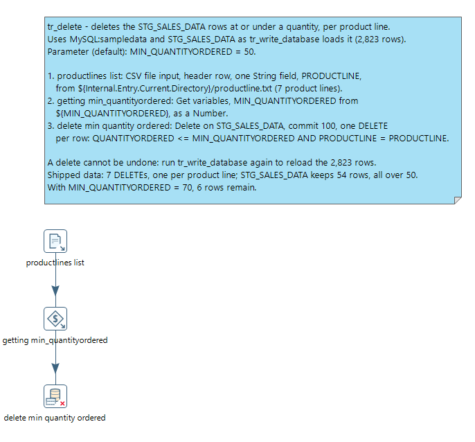
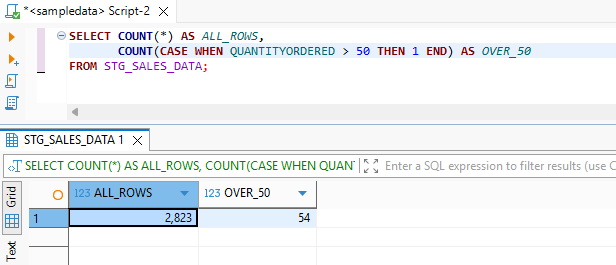
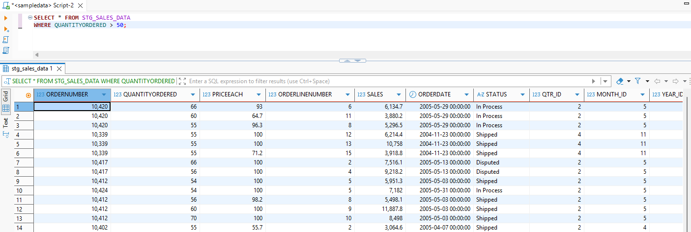
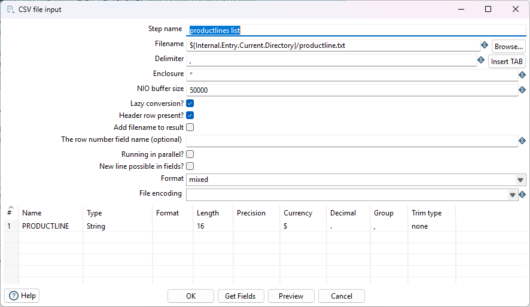
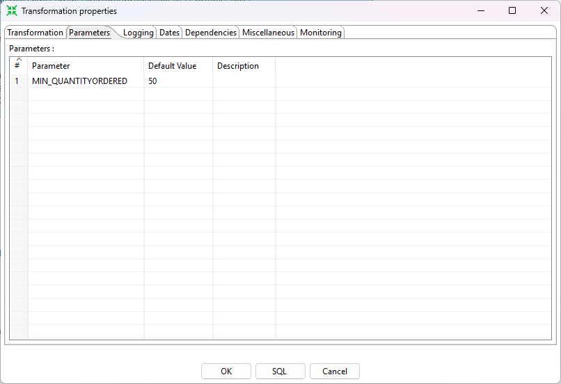
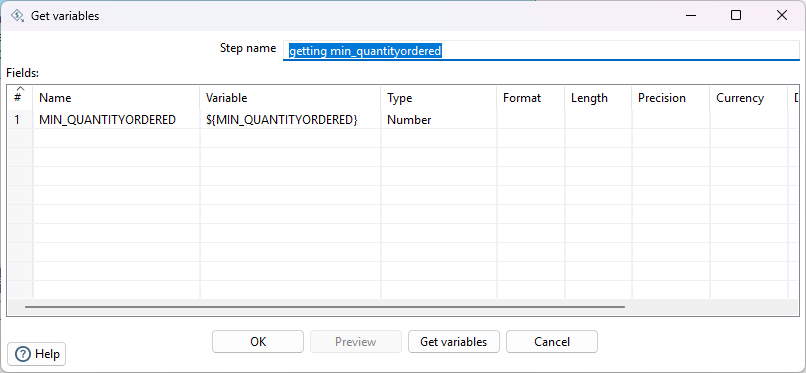
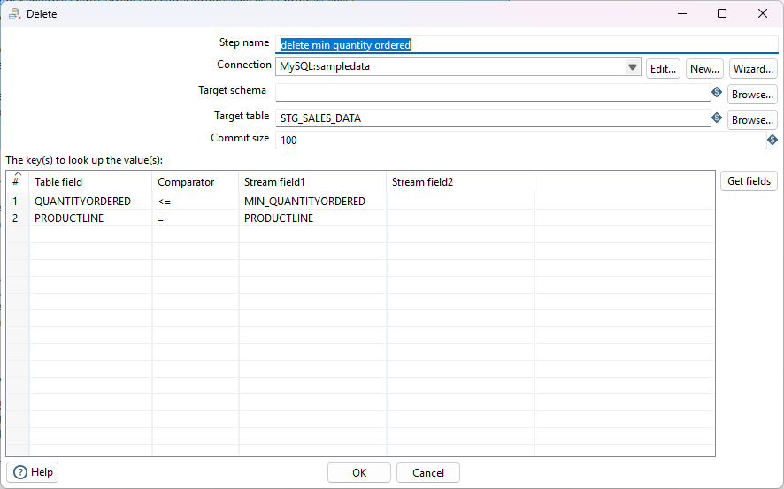

# Deleting Records

> **Warning:**
>
> #### Workshop - Deleting Records
>
> Delete rows from `STG_SALES_DATA` using criteria that arrive in the stream: a list of product lines and a minimum quantity. Use the **Delete** step when the transformation produces the delete criteria. For a fixed delete, an **Execute SQL script** is simpler.
>
> **What you'll do**
>
> * Take a baseline of the table before you delete
> * Build a stream of delete criteria: product line and quantity
> * Pass a threshold in with a transformation parameter and **Get variables**
> * Delete the matching rows with **Delete**, and check the result with SQL
>
> **Prerequisites:**
>
> * `STG_SALES_DATA`, loaded in [Writing to a Database](../14-mod3-writing-to-a-database/guide.md) (2,823 rows)
> * The `MySQL:sampledata` connection from [Connecting to Database](../12-mod3-connecting-to-database/guide.md)
> * DBeaver (or Adminer on a lab VM), connected to `sampledata` as `pentaho_admin`
>
> **Estimated time:** 30 minutes

<div align="center">
<figure>

<figcaption>What you build</figcaption>
</figure>
</div>

:::: tabs

### 1. Inspect the data

> **Note:**
>
> #### Inspect the data
>
> Look at `STG_SALES_DATA` before you delete anything. The counts are your baseline for checking the delete.

1. In DBeaver, run:

   ```sql
   SELECT COUNT(*) AS ALL_ROWS,
          COUNT(CASE WHEN QUANTITYORDERED > 50 THEN 1 END) AS OVER_50
   FROM STG_SALES_DATA;
   ```

<div align="center">
<figure>

<figcaption>The baseline counts</figcaption>
</figure>
</div>

> **Success:** Checkpoint: `ALL_ROWS` is 2,823, and `OVER_50` is 54: the rows with `QUANTITYORDERED` over 50.

2. List the rows that will survive. In DBeaver, run:

   ```sql
   SELECT * FROM STG_SALES_DATA
   WHERE QUANTITYORDERED > 50;
   ```

<div align="center">
<figure>

<figcaption>The rows that survive</figcaption>
</figure>
</div>

> **Note:** The delete removes every row with `QUANTITYORDERED` of 50 or less, in each product line listed in `productline.txt`. The file lists all seven, so only these 54 rows remain.

### 2. CSV file input

> **Note:**
>
> #### CSV file input
>
> Read `productline.txt`: a header and one `PRODUCTLINE` value per line, seven in all.

1. Start Spoon with the **Start Pentaho Data Integration** button below, or from PowerShell:

```powershell
Set-Location C:\Pentaho\design-tools\data-integration
.\spoon.bat
```

<button data-launch="spoon" data-path="">Start Pentaho Data Integration</button>

2. Select **File > New > Transformation** (`Ctrl+N`).
3. Select **File > Save as** and save it as `tr_delete.ktr` in `C:\Workshop-DI-Practitioner\03-data-sources\02-databases\17-mod3-deleting-records`, the folder that holds `productline.txt`.
4. On the **Design** tab, open the **Input** folder and drag **CSV file input** onto the canvas.
5. Double-click **CSV file input**.
6. Set **Step name** to `productlines list`.
7. Enter `${Internal.Entry.Current.Directory}/productline.txt` in **Filename**. Leave **Header row present?** selected.
8. Select **Get Fields**, select **OK** in **Sample size**, and close **Scan results**. The grid has one field, `PRODUCTLINE`, a String.

<div align="center">
<figure>

<figcaption>One field: PRODUCTLINE</figcaption>
</figure>
</div>

9. Select **Preview**, enter `100` rows, and select **OK**. The rows show in **Examine preview data**.

> **Success:** Checkpoint: **Examine preview data** shows 7 rows of `PRODUCTLINE`: `Motorcycles`, `Classic Cars`, `Trucks and Buses`, `Vintage Cars`, `Planes`, `Ships` and `Trains`.

10. Select **Close**, then select **OK** to close **productlines list**.

### 3. Parameters

> **Note:**
>
> #### Transformation parameters
>
> Hold the quantity threshold in a parameter, so a run can change it without editing the transformation.

1. Double-click an empty part of the canvas. **Transformation properties** opens.
2. On the **Parameters** tab, fill the grid with one row:

| Parameter             | Default Value |
| --------------------- | ------------- |
| `MIN_QUANTITYORDERED` | `50`          |

<div align="center">
<figure>

<figcaption>The threshold parameter</figcaption>
</figure>
</div>

3. Select **OK**.

### 4. Get variables

> **Note:**
>
> #### Get variables
>
> **Get variables** adds a variable's value to every row as a field, so the Delete step can compare against it.

1. On the **Design** tab, open the **Job** folder and drag **Get variables** onto the canvas.
2. Create a hop from **productlines list** to **Get variables**: hold `Shift` and drag from one step to the other.
3. Double-click **Get variables**.
4. Set **Step name** to `getting min_quantityordered`.
5. Fill the **Fields** grid with one row:

| Name                  | Variable                 | Type   |
| --------------------- | ------------------------ | ------ |
| `MIN_QUANTITYORDERED` | `${MIN_QUANTITYORDERED}` | Number |

<div align="center">
<figure>

<figcaption>The parameter, as a field</figcaption>
</figure>
</div>

6. Select **OK**.

> **Under the hood:**
>
> #### A parameter is a variable with a default; Get variables copies it into the row
>
> When the transformation starts, every parameter you defined is
> registered in its variable space (the same space `kettle.properties`
> and `${Internal.Entry.Current.Directory}` live in), using the default
> unless the **Run Options** dialog or a parent job supplied a value.
> Steps, though, only ever see *rows*. **Get variables** is the bridge:
> it reads `${MIN_QUANTITYORDERED}` from that space, converts it to the
> type you set, and appends it as a field to each row passing through.
>
> From the Delete step's point of view the threshold is now just
> another column, no different from one read from the file.
>
> **Why it matters:** anything that varies from run to run (a date, a
> threshold, a region) belongs in a parameter with a default, brought
> into the stream where it is needed. The `.ktr` never changes; the
> value does.

### 5. Delete

> **Note:**
>
> #### Delete
>
> **Delete** runs one `DELETE` for each row it receives, built from the row's values. It is an end step: no rows leave it.

1. On the **Design** tab, open the **Output** folder and drag **Delete** onto the canvas.
2. Create a hop from **getting min_quantityordered** to **Delete**.
3. Double-click **Delete**.
4. Set **Step name** to `delete min quantity ordered`.
5. Set **Connection** to `MySQL:sampledata`, **Target table** to `STG_SALES_DATA` and **Commit size** to `100`. Leave **Target schema** empty.
6. Fill **The key(s) to look up the value(s)** grid with two rows:

| Table field       | Comparator | Stream field1         |
| ----------------- | ---------- | --------------------- |
| `QUANTITYORDERED` | `<=`       | `MIN_QUANTITYORDERED` |
| `PRODUCTLINE`     | `=`        | `PRODUCTLINE`         |

<div align="center">
<figure>

<figcaption>Delete where QUANTITYORDERED &lt;= 50 and the product line matches</figcaption>
</figure>
</div>

7. Select **OK**.

> **Danger:** The comparators decide what is deleted, and a delete can't be undone: look at each key row again before you run. Here the table is a staging copy: to get it back, run the Writing to a Database transformation again, which truncates and reloads all 2,823 rows. On a real table, back it up or take a snapshot first.

### 6. Run and validate

> **Note:**
>
> #### Run and validate
>
> Run the transformation, then repeat the baseline counts.

1. Save the transformation (`Ctrl+S`).
2. Press `F9` (**Action > Run**). In the **Run Options** dialog, the **Parameters** tab lists `MIN_QUANTITYORDERED` with **Default value** `50`. Select **Run**.

> **Under the hood:**
>
> #### One DELETE per incoming row, comparators and all
>
> The step prepared a single statement from the grid, `DELETE FROM
> STG_SALES_DATA WHERE QUANTITYORDERED <= ? AND PRODUCTLINE = ?`, and
> executed it once for every row that arrived, binding that row's
> `MIN_QUANTITYORDERED` and `PRODUCTLINE` into the markers. Seven
> product lines in the file meant seven statements, each free to remove
> hundreds of rows, committed together every **Commit size** rows.
>
> No rows leave the step, and its **Updated** count in Step Metrics
> counts *statements executed*, one per driving row, not rows removed.
> Only the database knows that number, which is why you repeat the
> baseline counts next.
>
> **Why it matters:** a small driving stream can delete a large amount
> of data; that is both the point and the risk. Before a real delete,
> disable the hop into **Delete** and preview the driving rows: each
> one is a `WHERE` clause you are about to execute.

3. In **Execution Results**, open the **Step Metrics** tab.

> **Success:** Checkpoint: **delete min quantity ordered** shows 7 in **Updated**: one `DELETE` per product line.

4. Repeat the counts from the first tab. In DBeaver, run:

   ```sql
   SELECT COUNT(*) AS ALL_ROWS,
          COUNT(CASE WHEN QUANTITYORDERED > 50 THEN 1 END) AS OVER_50
   FROM STG_SALES_DATA;
   ```

<div align="center">
<figure>

<figcaption>The counts after the delete</figcaption>
</figure>
</div>

> **Success:** Checkpoint: `ALL_ROWS` and `OVER_50` are both 54. `STG_SALES_DATA` holds 54 rows, every one with `QUANTITYORDERED` over 50.

5. Run it again with a higher threshold: press `F9` (**Action > Run**). In the **Run Options** dialog, on the **Parameters** tab, set **Value** for `MIN_QUANTITYORDERED` to `70`. Select **Run**.
6. In DBeaver, run:

   ```sql
   SELECT COUNT(*) FROM STG_SALES_DATA;
   ```

> **Success:** Checkpoint: `STG_SALES_DATA` holds 6 rows, every one with `QUANTITYORDERED` over 70. You get the same 6 whether or not you reload the table before this run, because a row over 70 survives both thresholds.

::::

## Troubleshooting <!-- no-step -->

<details>
<summary>Nothing was deleted</summary>

The criteria matched no rows. Look at the comparators, and make sure `MIN_QUANTITYORDERED` is a Number in **Get variables**. If an earlier run already cut the table down, reload it first.

</details>

<details>
<summary>Too many rows deleted</summary>

A comparator is too broad (`>=` instead of `<=`, say), or a key row compares the wrong fields.

</details>

<details>
<summary>Type conversion errors in Delete</summary>

`MIN_QUANTITYORDERED` arrived as a String. Set its **Type** to Number in **Get variables**.

</details>

## Lab Files

Click a file to download. For `.ktr` and `.kjb` files, **Open in Pentaho Data Integration** launches Pentaho Data Integration with the file loaded. If Pentaho Data Integration is already running, the path is copied to your clipboard — switch to Pentaho Data Integration and press `Ctrl+O`, `Ctrl+V`, `Enter`.

[productline.txt](./files/productline.txt)

### Solution <!-- no-step -->

The finished transformation for this lab. Open it alongside your own to compare, or run to see the expected result.

Also on disk at `C:\Workshop-DI-Practitioner\03-data-sources\02-databases\17-mod3-deleting-records\solution`.

[tr_delete.ktr](./files/tr_delete.ktr) <button data-launch="spoon" data-path="files/tr_delete.ktr">Open in Pentaho Data Integration</button> <button data-graph="files/tr_delete.ktr">View graph</button>
