# Slowly Changing Dimensions

> **Warning:**
>
> #### Workshop - Slowly Changing Dimensions
>
> Maintain a small city dimension, `DIM_SCD`, as its values change, with the **Dimension lookup/update** step. Six runs take it from a lookup on an empty table, through type 1 overwrites and type 2 versions, to punch through.
>
> **What you'll do**
>
> * Create the `DIM_SCD` table and build a three-step transformation
> * Use **Dimension lookup/update** in lookup mode, then in update mode
> * Overwrite a value with **Update** (type 1) and keep its history with **Insert** (type 2)
> * Rewrite every version of a key with **Punch through**
>
> **Prerequisites:**
>
> * [Review SCDs](../topic-mod3-databases-scds-review/guide.md): types 1 and 2, natural and surrogate keys
> * The `MySQL:sampledata` connection from [Connecting to Database](../12-mod3-connecting-to-database/guide.md)
> * DBeaver (or Adminer on a lab VM), connected to `sampledata` as `pentaho_admin`
>
> **Estimated time:** 40 minutes

<figure>

<figcaption class="pcm-video-caption">Walkthrough: coming soon</figcaption>

</figure>

---

<div align="center">
<figure>
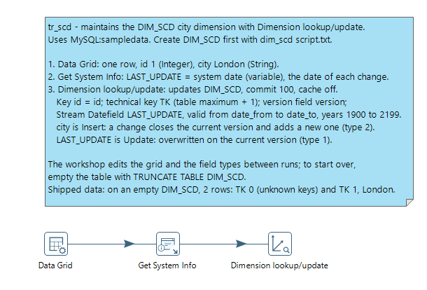
<figcaption>What you build</figcaption>
</figure>
</div>

::::: tabs

### 1. Build

> **Warning:**
>
> #### Build it first
>
> Create the table and the transformation in this tab before you start the runs in the other tabs. The runs build on each other: do them in order. To start the runs again, empty the table with `TRUNCATE TABLE DIM_SCD;` and set the grid and the fields back as in this tab.

:::: tabs

### 1. DIM_SCD table

> **Note:**
>
> #### The dimension table
>
> `DIM_SCD` holds one city per natural key, `id`, with the columns a type 2 dimension needs: a technical key (`TK`), a `version`, and the dates each version is valid from and to. `last_update` records when a row last changed.

1. In DBeaver, run:

   ```sql
   CREATE TABLE `DIM_SCD` (
     `TK` bigint(10) NOT NULL,
     `version` int(11) DEFAULT '0',
     `id` int(11) DEFAULT '0',
     `city` tinytext,
     `date_from` datetime DEFAULT NULL,
     `date_to` datetime DEFAULT NULL,
     `last_update` datetime DEFAULT NULL,
     PRIMARY KEY (`TK`),
     KEY `idx_DIM_SCD_lookup` (`id`)
   ) ENGINE=InnoDB DEFAULT CHARSET=latin1;
   ```

   The same statement is in `dim_scd script.txt` in **Lab Files**.

> **Success:** Checkpoint: `DIM_SCD` exists, empty, with seven columns: `TK`, `version`, `id`, `city`, `date_from`, `date_to` and `last_update`.

### 2. Data grid

> **Note:**
>
> #### Data grid
>
> **Data grid** holds a few rows typed into the step itself: handy for tests and demonstrations. Here it is the source data, and you edit it between runs.

1. Start Spoon with the **Start Pentaho Data Integration** button below, or from PowerShell:

```powershell
Set-Location C:\Pentaho\design-tools\data-integration
.\spoon.bat
```

<button data-launch="spoon" data-path="">Start Pentaho Data Integration</button>

2. Select **File > New > Transformation** (`Ctrl+N`).
3. Select **File > Save as** and save it as `tr_scd.ktr` in `C:\Workshop-DI-Practitioner\03-data-sources\02-databases\18-mod3-slowly-changing-dimensions`.
4. On the **Design** tab, open the **Input** folder and drag **Data grid** onto the canvas.
5. Double-click **Data grid**.
6. Set **Step name** to `Data Grid`.
7. On the **Meta** tab, fill the grid with two rows:

| Name   | Type    |
| ------ | ------- |
| `id`   | Integer |
| `city` | String  |

<div align="center">
<figure>
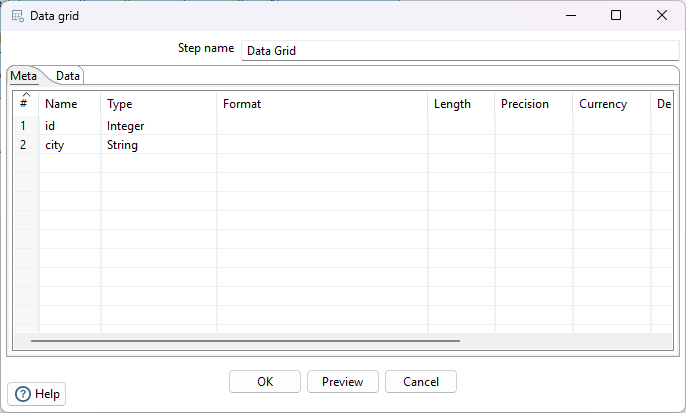
<figcaption>Two fields</figcaption>
</figure>
</div>

8. On the **Data** tab, enter one row:

| `id` | `city`   |
| ---- | -------- |
| `1`  | `London` |

<div align="center">
<figure>
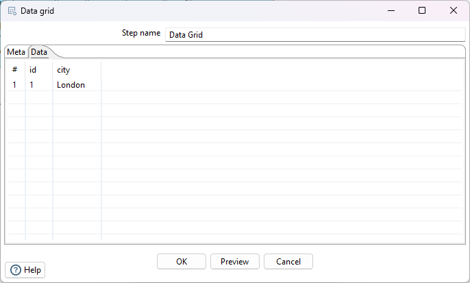
<figcaption>One city to start</figcaption>
</figure>
</div>

9. Select **OK**.

### 3. Get system info

> **Note:**
>
> #### Get system info
>
> **Get system info** adds values from the Pentaho Data Integration environment, such as the current date, to each row. The dimension step uses it as the date of each change.

1. On the **Design** tab, open the **Input** folder and drag **Get system info** onto the canvas.
2. Create a hop from **Data Grid** to **Get system info**: hold `Shift` and drag from one step to the other.
3. Double-click **Get system info**.
4. Set **Step name** to `Get System Info`.
5. Fill the **Fields** grid with one row:

| Name          | Type                     |
| ------------- | ------------------------ |
| `LAST_UPDATE` | `system date (variable)` |

<div align="center">
<figure>
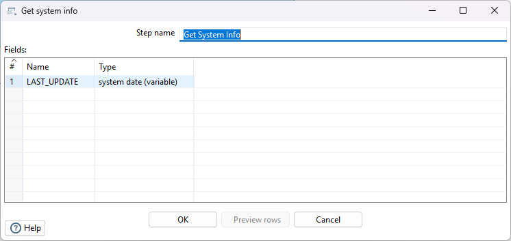
<figcaption>The time of the run</figcaption>
</figure>
</div>

6. Select **OK**.

### 4. Dimension lookup/update

> **Note:**
>
> #### Dimension lookup/update
>
> **Dimension lookup/update** maintains a type 1 or type 2 dimension, field by field, or only looks keys up in it. It finds a row by its natural key and the stream date, and returns the row's technical key.

1. On the **Design** tab, open the **Data Warehouse** folder and drag **Dimension lookup/update** onto the canvas.
2. Create a hop from **Get System Info** to **Dimension lookup/update**.
3. Double-click **Dimension lookup/update**. Leave **Step name** as `Dimension lookup/update`, and **Update the dimension?** selected.
4. Set **Connection** to `MySQL:sampledata`, **Target table** to `DIM_SCD` and **Commit size** to `100`.
5. Clear **Enable the cache?**.
6. On the **Keys** tab, fill the grid with one row:

| Dimension field | Field in stream |
| --------------- | --------------- |
| `id`            | `id`            |

7. Below the tabs, set these fields:

| Field                         | Value                     |
| ----------------------------- | ------------------------- |
| **Technical key field**       | `TK`                      |
| **Creation of technical key** | **Use table maximum + 1** |
| **Version field**             | `version`                 |
| **Stream Datefield**          | `LAST_UPDATE`             |
| **Date range start field**    | `date_from`               |
| **Min. year**                 | `1900`                    |
| **Table date range end**      | `date_to`                 |
| **Max. year**                 | `2199`                    |

<div align="center">
<figure>
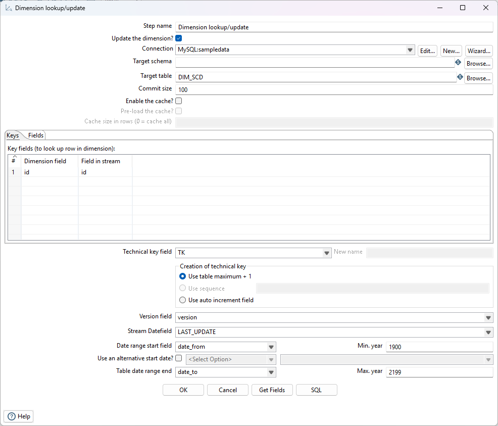
<figcaption>Keys and the type 2 columns</figcaption>
</figure>
</div>

8. On the **Fields** tab, fill the grid with two rows. You change **Type of dimension update** between runs; start with **Update** for both:

| Dimension field | Stream field to compare with | Type of dimension update |
| --------------- | ---------------------------- | ------------------------ |
| `city`          | `city`                       | Update                   |
| `LAST_UPDATE`   | `LAST_UPDATE`                | Update                   |

MySQL column names are not case-sensitive, so the dimension field `LAST_UPDATE` is the table's `last_update` column.

9. Select **OK**.
10. Save the transformation (`Ctrl+S`).

::::

### 2. Lookup

> **Note:**
>
> #### Run 1: lookup mode
>
> With **Update the dimension?** cleared, the step only reads: it finds each row's technical key and writes nothing.

1. Double-click **Dimension lookup/update** and clear **Update the dimension?**.

<div align="center">
<figure>
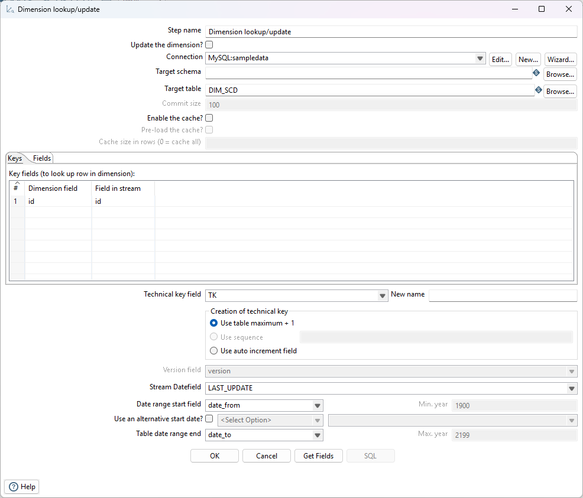
<figcaption>Lookup mode</figcaption>
</figure>
</div>

2. On the **Fields** tab, the columns now describe what the lookup returns. On the `city` row, set **Type of return field** to `String`.
3. Right-click the `LAST_UPDATE` row and select **Delete selected lines**.

<div align="center">
<figure>
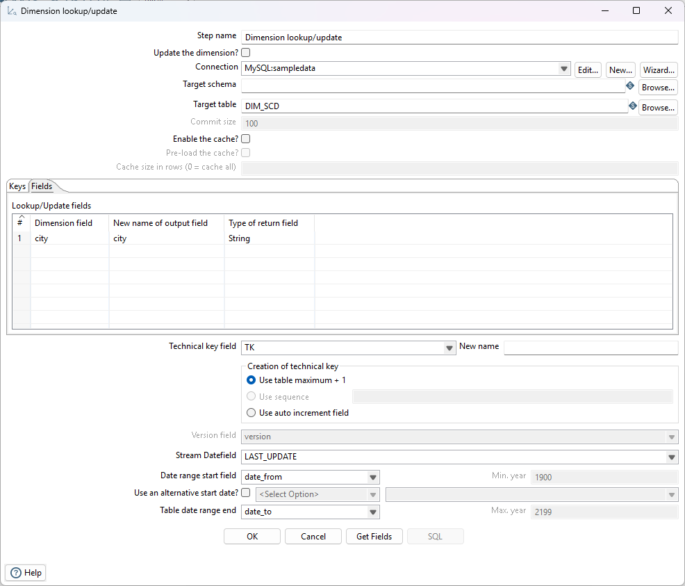
<figcaption>Return city as a String</figcaption>
</figure>
</div>

4. Select **OK**.
5. Save the transformation (`Ctrl+S`).
6. Press `F9` (**Action > Run**), and select **Run** in the **Run Options** dialog (run 1).

> **Under the hood:**
>
> #### The system date isn't decoration: it is the lookup's point in time
>
> A type 2 dimension can hold several versions of the same `id`, each
> valid between its `date_from` and `date_to`. So a lookup needs two
> things, not one: the natural key *and a date*. **Get system info**
> supplied the date, as the **Stream Datefield**, and the query the
> step ran was, in effect, `SELECT TK ... WHERE id = ? AND date_from <= ?
> AND ? < date_to`. Leave the datefield empty and the step uses the
> current time: fine for "what is it now", wrong for "what was it when
> this order shipped".
>
> London had no row at all, so the lookup returned technical key 0, the
> key the step keeps for "unknown". A fact row can then always carry
> *some* key, and referential integrity holds.
>
> **Why it matters:** feed an order's date into the datefield and a fact
> loaded today for a 2019 order links to the 2019 version of the
> customer, not today's. That is the whole point of keeping history.

7. In DBeaver, run:

   ```sql
   SELECT * FROM DIM_SCD ORDER BY TK;
   ```

> **Success:** Checkpoint: the query returns no rows. In lookup mode the step writes nothing, not even its row for unknown keys.

8. Select **Dimension lookup/update** on the canvas and open the **Preview data** tab.

<div align="center">
<figure>
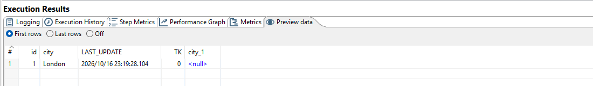
<figcaption>London isn't in the dimension: TK 0</figcaption>
</figure>
</div>

> **Success:** Checkpoint: London comes back with `TK` `0` and `city_1` `<null>` (`city_1` is the returned city, renamed because the stream already has a `city`).

### 3. Type 1

> **Note:**
>
> #### Runs 2 and 3: update mode, type 1
>
> With **Update the dimension?** selected, the step inserts keys it doesn't find and compares the ones it does, field by field. A field set to **Update** is overwritten in place: type 1.

1. Double-click **Dimension lookup/update** and select **Update the dimension?** again.
2. On the **Fields** tab, set the grid back to the two rows of the Build tab: set **Type of dimension update** to **Update** on the `city` row, and add the `LAST_UPDATE` row again.

| Dimension field | Stream field to compare with | Type of dimension update |
| --------------- | ---------------------------- | ------------------------ |
| `city`          | `city`                       | Update                   |
| `LAST_UPDATE`   | `LAST_UPDATE`                | Update                   |

<div align="center">
<figure>
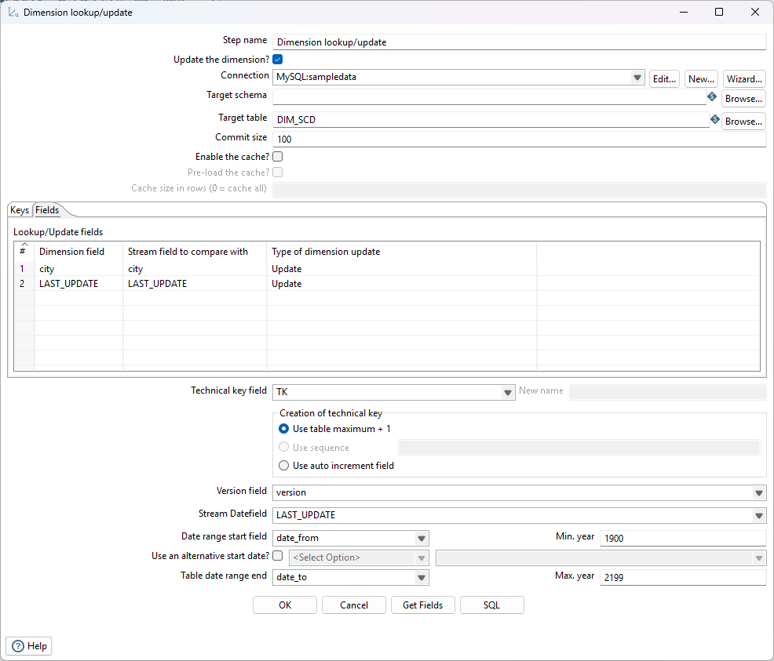
<figcaption>Both fields: Update (type 1)</figcaption>
</figure>
</div>

> **Note:**
>
> #### What the step decides for each row
>
> In update mode the step looks up the version valid at the stream date and compares each field on the **Fields** tab:
>
> * **Key not found**: insert a new row, version 1.
> * **An Insert field differs**: close the current version and insert a new one (type 2).
> * **An Update field differs**: overwrite it on the current version (type 1).
> * **A Punch through field differs**: overwrite the punch-through fields on *every* version of the key.
> * **Nothing differs**: do nothing.
>
> Mixing the types per field gives a hybrid dimension. The other types in the list (*Date of last insert or update*, *Date of last insert*, *Date of last update* and *Last version*, all "without stream field as source") let the step maintain a date or a current-version flag itself.

3. Select **OK**.
4. Save the transformation (`Ctrl+S`).
5. Press `F9` (**Action > Run**), and select **Run** in the **Run Options** dialog (run 2).
6. In DBeaver, run:

   ```sql
   SELECT * FROM DIM_SCD ORDER BY TK;
   ```

In the tables below, `(run N)` stands for the date and time of run N.

> **Success:** Checkpoint: after run 2 the table has two rows. The step added row `0` itself, for unknown keys, the first time it wrote to the table.
>
> | TK | version | id | city   | date_from           | date_to             | last_update |
> | -- | ------- | -- | ------ | ------------------- | ------------------- | ----------- |
> | 0  | 1       | 0  | NULL   | NULL                | NULL                | NULL        |
> | 1  | 1       | 1  | London | 1900-01-01 00:00:00 | 2200-01-01 00:00:00 | (run 2)     |
>
> A key's first version is valid from the start of **Min. year** to the end of **Max. year**, so a lookup at any date finds it. The step writes the end as 2199-12-31 23:59:59.999; MySQL's `DATETIME` rounds that to `2200-01-01 00:00:00`.

7. Double-click **Data Grid** and, on the **Data** tab, add a second row:

| `id` | `city`   |
| ---- | -------- |
| `2`  | `Madrid` |

<div align="center">
<figure>
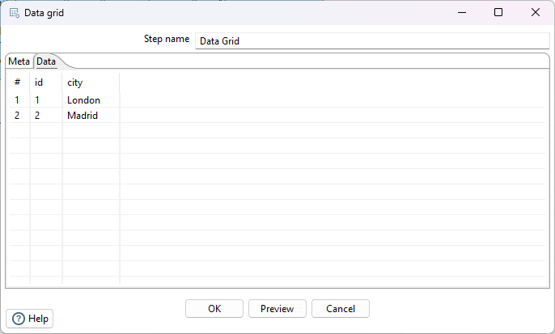
<figcaption>Add Madrid</figcaption>
</figure>
</div>

8. Select **OK**.
9. Save the transformation (`Ctrl+S`).
10. Press `F9` (**Action > Run**), and select **Run** in the **Run Options** dialog (run 3).
11. In **Execution Results**, open the **Step Metrics** tab.

> **Success:** Checkpoint: **Dimension lookup/update** shows 1 in **Output** (the insert) and 1 in **Updated**.

12. In DBeaver, run:

    ```sql
    SELECT * FROM DIM_SCD ORDER BY TK;
    ```

> **Success:** Checkpoint: after run 3, Madrid is inserted, and London's `last_update` moves to the new run.
>
> | TK | version | id | city       | date_from           | date_to             | last_update   |
> | -- | ------- | -- | ---------- | ------------------- | ------------------- | ------------- |
> | 0  | 1       | 0  | NULL       | NULL                | NULL                | NULL          |
> | 1  | 1       | 1  | London     | 1900-01-01 00:00:00 | 2200-01-01 00:00:00 | **(run 3)**   |
> | **2** | **1** | **2** | **Madrid** | 1900-01-01 00:00:00 | 2200-01-01 00:00:00 | **(run 3)** |

### 4. Type 2

> **Note:**
>
> #### Runs 4 and 5: keep the history
>
> First add a city with a typo, `Pariss`. Then correct it with `city` set to **Insert**, so the correction is recorded as a new version instead of overwriting the old one.

1. Double-click **Data Grid** and, on the **Data** tab, add a third row (`Pariss` is misspelled on purpose):

| `id` | `city`   |
| ---- | -------- |
| `3`  | `Pariss` |

<div align="center">
<figure>
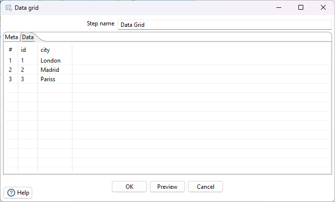
<figcaption>Add Pariss</figcaption>
</figure>
</div>

2. Select **OK**.
3. Save the transformation (`Ctrl+S`).
4. Press `F9` (**Action > Run**), and select **Run** in the **Run Options** dialog (run 4). The fields stay on **Update**.
5. In DBeaver, run:

   ```sql
   SELECT * FROM DIM_SCD ORDER BY TK;
   ```

> **Success:** Checkpoint: after run 4, `Pariss` is `TK` `3`, version 1, and all three cities' `last_update` is (run 4).
>
> | TK | version | id | city       | date_from           | date_to             | last_update |
> | -- | ------- | -- | ---------- | ------------------- | ------------------- | ----------- |
> | 0  | 1       | 0  | NULL       | NULL                | NULL                | NULL        |
> | 1  | 1       | 1  | London     | 1900-01-01 00:00:00 | 2200-01-01 00:00:00 | **(run 4)** |
> | 2  | 1       | 2  | Madrid     | 1900-01-01 00:00:00 | 2200-01-01 00:00:00 | **(run 4)** |
> | **3** | **1** | **3** | **Pariss** | 1900-01-01 00:00:00 | 2200-01-01 00:00:00 | **(run 4)** |

6. Double-click **Data Grid** and, on the **Data** tab, correct `Pariss` to `Paris`.

<div align="center">
<figure>
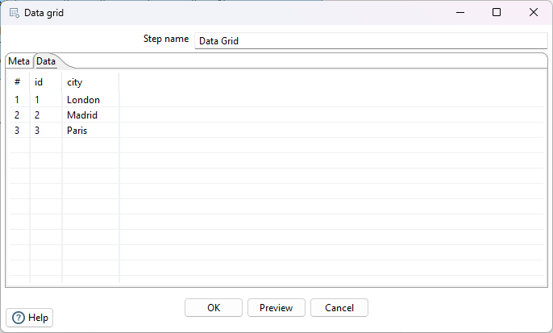
<figcaption>Correct the typo</figcaption>
</figure>
</div>

7. Select **OK**.
8. Double-click **Dimension lookup/update**. On the **Fields** tab, set **Type of dimension update** for `city` to **Insert**, and leave `LAST_UPDATE` on **Update**.

<div align="center">
<figure>

<figcaption>city: Insert (type 2)</figcaption>
</figure>
</div>

> **Warning:** **Insert** records the change as a new version. With **Update**, the step would overwrite `Pariss` in place, and the old value would be gone (type 1).

9. Select **OK**.
10. Save the transformation (`Ctrl+S`).
11. Press `F9` (**Action > Run**), and select **Run** in the **Run Options** dialog (run 5).

> **Under the hood:**
>
> #### A type 2 change is an UPDATE and an INSERT
>
> When the step found `id = 3` holding `Pariss` and a stream value of
> `Paris` on a field set to **Insert**, it did two things. It closed the
> old version, `UPDATE DIM_SCD SET date_to = <stream date> WHERE TK = 3`,
> and inserted a new row with `version = 2`, `date_from` at the stream
> date and `date_to` at the end of **Max. year**. The new technical key
> came from the step's own key generation (**Use table maximum + 1**),
> not from the natural key, which is why `TK` and `id` part company from
> here on.
>
> `last_update` moved on every *current* row for a different reason. It
> is an ordinary **Update** field fed from the system date, so its value
> differs on every run and each current version gets an `UPDATE`; the
> closed version keeps (run 4). Run the transformation again and
> **Updated** shows 3 even though nothing else changed. Use one of the
> *Date of last insert or update* types for that column instead and the
> step maintains it itself, only on rows it really inserts or updates.
>
> **Why it matters:** you set a key, a version field and two dates once,
> and the step does the type 2 bookkeeping on every row, every run.
> Written by hand, each change needs its own lookup, `UPDATE` and
> `INSERT`, issued in the right order for every key.

12. In DBeaver, run:

    ```sql
    SELECT * FROM DIM_SCD ORDER BY TK;
    ```

> **Success:** Checkpoint: after run 5, id `3` has two versions. Version 1 ends when version 2 begins.
>
> | TK | version | id | city      | date_from           | date_to             | last_update |
> | -- | ------- | -- | --------- | ------------------- | ------------------- | ----------- |
> | 0  | 1       | 0  | NULL      | NULL                | NULL                | NULL        |
> | 1  | 1       | 1  | London    | 1900-01-01 00:00:00 | 2200-01-01 00:00:00 | **(run 5)** |
> | 2  | 1       | 2  | Madrid    | 1900-01-01 00:00:00 | 2200-01-01 00:00:00 | **(run 5)** |
> | 3  | 1       | 3  | Pariss    | 1900-01-01 00:00:00 | **(run 5)**         | (run 4)     |
> | **4** | **2** | 3 | **Paris** | **(run 5)**       | 2200-01-01 00:00:00 | **(run 5)** |

### 5. Punch through

> **Note:**
>
> #### Run 6: punch through
>
> **Punch through** is also an overwrite, but on *every* version of the key, not only the current one. Use it for a correction that should apply to all of history.

1. Double-click **Dimension lookup/update**. On the **Fields** tab, set **Type of dimension update** to **Punch through** for both `city` and `LAST_UPDATE`.

<div align="center">
<figure>

<figcaption>Both fields: Punch through</figcaption>
</figure>
</div>

2. Select **OK**.
3. Save the transformation (`Ctrl+S`).
4. Press `F9` (**Action > Run**), and select **Run** in the **Run Options** dialog (run 6). The grid stays as it is.

> **Under the hood:**
>
> #### Punch through fires when a punch-through field differs from the current version
>
> The step compares the stream with the *current* version only. For id
> `3` that is version 2, which already says `Paris`, so `city` alone
> would not have triggered anything. `last_update` did: it is set to
> **Punch through** too, and it differs on every run. One differing
> punch-through field is enough, and the step then writes *all* the
> punch-through fields, `city` included, to every version of the key.
> That is how version 1's `Pariss` became `Paris`.
>
> Try it: set `LAST_UPDATE` back to **Update**, leave `city` on
> **Punch through** and run again. The current versions get a new
> `last_update`, but version 1 keeps (run 6): no punch-through field
> differed from the current version, so nothing was punched through.
>
> **Why it matters:** punch through rewrites history, so it suits
> corrections (a typo, a renamed product line) that should read the
> same in every period's reports. For a real change of value, use
> **Insert** and keep the history.

5. In DBeaver, run:

   ```sql
   SELECT * FROM DIM_SCD ORDER BY TK;
   ```

> **Success:** Checkpoint: after run 6, both versions of id `3` now say `Paris`, and every city row's `last_update` is (run 6). The dates and versions are untouched.
>
> | TK | version | id | city      | date_from           | date_to             | last_update |
> | -- | ------- | -- | --------- | ------------------- | ------------------- | ----------- |
> | 0  | 1       | 0  | NULL      | NULL                | NULL                | NULL        |
> | 1  | 1       | 1  | London    | 1900-01-01 00:00:00 | 2200-01-01 00:00:00 | **(run 6)** |
> | 2  | 1       | 2  | Madrid    | 1900-01-01 00:00:00 | 2200-01-01 00:00:00 | **(run 6)** |
> | 3  | 1       | 3  | **Paris** | 1900-01-01 00:00:00 | (run 5)             | **(run 6)** |
> | 4  | 2       | 3  | Paris     | (run 5)             | 2200-01-01 00:00:00 | **(run 6)** |

:::::

## Troubleshooting <!-- no-step -->

<details>
<summary>"Table DIM_SCD doesn't exist"</summary>

Run the `CREATE TABLE` in the Build tab, in the `sampledata` database the connection points at.

</details>

<details>
<summary>Every run adds a version for every key</summary>

A field that changes on every run, such as `LAST_UPDATE`, is set to **Insert**. Set it to **Update**, or to one of the *Date of last ...* types.

</details>

<details>
<summary>Run 5 overwrote Pariss instead of adding a version</summary>

`city` was still on **Update**. Set it to **Insert**; to repeat run 5, truncate the table and run from run 2.

</details>

<details>
<summary>The lookup returns TK 0 for a key that exists</summary>

The stream date falls outside every version's `date_from` to `date_to` range, or **Stream Datefield** is set to the wrong field.

</details>

## Lab Files

Click a file to download. For `.ktr` and `.kjb` files, **Open in Pentaho Data Integration** launches Pentaho Data Integration with the file loaded. If Pentaho Data Integration is already running, the path is copied to your clipboard — switch to Pentaho Data Integration and press `Ctrl+O`, `Ctrl+V`, `Enter`.

The `CREATE TABLE DIM_SCD` statement from the Build tab, for MySQL:

[dim_scd script.txt](./files/dim_scd%20script.txt)

### Solution <!-- no-step -->

The transformation as built in the Build tab, with `city` set to **Insert** (type 2), `last_update` to **Update**, and London in the grid. Open it alongside your own to compare. Run on an empty `DIM_SCD`, it gives the table after run 2: row `0` and London.

Also on disk at `C:\Workshop-DI-Practitioner\03-data-sources\02-databases\18-mod3-slowly-changing-dimensions\solution`.

[tr_scd.ktr](./files/tr_scd.ktr) <button data-launch="spoon" data-path="files/tr_scd.ktr">Open in Pentaho Data Integration</button> <button data-graph="files/tr_scd.ktr">View graph</button>
