# MinIO

> **Warning:**
>
> #### Workshop - MinIO
>
> Six workshops that read from and write to **MinIO**, an S3-compatible object store, through a PDI **VFS connection**. Choose one of them and build it; each stands on its own.\
> They get harder down the list: CSV lookups first, then XML and JSON parsing, reconciliation, log analysis, scoring and multi-format ingestion.
>
> **What you’ll do**
>
> * Connect PDI to MinIO with a VFS connection
> * Read and write objects with `pvfs://MinIO/...` paths
> * Build the workshop you choose: enrich rows with lookups and joins, or parse XML, JSON or log lines, and shape the results for a curated layer
>
> **Prerequisites:** MinIO running and seeded (see [Before You Start](../00-before-you-start/guide.md)); [Review Storage](../topic-mod3-storage-review/guide.md); joins and aggregations at the level of the earlier workshops
>
> **Estimated time:** about 30 minutes: 5 minutes for the connection, then 15 to 35 minutes for the workshop you choose (see the table)

| Workshop                 | Key skills                                  | Time   |
| ------------------------ | ------------------------------------------- | ------ |
| Sales Dashboard          | VFS input, stream lookups, calculations     | 20 min |
| Inventory Reconciliation | XML parsing, full outer join, variance      | 35 min |
| Customer 360             | JSON lines, aggregation, merge joins        | 25 min |
| Log Parsing              | regular expressions, rolling averages       | 25 min |
| Fraud Detection          | lookups and joins, rule-based scoring       | 15 min |
| Data Lake Ingestion      | three formats, one schema                   | 25 min |

## Connect PDI to MinIO

> **Warning:** Every path in these workshops starts `pvfs://MinIO/`, which means "the VFS connection named **MinIO**". Create it before you start your workshop. Connection names are case-sensitive: `pvfs://minio/...` doesn't find a connection named `MinIO`.

1. Start Spoon with the **Start PDI** button below, or from PowerShell:

```powershell
Set-Location C:\Pentaho\design-tools\data-integration
.\spoon.bat
```

<button data-launch="spoon" data-path="">Start PDI</button>

2. Check that MinIO is running and seeded: open the MinIO console at **http://127.0.0.1:9099** and sign in as `minioadmin` / `minioadmin`. The first time, the console shows MinIO's license notice: read it and select **Acknowledge**. The **raw-data** bucket holds `csv/`, `json/`, `xml/` and `finance/` folders, and the **logs** bucket holds `app/`, `web/` and `error/`.

   ```powershell
   # Or check the S3 API from PowerShell
   Invoke-WebRequest http://127.0.0.1:9000/minio/health/live -UseBasicParsing | Select-Object StatusCode
   ```

3. In Spoon, open the **View** tab, right-click **VFS Connections** and select **New...**. In the **New VFS Connection** dialog, set:

| Setting                | Value                   |
| ---------------------- | ----------------------- |
| **Connection Name**    | `MinIO`                 |
| **Connection Type**    | Amazon S3/Minio/HCP     |
| **S3 Connection Type** | Minio/HCP               |
| **Access Key**         | `minioadmin`            |
| **Secret Key**         | `minioadmin`            |
| **Endpoint**           | `http://127.0.0.1:9000` |
| **Signature Version**  | `AWSS3V4SignerType`     |
| **PathStyle Access**   | selected                |

4. Select **Test**.

> **Success:** Checkpoint: Spoon reports `Connection was successfully established.` With **Signature Version** empty, the test fails with `unknown signer type: aws.endpoint`.

5. Select **OK**. The connection is saved for every transformation on this machine, so you create it once.

> **Under the hood:**
>
> #### `pvfs://` is a name, not an address
>
> PDI reads `pvfs://MinIO/raw-data/csv/sales.csv` as "bucket `raw-data`,
> object `csv/sales.csv`, through the connection called MinIO". The
> endpoint and keys live in the connection, not in the transformation.
> Point the same connection at Amazon S3 and every transformation in
> this series runs there unchanged. **PathStyle Access** is what MinIO
> needs: it addresses buckets as `host/bucket` rather than
> `bucket.host`.
>
> **Why it matters:** credentials stay out of `.ktr` files, and moving
> between environments is one connection, not every path.

## Choose One Workshop <!-- no-step -->

Choose one workshop from the tabs below and build it. Save the transformation in the lab folder, `C:\Workshop-DI-Practitioner\03-data-sources\03-storage\19-mod3-minio`.

::::: tabs

### Sales Dashboard

> **Warning:**
>
> #### Sales Dashboard
>
> Build one fact file for a sales dashboard from three CSV files in MinIO: sales, products and customers. Each sale gets its product and customer details, a few calculated fields and two audit fields, and the result goes back to MinIO.
>
> **Skills:** reading from a bucket, **Stream lookup**, **Calculator**, **Formula**, writing to a bucket

<div align="center">
<figure>
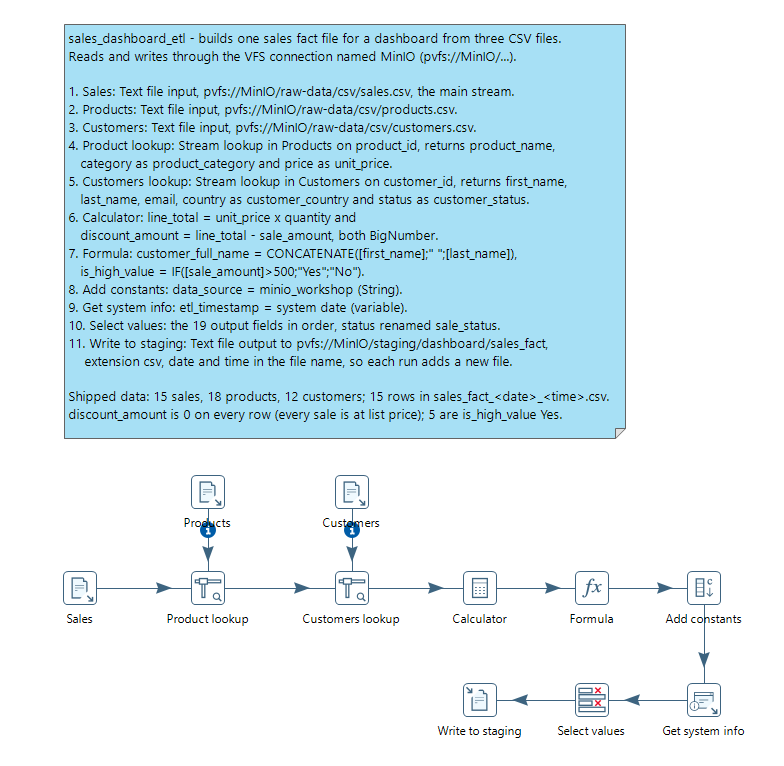
<figcaption>What you build</figcaption>
</figure>
</div>

> **Note:** **Workshop files**
>
> These files are already in MinIO:
>
> * `pvfs://MinIO/raw-data/csv/sales.csv` (15 sales)
> * `pvfs://MinIO/raw-data/csv/products.csv` (18 products)
> * `pvfs://MinIO/raw-data/csv/customers.csv` (12 customers)
>
> Output: `pvfs://MinIO/staging/dashboard/sales_fact_<date>_<time>.csv`

::: tabs

### 1. Read the Sources

> **Note:**
>
> #### Text file input
>
> **Text file input** reads delimited or fixed-width files from disk or, through a VFS connection, from object storage. Here three of them read CSV files from the `raw-data` bucket.

1. Select **File > New > Transformation** (`Ctrl+N`).
2. Select **File > Save as** and save it as `sales_dashboard_etl.ktr` in `C:\Workshop-DI-Practitioner\03-data-sources\03-storage\19-mod3-minio`.
3. On the **Design** tab, open the **Input** folder and drag **Text file input** onto the canvas three times.
4. Double-click each **Text file input** in turn and set **Step name** to `Sales`, `Products` and `Customers`.
5. In each, on the **File** tab, enter the file in **File or directory** and select **Add**. Or select **Browse**, set **File type** to `*.csv`, and pick it under **VFS Connections > MinIO**:

| Step        | File                                      |
| ----------- | ----------------------------------------- |
| `Sales`     | `pvfs://MinIO/raw-data/csv/sales.csv`     |
| `Products`  | `pvfs://MinIO/raw-data/csv/products.csv`  |
| `Customers` | `pvfs://MinIO/raw-data/csv/customers.csv` |

<div align="center">
<figure>
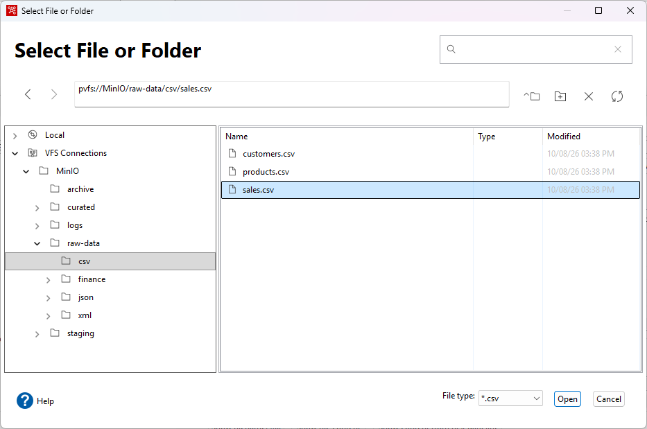
<figcaption>Browse the bucket through the connection</figcaption>
</figure>
</div>

6. On each **Content** tab, set **Separator** to `,`, keep **Header** selected and set **Format** to `mixed`.
7. On each **Fields** tab, select **Get Fields**, select **OK** at **Number of sample lines**, and close the **Scan results**. Check the types:

| Step        | Types to check                                                                                                   |
| ----------- | ---------------------------------------------------------------------------------------------------------------- |
| `Sales`     | `customer_id`, `quantity` Integer; `sale_date` Date (`yyyy-MM-dd`); `sale_amount` BigNumber; the rest String       |
| `Products`  | `price` BigNumber; `stock_quantity` Integer; `last_updated` Date (`yyyy-MM-dd`); the rest String                  |
| `Customers` | `customer_id` Integer; `registration_date` Date (`yyyy-MM-dd`); the rest String                                   |

<div align="center">
<figure>
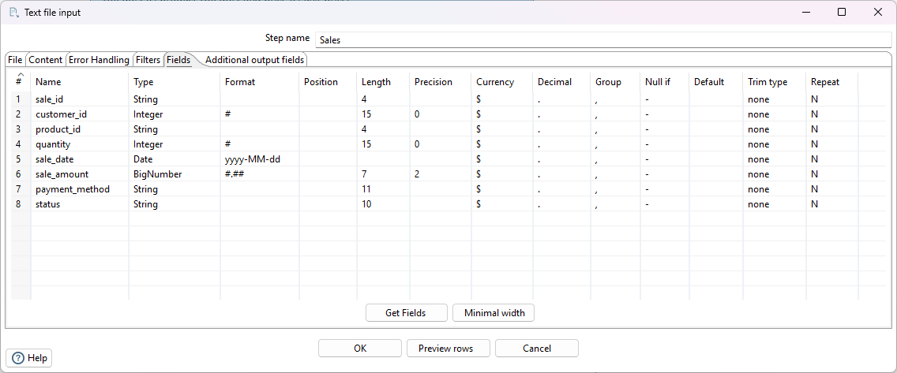
<figcaption>Sales fields</figcaption>
</figure>
</div>

<div align="center">
<figure>
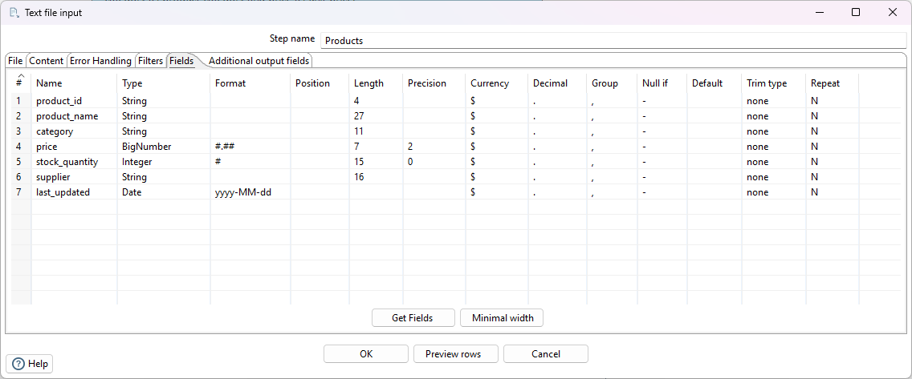
<figcaption>Products fields</figcaption>
</figure>
</div>

8. In each, select **Preview rows**, enter `100` rows, and select **OK**.

> **Success:** Checkpoint: 15 sales (`S001` to `S015`), 18 products (`P001` to `P018`) and 12 customers.

9. Select **Close**, then **OK**.

### 2. Look Up Products and Customers

> **Note:**
>
> #### Stream lookup
>
> **Stream lookup** adds fields to each main row from a second stream, matched on key fields. The second stream comes from another step in the same transformation, not from a database.

1. On the **Design** tab, open the **Lookup** folder and drag **Stream lookup** onto the canvas twice. Double-click each in turn, set **Step name** to `Product lookup` and `Customers lookup`, and select **OK**.
2. Create a hop from **Sales** to **Product lookup**: hold `Shift` and drag from one step to the other. If Spoon shows a menu of hop types, select **Main output of step**.
3. Create a hop from **Products** to **Product lookup**, from **Product lookup** to **Customers lookup**, and from **Customers** to **Customers lookup**.
4. Double-click **Product lookup** and set **Lookup step** to `Products`. In **The key(s) to look up the value(s)**, set **Field** to `product_id` and **LookupField** to `product_id`. Fill **Specify the fields to retrieve**:

| Field          | New name           |
| -------------- | ------------------ |
| `product_name` |                    |
| `category`     | `product_category` |
| `price`        | `unit_price`       |

<div align="center">
<figure>
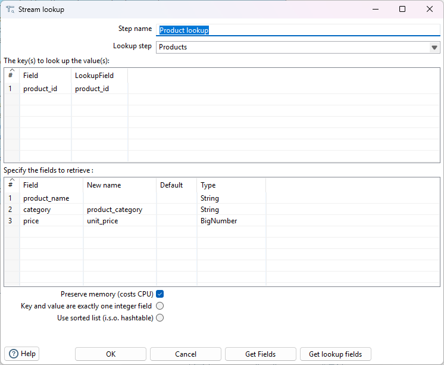
<figcaption>Product lookup</figcaption>
</figure>
</div>

5. Select **OK**.
6. Double-click **Customers lookup** and set **Lookup step** to `Customers`, with the key **Field** `customer_id` and **LookupField** `customer_id`. Fill **Specify the fields to retrieve**:

| Field        | New name           |
| ------------ | ------------------ |
| `first_name` |                    |
| `last_name`  |                    |
| `email`      |                    |
| `country`    | `customer_country` |
| `status`     | `customer_status`  |

<div align="center">
<figure>
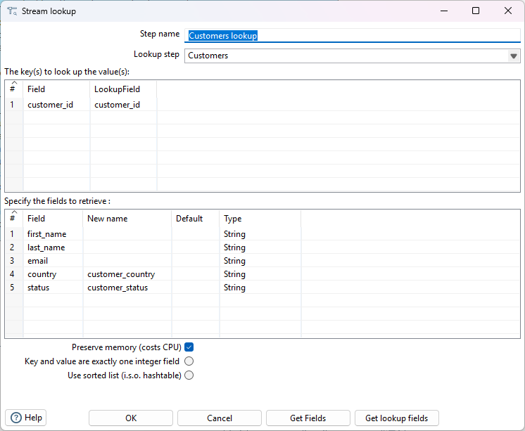
<figcaption>Customers lookup</figcaption>
</figure>
</div>

7. Select **OK** and save the transformation (`Ctrl+S`).
8. Select **Customers lookup** on the canvas, press `F10` (**Action > Preview**), and select **Quick Launch**.

<div align="center">
<figure>
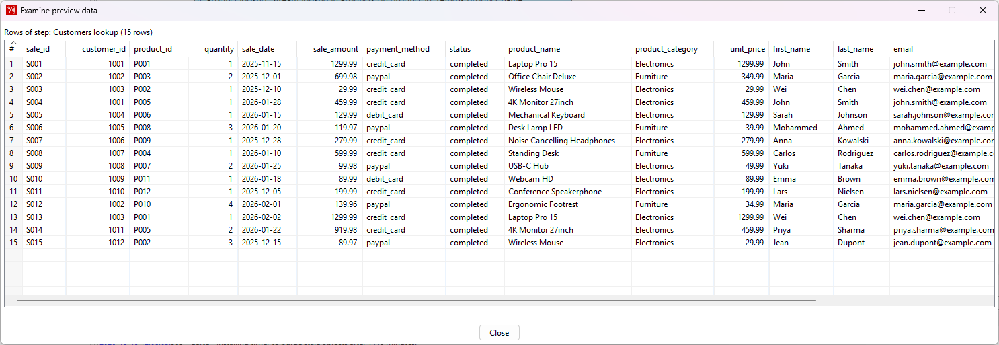
<figcaption>Sales with product and customer details</figcaption>
</figure>
</div>

> **Success:** Checkpoint: 15 rows, every one with a `product_name` and a `customer_country`.

9. Select **Close**.

> **Under the hood:**
>
> #### The lookup stream is read first, into memory
>
> **Stream lookup** reads the whole **Lookup step** stream before it
> passes a single main row: all 18 products go into an in-memory table
> keyed on `product_id`. Then each sale is answered from that table, with
> no sort and no database round trip. That is why the hop from
> **Products** shows a small information icon on the canvas: it feeds
> the lookup, not the main flow.
>
> **Why it matters:** this is the fastest way to enrich a stream from a
> small reference set. For a reference set too large for memory, sort
> both streams and use **Merge join**, as the later workshops do.

### 3. Calculate

> **Note:**
>
> #### Calculator and Formula
>
> **Calculator** runs predefined functions on fields; **Formula** evaluates spreadsheet-style expressions. Use whichever reads more clearly.

1. On the **Design** tab, open the **Transform** folder and drag **Calculator** onto the canvas. Create a hop from **Customers lookup** to **Calculator**.
2. Double-click **Calculator** and fill the **Fields** grid:

| New field         | Calculation | Field A      | Field B       | Value type |
| ----------------- | ----------- | ------------ | ------------- | ---------- |
| `line_total`      | A * B       | `unit_price` | `quantity`    | BigNumber  |
| `discount_amount` | A - B       | `line_total` | `sale_amount` | BigNumber  |

> **Warning:** Put `unit_price` in **Field A**. Calculator works in Field A's type, so with the Integer `quantity` first, `unit_price` is cut to a whole number before the multiplication: 1299.99 × 1 comes out as 1299.

<div align="center">
<figure>
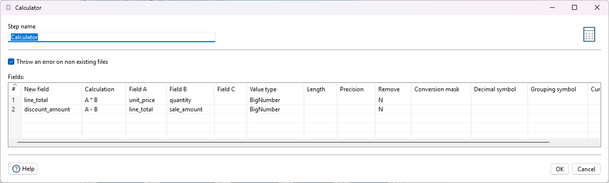
<figcaption>Calculator</figcaption>
</figure>
</div>

3. Select **OK**.
4. On the **Design** tab, open the **Scripting** folder and drag **Formula** onto the canvas. Create a hop from **Calculator** to **Formula**.
5. Double-click **Formula** and fill the **Fields** grid with two fields, both with **Value type** String:

| New field            | Formula                                       |
| -------------------- | --------------------------------------------- |
| `customer_full_name` | `CONCATENATE([first_name];" ";[last_name])`   |
| `is_high_value`      | `IF([sale_amount]>500;"Yes";"No")`            |

<div align="center">
<figure>
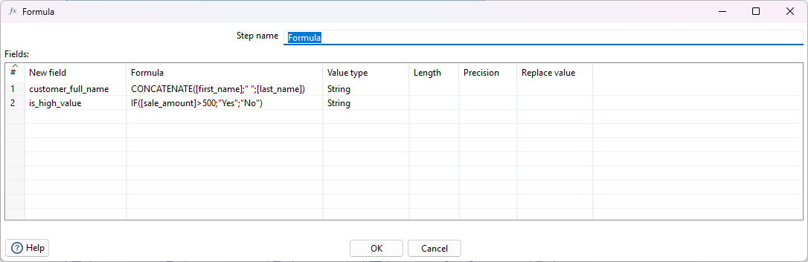
<figcaption>Formula</figcaption>
</figure>
</div>

6. Select **OK** and save the transformation (`Ctrl+S`).
7. Select **Formula** on the canvas, press `F10` (**Action > Preview**), and select **Quick Launch**.

> **Success:** Checkpoint: `line_total` equals `sale_amount` on all 15 rows, to the cent. Every sale in this data is at list price, so `discount_amount` is 0; a positive value would mean the customer paid less than list. 5 sales are `is_high_value` `Yes`.

8. Select **Close**.

### 4. Add Audit Fields

1. On the **Design** tab, open the **Transform** folder and drag **Add constants** onto the canvas. Create a hop from **Formula** to **Add constants**.
2. Double-click **Add constants** and fill the **Fields** grid with one row: **Name** `data_source`, **Type** String, **Value** `minio_workshop`. Select **OK**.
3. On the **Design** tab, open the **Input** folder and drag **Get system info** onto the canvas. Create a hop from **Add constants** to **Get system info**.
4. Double-click **Get system info** and fill the **Fields** grid with one row: **Name** `etl_timestamp`, **Type** `system date (variable)`. Select **OK**.

> **Note:** `data_source` and `etl_timestamp` say where each row came from and when it was loaded, the two questions asked first when a number in a dashboard looks wrong.

### 5. Select and Write

1. On the **Design** tab, open the **Transform** folder and drag **Select values** onto the canvas. Create a hop from **Get system info** to **Select values**.
2. Double-click **Select values**. On the **Select & Alter** tab, list these fields in this order, and set **Rename to** `sale_status` on the `status` row:

   `sale_id`, `sale_date`, `customer_id`, `customer_full_name`, `customer_country`, `customer_status`, `product_id`, `product_name`, `product_category`, `quantity`, `unit_price`, `sale_amount`, `line_total`, `discount_amount`, `is_high_value`, `payment_method`, `status`, `etl_timestamp`, `data_source`

3. Select **OK**.
4. On the **Design** tab, open the **Output** folder and drag **Text file output** onto the canvas. Create a hop from **Select values** to it, double-click it and set **Step name** to `Write to staging`.
5. On the **File** tab, set **Filename** to `pvfs://MinIO/staging/dashboard/sales_fact` and **Extension** to `csv`, and select **Include date in filename?** and **Include time in filename?**.
6. On the **Content** tab, set **Separator** to `,` and keep **Header** selected.
7. On the **Fields** tab, select **Get Fields**, then **Minimal width**.

> **Warning:** Select **Minimal width**. Without it, Text file output pads every String to its declared length, and `USA` is written as `USA` followed by spaces.

8. Select **OK** and save the transformation (`Ctrl+S`).
9. Press `F9` (**Action > Run**), and select **Run** in the **Run Options** dialog.
10. In the MinIO console, open **staging** > `dashboard/`.

<div align="center">
<figure>
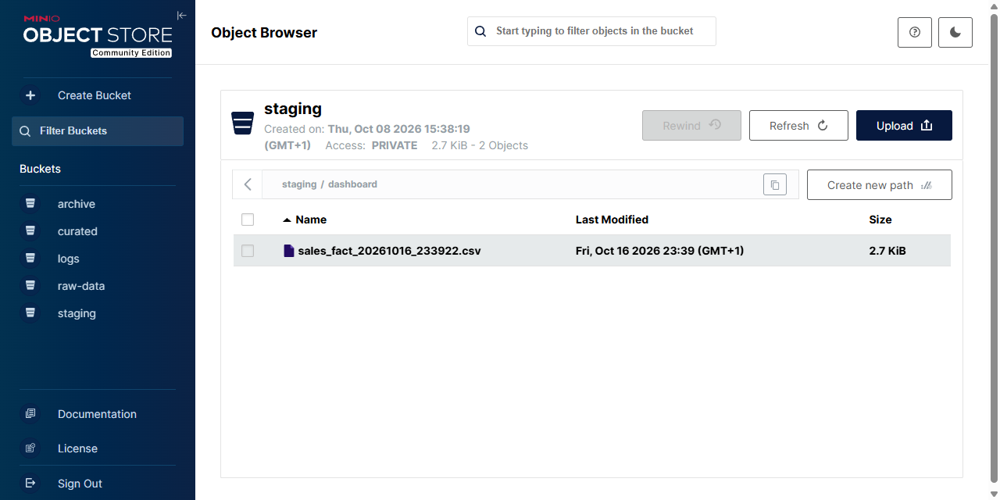
<figcaption>The output in MinIO</figcaption>
</figure>
</div>

> **Success:** Checkpoint: `sales_fact_<date>_<time>.csv` holds a header and 15 rows, with no padded values. Each run adds a new file, because the date and time are in the name.

:::

***

> **Note:** **Workshop files**
>
> Download the files for this workshop. For `.ktr` files, **Open in Pentaho Data Integration** launches PDI with the transformation loaded; if PDI is already running, the path is copied to your clipboard (press `Ctrl+O`, `Ctrl+V`, `Enter`).

[sales_dashboard_etl.ktr](./files/sales_dashboard_etl.ktr) <button data-launch="spoon" data-path="files/sales_dashboard_etl.ktr">Open in Pentaho Data Integration</button> <button data-graph="files/sales_dashboard_etl.ktr">View graph</button>

### Inventory Reconciliation

> **Warning:**
>
> #### Inventory Reconciliation
>
> Reconcile a warehouse system's XML inventory feed with the ERP product catalog, a CSV file. A full outer join keeps items missing from either side; each row is classified, and the results go to three work queues by priority.
>
> **Scenario:** a warehouse management system (WMS) exports its stock as XML each night, and the ERP holds the product master. Where they disagree, someone has to investigate or count:
>
> * **Missing in the warehouse:** the ERP lists a product the warehouse doesn't hold
> * **Missing in the catalog:** the warehouse holds an item the ERP doesn't know
> * **Quantity variance:** both know the product, but the quantities differ
>
> **Skills:** **Get data from XML**, **Merge join** (full outer), **Calculator**, **Modified JavaScript value**, **Switch / case**, **Group by**

<div align="center">
<figure>
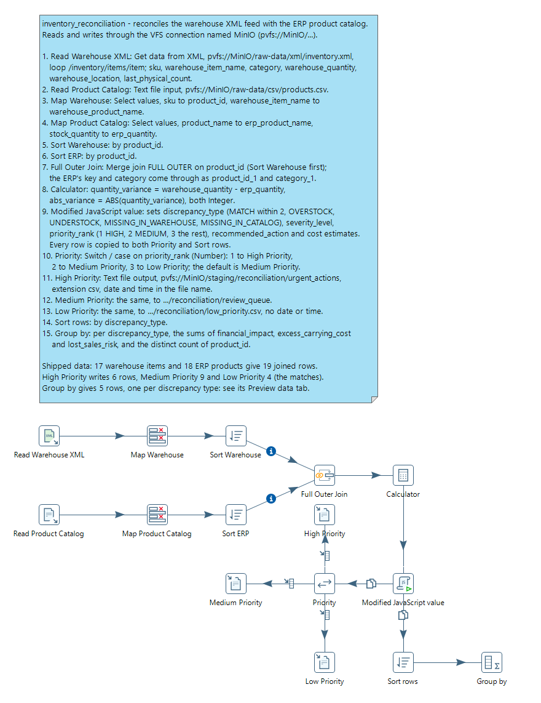
<figcaption>What you build</figcaption>
</figure>
</div>

> **Note:** **Workshop files**
>
> These files are already in MinIO:
>
> * `pvfs://MinIO/raw-data/xml/inventory.xml` (17 items)
> * `pvfs://MinIO/raw-data/csv/products.csv` (18 products)
>
> Outputs, in `pvfs://MinIO/staging/reconciliation/`: `urgent_actions_<date>_<time>.csv`, `review_queue_<date>_<time>.csv` and `low_priority.csv`

::: tabs

### 1. Read the Warehouse Feed

> **Note:**
>
> #### Get data from XML
>
> **Get data from XML** reads an XML file and returns one row per node that matches the **Loop XPath**. Each field is an XPath relative to that node.

1. Select **File > New > Transformation** (`Ctrl+N`).
2. Select **File > Save as** and save it as `inventory_reconciliation.ktr` in `C:\Workshop-DI-Practitioner\03-data-sources\03-storage\19-mod3-minio`.
3. On the **Design** tab, open the **Input** folder and drag **Get data from XML** onto the canvas.
4. Double-click **Get data from XML** and set **Step name** to `Read Warehouse XML`.
5. On the **File** tab, enter `pvfs://MinIO/raw-data/xml/inventory.xml` in **File or directory** and select **Add**.
6. On the **Content** tab, select **Get XPath nodes**, select `/inventory/items/item` in **Available Paths**, and select **OK**. **Loop XPath** now reads `/inventory/items/item`.
7. Set **Encoding** to `UTF-8`, and select **Ignore comments?** and **Ignore empty file**.

<div align="center">
<figure>
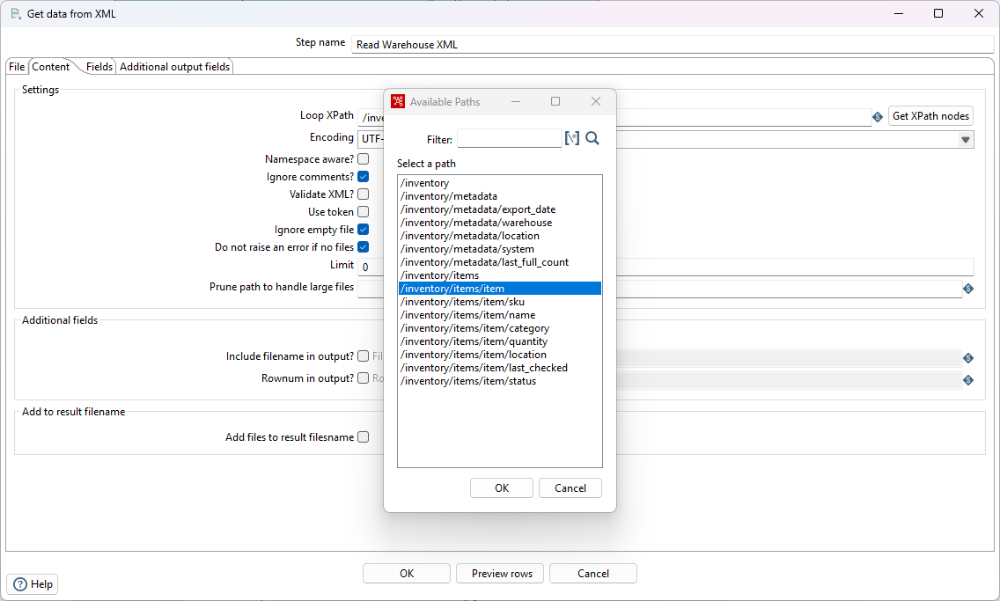
<figcaption>One row per item element</figcaption>
</figure>
</div>

> **Note:** `/inventory/items/item` starts at the root element, `inventory`, goes into `items`, and returns one row for each `item` inside it.

8. On the **Fields** tab, select **Get fields**. Make the grid match this table: rename the fields, set their types, and delete any other row, such as `status`. **Element** stays `Node` and **Result type** `Value of`. The `warehouse_` prefix keeps these fields apart from the ERP fields after the join:

| Name                  | XPath          | Type    | Format       | Length |
| --------------------- | -------------- | ------- | ------------ | ------ |
| `sku`                 | `sku`          | String  |              | 20     |
| `warehouse_item_name` | `name`         | String  |              | 100    |
| `category`            | `category`     | String  |              |        |
| `warehouse_quantity`  | `quantity`     | Integer |              |        |
| `warehouse_location`  | `location`     | String  |              | 50     |
| `last_physical_count` | `last_checked` | Date    | `yyyy-MM-dd` |        |

9. Select **Preview rows**, enter `100` rows, and select **OK**.

<div align="center">
<figure>
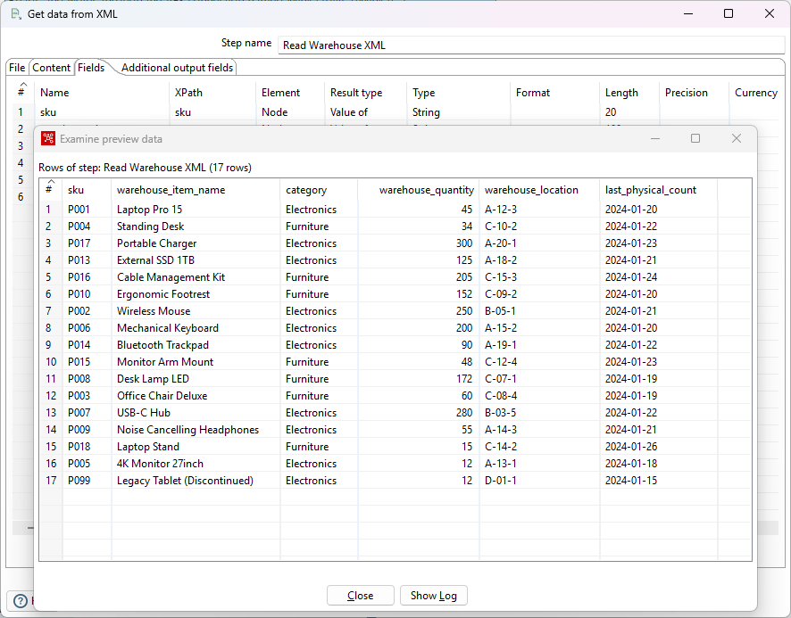
<figcaption>Renamed fields and the preview</figcaption>
</figure>
</div>

> **Success:** Checkpoint: 17 rows, in file order. The first is `P001`, `Laptop Pro 15`, `Electronics`, `45`, `A-12-3`, `2024-01-20`; the last is `P099`, `Legacy Tablet (Discontinued)`.

10. Select **Close**, then **OK**.

### 2. Read the Product Catalog

> **Note:**
>
> #### Text file input
>
> The ERP side: the product master, one row per product.

1. On the **Design** tab, open the **Input** folder and drag **Text file input** onto the canvas.
2. Double-click **Text file input** and set **Step name** to `Read Product Catalog`.
3. On the **File** tab, enter `pvfs://MinIO/raw-data/csv/products.csv` in **File or directory** and select **Add**.
4. On the **Content** tab, set **Separator** to `,` and **Format** to `mixed`, keep **Enclosure** `"`, and keep **Header** selected.
5. On the **Fields** tab, select **Get Fields**, select **OK** at **Number of sample lines**, and close the **Scan results**. Check the types:

| Name             | Type      | Format       |
| ---------------- | --------- | ------------ |
| `product_id`     | String    |              |
| `product_name`   | String    |              |
| `category`       | String    |              |
| `price`          | BigNumber | `#.##`       |
| `stock_quantity` | Integer   | `#`          |
| `supplier`       | String    |              |
| `last_updated`   | Date      | `yyyy-MM-dd` |

6. Select **Preview rows**, enter `100` rows, and select **OK**.

> **Success:** Checkpoint: 18 rows, from `P001` (`Laptop Pro 15`, price `1299.99`, stock `45`) to `P018` (`Laptop Stand`).

7. Select **Close**, then **OK**.

### 3. Join the Two Systems

> **Note:**
>
> #### Full outer join on the product id
>
> Rename both sides to one key, sort, then join so that items missing from *either* system still come through.

1. On the **Design** tab, open the **Transform** folder and drag **Select values** onto the canvas. Create a hop from **Read Warehouse XML** to it.
2. Double-click **Select values** and set **Step name** to `Map Warehouse`. On the **Select & Alter** tab, fill the **Fields** grid:

| Fieldname             | Rename to                |
| --------------------- | ------------------------ |
| `sku`                 | `product_id`             |
| `warehouse_item_name` | `warehouse_product_name` |
| `category`            |                          |
| `warehouse_quantity`  |                          |
| `warehouse_location`  |                          |
| `last_physical_count` |                          |

3. Select **OK**.
4. Drag a second **Select values** onto the canvas and create a hop from **Read Product Catalog** to it. Double-click it and set **Step name** to `Map Product Catalog`. On the **Select & Alter** tab, fill the **Fields** grid:

| Fieldname        | Rename to          |
| ---------------- | ------------------ |
| `product_id`     |                    |
| `product_name`   | `erp_product_name` |
| `category`       |                    |
| `price`          |                    |
| `stock_quantity` | `erp_quantity`     |
| `supplier`       |                    |
| `last_updated`   |                    |

5. Select **OK**.
6. From the **Transform** folder, drag **Sort rows** onto the canvas twice. Create a hop from **Map Warehouse** to the first and from **Map Product Catalog** to the second.
7. Double-click each **Sort rows** in turn. Set **Step name** to `Sort Warehouse` and `Sort ERP`, and in each fill the **Fields** grid with one row: **Fieldname** `product_id`, **Ascending** `Y`, **Case sensitive compare?** `N`. Select **OK**.
8. On the **Design** tab, open the **Joins** folder and drag **Merge join** onto the canvas. Create a hop from **Sort Warehouse** to **Merge join**, and one from **Sort ERP** to **Merge join**.
9. Double-click **Merge join** and set:
   * **Step name**: `Full Outer Join`
   * **First Step**: `Sort Warehouse`
   * **Second Step**: `Sort ERP`
   * **Join Type**: `FULL OUTER`
10. Enter `product_id` in **Keys for 1st step** and in **Keys for 2nd step**. Select **OK**.
11. Save the transformation (`Ctrl+S`).
12. Select **Full Outer Join** on the canvas, press `F10` (**Action > Preview**), and select **Quick Launch**.

> **Success:** Checkpoint: 19 rows: the 17 warehouse items plus `P011` and `P012`, which only the ERP knows. On those two rows `product_id` and the warehouse fields are empty, and the ERP's id is in `product_id_1`. `P099` has a warehouse quantity of 12 and empty ERP fields.

13. Select **Close**.

> **Under the hood:**
>
> #### A full outer join keeps the unmatched rows from both sides
>
> **Merge join** reads its two sorted inputs side by side, comparing
> one key from each. Equal keys become one joined row. A key that only
> one side has still becomes a row, with the other side's fields left
> empty: `P099` from the warehouse, `P011` and `P012` from the ERP. Both
> inputs carry `product_id` and `category`, so the join renames the
> second step's copies `product_id_1` and `category_1`.
>
> **Why it matters:** a reconciliation is about the rows that don't
> match. An inner join would drop exactly the three products that need
> someone's attention first.

### 4. Calculate the Variance

> **Note:**
>
> #### Calculator
>
> Two numbers per row: the signed difference between the warehouse and ERP quantities, and its size.

1. On the **Design** tab, open the **Transform** folder and drag **Calculator** onto the canvas. Create a hop from **Full Outer Join** to **Calculator**.
2. Double-click **Calculator** and fill the **Fields** grid:

| New field           | Calculation             | Field A              | Field B        | Value type | Conversion mask |
| ------------------- | ----------------------- | -------------------- | -------------- | ---------- | --------------- |
| `quantity_variance` | A - B                   | `warehouse_quantity` | `erp_quantity` | Integer    | `#,##0`         |
| `abs_variance`      | Absolute value ABS( A ) | `quantity_variance`  |                | Integer    | `#,##0`         |

3. Select **OK** and save the transformation (`Ctrl+S`).
4. Select **Calculator** on the canvas, press `F10` (**Action > Preview**), and select **Quick Launch**.

> **Success:** Checkpoint: 19 rows. `P006` has `quantity_variance` `44` (200 in the warehouse, 156 in the ERP); `P005` has `-80` and `abs_variance` `80`. The three rows with one side missing, `P011`, `P012` and `P099`, have both fields empty.

5. Select **Close**.

### 5. Classify Each Row

> **Note:**
>
> #### Modified JavaScript value
>
> A script reads each joined row and sets its discrepancy type, severity, work-queue priority and cost estimates.

1. On the **Design** tab, open the **Scripting** folder and drag **Modified JavaScript value** onto the canvas. Create a hop from **Calculator** to it. Keep its name, `Modified JavaScript value`.
2. Double-click **Modified JavaScript value** and replace the text on the **Script 1** tab with this script:

```javascript
// Initialize variables
var match_status = "";
var severity = "";
var action_required = "";
var variance_pct = 0;

// Determine status based on null checks and variance
if (warehouse_quantity == null || warehouse_quantity == 0) {
    match_status = "MISSING_IN_WAREHOUSE";
    severity = "HIGH";
    action_required = "Physical inventory check required";

} else if (erp_quantity == null || erp_quantity == 0) {
    match_status = "MISSING_IN_CATALOG";
    severity = "MEDIUM";
    action_required = "Add to ERP or remove from warehouse";

} else {
    // Both systems have the item - check variance
    var variance = warehouse_quantity - erp_quantity;

    // Calculate variance percentage
    if (erp_quantity > 0) {
        variance_pct = Math.abs((variance / erp_quantity) * 100);
    }

    // Classify based on variance thresholds
    if (Math.abs(variance) <= 2) {
        match_status = "MATCH";
        severity = "NONE";
        action_required = "No action - within tolerance";

    } else if (variance > 0) {
        match_status = "OVERSTOCK";
        severity = variance_pct > 20 ? "HIGH" : "MEDIUM";
        action_required = "Update ERP quantity or investigate recent receiving";

    } else {
        match_status = "UNDERSTOCK";
        severity = variance_pct > 20 ? "HIGH" : "MEDIUM";
        action_required = "Update ERP quantity or investigate shrinkage";
    }
}

// Determine priority for work queue
var priority;
if (severity == "HIGH") {
    priority = 1;
} else if (severity == "MEDIUM") {
    priority = 2;
} else {
    priority = 3;
}

// Financial Impact
// Requires price field from ERP
var financial_impact = abs_variance * price;

// Carrying cost of excess inventory (20% annually)
var excess_carrying_cost = 0;
if (match_status == "OVERSTOCK") {
    excess_carrying_cost = (quantity_variance * price * 0.20) / 365 * 30; // Monthly cost
}

// Lost sales from understocked items
var lost_sales_risk = 0;
if (match_status == "UNDERSTOCK") {
    lost_sales_risk = quantity_variance * price * -1; // Absolute value
}

// Add Audit Trail
var reconciliation_timestamp = new Date();
var reconciliation_date = new Date();
reconciliation_date.setHours(0, 0, 0, 0); // Remove time component

var tolerance_threshold = 2;
var data_source_warehouse = "WMS-XML-Export";
var data_source_erp = "ERP-CSV-Extract";
```

3. Fill the **Fields** grid under the script. Type the rows, or select **Get variables** and then delete any row that is not in this table and correct the rest. **Replace value 'Fieldname' or 'Rename to'** stays `N` on every row:

| Fieldname                  | Rename to             | Type    | Length | Precision |
| -------------------------- | --------------------- | ------- | ------ | --------- |
| `match_status`             | `discrepancy_type`    | String  | 50     |           |
| `severity`                 | `severity_level`      | String  | 20     |           |
| `action_required`          | `recommended_action`  | String  | 200    |           |
| `variance_pct`             | `variance_percentage` | Number  |        | 2         |
| `priority`                 | `priority_rank`       | Integer |        |           |
| `financial_impact`         |                       | Number  |        | 2         |
| `excess_carrying_cost`     |                       | Number  |        | 2         |
| `lost_sales_risk`          |                       | Number  |        | 2         |
| `reconciliation_timestamp` |                       | Date    |        |           |
| `reconciliation_date`      |                       | Date    |        |           |
| `tolerance_threshold`      |                       | Integer |        |           |
| `data_source_warehouse`    |                       | String  |        |           |
| `data_source_erp`          |                       | String  |        |           |

4. Select **OK**.

What the script decides, row by row:

| Output field          | Rule                                                                                   |
| --------------------- | -------------------------------------------------------------------------------------- |
| `discrepancy_type`    | `MISSING_IN_WAREHOUSE` (no warehouse quantity, or 0), `MISSING_IN_CATALOG` (no ERP quantity, or 0), `MATCH` (within ±2), else `OVERSTOCK` or `UNDERSTOCK` |
| `severity_level`      | `HIGH` for missing in the warehouse, or a variance over 20% of the ERP quantity; `MEDIUM` for missing in the catalog or a smaller variance; `NONE` for a match |
| `priority_rank`       | 1 for `HIGH`, 2 for `MEDIUM`, 3 for the rest                                              |
| `recommended_action`, `financial_impact`, `excess_carrying_cost`, `lost_sales_risk` | the work-queue text and cost estimates |

5. Save the transformation (`Ctrl+S`).
6. Select **Modified JavaScript value** on the canvas, press `F10` (**Action > Preview**), and select **Quick Launch**.

> **Success:** Checkpoint: 19 rows. `P006` is `OVERSTOCK`, `HIGH`, priority `1`; `P099` is `MISSING_IN_CATALOG`, `MEDIUM`, priority `2`; `P015` (48 against 50) is `MATCH`, `NONE`, priority `3`. The two rows with an empty `product_id` are `MISSING_IN_WAREHOUSE`, `HIGH`.

7. Select **Close**.

> **Under the hood:**
>
> #### Script variables become fields through the Fields grid
>
> For each row, the step hands the script every incoming field as a
> JavaScript variable of the same name, runs the script, then reads back
> only the variables listed in the **Fields** grid. Each one is added to
> the row under its **Rename to** name, converted to its **Type**.
> A variable that is not in the grid, such as `variance`, stays inside
> the script.
>
> **Why it matters:** the script can use short working names while the
> output gets clear, typed fields, and the grid is the one place that
> says what the step adds to the stream.

### 6. Route to the Work Queues

> **Note:**
>
> #### Switch / case
>
> **Switch / case** sends each row to one of several steps, by the value of one field. Here `priority_rank` picks the work queue.

1. On the **Design** tab, open the **Flow** folder and drag **Switch / case** onto the canvas. Create a hop from **Modified JavaScript value** to it.
2. On the **Design** tab, open the **Output** folder and drag **Text file output** onto the canvas three times. Double-click each in turn, set **Step name** to `High Priority`, `Medium Priority` and `Low Priority`, and select **OK**.
3. Create a hop from **Switch / case** to each of the three outputs. In the menu Spoon shows for each hop, select **Create a new target case for this step**.
4. Double-click **Switch / case** and set:
   * **Step name**: `Priority`
   * **Field name to switch**: `priority_rank`
   * **Case value data type**: `Number`
   * **Default target step**: `Medium Priority`
5. Fill the **Case values** grid:

| Value | Target step       |
| ----- | ----------------- |
| `1`   | `High Priority`   |
| `2`   | `Medium Priority` |
| `3`   | `Low Priority`    |

6. Select **OK**.
7. Double-click **High Priority**. On the **File** tab, set **Filename** to `pvfs://MinIO/staging/reconciliation/urgent_actions` and **Extension** to `csv`, and select **Include date in filename?** and **Include time in filename?**.
8. On the **Content** tab, set **Separator** to `,` and **Encoding** to `UTF-8`, and keep **Header** selected.
9. On the **Fields** tab, select **Get Fields**, then **Minimal width**. Select **OK**.
10. Set up **Medium Priority** and **Low Priority** the same way, with these files:

| Step              | Filename                                           | Include date and time in filename? |
| ----------------- | -------------------------------------------------- | ---------------------------------- |
| `Medium Priority` | `pvfs://MinIO/staging/reconciliation/review_queue` | both selected                      |
| `Low Priority`    | `pvfs://MinIO/staging/reconciliation/low_priority` | both cleared                       |

> **Note:** **Get Fields** also lists `product_id_1` and `category_1`, the ERP's copies of the key and the category. Keep them: on the two products missing in the warehouse, `product_id_1` holds the only product id.

### 7. Summarize and Run

> **Note:**
>
> #### Sort rows and Group by
>
> A second copy of every classified row goes to a summary: one row per discrepancy type, with its total costs.

1. On the **Design** tab, open the **Transform** folder and drag **Sort rows** onto the canvas. Create a hop from **Modified JavaScript value** to it. When Spoon asks, select **Copy**: **Distribute** would send each row to only one of the two steps, so neither would see all 19.
2. Double-click **Sort rows**, keep its name, and fill the **Fields** grid with one row: **Fieldname** `discrepancy_type`, **Ascending** `Y`, **Case sensitive compare?** `N`. Select **OK**.
3. On the **Design** tab, open the **Statistics** folder and drag **Group by** onto the canvas. Create a hop from **Sort rows** to **Group by**.
4. Double-click **Group by**, keep its name, and enter `discrepancy_type` in **The fields that make up the group**.
5. Fill the **Aggregates** grid:

| Name                          | Subject                | Type                          |
| ----------------------------- | ---------------------- | ----------------------------- |
| `Sum of financial_impact`     | `financial_impact`     | Sum                           |
| `Sum of excess_carrying_cost` | `excess_carrying_cost` | Sum                           |
| `Sum of lost_sales_risk`      | `lost_sales_risk`      | Sum                           |
| `Count of product_id`         | `product_id`           | Number of Distinct Values (N) |

6. Select **OK** and save the transformation (`Ctrl+S`).
7. Press `F9` (**Action > Run**), and select **Run** in the **Run Options** dialog.
8. In **Execution Results**, open the **Step Metrics** tab.

> **Success:** Checkpoint: in **Written**, **Read Warehouse XML** shows 17, **Read Product Catalog** 18 and **Full Outer Join** 19. **High Priority** shows 6, **Medium Priority** 9 and **Low Priority** 4: 19 rows, each in one queue.

9. In the MinIO console, open **staging** > `reconciliation/`.

> **Success:** Checkpoint: three files, each with a header row:
>
> | File               | Rows | What is in it                                             |
> | ------------------ | ---- | --------------------------------------------------------- |
> | `urgent_actions_*` | 6    | 3 understock, 2 missing in the warehouse, 1 overstock      |
> | `review_queue_*`   | 9    | 4 overstock, 4 understock, 1 missing in the catalog        |
> | `low_priority.csv` | 4    | the matches: `P001`, `P004`, `P015` and `P017`             |

10. In Spoon, select **Group by** on the canvas and open the **Preview data** tab.

> **Success:** Checkpoint: 5 rows, one per discrepancy type, in order: `MATCH`, `MISSING_IN_CATALOG`, `MISSING_IN_WAREHOUSE`, `OVERSTOCK`, `UNDERSTOCK`.

:::

***

> **Note:** **Workshop files**
>
> Download the files for this workshop. For `.ktr` files, **Open in Pentaho Data Integration** launches PDI with the transformation loaded; if PDI is already running, the path is copied to your clipboard (press `Ctrl+O`, `Ctrl+V`, `Enter`).

[inventory_reconciliation.ktr](./files/inventory_reconciliation.ktr) <button data-launch="spoon" data-path="files/inventory_reconciliation.ktr">Open in Pentaho Data Integration</button> <button data-graph="files/inventory_reconciliation.ktr">View graph</button>

### Customer 360

> **Warning:**
>
> #### Customer 360
>
> Build one profile per customer from three sources: who they are (`customers.csv`), what they bought (`sales.csv`) and what they did on the site (`user_events.json`). The sales and the events are each reduced to one row per customer, then all three are joined, scored and segmented.
>
> **Skills:** JSON lines, **Memory group by** and **Group by**, **Merge join**, **Calculator**, **Formula**, **Modified JavaScript value**

<div align="center">
<figure>
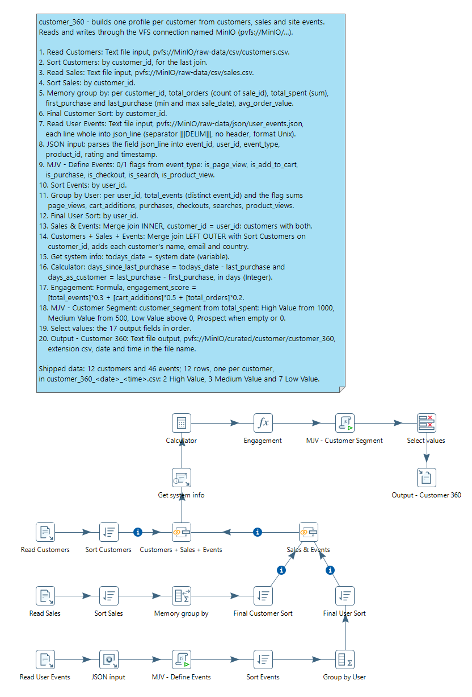
<figcaption>What you build</figcaption>
</figure>
</div>

> **Note:** **Workshop files**
>
> These files are already in MinIO:
>
> * `pvfs://MinIO/raw-data/csv/customers.csv` (12 customers)
> * `pvfs://MinIO/raw-data/csv/sales.csv` (15 sales)
> * `pvfs://MinIO/raw-data/json/user_events.json` (46 events, one JSON object per line)
>
> Output: `pvfs://MinIO/curated/customer/customer_360_<date>_<time>.csv`

::: tabs

### 1. Read the Customers

> **Note:**
>
> #### The customer master
>
> One row per customer, sorted on `customer_id` for the join at the end.

1. Select **File > New > Transformation** (`Ctrl+N`).
2. Select **File > Save as** and save it as `customer_360.ktr` in `C:\Workshop-DI-Practitioner\03-data-sources\03-storage\19-mod3-minio`.
3. On the **Design** tab, open the **Input** folder and drag **Text file input** onto the canvas.
4. Double-click **Text file input** and set **Step name** to `Read Customers`.
5. On the **File** tab, enter `pvfs://MinIO/raw-data/csv/customers.csv` in **File or directory** and select **Add**.
6. On the **Content** tab, set **Separator** to `,` and **Format** to `mixed`, and keep **Header** selected.
7. On the **Fields** tab, select **Get Fields**, select **OK** at **Number of sample lines**, and close the **Scan results**. Check the types: `customer_id` Integer (`#`); `registration_date` Date (`yyyy-MM-dd`); `first_name`, `last_name`, `email`, `phone`, `country` and `status` String.
8. Select **Preview rows**, enter `100` rows, and select **OK**.

> **Success:** Checkpoint: 12 rows, from `1001` (`John`, `Smith`, `USA`) to `1012` (`Jean`, `Dupont`, `France`).

9. Select **Close**, then **OK**.
10. On the **Design** tab, open the **Transform** folder and drag **Sort rows** onto the canvas. Create a hop from **Read Customers** to it.
11. Double-click **Sort rows** and set **Step name** to `Sort Customers`. Fill the **Fields** grid with one row: **Fieldname** `customer_id`, **Ascending** `Y`, **Case sensitive compare?** `N`. Select **OK**.

### 2. Summarize the Sales

> **Note:**
>
> #### Memory group by
>
> **Memory group by** reduces the 15 sales to one row per customer. It needs the sales sorted by customer, so this tab adds a second sort, `Sort Sales`, beside tab 1's `Sort Customers`.

1. On the **Design** tab, open the **Input** folder and drag **Text file input** onto the canvas. Double-click it and set **Step name** to `Read Sales`.
2. On the **File** tab, enter `pvfs://MinIO/raw-data/csv/sales.csv` in **File or directory** and select **Add**, or select **Browse**, set **File type** to `*.csv`, and pick it under **VFS Connections > MinIO**.

<div align="center">
<figure>

<figcaption>Browse the bucket through the connection</figcaption>
</figure>
</div>

3. On the **Content** tab, set **Separator** to `,` and **Format** to `mixed`, and keep **Header** selected.
4. On the **Fields** tab, select **Get Fields**, select **OK** at **Number of sample lines**, and close the **Scan results**. Check the types: `customer_id` and `quantity` Integer (`#`); `sale_date` Date (`yyyy-MM-dd`); `sale_amount` BigNumber (`#.##`); `sale_id`, `product_id`, `payment_method` and `status` String. Select **OK**.
5. On the **Design** tab, open the **Transform** folder and drag **Sort rows** onto the canvas. Create a hop from **Read Sales** to it.
6. Double-click the new **Sort rows** and set **Step name** to `Sort Sales`. Fill the **Fields** grid with one row: **Fieldname** `customer_id`, **Ascending** `Y`, **Case sensitive compare?** `N`. Select **OK**.
7. On the **Design** tab, open the **Statistics** folder and drag **Memory group by** onto the canvas. Create a hop from **Sort Sales** to it.
8. Double-click **Memory group by** and keep its name. Enter `customer_id` in **The fields that make up the group**, and fill the **Aggregates** grid:

| Name              | Subject       | Type                 |
| ----------------- | ------------- | -------------------- |
| `total_orders`    | `sale_id`     | Number of Values (N) |
| `total_spent`     | `sale_amount` | Sum                  |
| `first_purchase`  | `sale_date`   | Minimum              |
| `last_purchase`   | `sale_date`   | Maximum              |
| `avg_order_value` | `sale_amount` | Average (Mean)       |

9. Select **OK**.
10. From the **Transform** folder, drag **Sort rows** onto the canvas. Create a hop from **Memory group by** to it, double-click it and set **Step name** to `Final Customer Sort`. Fill the **Fields** grid with one row: **Fieldname** `customer_id`, **Ascending** `Y`, **Case sensitive compare?** `N`. Select **OK**.
11. Save the transformation (`Ctrl+S`).
12. Select **Final Customer Sort** on the canvas, press `F10` (**Action > Preview**), and select **Quick Launch**.

> **Success:** Checkpoint: 12 rows, one per customer, `1001` to `1012`. `1001` has `total_orders` `2`, `total_spent` `1759.98`, `avg_order_value` `879.99`, `first_purchase` `2025-11-15` and `last_purchase` `2026-01-28`.

13. Select **Close**.

> **Under the hood:**
>
> #### Memory group by keeps a table of groups, not a sorted stream
>
> **Memory group by** holds one entry per `customer_id` in memory and
> adds each sale to its entry, in whatever order the sales arrive. When
> the input ends, it writes the entries out, in no particular key order.
> That is why the sort before it is not needed, and the sort after it,
> `Final Customer Sort`, is: **Merge join** needs its input sorted.
> **Group by**, in the next tab, works the other way: it needs sorted
> input and writes each group as soon as the key changes.
>
> **Why it matters:** **Memory group by** suits a modest number of
> groups; **Group by** handles any number, provided the input is sorted.

### 3. Count the Events

> **Note:**
>
> #### JSON lines
>
> `user_events.json` holds one JSON object per line, not one JSON document. **Text file input** reads each line whole into one field, and **JSON input** parses that field.

1. On the **Design** tab, open the **Input** folder and drag **Text file input** onto the canvas. Double-click it and set **Step name** to `Read User Events`.
2. On the **File** tab, enter `pvfs://MinIO/raw-data/json/user_events.json` in **File or directory** and select **Add**.
3. On the **Content** tab, set **Separator** to `|||DELIM|||`, delete the `"` from **Enclosure**, clear **Header**, and set **Format** to `Unix`. The separator never occurs in the data, so each line arrives whole.
4. On the **Fields** tab, fill the grid with one row: **Name** `json_line`, **Type** `String`.
5. Select **Preview rows**, enter `100` rows, and select **OK**.

> **Success:** Checkpoint: 46 rows, each one whole JSON object. The first starts `{"event_id":"evt_001","user_id":1001,"event_type":"page_view"`.

6. Select **Close**, then **OK**.
7. On the **Design** tab, open the **Input** folder and drag **JSON input** onto the canvas. Create a hop from **Read User Events** to it, and keep its name, `JSON input`.
8. Double-click **JSON input**. On the **File** tab, select **Source is from a previous step**, and set **Select field** to `json_line`.
9. On the **Content** tab, keep **Ignore missing path** and **Default path leaf to null** selected, as PDI 11 sets them for a new step: not every event has a `product_id` or a `rating`.
10. On the **Fields** tab, fill the grid:

| Name         | Path           | Type    |
| ------------ | -------------- | ------- |
| `event_id`   | `$.event_id`   | String  |
| `user_id`    | `$.user_id`    | Integer |
| `event_type` | `$.event_type` | String  |
| `product_id` | `$.product_id` | String  |
| `rating`     | `$.rating`     | Integer |
| `timestamp`  | `$.timestamp`  | String  |

11. Select **OK**.
12. On the **Design** tab, open the **Scripting** folder and drag **Modified JavaScript value** onto the canvas. Create a hop from **JSON input** to it.
13. Double-click **Modified JavaScript value** and set **Step name** to `MJV - Define Events`. Replace the text on the **Script 1** tab with this script:

```javascript
// Initialize counters (these will accumulate per row, so we'll aggregate later)
var is_page_view = (event_type == "page_view") ? 1 : 0;
var is_add_to_cart = (event_type == "add_to_cart") ? 1 : 0;
var is_purchase = (event_type == "purchase") ? 1 : 0;
var is_checkout = (event_type == "checkout") ? 1 : 0;
var is_search = (event_type == "search") ? 1 : 0;
var is_product_view = (event_type == "product_view") ? 1 : 0;
```

14. Fill the **Fields** grid under the script with six rows, each with **Type** `Number`: `is_page_view`, `is_add_to_cart`, `is_purchase`, `is_checkout`, `is_search` and `is_product_view`. Select **OK**.
15. On the **Design** tab, open the **Transform** folder and drag **Sort rows** onto the canvas. Create a hop from **MJV - Define Events** to it, double-click it and set **Step name** to `Sort Events`. Fill the **Fields** grid with one row: **Fieldname** `user_id`, **Ascending** `Y`, **Case sensitive compare?** `N`. Select **OK**.
16. On the **Design** tab, open the **Statistics** folder and drag **Group by** onto the canvas. Create a hop from **Sort Events** to it.
17. Double-click **Group by** and set **Step name** to `Group by User`. Enter `user_id` in **The fields that make up the group**, and fill the **Aggregates** grid:

| Name             | Subject           | Type                          |
| ---------------- | ----------------- | ----------------------------- |
| `total_events`   | `event_id`        | Number of Distinct Values (N) |
| `page_views`     | `is_page_view`    | Sum                           |
| `cart_additions` | `is_add_to_cart`  | Sum                           |
| `purchases`      | `is_purchase`     | Sum                           |
| `checkouts`      | `is_checkout`     | Sum                           |
| `searches`       | `is_search`       | Sum                           |
| `product_views`  | `is_product_view` | Sum                           |

18. Select **OK**.
19. From the **Transform** folder, drag **Sort rows** onto the canvas. Create a hop from **Group by User** to it, double-click it and set **Step name** to `Final User Sort`. Fill the **Fields** grid with one row: **Fieldname** `user_id`, **Ascending** `Y`, **Case sensitive compare?** `N`. Select **OK**.
20. Save the transformation (`Ctrl+S`).
21. Select **Final User Sort** on the canvas, press `F10` (**Action > Preview**), and select **Quick Launch**.

> **Success:** Checkpoint: 12 rows, users `1001` to `1012`. `1001` has 8 events, 3 page views and 1 cart addition; `1003` has 4 events and no page views.

22. Select **Close**.

### 4. Join the Three Streams

> **Note:**
>
> #### Two merge joins
>
> **Merge join** matches two streams sorted on their keys. The first join keeps the customers who have both sales and events; the second adds each one's details from the customer master.

1. On the **Design** tab, open the **Joins** folder and drag **Merge join** onto the canvas. Create a hop from **Final Customer Sort** to it, and one from **Final User Sort** to it.
2. Double-click **Merge join** and set:
   * **Step name**: `Sales & Events`
   * **First Step**: `Final Customer Sort`
   * **Second Step**: `Final User Sort`
   * **Join Type**: `INNER`
3. Enter `customer_id` in **Keys for 1st step** and `user_id` in **Keys for 2nd step**. Select **OK**.
4. Drag a second **Merge join** onto the canvas. Create a hop from **Sales & Events** to it, and one from **Sort Customers** to it.
5. Double-click it and set:
   * **Step name**: `Customers + Sales + Events`
   * **First Step**: `Sales & Events`
   * **Second Step**: `Sort Customers`
   * **Join Type**: `LEFT OUTER`
6. Enter `customer_id` in **Keys for 1st step** and in **Keys for 2nd step**. Select **OK**.
7. Save the transformation (`Ctrl+S`).
8. Select **Customers + Sales + Events** on the canvas, press `F10` (**Action > Preview**), and select **Quick Launch**.

> **Success:** Checkpoint: 12 rows, one per customer: every customer in `customers.csv` has at least one sale and one event. Each row carries the order totals, the event counts and the customer's `first_name`, `last_name`, `email` and `country`.

9. Select **Close**.

### 5. Score and Segment

> **Note:**
>
> #### Calculator, Formula and a script
>
> Three derived fields: how many days since each customer's last purchase, an engagement score from the counts, and a segment from the total spend.

1. On the **Design** tab, open the **Input** folder and drag **Get system info** onto the canvas. Create a hop from **Customers + Sales + Events** to it.
2. Double-click **Get system info**, keep its name, and fill the **Fields** grid with one row: **Name** `todays_date`, **Type** `system date (variable)`. Select **OK**.
3. On the **Design** tab, open the **Transform** folder and drag **Calculator** onto the canvas. Create a hop from **Get system info** to it.
4. Double-click **Calculator** and fill the **Fields** grid:

| New field                  | Calculation               | Field A         | Field B          | Value type |
| -------------------------- | ------------------------- | --------------- | ---------------- | ---------- |
| `days_since_last_purchase` | Date A - Date B (in days) | `todays_date`   | `last_purchase`  | Integer    |
| `days_as_customer`         | Date A - Date B (in days) | `last_purchase` | `first_purchase` | Integer    |

5. Select **OK**.
6. On the **Design** tab, open the **Scripting** folder and drag **Formula** onto the canvas. Create a hop from **Calculator** to it.
7. Double-click **Formula** and set **Step name** to `Engagement`. Fill the **Fields** grid with one row: **New field** `engagement_score`, **Formula** `[total_events]*0.3 + [cart_additions]*0.5 + [total_orders]*0.2`, **Value type** Number. Select **OK**.
8. On the **Design** tab, open the **Scripting** folder and drag **Modified JavaScript value** onto the canvas. Create a hop from **Engagement** to it.
9. Double-click **Modified JavaScript value** and set **Step name** to `MJV - Customer Segment`. Replace the text on the **Script 1** tab with this script:

```javascript
// Classify customer based on total lifetime spend
var customer_segment = "";

if (total_spent == null || total_spent == 0) {
    customer_segment = "Prospect";
} else if (total_spent >= 1000) {
    customer_segment = "High Value";
} else if (total_spent >= 500) {
    customer_segment = "Medium Value";
} else if (total_spent > 0) {
    customer_segment = "Low Value";
}
```

10. Fill the **Fields** grid with one row: **Fieldname** `customer_segment`, **Type** `String`. Select **OK**.
11. Save the transformation (`Ctrl+S`).
12. Select **MJV - Customer Segment** on the canvas, press `F10` (**Action > Preview**), and select **Quick Launch**.

> **Success:** Checkpoint: 12 rows. `customer_segment` is `High Value` for `1001` and `1003` (1,759.98 and 1,329.98 spent), `Medium Value` for `1002`, `1007` and `1011`, and `Low Value` for the other 7. `days_since_last_purchase` depends on today's date.

13. Select **Close**.

### 6. Select and Write

1. On the **Design** tab, open the **Transform** folder and drag **Select values** onto the canvas. Create a hop from **MJV - Customer Segment** to it, and keep its name, `Select values`.
2. Double-click **Select values**. On the **Select & Alter** tab, list these 17 fields in this order:

   `customer_id`, `first_name`, `last_name`, `email`, `country`, `registration_date`, `total_orders`, `total_spent`, `avg_order_value`, `first_purchase`, `last_purchase`, `days_since_last_purchase`, `total_events`, `page_views`, `cart_additions`, `engagement_score`, `customer_segment`

3. Select **OK**.
4. On the **Design** tab, open the **Output** folder and drag **Text file output** onto the canvas. Create a hop from **Select values** to it, double-click it and set **Step name** to `Output - Customer 360`.
5. On the **File** tab, set **Filename** to `pvfs://MinIO/curated/customer/customer_360` and **Extension** to `csv`, and select **Include date in filename?** and **Include time in filename?**.
6. On the **Content** tab, set **Separator** to `,` and **Encoding** to `UTF-8`, and keep **Header** selected.
7. On the **Fields** tab, select **Get Fields**, then **Minimal width**. Select **OK**.
8. Save the transformation (`Ctrl+S`).
9. Press `F9` (**Action > Run**), and select **Run** in the **Run Options** dialog.
10. In the MinIO console, open **curated** > `customer/`.

> **Success:** Checkpoint: `customer_360_<date>_<time>.csv` holds a header with the 17 fields and 12 rows, one per customer: 2 `High Value`, 3 `Medium Value` and 7 `Low Value`.

:::

***

> **Note:** **Workshop files**
>
> Download the files for this workshop. For `.ktr` files, **Open in Pentaho Data Integration** launches PDI with the transformation loaded; if PDI is already running, the path is copied to your clipboard (press `Ctrl+O`, `Ctrl+V`, `Enter`).

[customer_360.ktr](./files/customer_360.ktr) <button data-launch="spoon" data-path="files/customer_360.ktr">Open in Pentaho Data Integration</button> <button data-graph="files/customer_360.ktr">View graph</button>

### Log Parsing

> **Warning:**
>
> #### Log Parsing and Anomaly Detection
>
> Parse an application log into fields, count the errors and warnings in each hour, and flag an hour whose count jumps above its recent average. The critical hours go to an alert file in MinIO.
>
> **Skills:** **Regex evaluation**, **Calculator** on dates, **Filter rows**, **Group by**, a rolling average in **Modified JavaScript value**, **Formula**, **Switch / case**

<div align="center">
<figure>
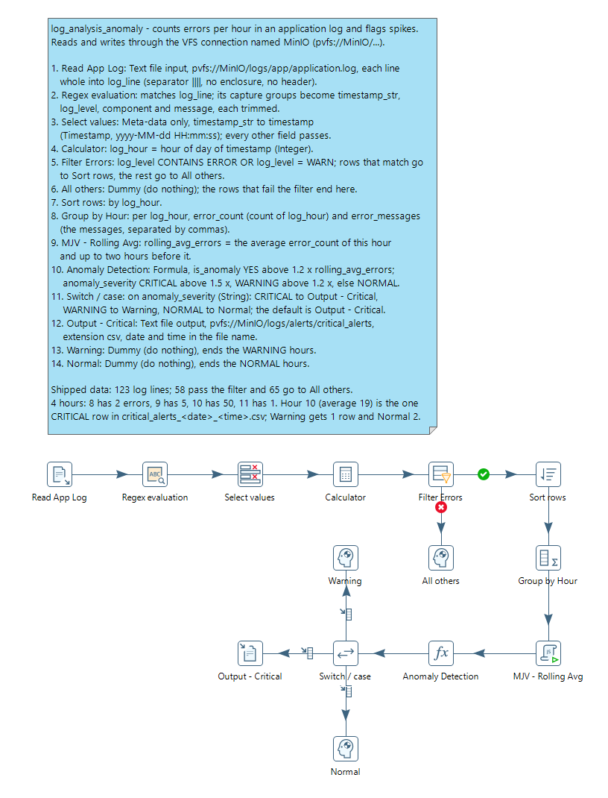
<figcaption>What you build</figcaption>
</figure>
</div>

> **Note:** **Workshop files**
>
> Input: `pvfs://MinIO/logs/app/application.log` (123 lines over four hours). Output: `pvfs://MinIO/logs/alerts/critical_alerts_<date>_<time>.csv`.

::: tabs

### 1. Read the Log

> **Note:**
>
> #### One line, one field
>
> **Text file input** with a separator that never occurs in the data reads each log line whole, into one String field.

1. Select **File > New > Transformation** (`Ctrl+N`).
2. Select **File > Save as** and save it as `log_analysis_anomaly.ktr` in `C:\Workshop-DI-Practitioner\03-data-sources\03-storage\19-mod3-minio`.
3. On the **Design** tab, open the **Input** folder and drag **Text file input** onto the canvas.
4. Double-click **Text file input** and set **Step name** to `Read App Log`.
5. On the **File** tab, enter `pvfs://MinIO/logs/app/application.log` in **File or directory** and select **Add**.
6. On the **Content** tab, set **Separator** to `||||`, delete the `"` from **Enclosure**, clear **Header**, and set **Format** to `mixed`.
7. On the **Fields** tab, fill the grid with one row: **Name** `log_line`, **Type** `String`.
8. Select **Preview rows**, enter `100` rows, and select **OK**.

> **Success:** Checkpoint: 100 rows, one whole log line each. The first is `2024-01-23 08:00:01 INFO  [main] Application started successfully`.

9. Select **Close**, then **OK**.

### 2. Parse Each Line

> **Note:**
>
> #### Regex evaluation
>
> **Regex evaluation** matches a field against a regular expression. With **Create fields for capture groups** selected, each group in parentheses becomes a new field.

1. On the **Design** tab, open the **Scripting** folder and drag **Regex evaluation** onto the canvas. Create a hop from **Read App Log** to it, and keep its name, `Regex evaluation`.
2. Double-click **Regex evaluation**. On the **Settings** tab, set **Field to evaluate** to `log_line`, keep **Result field name** `result`, and select **Create fields for capture groups**.
3. In **Regular expression**, enter:

   ```text
   ^(\d{4}-\d{2}-\d{2} \d{2}:\d{2}:\d{2})\s+(\w+)\s+\[([^\]]+)\]\s+(.*)$
   ```

4. Fill the **Capture Group Fields** grid, one row per group, in this order:

| New field       | Type   | Trim |
| --------------- | ------ | ---- |
| `timestamp_str` | String | both |
| `log_level`     | String | both |
| `component`     | String | both |
| `message`       | String | both |

5. Select **OK**.

The four groups, read against the first line:

| Group | Matches                                     | Field           | First line              |
| ----- | ------------------------------------------- | --------------- | ----------------------- |
| 1     | a date and a time, `yyyy-MM-dd HH:mm:ss`    | `timestamp_str` | `2024-01-23 08:00:01`   |
| 2     | one word                                    | `log_level`     | `INFO`                  |
| 3     | the text inside the square brackets         | `component`     | `main`                  |
| 4     | the rest of the line                        | `message`       | `Application started successfully` |

6. On the **Design** tab, open the **Transform** folder and drag **Select values** onto the canvas. Create a hop from **Regex evaluation** to it, and keep its name, `Select values`.
7. Double-click **Select values**. Leave the **Select & Alter** tab empty, so every field passes. On the **Meta-data** tab, fill the grid with one row:

| Fieldname       | Rename to   | Type      | Format                |
| --------------- | ----------- | --------- | --------------------- |
| `timestamp_str` | `timestamp` | Timestamp | `yyyy-MM-dd HH:mm:ss` |

8. Select **OK**.
9. On the **Design** tab, open the **Transform** folder and drag **Calculator** onto the canvas. Create a hop from **Select values** to it.
10. Double-click **Calculator** and fill the **Fields** grid with one row: **New field** `log_hour`, **Calculation** `Hour of Day of Date A`, **Field A** `timestamp`, **Value type** Integer. Select **OK**.
11. Save the transformation (`Ctrl+S`).
12. Select **Calculator** on the canvas, press `F10` (**Action > Preview**), and select **Quick Launch**.

> **Success:** Checkpoint: 123 rows. The first has `log_level` `INFO`, `component` `main`, `message` `Application started successfully` and `log_hour` `8`.

13. Select **Close**.

### 3. Keep Errors and Warnings

> **Note:**
>
> #### Filter rows
>
> **Filter rows** sends each row to one of two steps, by a condition. Here `ERROR` and `WARN` lines go on; the `INFO` lines go to a **Dummy (do nothing)** step, which discards them.

1. On the **Design** tab, open the **Flow** folder and drag **Filter rows** onto the canvas. Create a hop from **Calculator** to it.
2. From the **Flow** folder, drag **Dummy (do nothing)** onto the canvas. Double-click it, set **Step name** to `All others`, and select **OK**.
3. On the **Design** tab, open the **Transform** folder and drag **Sort rows** onto the canvas.
4. Create a hop from **Filter rows** to **Sort rows** and select **Result is TRUE**. Create a hop from **Filter rows** to **All others** and select **Result is FALSE**.
5. Double-click **Filter rows** and set **Step name** to `Filter Errors`. **Send 'true' data to step** reads `Sort rows`, and **Send 'false' data to step** reads `All others`.
6. In **The condition**, select `<field>` on the left and select `log_level`. Select the function (`=`) and select `CONTAINS`. Select `<value>`, set **Value** to `ERROR`, and select **OK**.
7. Select **Add condition** (the `+` icon), set the second condition to `log_level` `=` `WARN`, and set its operator to `OR`. The condition reads:

   ```text
   log_level CONTAINS ERROR
   OR log_level = WARN
   ```

8. Select **OK**.
9. Double-click **Sort rows**, keep its name, and fill the **Fields** grid with one row: **Fieldname** `log_hour`, **Ascending** `Y`, **Case sensitive compare?** `N`. Select **OK**.

### 4. Count per Hour

> **Note:**
>
> #### Group by
>
> **Group by** aggregates rows that arrive sorted on the group field: one output row per hour.

1. On the **Design** tab, open the **Statistics** folder and drag **Group by** onto the canvas. Create a hop from **Sort rows** to it.
2. Double-click **Group by** and set **Step name** to `Group by Hour`. Enter `log_hour` in **The fields that make up the group**.
3. Fill the **Aggregates** grid:

| Name             | Subject    | Type                               |
| ---------------- | ---------- | ---------------------------------- |
| `error_count`    | `log_hour` | Number of Values (N)               |
| `error_messages` | `message`  | Concatenate strings separated by , |

4. Select **OK** and save the transformation (`Ctrl+S`).
5. Select **Group by Hour** on the canvas, press `F10` (**Action > Preview**), and select **Quick Launch**.

> **Success:** Checkpoint: 4 rows, one per hour: `log_hour` `8` with `error_count` `2`, `9` with `5`, `10` with `50` and `11` with `1`. 58 of the 123 lines passed the filter. `error_messages` holds each hour's messages, separated by commas.

6. Select **Close**.

### 5. Compare with the Rolling Average

> **Note:**
>
> #### A rolling average
>
> Each hour is compared with the average of itself and the two hours before it. A script keeps the previous counts from one row to the next.

1. On the **Design** tab, open the **Scripting** folder and drag **Modified JavaScript value** onto the canvas. Create a hop from **Group by Hour** to it.
2. Double-click **Modified JavaScript value** and set **Step name** to `MJV - Rolling Avg`. Replace the text on the **Script 1** tab with this script:

```javascript
// Calculate 3-hour rolling average using global variables
var rowNum = getProcessCount('r');

if (typeof prev_error_1 == 'undefined') {
    prev_error_1 = 0;
    prev_error_2 = 0;
}

if (rowNum == 1) {
    // First row: no history, use current value
    rolling_avg_errors = error_count;
    prev_error_1 = error_count;
    prev_error_2 = 0;
} else if (rowNum == 2) {
    // Second row: average of 2 values
    rolling_avg_errors = (prev_error_1 + error_count) / 2.0;
    prev_error_2 = prev_error_1;
    prev_error_1 = error_count;
} else {
    // Third row onwards: average of current + 2 previous
    rolling_avg_errors = (prev_error_2 + prev_error_1 + error_count) / 3.0;
    prev_error_2 = prev_error_1;
    prev_error_1 = error_count;
}
```

3. Fill the **Fields** grid with one row: **Fieldname** `rolling_avg_errors`, **Type** `Number`. Select **OK**.
4. On the **Design** tab, open the **Scripting** folder and drag **Formula** onto the canvas. Create a hop from **MJV - Rolling Avg** to it.
5. Double-click **Formula** and set **Step name** to `Anomaly Detection`. Fill the **Fields** grid with two rows, both with **Value type** String:

| New field          | Formula                                                                                                                          |
| ------------------ | -------------------------------------------------------------------------------------------------------------------------------- |
| `is_anomaly`       | `IF([error_count] > ([rolling_avg_errors] * 1.2); "YES"; "NO")`                                                                   |
| `anomaly_severity` | `IF([error_count] > ([rolling_avg_errors] * 1.5); "CRITICAL"; IF([error_count] > ([rolling_avg_errors] * 1.2); "WARNING"; "NORMAL"))` |

6. Select **OK** and save the transformation (`Ctrl+S`).
7. Select **Anomaly Detection** on the canvas, press `F10` (**Action > Preview**), and select **Quick Launch**.

> **Success:** Checkpoint: 4 rows:
>
> | `log_hour` | `error_count` | `rolling_avg_errors` | `is_anomaly` | `anomaly_severity` |
> | ---------- | ------------- | -------------------- | ------------ | ------------------ |
> | 8          | 2             | 2                    | NO           | NORMAL             |
> | 9          | 5             | 3.5                  | YES          | WARNING            |
> | 10         | 50            | 19                   | YES          | CRITICAL           |
> | 11         | 1             | 18.67 (to 2 places)  | NO           | NORMAL             |

8. Select **Close**.

> **Under the hood:**
>
> #### A rolling average needs memory between rows
>
> Every other step here treats each row on its own. A rolling average
> cannot: it needs the last two hours' counts. The JavaScript step keeps
> them in script variables that survive from one row to the next, which
> is why the rows must arrive in hour order, and why the Sort rows comes
> first.
>
> **Why it matters:** "compared with recent history" is the core of
> most anomaly checks, and the order of the rows is part of the logic.

### 6. Route and Write the Alerts

> **Note:**
>
> #### Switch / case
>
> Each hour goes to one step by its `anomaly_severity`: critical hours to a file in MinIO, the others to two **Dummy (do nothing)** steps.

1. On the **Design** tab, open the **Output** folder and drag **Text file output** onto the canvas. Double-click it, set **Step name** to `Output - Critical`, and select **OK**.
2. On the **Design** tab, open the **Flow** folder and drag **Dummy (do nothing)** onto the canvas twice. Double-click each in turn, set **Step name** to `Warning` and `Normal`, and select **OK**.
3. From the **Flow** folder, drag **Switch / case** onto the canvas. Create a hop from **Anomaly Detection** to it, and keep its name, `Switch / case`.
4. Create a hop from **Switch / case** to **Output - Critical**, to **Warning** and to **Normal**. In the menu Spoon shows for each hop, select **Create a new target case for this step**.
5. Double-click **Switch / case** and set:
   * **Field name to switch**: `anomaly_severity`
   * **Case value data type**: `String`
   * **Default target step**: `Output - Critical`
6. Fill the **Case values** grid:

| Value      | Target step         |
| ---------- | ------------------- |
| `CRITICAL` | `Output - Critical` |
| `WARNING`  | `Warning`           |
| `NORMAL`   | `Normal`            |

7. Select **OK**.
8. Double-click **Output - Critical**. On the **File** tab, set **Filename** to `pvfs://MinIO/logs/alerts/critical_alerts` and **Extension** to `csv`, and select **Include date in filename?** and **Include time in filename?**.
9. On the **Content** tab, set **Separator** to `,` and **Encoding** to `UTF-8`, and keep **Header** selected.
10. On the **Fields** tab, select **Get Fields**, then **Minimal width**. Select **OK**.
11. Save the transformation (`Ctrl+S`).
12. Press `F9` (**Action > Run**), and select **Run** in the **Run Options** dialog.
13. In **Execution Results**, open the **Step Metrics** tab.

> **Success:** Checkpoint: **Filter Errors** reads 123 rows, and **All others** reads 65 and **Sort rows** 58 of them. **Group by Hour** writes 4 rows. **Output - Critical** and **Warning** read 1 row each, and **Normal** 2.

14. In the MinIO console, open **logs** > `alerts/`.

> **Success:** Checkpoint: `critical_alerts_<date>_<time>.csv` holds a header and one row: `log_hour` `10`, `error_count` `50`, that hour's messages, `rolling_avg_errors` 19, `YES` and `CRITICAL`. Each run adds a new file, because the date and time are in the name.

:::

***

> **Note:** **Workshop files**
>
> Download the files for this workshop. For `.ktr` files, **Open in Pentaho Data Integration** launches PDI with the transformation loaded; if PDI is already running, the path is copied to your clipboard (press `Ctrl+O`, `Ctrl+V`, `Enter`).

[log_analysis_anomaly.ktr](./files/log_analysis_anomaly.ktr) <button data-launch="spoon" data-path="files/log_analysis_anomaly.ktr">Open in Pentaho Data Integration</button> <button data-graph="files/log_analysis_anomaly.ktr">View graph</button>

### Fraud

> **Warning:**
>
> #### Transactions & Fraud Detection
>
> Score 63 card transactions for fraud risk. Each transaction gets its account and merchant details, a few metrics and six 0/1 flags; the flags add up to a score, and the score sets a risk category.
>
> **Scenario:** a payment processor reviews transactions for fraud before it authorizes them. It flags a high amount, a credit account pushed below zero, a high-risk merchant, a declined attempt, a new account and a high share of the credit limit.
>
> **Skills:** **Stream lookup**, **Merge join** (left outer), **Formula**, rule-based scoring

<div align="center">
<figure>
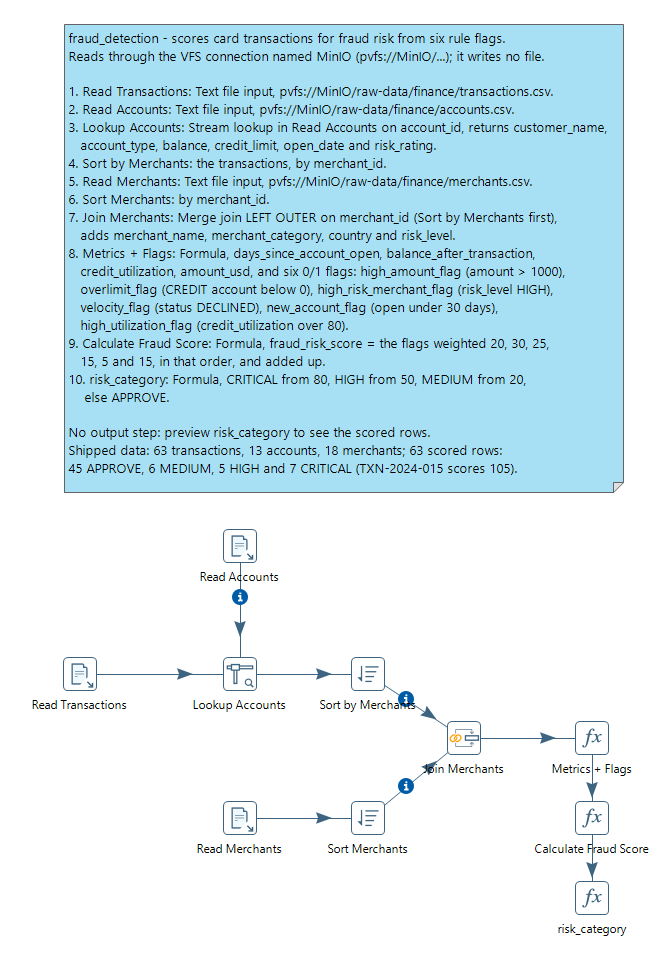
<figcaption>What you build</figcaption>
</figure>
</div>

> **Note:** **Workshop files**
>
> Inputs (already in MinIO, and also under **Workshop files** below):
>
> * `pvfs://MinIO/raw-data/finance/transactions.csv` (63 transactions)
> * `pvfs://MinIO/raw-data/finance/accounts.csv` (13 accounts)
> * `pvfs://MinIO/raw-data/finance/merchants.csv` (18 merchants)

::: tabs

### 1. Read the Finance Files

> **Note:**
>
> #### Three Text file inputs
>
> The transactions, and the two reference files that enrich them.

1. Select **File > New > Transformation** (`Ctrl+N`).
2. Select **File > Save as** and save it as `fraud_detection.ktr` in `C:\Workshop-DI-Practitioner\03-data-sources\03-storage\19-mod3-minio`.
3. On the **Design** tab, open the **Input** folder and drag **Text file input** onto the canvas three times.
4. Double-click each **Text file input** in turn and set **Step name** to `Read Transactions`, `Read Accounts` and `Read Merchants`.
5. In each, on the **File** tab, enter the file in **File or directory** and select **Add**:

| Step                | File                                              |
| ------------------- | ------------------------------------------------- |
| `Read Transactions` | `pvfs://MinIO/raw-data/finance/transactions.csv`  |
| `Read Accounts`     | `pvfs://MinIO/raw-data/finance/accounts.csv`      |
| `Read Merchants`    | `pvfs://MinIO/raw-data/finance/merchants.csv`     |

6. On each **Content** tab, set **Separator** to `,` and **Format** to `mixed`, and keep **Header** selected.
7. On each **Fields** tab, select **Get Fields**, select **OK** at **Number of sample lines**, and close the **Scan results**. Check the types:

| Step                | Types to check                                                                                                         |
| ------------------- | ---------------------------------------------------------------------------------------------------------------------- |
| `Read Transactions` | `amount` BigNumber (`#.##`); `transaction_date` Date (`yyyy-MM-dd HH:mm:ss`); `transaction_id`, `account_id`, `merchant_id`, `currency`, `status` String |
| `Read Accounts`     | `balance`, `credit_limit` BigNumber (`#.##`); `open_date` Date (`yyyy-MM-dd`); `account_id`, `customer_name`, `account_type`, `risk_rating` String |
| `Read Merchants`    | all five String: `merchant_id`, `merchant_name`, `merchant_category`, `country`, `risk_level`                          |

8. In each, select **Preview rows**, enter `100` rows, and select **OK**.

> **Success:** Checkpoint: 63 transactions (`TXN-2024-001` to `TXN-2024-063`), 13 accounts (`ACC-1001` to `ACC-1013`) and 18 merchants (`MER-5001` to `MER-5018`).

9. Select **Close**, then **OK**.

### 2. Add the Account Details

> **Note:**
>
> #### Stream lookup
>
> The 13 accounts are few enough to hold in memory: **Stream lookup** reads them once and answers each transaction from there.

1. On the **Design** tab, open the **Lookup** folder and drag **Stream lookup** onto the canvas.
2. Create a hop from **Read Transactions** to **Stream lookup**, and one from **Read Accounts** to **Stream lookup**.
3. Double-click **Stream lookup**, set **Step name** to `Lookup Accounts` and **Lookup step** to `Read Accounts`.
4. In **The key(s) to look up the value(s)**, set **Field** to `account_id` and **LookupField** to `account_id`.
5. Fill **Specify the fields to retrieve** with six rows: `customer_name`, `account_type`, `balance`, `credit_limit`, `open_date` and `risk_rating`. Or select **Get lookup fields** and delete the `account_id` row.
6. Select **OK**.

### 3. Add the Merchant Details

> **Note:**
>
> #### Merge join, left outer
>
> The merchants are joined with **Merge join**, which needs both streams sorted on `merchant_id`. A left outer join keeps every transaction, even one whose merchant is unknown.

1. On the **Design** tab, open the **Transform** folder and drag **Sort rows** onto the canvas twice. Create a hop from **Lookup Accounts** to the first, and from **Read Merchants** to the second.
2. Double-click each **Sort rows** in turn. Set **Step name** to `Sort by Merchants` (after **Lookup Accounts**) and `Sort Merchants` (after **Read Merchants**), and in each fill the **Fields** grid with one row: **Fieldname** `merchant_id`, **Ascending** `Y`, **Case sensitive compare?** `N`. Select **OK**.
3. On the **Design** tab, open the **Joins** folder and drag **Merge join** onto the canvas. Create a hop from **Sort by Merchants** to it, and one from **Sort Merchants** to it.
4. Double-click **Merge join** and set:
   * **Step name**: `Join Merchants`
   * **First Step**: `Sort by Merchants`
   * **Second Step**: `Sort Merchants`
   * **Join Type**: `LEFT OUTER`
5. Enter `merchant_id` in **Keys for 1st step** and in **Keys for 2nd step**. Select **OK**.
6. Save the transformation (`Ctrl+S`).
7. Select **Join Merchants** on the canvas, press `F10` (**Action > Preview**), and select **Quick Launch**.

> **Success:** Checkpoint: 63 rows, in `merchant_id` order. Every account and every merchant is found, so each row has its `customer_name`, `balance`, `merchant_name` and `risk_level` filled.

8. Select **Close**.

### 4. Calculate Metrics and Flags

> **Note:**
>
> #### Formula
>
> One **Formula** step adds three metrics, an amount in US dollars and six 0/1 flags. A formula can use a field that a row above it in the same grid calculates.

1. On the **Design** tab, open the **Scripting** folder and drag **Formula** onto the canvas. Create a hop from **Join Merchants** to it.
2. Double-click **Formula** and set **Step name** to `Metrics + Flags`. Fill the **Fields** grid, in this order:

| New field                   | Formula                                                                 | Value type | Length | Precision |
| --------------------------- | ----------------------------------------------------------------------- | ---------- | ------ | --------- |
| `days_since_account_open`   | `ABS(DAYS([transaction_date]; [open_date]))`                            | Integer    |        |           |
| `balance_after_transaction` | `[balance] - [amount]`                                                  | Number     |        |           |
| `credit_utilization`        | `IF([credit_limit] > 0; ([amount] / [credit_limit]) * 100; 0)`          | Integer    |        |           |
| `amount_usd`                | `IF([currency]="USD"; [amount]; IF([currency]="EUR"; [amount]*1.08; IF([currency]="GBP"; [amount]*1.27; [amount])))` | Number | 15 | 2 |
| `high_amount_flag`          | `IF([amount] > 1000; 1; 0)`                                             | Integer    |        |           |
| `overlimit_flag`            | `IF(AND([account_type]="CREDIT"; [balance_after_transaction] < 0); 1; 0)` | Integer  |        |           |
| `high_risk_merchant_flag`   | `IF([risk_level]="HIGH"; 1; 0)`                                         | Integer    |        |           |
| `velocity_flag`             | `IF([status]="DECLINED"; 1; 0)`                                         | Integer    |        |           |
| `new_account_flag`          | `IF([days_since_account_open] < 30; 1; 0)`                              | Integer    |        |           |
| `high_utilization_flag`     | `IF([credit_utilization] > 80; 1; 0)`                                   | Integer    |        |           |

3. Select **OK**.

### 5. Score and Categorize

> **Note:**
>
> #### A weighted score
>
> Each flag carries a weight; the sum is the score, and the score sets the category.

1. On the **Design** tab, open the **Scripting** folder and drag **Formula** onto the canvas. Create a hop from **Metrics + Flags** to it.
2. Double-click **Formula** and set **Step name** to `Calculate Fraud Score`. Fill the **Fields** grid with one row: **New field** `fraud_risk_score`, **Value type** Integer, and this **Formula**:

   ```text
   ([high_amount_flag] * 20) + ([overlimit_flag] * 30) + ([high_risk_merchant_flag] * 25) + ([velocity_flag] * 15) + ([new_account_flag] * 5) + ([high_utilization_flag] * 15)
   ```

3. Select **OK**.
4. Drag another **Formula** onto the canvas. Create a hop from **Calculate Fraud Score** to it.
5. Double-click it and set **Step name** to `risk_category`. Fill the **Fields** grid with one row: **New field** `risk_category`, **Value type** String, and this **Formula**:

   ```text
   IF([fraud_risk_score] >= 80; "CRITICAL"; IF([fraud_risk_score] >= 50; "HIGH"; IF([fraud_risk_score] >= 20; "MEDIUM"; "APPROVE")))
   ```

6. Select **OK** and save the transformation (`Ctrl+S`).
7. Select **risk_category** on the canvas, press `F10` (**Action > Preview**), and select **Quick Launch**.

> **Success:** Checkpoint: 63 rows: 45 `APPROVE`, 6 `MEDIUM`, 5 `HIGH` and 7 `CRITICAL`. `TXN-2024-002` (1250.00 at Luxury Watches Inc, on account `ACC-1002`, which holds 150.00) has `high_amount_flag`, `overlimit_flag` and `high_risk_merchant_flag` at 1: score `75`, `HIGH`. `TXN-2024-015`, a declined 3500.00 on the same account, scores `105`: `CRITICAL`.

8. Select **Close**.

> **Under the hood:**
>
> #### Stream lookup for the small side, merge join for the sorted one
>
> The accounts are small, so **Stream lookup** reads all 13 into memory
> once and answers each transaction from there, with no sorting. The
> merchants go through **Merge join**, which needs both inputs sorted
> but never holds a whole side in memory. Two ways of enriching a
> stream, chosen by size.
>
> **Why it matters:** the score is plain arithmetic over flags, so every
> rating can be explained: a CRITICAL is a sum of named reasons.

:::

***

> **Note:** **Workshop files**
>
> Download the files for this workshop. For `.ktr` files, **Open in Pentaho Data Integration** launches PDI with the transformation loaded; if PDI is already running, the path is copied to your clipboard (press `Ctrl+O`, `Ctrl+V`, `Enter`).

[fraud_detection.ktr](./files/fraud_detection.ktr) <button data-launch="spoon" data-path="files/fraud_detection.ktr">Open in Pentaho Data Integration</button> <button data-graph="files/fraud_detection.ktr">View graph</button>

[data/accounts.csv](./files/data/accounts.csv)

[data/merchants.csv](./files/data/merchants.csv)

[data/transactions.csv](./files/data/transactions.csv)

### Data Lake Ingestion

> **Warning:**
>
> #### Data Lake Ingestion
>
> A data lake often receives the same entities from several sources in different formats. Here the products arrive three ways, as CSV, JSON and XML, and you bring them into one schema: same field names, same order, same types, with each row's source recorded.
>
> **Skills:** three input formats, schema mapping, **Select values** for layout, combining streams

<div align="center">
<figure>
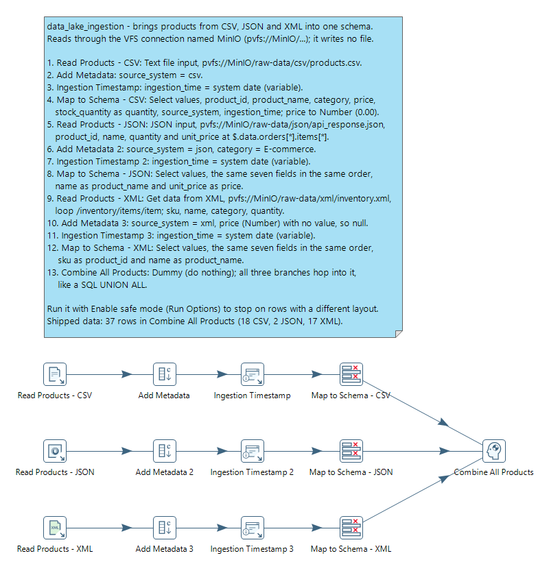
<figcaption>What you build (the solution ends at Combine All Products)</figcaption>
</figure>
</div>

> **Note:** **Workshop files**
>
> These files are already in MinIO:
>
> * `pvfs://MinIO/raw-data/csv/products.csv` (18 products)
> * `pvfs://MinIO/raw-data/json/api_response.json` (2 orders, one item each)
> * `pvfs://MinIO/raw-data/xml/inventory.xml` (17 items)

:::: tabs

### 1. Design the Schema

> **Note:**
>
> #### Inspect first, then decide
>
> You can't normalize what you haven't inspected. Look at a real record from each source, map the fields, and write the decisions down before you build anything.

::: tabs

### CSV (products.csv)

Open `csv/products.csv` in the MinIO console (**raw-data** bucket, then **Preview** or **Download**):

```csv
product_id,product_name,category,price,stock_quantity,supplier,last_updated
P001,Laptop Pro 15,Electronics,1299.99,45,TechSupply Inc,2024-01-15
P002,Wireless Mouse,Electronics,29.99,230,TechSupply Inc,2024-01-16
```

* All five product fields are there, as `product_id`, `product_name`, `category`, `price` and `stock_quantity`, plus `supplier` and `last_updated`.
* 18 products, `P001` to `P018`.

### JSON (api_response.json)

Open `json/api_response.json`. Each order has an `items` array; one item:

```json
{
  "product_id": "P001",
  "name": "Laptop Pro 15",
  "quantity": 1,
  "unit_price": 1299.99
}
```

* The product name is `name`, and the price is `unit_price`.
* `quantity` is the quantity *ordered*, not stock.
* There is no `category`.
* The items sit at `$.data.orders[*].items[*]`: 2 orders, one item each.

### XML (inventory.xml)

Open `xml/inventory.xml`. Items sit under `/inventory/items/item`:

```xml
<item>
    <sku>P001</sku>
    <name>Laptop Pro 15</name>
    <category>Electronics</category>
    <quantity>45</quantity>
    <location>A-12-3</location>
    <last_checked>2024-01-20</last_checked>
</item>
```

* The product id is `sku`, and the name is `name`.
* `quantity` is the warehouse stock.
* There is no price.
* 17 items.

:::

**The field mapping**

| Target field     | Type      | CSV              | JSON                     | XML        |
| ---------------- | --------- | ---------------- | ------------------------ | ---------- |
| `product_id`     | String    | `product_id`     | `product_id`             | `sku`      |
| `product_name`   | String    | `product_name`   | `name`                   | `name`     |
| `category`       | String    | `category`       | none: `E-commerce`       | `category` |
| `price`          | Number    | `price`          | `unit_price`             | none: null |
| `quantity`       | Integer   | `stock_quantity` | `quantity` (ordered)     | `quantity` |
| `source_system`  | String    | `csv`            | `json`                   | `xml`      |
| `ingestion_time` | Date      | system date      | system date              | system date |

**The decisions**

* Names follow the CSV, the product master.
* A field a source lacks gets a stated default (`category` = `E-commerce` for JSON) or stays null (`price` for XML).
* `source_system` and `ingestion_time` record where each row came from and when.
* The same product can arrive from all three sources. `P001` comes from the CSV (price 1299.99, stock 45, Electronics), the JSON (price 1299.99, quantity 1, E-commerce) and the XML (no price, stock 45, Electronics). This workshop keeps all three rows; a later step could keep one per product, preferring the CSV, then the JSON, then the XML.

### 2. Ingest the Sources

> **Note:**
>
> #### One branch per source, one layout at the end
>
> Each branch reads its source, adds the fields the source lacks, stamps the time, and ends in a **Select values** that lists the seven target fields in the same order. The branches only differ in where each field comes from.

1. Select **File > New > Transformation** (`Ctrl+N`).
2. Select **File > Save as** and save it as `data_lake_ingestion.ktr` in `C:\Workshop-DI-Practitioner\03-data-sources\03-storage\19-mod3-minio`.

**CSV branch**

3. On the **Design** tab, open the **Input** folder and drag **Text file input** onto the canvas. Double-click it and set **Step name** to `Read Products - CSV`.
4. On the **File** tab, enter `pvfs://MinIO/raw-data/csv/products.csv` in **File or directory** and select **Add**. On the **Content** tab, set **Separator** to `,` and **Format** to `mixed`, and keep **Header** selected.
5. On the **Fields** tab, select **Get Fields**, select **OK** at **Number of sample lines**, and close the **Scan results**. Check that `price` is BigNumber and `stock_quantity` Integer. Select **OK**.
6. On the **Design** tab, open the **Transform** folder and drag **Add constants** onto the canvas. Create a hop from **Read Products - CSV** to it. Double-click it, set **Step name** to `Add Metadata`, and fill the **Fields** grid with one row: **Name** `source_system`, **Type** String, **Value** `csv`. Select **OK**.
7. On the **Design** tab, open the **Input** folder and drag **Get system info** onto the canvas. Create a hop from **Add Metadata** to it. Double-click it, set **Step name** to `Ingestion Timestamp`, and fill the **Fields** grid with one row: **Name** `ingestion_time`, **Type** `system date (variable)`. Select **OK**.
8. On the **Design** tab, open the **Transform** folder and drag **Select values** onto the canvas. Create a hop from **Ingestion Timestamp** to it, double-click it and set **Step name** to `Map to Schema - CSV`.
9. On the **Select & Alter** tab, list `product_id`, `product_name`, `category`, `price`, `stock_quantity` (with **Rename to** `quantity`), `source_system` and `ingestion_time`, in that order.
10. On the **Meta-data** tab, fill the grid with one row: **Fieldname** `price`, **Type** Number, **Length** `15`, **Precision** `2`, **Format** `0.00`. Select **OK**.

**JSON branch**

11. On the **Design** tab, open the **Input** folder and drag **JSON input** onto the canvas. Double-click it and set **Step name** to `Read Products - JSON`. On the **File** tab, enter `pvfs://MinIO/raw-data/json/api_response.json` in **File or directory** and select **Add**.
12. On the **Fields** tab, fill the grid, and select **OK**:

| Name         | Path                                   | Type    | Length | Precision |
| ------------ | -------------------------------------- | ------- | ------ | --------- |
| `product_id` | `$.data.orders[*].items[*].product_id` | String  | 50     |           |
| `name`       | `$.data.orders[*].items[*].name`       | String  | 200    |           |
| `quantity`   | `$.data.orders[*].items[*].quantity`   | Integer | 10     |           |
| `unit_price` | `$.data.orders[*].items[*].unit_price` | Number  | 15     | 2         |

13. From the **Transform** folder, drag **Add constants** onto the canvas. Create a hop from **Read Products - JSON** to it. Double-click it, set **Step name** to `Add Metadata 2`, and fill the **Fields** grid with two rows: `source_system`, String, `json`; and `category`, String, `E-commerce`. Select **OK**.
14. From the **Input** folder, drag **Get system info** onto the canvas. Create a hop from **Add Metadata 2** to it. Double-click it, set **Step name** to `Ingestion Timestamp 2`, and fill the **Fields** grid with one row: **Name** `ingestion_time`, **Type** `system date (variable)`. Select **OK**.
15. From the **Transform** folder, drag **Select values** onto the canvas. Create a hop from **Ingestion Timestamp 2** to it, double-click it and set **Step name** to `Map to Schema - JSON`. On the **Select & Alter** tab, list `product_id`, `name` (renamed `product_name`), `category`, `unit_price` (renamed `price`), `quantity`, `source_system` and `ingestion_time`. Select **OK**.

**XML branch**

16. On the **Design** tab, open the **Input** folder and drag **Get data from XML** onto the canvas. Double-click it and set **Step name** to `Read Products - XML`. On the **File** tab, enter `pvfs://MinIO/raw-data/xml/inventory.xml` in **File or directory** and select **Add**.
17. On the **Content** tab, set **Loop XPath** to `/inventory/items/item` and **Encoding** to `UTF-8`.
18. On the **Fields** tab, fill the grid (each **XPath** is the field's own name), and select **OK**:

| Name       | XPath      | Type    | Format | Length |
| ---------- | ---------- | ------- | ------ | ------ |
| `sku`      | `sku`      | String  |        | 50     |
| `name`     | `name`     | String  |        | 200    |
| `category` | `category` | String  |        | 100    |
| `quantity` | `quantity` | Integer | `#`    | 10     |

19. From the **Transform** folder, drag **Add constants** onto the canvas. Create a hop from **Read Products - XML** to it. Double-click it, set **Step name** to `Add Metadata 3`, and fill the **Fields** grid with two rows: `source_system`, String, `xml`; and `price`, Number, **Format** `0.00`, with no value (null). Select **OK**.
20. From the **Input** folder, drag **Get system info** onto the canvas. Create a hop from **Add Metadata 3** to it. Double-click it, set **Step name** to `Ingestion Timestamp 3`, and fill the **Fields** grid with one row: **Name** `ingestion_time`, **Type** `system date (variable)`. Select **OK**.
21. From the **Transform** folder, drag **Select values** onto the canvas. Create a hop from **Ingestion Timestamp 3** to it, double-click it and set **Step name** to `Map to Schema - XML`. On the **Select & Alter** tab, list `sku` (renamed `product_id`), `name` (renamed `product_name`), `category`, `price`, `quantity`, `source_system` and `ingestion_time`. Select **OK**.
22. Save the transformation (`Ctrl+S`).
23. Select each **Map to Schema** step on the canvas in turn, press `F10` (**Action > Preview**), and select **Quick Launch**.

> **Success:** Checkpoint: the CSV gives 18 rows, the JSON 2 and the XML 17, each with the same seven columns in the same order.

24. Select **Close**.

### 3. Combine

> **Note:**
>
> #### Three hops into one step
>
> **Append streams** takes only two inputs, a head and a tail. To stack three, hop them all into one step: PDI passes on every row that arrives on any of its input hops, like a SQL `UNION ALL`.

1. On the **Design** tab, open the **Flow** folder and drag **Dummy (do nothing)** onto the canvas. Double-click it, set **Step name** to `Combine All Products`, and select **OK**.
2. Create a hop from each **Map to Schema** step to **Combine All Products**.
3. Save the transformation (`Ctrl+S`).
4. Press `F9` (**Action > Run**). In the **Run Options** dialog, select **Enable safe mode**, then select **Run**.

> **Under the hood:**
>
> #### A step expects every row to have the same layout
>
> A step reads each incoming row by position, using the layout of the
> first row it received. Rows with a different order or different
> types still flow, but their values are read as the wrong fields:
> without the final **Select values**, a JSON row's `quantity` sits
> where the CSV rows have `category`. Nothing fails; the data is
> wrong.
>
> **Enable safe mode** makes PDI compare every row with the first and
> stop at the first difference, with a message such as "you're mixing
> rows with different layout. Field [category String] does not have
> the same name as field [quantity Integer]".
>
> **Why it matters:** whenever streams meet, give them one layout first,
> and use safe mode while you build.

5. Select **Combine All Products** on the canvas and open the **Preview data** tab.

```text
product_id  product_name    category     price    quantity  source_system
P001        Laptop Pro 15   Electronics  1299.99  45        csv
...
P001        Laptop Pro 15   E-commerce   1299.99  1         json   <- the same product again
...
P001        Laptop Pro 15   Electronics           45        xml    <- again, and no price
```

> **Success:** Checkpoint: 37 rows (18 CSV, 2 JSON, 17 XML), no errors in safe mode, and every value in its own column.

### 4. Validate (Extension)

> **Note:**
>
> #### Data validation
>
> An extension beyond the solution, which stops at **Combine All Products**: check the unified rows before you publish them, write the good rows to the curated layer, and route the failures to an error file.

1. On the **Design** tab, open the **Validation** folder and drag **Data validator** onto the canvas. Create a hop from **Combine All Products** to it.
2. Double-click **Data validator** and set **Stepname** to `Validate Product Data`.
3. Select **New validation**, enter `product_id required`, and select **OK**. Set **Name of field to validate** to `product_id`, and clear **Null allowed?**.
4. Select **New validation**, enter `product_name required`, and select **OK**. Set **Name of field to validate** to `product_name`, and clear **Null allowed?**.
5. Select **New validation**, enter `price not negative`, and select **OK**. Set **Name of field to validate** to `price`, keep **Null allowed?** selected (the XML feed has no price), set **Data type** to `Number` and **Minimum value** to `0`.
6. Select **OK**.
7. On the **Design** tab, open the **Output** folder and drag **Text file output** onto the canvas twice. Double-click each in turn, set **Step name** to `Write Valid Products` and `Write Error Records`, and select **OK**.
8. Create a hop from **Validate Product Data** to **Write Valid Products** and select **Main output of step**.
9. Create a hop from **Validate Product Data** to **Write Error Records** and select **Error handling of step**.
10. Right-click **Validate Product Data** and select **Error Handling...**. In the **Step error handling settings** dialog, set **Error descriptions fieldname** to `validation_errors`, and select **OK**.

> **Note:** **Data validator** routes failing rows through its error hop; there is no "validation result" field on the good rows to filter on.

11. Double-click **Write Valid Products**. On the **File** tab, set **Filename** to `pvfs://MinIO/curated/products/products` and **Extension** to `csv`, and select **Include date in filename?**. On the **Content** tab, set **Separator** to `,`. On the **Fields** tab, select **Get Fields**, then **Minimal width**. Select **OK**.
12. Set up **Write Error Records** the same way, with **Filename** `pvfs://MinIO/curated/products/errors/validation_errors`. Its **Get Fields** adds `validation_errors` after the product fields.
13. Save the transformation (`Ctrl+S`).
14. Press `F9` (**Action > Run**), and select **Run** in the **Run Options** dialog.
15. In **Execution Results**, open the **Step Metrics** tab.

> **Success:** Checkpoint: **Validate Product Data** reads 37 rows, **Write Valid Products** writes 37 and **Write Error Records** writes 0. Every row has a `product_id` and a `product_name`, and every price is 0 or more, or empty.

::::

***

> **Note:** **Workshop files**
>
> Download the files for this workshop. For `.ktr` files, **Open in Pentaho Data Integration** launches PDI with the transformation loaded; if PDI is already running, the path is copied to your clipboard (press `Ctrl+O`, `Ctrl+V`, `Enter`).

[data_lake_ingestion.ktr](./files/data_lake_ingestion.ktr) <button data-launch="spoon" data-path="files/data_lake_ingestion.ktr">Open in Pentaho Data Integration</button> <button data-graph="files/data_lake_ingestion.ktr">View graph</button>

:::::

## Lab Files

Click a file to download. For `.ktr` and `.kjb` files, **Open in Pentaho Data Integration** launches PDI with the file loaded. If PDI is already running, the path is copied to your clipboard — switch to PDI and press `Ctrl+O`, `Ctrl+V`, `Enter`.

The workshops read their data from MinIO. The three finance files that the Fraud workshop reads are also here, in `data/`:

[data/accounts.csv](./files/data/accounts.csv)

[data/merchants.csv](./files/data/merchants.csv)

[data/transactions.csv](./files/data/transactions.csv)

### Solution <!-- no-step -->

One finished transformation per workshop. Open the one for your workshop alongside your own to compare, or run it to see the expected result.

Also on disk at `C:\Workshop-DI-Practitioner\03-data-sources\03-storage\19-mod3-minio\solution`.

[customer_360.ktr](./files/customer_360.ktr) <button data-launch="spoon" data-path="files/customer_360.ktr">Open in Pentaho Data Integration</button> <button data-graph="files/customer_360.ktr">View graph</button>

[data_lake_ingestion.ktr](./files/data_lake_ingestion.ktr) <button data-launch="spoon" data-path="files/data_lake_ingestion.ktr">Open in Pentaho Data Integration</button> <button data-graph="files/data_lake_ingestion.ktr">View graph</button>

[fraud_detection.ktr](./files/fraud_detection.ktr) <button data-launch="spoon" data-path="files/fraud_detection.ktr">Open in Pentaho Data Integration</button> <button data-graph="files/fraud_detection.ktr">View graph</button>

[inventory_reconciliation.ktr](./files/inventory_reconciliation.ktr) <button data-launch="spoon" data-path="files/inventory_reconciliation.ktr">Open in Pentaho Data Integration</button> <button data-graph="files/inventory_reconciliation.ktr">View graph</button>

[log_analysis_anomaly.ktr](./files/log_analysis_anomaly.ktr) <button data-launch="spoon" data-path="files/log_analysis_anomaly.ktr">Open in Pentaho Data Integration</button> <button data-graph="files/log_analysis_anomaly.ktr">View graph</button>

[sales_dashboard_etl.ktr](./files/sales_dashboard_etl.ktr) <button data-launch="spoon" data-path="files/sales_dashboard_etl.ktr">Open in Pentaho Data Integration</button> <button data-graph="files/sales_dashboard_etl.ktr">View graph</button>
