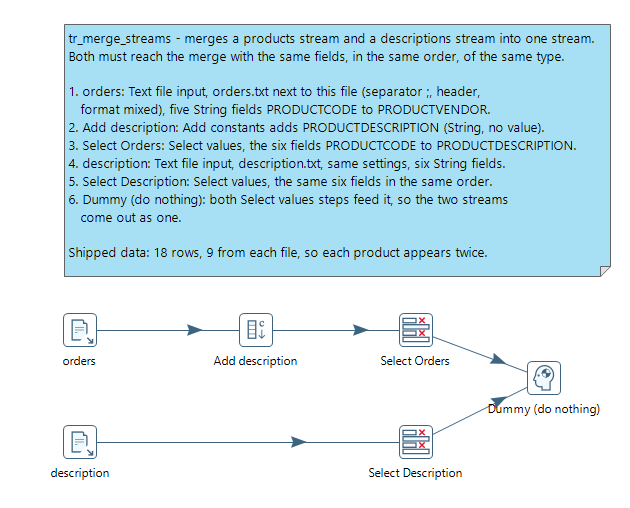
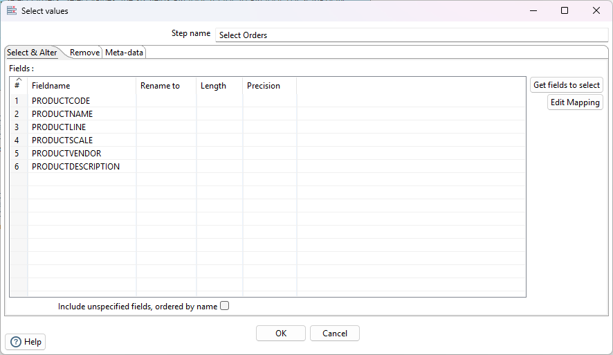
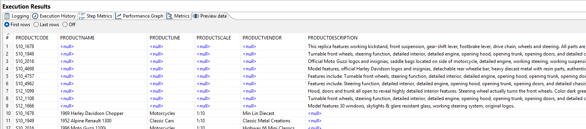

# Merge Streams

> **Warning:**
>
> #### Workshop - Merge Streams
> 
> Two streams can only become one when they share a layout: the same fields, in the same order, with the same types.\
> In this workshop you bring a products stream and a descriptions stream to one layout, then merge them.
> 
> **What you'll do**
> 
> * Read two text files with **Text file input**
> * Add the missing field to one stream with **Add constants**
> * Put both streams in the same field order with **Select values**
> * Merge them into one step and check the result
> 
> **Prerequisites:** [Review Merge](../topic-mod4-merge-review/guide.md), and the steps from the earlier workshops: Text file input, Add constants, Select values.
> 
> **Estimated time:** 25 minutes

<figure>

<figcaption class="pcm-video-caption">Walkthrough: coming soon</figcaption>

</figure>

---

<div align="center">
<figure>

<figcaption>What you build</figcaption>
</figure>
</div>

:::: tabs

### 1. Text file input

> **Note:**
>
> #### Text file input
> 
> Read the two files, each into its own stream. Look at them first: `orders.txt` has five product fields, and `description.txt` has the same five plus `PRODUCTDESCRIPTION`, with only the code and the description filled in.

1. Start Spoon with the **Start Pentaho Data Integration** button below, or from PowerShell:

```powershell
Set-Location C:\Pentaho\design-tools\data-integration
.\spoon.bat
```

<button data-launch="spoon" data-path="">Start Pentaho Data Integration</button>

2. Select **File > New > Transformation** (`Ctrl+N`).
3. Select **File > Save as** and save it as `tr_merge_streams.ktr` in `C:\Workshop-DI-Practitioner\04-enriching-the-dataset\01-merge\20-mod4-merge-streams`, next to `orders.txt` and `description.txt`.
4. Open both files in a text editor and compare their header lines:

   ```text
   orders.txt:       PRODUCTCODE;PRODUCTNAME;PRODUCTLINE;PRODUCTSCALE;PRODUCTVENDOR
   description.txt:  PRODUCTCODE;PRODUCTNAME;PRODUCTLINE;PRODUCTSCALE;PRODUCTVENDOR;PRODUCTDESCRIPTION
   ```

5. On the **Design** tab, open the **Input** folder and drag **Text file input** onto the canvas.
6. Double-click **Text file input**. Set **Step name** to `orders`.
7. On the **File** tab, enter this path in **File or directory**, then select **Add**:

   ```text
   ${Internal.Entry.Current.Directory}/orders.txt
   ```

8. On the **Content** tab, set **Separator** to `;`, keep **Header** selected, and set **Format** to `mixed`.
9. On the **Fields** tab, select **Get Fields**, select **OK** at the number of sample lines, and close the **Scan results**. The grid lists five String fields, `PRODUCTCODE` to `PRODUCTVENDOR`.
10. Select **Preview rows**, enter `100` rows, and select **OK**.

> **Success:** Checkpoint: **Examine preview data** shows 9 rows, `S10_1678` to `S12_1666`, each with a name, line, scale and vendor.

11. Select **Close**, then **OK**.
12. Drag a second **Text file input** onto the canvas.
13. Double-click it. Set **Step name** to `description`.
14. On the **File** tab, enter this path in **File or directory**, then select **Add**:

    ```text
    ${Internal.Entry.Current.Directory}/description.txt
    ```

15. On the **Content** tab, set **Separator** to `;`, keep **Header** selected, and set **Format** to `mixed`.
16. On the **Fields** tab, select **Get Fields**, select **OK** at the number of sample lines, and close the **Scan results**. The grid lists six String fields, `PRODUCTCODE` to `PRODUCTDESCRIPTION`.
17. Select **Preview rows**, enter `100` rows, and select **OK**.

> **Success:** Checkpoint: 9 rows with the same product codes. Only `PRODUCTCODE` and `PRODUCTDESCRIPTION` have values; the four fields between them are empty.

18. Select **Close**, then **OK**.

### 2. Add constants

> **Note:**
>
> #### Add constants
> 
> **Add constants** adds the same value to every row. Here it gives the `orders` stream the field it lacks.

1. On the **Design** tab, open the **Transform** folder and drag **Add constants** onto the canvas.
2. Create a hop from **orders** to **Add constants**: hold `Shift` and drag from one step to the other.
3. Double-click **Add constants**. Set **Step name** to `Add description`.
4. Fill the **Fields** grid with one row, and leave **Value** empty so that every row gets a null description:

| Name                 | Type     | Value |
| -------------------- | -------- | ----- |
| `PRODUCTDESCRIPTION` | `String` |       |

5. Select **OK**.
6. Select **Add description** on the canvas, press `F10` (**Action > Preview**), and select **Quick Launch**.

> **Success:** Checkpoint: **Examine preview data** shows the 9 orders with a sixth field, `PRODUCTDESCRIPTION`, empty in every row.

7. Select **Close**.

### 3. Select values

> **Note:**
>
> #### Select values
> 
> **Select values** chooses, orders, renames and retypes fields. It has three tabs:
> 
> * **Select & Alter**: the fields to keep, in output order, with new names or lengths
> * **Remove**: fields to drop
> * **Meta-data**: new types, lengths and formats

1. On the **Design** tab, open the **Transform** folder and drag **Select values** onto the canvas.
2. Create a hop from **Add description** to **Select values**.
3. Double-click **Select values**. Set **Step name** to `Select Orders`.
4. On the **Select & Alter** tab, select **Get fields to select**. Check that the **Fields** grid lists these six fields, in this order:

| #   | Fieldname            |
| --- | -------------------- |
| 1   | `PRODUCTCODE`        |
| 2   | `PRODUCTNAME`        |
| 3   | `PRODUCTLINE`        |
| 4   | `PRODUCTSCALE`       |
| 5   | `PRODUCTVENDOR`      |
| 6   | `PRODUCTDESCRIPTION` |

5. Select **OK**.

<div align="center">
<figure>

<figcaption>The same six fields, in the same order, in both</figcaption>
</figure>
</div>

6. Drag a second **Select values** onto the canvas, and create a hop from **description** to it.
7. Double-click it. Set **Step name** to `Select Description`.
8. On the **Select & Alter** tab, select **Get fields to select**. Check that the grid lists the same six fields, in the same order as the table above.
9. Select **OK**.

   Both streams already arrive with their fields in this order. Listing them fixes the layout: a field added to either file later is dropped here, instead of shifting the columns of the merge.

10. On the **Design** tab, open the **Flow** folder and drag **Dummy (do nothing)** onto the canvas.
11. Create a hop from **Select Orders** to **Dummy (do nothing)**, and another from **Select Description** to **Dummy (do nothing)**.

### 4. Run

> **Note:**
>
> #### Run the transformation
> 
> Run it, then check the merged stream.

1. Save the transformation (`Ctrl+S`).
2. Press `F9` (**Action > Run**), and select **Run** in the **Run Options** dialog.
3. Select **Dummy (do nothing)** on the canvas and open the **Preview data** tab.

<div align="center">
<figure>

<figcaption>One stream, one layout</figcaption>
</figure>
</div>

> **Success:** Checkpoint: 18 rows. The 9 rows from `orders` have their names, lines, scales and vendors, and an empty description; the 9 from `description` have only the code and the description. The merge stacks rows, it doesn't combine them: each product appears twice, once from each file. To combine both halves into one row per product, you join the streams on `PRODUCTCODE`, as the [Joins](../topic-mod4-joins-review/guide.md) workshops show.

4. In **Execution Results**, open the **Step Metrics** tab.

> **Success:** Checkpoint: **orders** and **description** each show 9 in **Written**, and **Dummy (do nothing)** shows 18 in **Read** and 18 in **Written**.

5. Press `F9` (**Action > Run**) again. In the **Run Options** dialog, select **Enable safe mode**, then select **Run**.

> **Under the hood:**
>
> #### Two hops into one step is a union, matched by position
>
> The **Dummy** at the end doesn't merge anything clever. Given two
> input hops, it takes rows from each as they arrive and passes them
> on, so the output is the *union* of both streams in arrival order.
> The engine identifies a field by its **position** in the row, not its
> name: field 3 from one stream and field 3 from the other land in the
> same column whatever they are called. That is why the two **Select
> values** steps had to agree on order and type, not only on names.
>
> Normally nothing checks this. Rows of a different shape flow on, and
> the first symptom is a wrong value or an error far downstream. Select
> **Enable safe mode** in **Run Options** and PDI compares every row
> with the first one it saw, stopping with an error such as "you're
> mixing rows with different layout" at the step where the streams
> meet.
>
> **Why it matters:** run merges in safe mode while you build them. It
> costs a little speed and turns a silent data bug into an error that
> names the step.

6. In **Execution Results**, open the **Step Metrics** tab.

> **Success:** Checkpoint: the run ends without an error, and **Dummy (do nothing)** again shows 18 in **Read**: both streams reach it with the same six fields, in the same order, all of type String.

::::

## Lab Files

Click a file to download. For `.ktr` and `.kjb` files, **Open in Pentaho Data Integration** launches PDI with the file loaded. If PDI is already running, the path is copied to your clipboard — switch to PDI and press `Ctrl+O`, `Ctrl+V`, `Enter`.

[description.txt](./files/description.txt)

[orders.txt](./files/orders.txt)

### Solution <!-- no-step -->

The finished transformation for this lab. Open it alongside your own to compare, or run to see the expected result.

Also on disk at `C:\Workshop-DI-Practitioner\04-enriching-the-dataset\01-merge\20-mod4-merge-streams\solution`.

[tr_merge_streams.ktr](./files/tr_merge_streams.ktr) <button data-launch="spoon" data-path="files/tr_merge_streams.ktr">Open in Pentaho Data Integration</button> <button data-graph="files/tr_merge_streams.ktr">View graph</button>
