# Merge Rows (diff)

> **Warning:**
>
> #### Workshop - Merge Rows (diff)
> 
> **Merge rows (diff)** compares a reference stream (the data you have) with a compare stream (the new data) and flags every row: identical, changed, new or deleted.\
> First you compare two files to see the flags; then you compare a file with a table and let **Synchronize after merge** apply the changes.
> 
> **What you'll do**
> 
> * Sort two streams on their key and compare them with **Merge rows (diff)**
> * Read the four flags
> * Apply the inserts, updates and deletes to a table with **Synchronize after merge**
> * Run it again, and see that nothing changes
> 
> **Prerequisites:** [Review Merge](../topic-mod4-merge-review/guide.md); `STG_ORDERS_MERGED` loaded in [Writing to a Database](../14-mod3-writing-to-a-database/guide.md), Workflow 2 (7 products)
> 
> **Estimated time:** 20 minutes

<figure>

<figcaption class="pcm-video-caption">Walkthrough: coming soon</figcaption>

</figure>

---

<div align="center">
<figure>

<figcaption>What you build in Workflow 2</figcaption>
</figure>
</div>

> **Note:** **The flags**
> 
> | Flag        | Meaning                                                    | The output row comes from |
> | ----------- | ---------------------------------------------------------- | ------------------------- |
> | `identical` | The key is in both streams and the compared values match   | the compare stream        |
> | `changed`   | The key is in both streams, but a compared value differs   | the compare stream        |
> | `new`       | The key is only in the compare stream                      | the compare stream        |
> | `deleted`   | The key is only in the reference stream                    | the reference stream      |

::::: tabs

### Workflow 1 - Two files

> **Note:**
>
> #### Compare two files
> 
> `orders.txt` is yesterday's product list and `orders_update.txt` today's. Compare them without a database first, to see each flag.

<div align="center">
<figure>
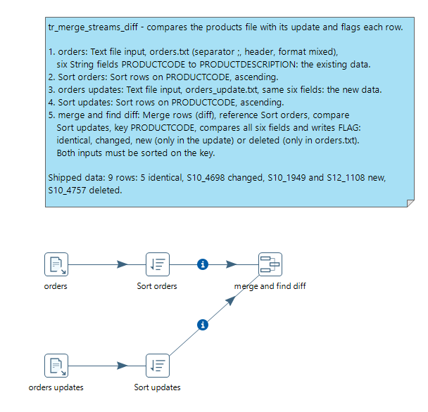
<figcaption>What you build in Workflow 1</figcaption>
</figure>
</div>

:::: tabs

### 1. orders

> **Note:**
>
> #### Read orders.txt
>
> `orders` reads yesterday's product list, the reference stream.

1. Start Spoon with the **Start Pentaho Data Integration** button below, or from PowerShell:

```powershell
Set-Location C:\Pentaho\design-tools\data-integration
.\spoon.bat
```

<button data-launch="spoon" data-path="">Start Pentaho Data Integration</button>

2. Select **File > New > Transformation** (`Ctrl+N`).
3. Select **File > Save as** and save it as `tr_merge_streams_diff.ktr` in `C:\Workshop-DI-Practitioner\04-enriching-the-dataset\01-merge\21-mod4-merge-streams-diff`.
4. On the **Design** tab, open the **Input** folder and drag **Text file input** onto the canvas.
5. Double-click **Text file input**. Set **Step name** to `orders`.
6. On the **File** tab, enter `${Internal.Entry.Current.Directory}/orders.txt` in **File or directory**, then select **Add**.

<div align="center">
<figure>
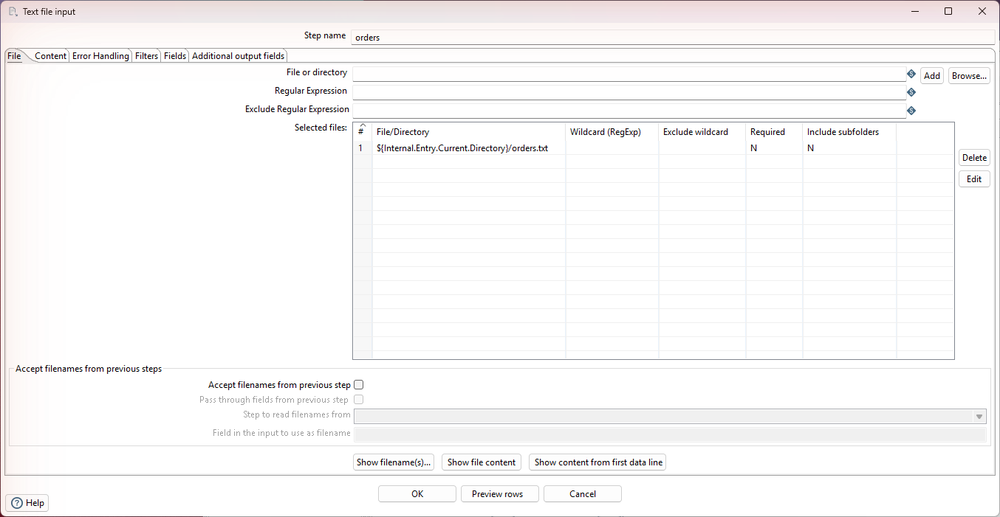
<figcaption>File tab: orders.txt in the selected files</figcaption>
</figure>
</div>

7. On the **Content** tab, set **Separator** to `;`, keep **Header** selected, and set **Format** to `mixed`.

<div align="center">
<figure>
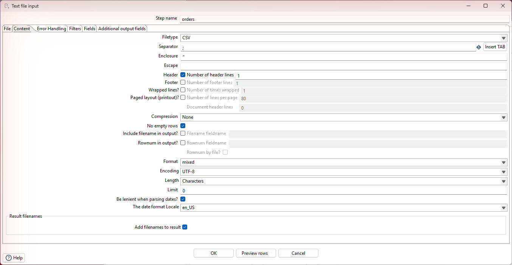
<figcaption>Content tab: separator ;, header line, format mixed</figcaption>
</figure>
</div>

8. On the **Fields** tab, select **Get Fields**, select **OK** at the number of sample lines, and close the **Scan results**. The grid lists six String fields, `PRODUCTCODE` to `PRODUCTDESCRIPTION`.

<div align="center">
<figure>
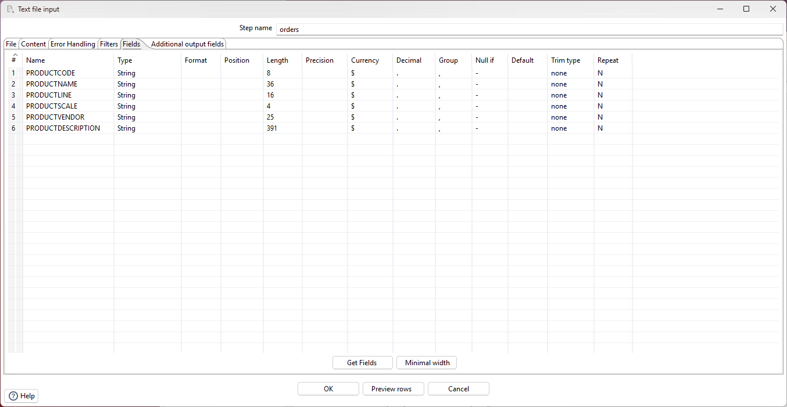
<figcaption>Fields tab: six String fields after Get Fields</figcaption>
</figure>
</div>

9. Select **Preview rows**, enter `100` rows, and select **OK**.

> **Success:** Checkpoint: 7 rows: `S10_1678`, `S10_2016`, `S10_4698`, `S10_4757`, `S10_4962`, `S12_1099` and `S12_1666`.

10. Select **Close**, then **OK**.

<div align="center">
<figure>
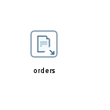
<figcaption>The canvas after orders</figcaption>
</figure>
</div>


### 2. orders updates

> **Note:**
>
> #### Read orders_update.txt
>
> `orders updates` reads today's list, the compare stream.

1. Drag a second **Text file input** onto the canvas. Double-click it and set **Step name** to `orders updates`.
2. On the **File** tab, enter `${Internal.Entry.Current.Directory}/orders_update.txt` in **File or directory**, then select **Add**.

<div align="center">
<figure>
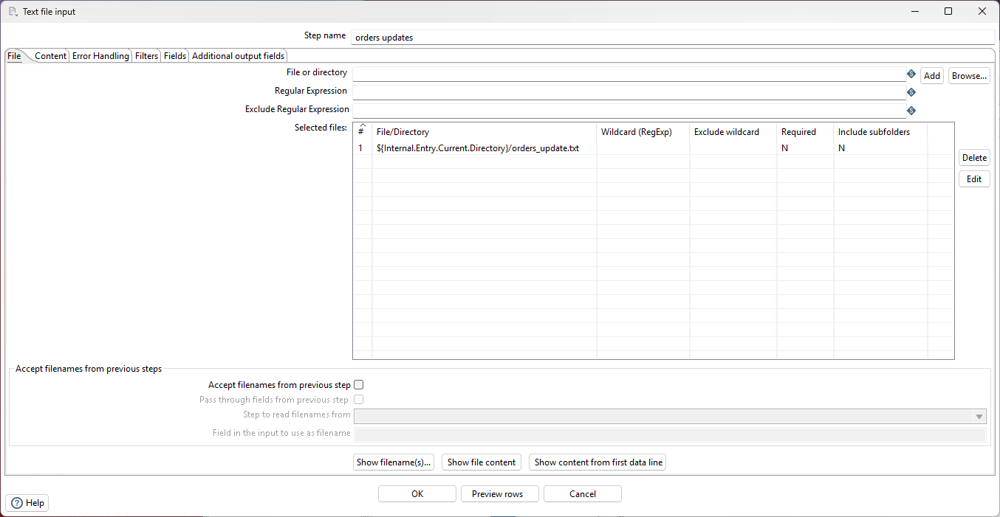
<figcaption>File tab: orders_update.txt in the selected files</figcaption>
</figure>
</div>

3. On the **Content** tab, set **Separator** to `;`, keep **Header** selected, and set **Format** to `mixed`.

<div align="center">
<figure>
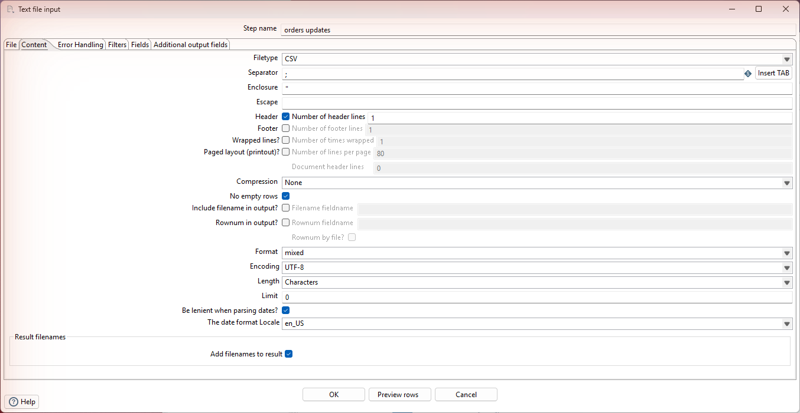
<figcaption>Content tab: the same settings as orders</figcaption>
</figure>
</div>

4. On the **Fields** tab, select **Get Fields**, select **OK** at the number of sample lines, and close the **Scan results**. The same six String fields.
5. Select **Preview rows**, enter `100` rows, and select **OK**.

> **Success:** Checkpoint: 8 rows: the same codes without `S10_4757`, plus `S10_1949` and `S12_1108`. `S10_4698` is now the 2004 model.

6. Select **Close**, then **OK**.

<div align="center">
<figure>
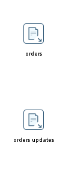
<figcaption>The canvas after orders updates</figcaption>
</figure>
</div>


### 3. Sort orders

> **Note:**
>
> #### Sort the reference stream
>
> **Merge rows (diff)** assumes both inputs are sorted on the key.

1. On the **Design** tab, open the **Transform** folder and drag **Sort rows** onto the canvas.
2. Create a hop from **orders** to **Sort rows**: hold `Shift` and drag from one step to the other.
3. Double-click **Sort rows**. Set **Step name** to `Sort orders`.
4. Fill the **Fields** grid with one row:

| Fieldname     | Ascending | Case sensitive compare? | Sort based on current locale? | Collator Strength | Presorted? |
| ------------- | --------- | ----------------------- | ----------------------------- | ----------------- | ---------- |
| `PRODUCTCODE` | `Y`       | `N`                     | `N`                           | `0`               | `N`        |

<div align="center">
<figure>
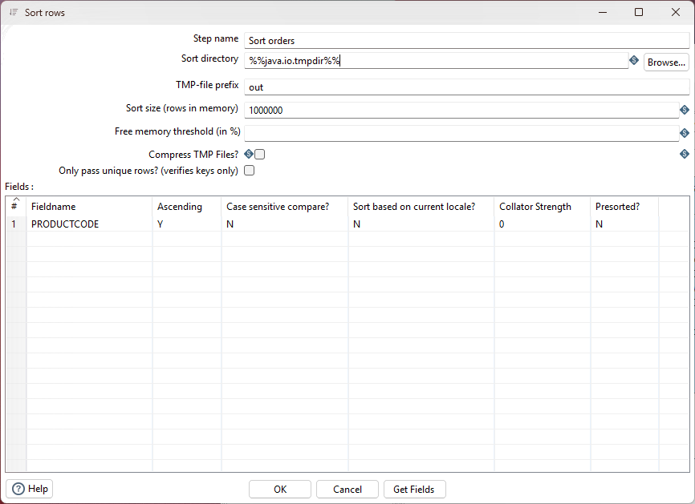
<figcaption>Sort orders: PRODUCTCODE, ascending</figcaption>
</figure>
</div>

5. Select **OK**.

<div align="center">
<figure>
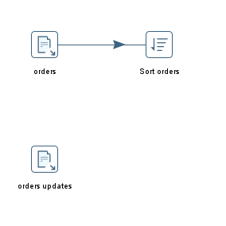
<figcaption>The canvas after Sort orders</figcaption>
</figure>
</div>


### 4. Sort updates

> **Note:**
>
> #### Sort the compare stream
>
> The same sort, on the other stream.

1. Drag a second **Sort rows** onto the canvas, and create a hop from **orders updates** to it.
2. Double-click it. Set **Step name** to `Sort updates`, and fill its **Fields** grid with the same row as **Sort orders**.

<div align="center">
<figure>
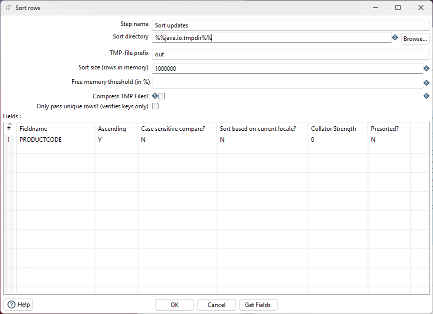
<figcaption>Sort updates: the same row as Sort orders</figcaption>
</figure>
</div>

3. Select **OK**.

<div align="center">
<figure>
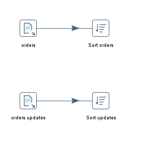
<figcaption>The canvas after Sort updates</figcaption>
</figure>
</div>


### 5. Merge rows (diff)

> **Note:**
>
> #### Compare the two streams
>
> **Merge rows (diff)** flags every row `identical`, `changed`, `new` or `deleted`.

1. On the **Design** tab, open the **Joins** folder and drag **Merge rows (diff)** onto the canvas.
2. Create a hop from **Sort orders** to **Merge rows (diff)**, and another from **Sort updates** to **Merge rows (diff)**.
3. Double-click **Merge rows (diff)** and set:
    * **Step name**: `merge and find diff`
    * **Reference rows origin**: `Sort orders`
    * **Compare rows origin**: `Sort updates`
    * **Flag fieldname**: `FLAG`
4. In **Keys to match**, enter `PRODUCTCODE` in the **Key field** column.
5. Under **Values to compare**, select **Get value fields**. Keep all six rows it adds, `PRODUCTCODE` to `PRODUCTDESCRIPTION`.

<div align="center">
<figure>
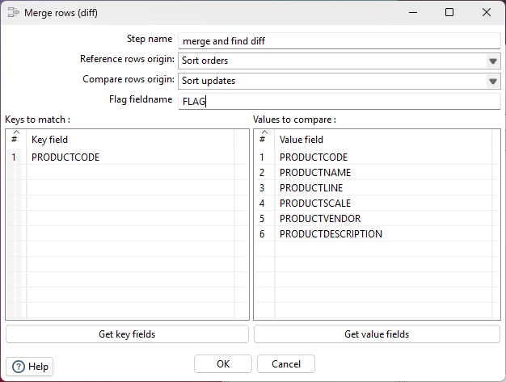
<figcaption>Reference: Sort orders; compare: Sort updates</figcaption>
</figure>
</div>

6. Select **OK**. If a **Notice** about sorted input appears, select **Close**.

<div align="center">
<figure>
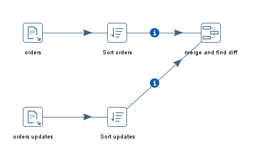
<figcaption>The canvas after merge and find diff</figcaption>
</figure>
</div>


### 6. Run

> **Note:**
>
> #### Preview the flags
>
> Preview the result to see each flag.

1. Save the transformation (`Ctrl+S`).
2. Select **merge and find diff** on the canvas, press `F10` (**Action > Preview**), and select **Quick Launch**.

> **Success:** Checkpoint: 9 rows, one per product code in either file:
>
> | Flag        | Rows | Products                                                       |
> | ----------- | ---- | -------------------------------------------------------------- |
> | `identical` | 5    | `S10_1678`, `S10_2016`, `S10_4962`, `S12_1099`, `S12_1666`     |
> | `changed`   | 1    | `S10_4698`: the name's year is now 2004, not 2003              |
> | `new`       | 2    | `S10_1949` and `S12_1108`, only in `orders_update.txt`         |
> | `deleted`   | 1    | `S10_4757`, only in `orders.txt`                               |

3. Select **Close**.

> **Under the hood:**
>
> #### It's a merge walk, so both sides must be sorted on the key
>
> **Merge rows (diff)** holds one row from the reference stream and
> one from the compare stream and walks both forward in step, like
> merging two sorted lists. Keys equal: compare the value fields, flag
> `identical` or `changed`, advance both. Reference key smaller: that
> key is gone from the new data, flag `deleted`, advance the reference.
> Compare key smaller: flag `new`, advance the compare side. It never
> holds more than the current pair, which is why it copes with any
> volume, and why it assumes order.
>
> Hand it unsorted input and it doesn't fail. It walks past matches it
> can no longer see and flags the same key `deleted` on one side and
> `new` on the other. The dialog warns about exactly this when you
> close it.
>
> **Why it matters:** a **Sort rows** on each input (or `ORDER BY` in
> the source query) is part of this step, not optional polish. Without
> it, a sync turns unchanged rows into a delete plus an insert.

::::

### Workflow 2 - Synchronize a table

> **Note:**
>
> #### Compare a table with a file, then apply the changes
> 
> The reference is now the `STG_ORDERS_MERGED` table, and **Synchronize after merge** turns each flag into an `INSERT`, `UPDATE` or `DELETE` on it.

:::: tabs

### 1. STG_ORDERS_MERGED

> **Note:**
>
> #### Read the table
> 
> The reference stream now comes from a **Table input**. Its `ORDER BY` sorts the rows in the database, so this side needs no **Sort rows**.

1. Select **File > New > Transformation** (`Ctrl+N`).
2. Select **File > Save as** and save it as `tr_merge_streams_database_diff.ktr` in `C:\Workshop-DI-Practitioner\04-enriching-the-dataset\01-merge\21-mod4-merge-streams-diff`.

3. On the **Design** tab, open the **Input** folder and drag **Table input** onto the canvas.
4. Double-click **Table input**. Set **Step name** to `STG_ORDERS_MERGED`, and set **Connection** to `MySQL:sampledata`.
5. Enter this query in **SQL**:

   ```sql
   SELECT
     PRODUCTCODE
   , PRODUCTNAME
   , PRODUCTLINE
   , PRODUCTSCALE
   , PRODUCTVENDOR
   , PRODUCTDESCRIPTION
   FROM STG_ORDERS_MERGED
   ORDER BY PRODUCTCODE
   ```

<div align="center">
<figure>
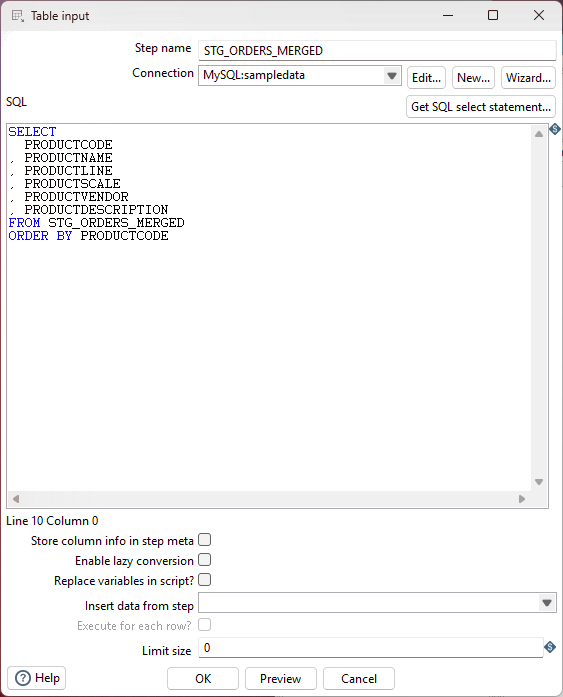
<figcaption>STG_ORDERS_MERGED: the table, sorted by the database</figcaption>
</figure>
</div>

6. Select **Preview**, enter `100` rows, and select **OK**.

> **Success:** Checkpoint: 7 rows, `S10_1678` to `S12_1666`: the products [Writing to a Database](../14-mod3-writing-to-a-database/guide.md) loaded.

7. Select **Close**, then **OK**.


### 2. orders updates

> **Note:**
>
> #### orders updates
>
> Add and set up **Text file input**.

1. Drag a **Text file input** onto the canvas and set it up as **orders updates** in Workflow 1: **Step name** `orders updates`, **File or directory** `${Internal.Entry.Current.Directory}/orders_update.txt` (select **Add**), **Separator** `;`, **Header** selected, **Format** `mixed`, and **Get Fields** on the **Fields** tab. Select **OK**.

<div align="center">
<figure>
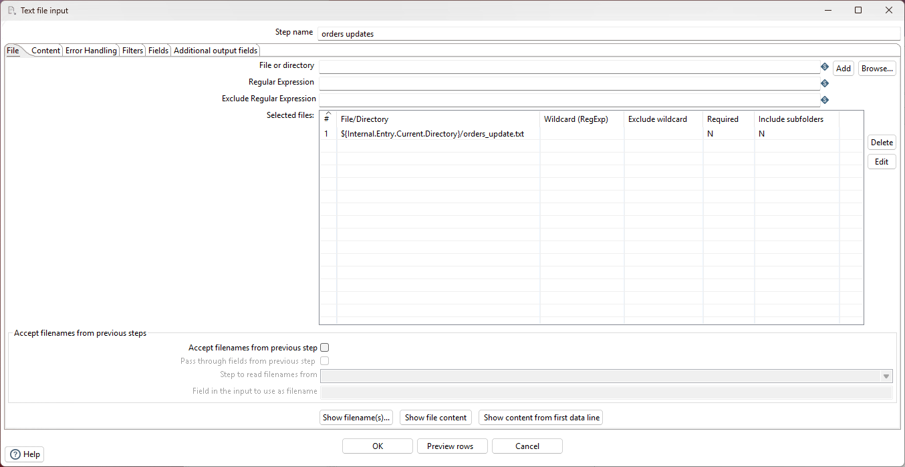
<figcaption>File tab: orders_update.txt in the selected files</figcaption>
</figure>
</div>

<div align="center">
<figure>
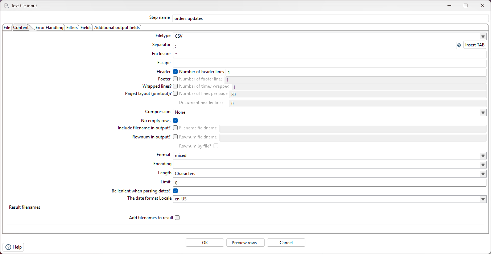
<figcaption>Content tab: separator ;, header line, format mixed</figcaption>
</figure>
</div>


### 3. Sort updates

> **Note:**
>
> #### Sort updates
>
> Add and set up **Sort rows**.

1. On the **Design** tab, open the **Transform** folder and drag **Sort rows** onto the canvas.
2. Create a hop from **orders updates** to **Sort rows**: hold `Shift` and drag from one step to the other.
3. Double-click **Sort rows**. Set **Step name** to `Sort updates`, fill the **Fields** grid with the `PRODUCTCODE` row from Workflow 1, and select **OK**.

<div align="center">
<figure>
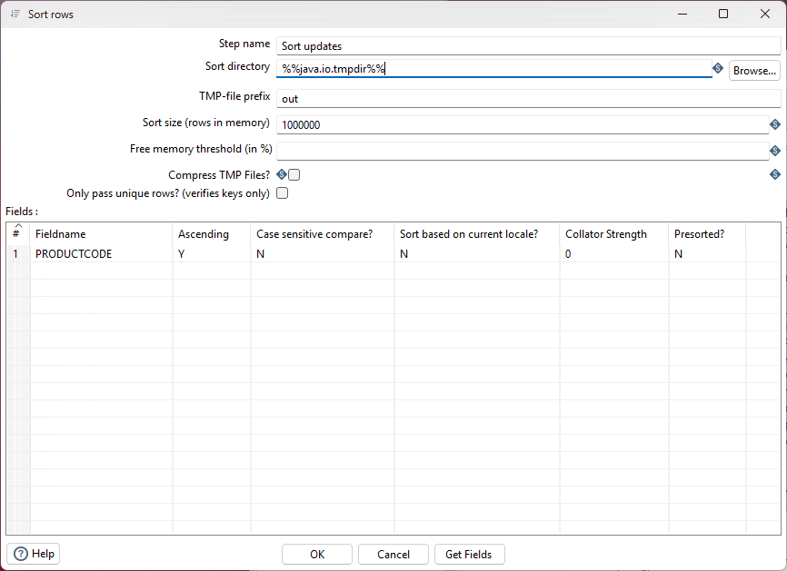
<figcaption>Sort updates: PRODUCTCODE, ascending</figcaption>
</figure>
</div>


### 4. Merge Rows (diff)

> **Note:**
>
> #### Merge Rows (diff)
>
> Add and set up **Merge rows (diff)**.

1. On the **Design** tab, open the **Joins** folder and drag **Merge rows (diff)** onto the canvas.
2. Create a hop from **STG_ORDERS_MERGED** to **Merge rows (diff)**, and another from **Sort updates** to **Merge rows (diff)**.
3. Double-click **Merge rows (diff)** and set:
    * **Step name**: `Merge Rows (diff)`
    * **Reference rows origin**: `STG_ORDERS_MERGED`
    * **Compare rows origin**: `Sort updates`
    * **Flag fieldname**: `FLAG`
4. In **Keys to match**, enter `PRODUCTCODE` in the **Key field** column.
5. Under **Values to compare**, select **Get value fields**. It adds six rows, `PRODUCTCODE` to `PRODUCTDESCRIPTION`.
6. Right-click the `PRODUCTDESCRIPTION` row and select **Delete selected lines**. These five remain:

| #   | Value field     |
| --- | --------------- |
| 1   | `PRODUCTCODE`   |
| 2   | `PRODUCTNAME`   |
| 3   | `PRODUCTLINE`   |
| 4   | `PRODUCTSCALE`  |
| 5   | `PRODUCTVENDOR` |

   The table was loaded from the copy of `orders.txt` in Writing to a Database, where five of the seven descriptions end in trailing spaces. The descriptions in `orders_update.txt` have none. Comparing `PRODUCTDESCRIPTION` would flag `S10_4962`, `S12_1099` and `S12_1666` as `changed` although their text is the same.

7. Select **OK**. If a **Notice** about sorted input appears, select **Close**.

<div align="center">
<figure>
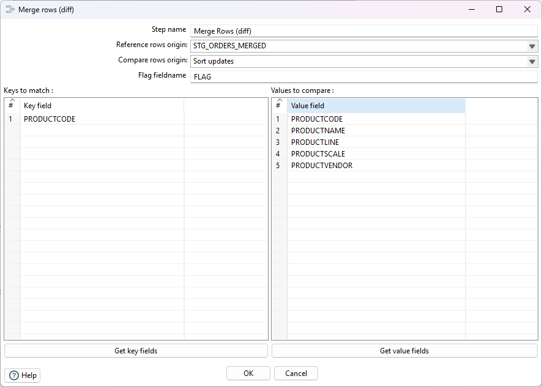
<figcaption>Reference: the table; compare: the file</figcaption>
</figure>
</div>

### 5. Synchronize after merge

> **Note:**
>
> #### Synchronize after merge
> 
> **Synchronize after merge** reads the flag on each row and runs the matching statement against the table. Rows flagged `identical` are skipped.

<div align="center">
<figure>
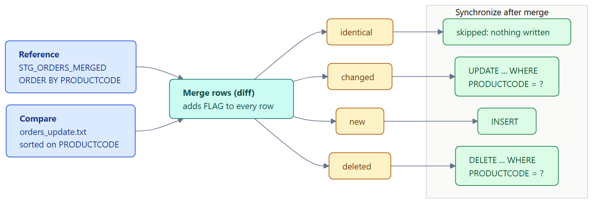
<figcaption>Each flag becomes one statement, or none</figcaption>
</figure>
</div>

1. On the **Design** tab, open the **Output** folder and drag **Synchronize after merge** onto the canvas.
2. Create a hop from **Merge Rows (diff)** to **Synchronize after merge**.
3. Double-click **Synchronize after merge**. On the **General** tab, set **Connection** to `MySQL:sampledata` and **Target table** to `STG_ORDERS_MERGED`. Keep **Commit size** at `100` and leave **Use batch update** cleared.


4. Fill **The key(s) to look up the value(s)** with one row:

| Table field   | Comparator | Stream field1 | Stream field2 |
| ------------- | ---------- | ------------- | ------------- |
| `PRODUCTCODE` | `=`        | `PRODUCTCODE` |               |

5. Under **Update fields**, select **Get update fields**. It adds one row per incoming field: the six product fields, and `FLAG` from **Merge Rows (diff)**.
6. Right-click the `FLAG` row and select **Delete selected lines**. `FLAG` exists only in the stream: the table has no such column, so an `INSERT` or `UPDATE` that names it fails.
7. Set **Update** to `N` for `PRODUCTCODE` and to `Y` for the other five, so the grid reads:

| Table field          | Stream field         | Update |
| -------------------- | -------------------- | ------ |
| `PRODUCTCODE`        | `PRODUCTCODE`        | `N`    |
| `PRODUCTNAME`        | `PRODUCTNAME`        | `Y`    |
| `PRODUCTLINE`        | `PRODUCTLINE`        | `Y`    |
| `PRODUCTSCALE`       | `PRODUCTSCALE`       | `Y`    |
| `PRODUCTVENDOR`      | `PRODUCTVENDOR`      | `Y`    |
| `PRODUCTDESCRIPTION` | `PRODUCTDESCRIPTION` | `Y`    |

   As with **Insert / update**, the key stays in the list so that inserts include it, but an update never changes it.

<div align="center">
<figure>
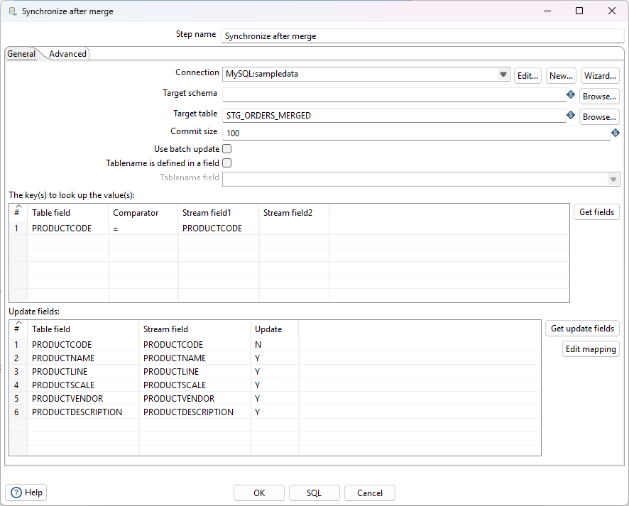
<figcaption>General tab</figcaption>
</figure>
</div>

8. Open the **Advanced** tab and set:
   * **Operation fieldname**: `FLAG`
   * **Insert when value equal**: `new`
   * **Update when value equal**: `changed`
   * **Delete when value equal**: `deleted`

<div align="center">
<figure>
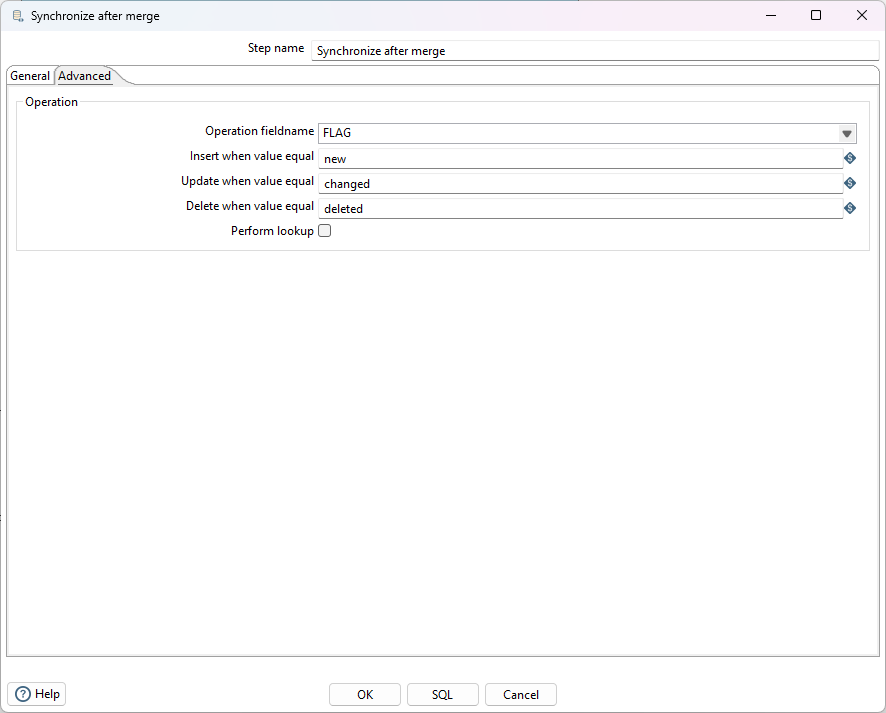
<figcaption>Advanced tab: one flag value per operation</figcaption>
</figure>
</div>

9. Select **OK**.

### 6. Run

> **Note:**
>
> #### Look at the flags, then apply them
> 
> Run once with the write switched off to see the flags, then again to apply them. To repeat this workflow from the start, run the Writing to a Database transformation again: it truncates `STG_ORDERS_MERGED` and reloads the 7 products.

1. In DBeaver, run:

   ```sql
   SELECT * FROM STG_ORDERS_MERGED ORDER BY PRODUCTCODE;
   ```

<div align="center">
<figure>
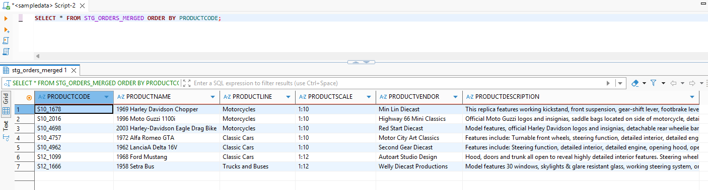
<figcaption>Before</figcaption>
</figure>
</div>

> **Success:** Checkpoint: 7 products, `S10_1678` to `S12_1666`.

2. Right-click the hop from **Merge Rows (diff)** to **Synchronize after merge** and select **Disable**.
3. Save the transformation (`Ctrl+S`).
4. Press `F9` (**Action > Run**), and select **Run** in the **Run Options** dialog.
5. Select **Merge Rows (diff)** on the canvas and open the **Preview data** tab.

<div align="center">
<figure>
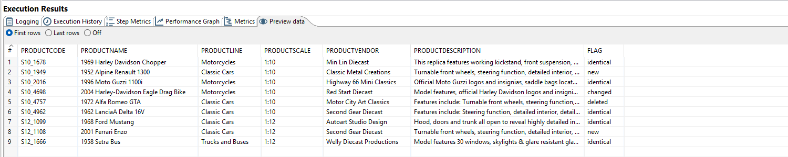
<figcaption>The flags, before anything is written</figcaption>
</figure>
</div>

> **Success:** Checkpoint: 9 rows with the same flags as Workflow 1: 5 `identical`, `S10_4698` `changed`, `S10_1949` and `S12_1108` `new`, `S10_4757` `deleted`.

6. Right-click the hop from **Merge Rows (diff)** to **Synchronize after merge** and select **Enable**.
7. Press `F9` (**Action > Run**), and select **Run** in the **Run Options** dialog.
8. In **Execution Results**, open the **Step Metrics** tab.

> **Success:** Checkpoint: **Synchronize after merge** shows 9 in **Read**, 2 in **Output** and 2 in **Updated**. **Output** counts the inserts, the 2 `new` rows. **Updated** counts the update of the `changed` row and also the delete of the `deleted` row: this step adds a delete to **Updated**, as it has no column of its own for deletes.

9. In DBeaver, run the query from action 1 again.

<div align="center">
<figure>
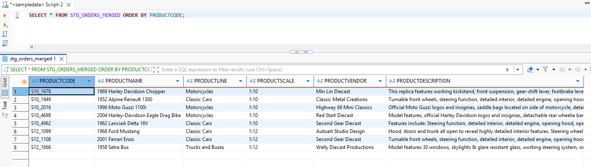
<figcaption>After</figcaption>
</figure>
</div>

> **Success:** Checkpoint: the table now holds 8 products: `S10_1949` and `S12_1108` added, `S10_4698` renamed to the 2004 model, `S10_4757` gone.

10. Press `F9` (**Action > Run**), and select **Run** in the **Run Options** dialog, to run it once more.

> **Under the hood:**
>
> #### Identical rows never touched the database
>
> **Synchronize after merge** read the flag on each row and mapped it
> straight to a statement: `new` to an `INSERT`, `changed` to an
> `UPDATE ... WHERE PRODUCTCODE = ?`, `deleted` to a `DELETE ... WHERE
> PRODUCTCODE = ?`. Rows flagged `identical` were skipped. Compare that
> with reloading the table: on a typical day most of a feed is
> unchanged, so most of the write traffic disappears.
>
> The step still runs one statement per changed row and commits every
> **Commit size** rows, so its cost scales with the *changes*, not with
> the feed.
>
> **Why it matters:** this pair, diff then synchronize, is change data
> capture with no triggers, no log mining and no vendor feature. Two
> inputs, and the engine works out what changed.

11. In **Execution Results**, open the **Step Metrics** tab.

> **Success:** Checkpoint: **Synchronize after merge** shows 8 in **Read**, 0 in **Output** and 0 in **Updated**. The table already matches the file, so every row is `identical` and nothing is written.

::::

:::::

## Lab Files

Click a file to download. For `.ktr` and `.kjb` files, **Open in Pentaho Data Integration** launches Pentaho Data Integration with the file loaded. If Pentaho Data Integration is already running, the path is copied to your clipboard — switch to Pentaho Data Integration and press `Ctrl+O`, `Ctrl+V`, `Enter`.

[orders_update.txt](./files/orders_update.txt)

[orders.txt](./files/orders.txt)

### Solution <!-- no-step -->

The finished transformations for this lab. Open them alongside your own to compare, or run to see the expected result.

Also on disk at `C:\Workshop-DI-Practitioner\04-enriching-the-dataset\01-merge\21-mod4-merge-streams-diff\solution`.

[tr_merge_streams_database_diff.ktr](./files/tr_merge_streams_database_diff.ktr) <button data-launch="spoon" data-path="files/tr_merge_streams_database_diff.ktr">Open in Pentaho Data Integration</button> <button data-graph="files/tr_merge_streams_database_diff.ktr">View graph</button>

[tr_merge_streams_diff.ktr](./files/tr_merge_streams_diff.ktr) <button data-launch="spoon" data-path="files/tr_merge_streams_diff.ktr">Open in Pentaho Data Integration</button> <button data-graph="files/tr_merge_streams_diff.ktr">View graph</button>

`tr_merge_streams_diff.ktr` compares `orders.txt` with `orders_update.txt` without a database: run it to see the four flags (identical, new, changed, deleted) before you synchronize a table.
