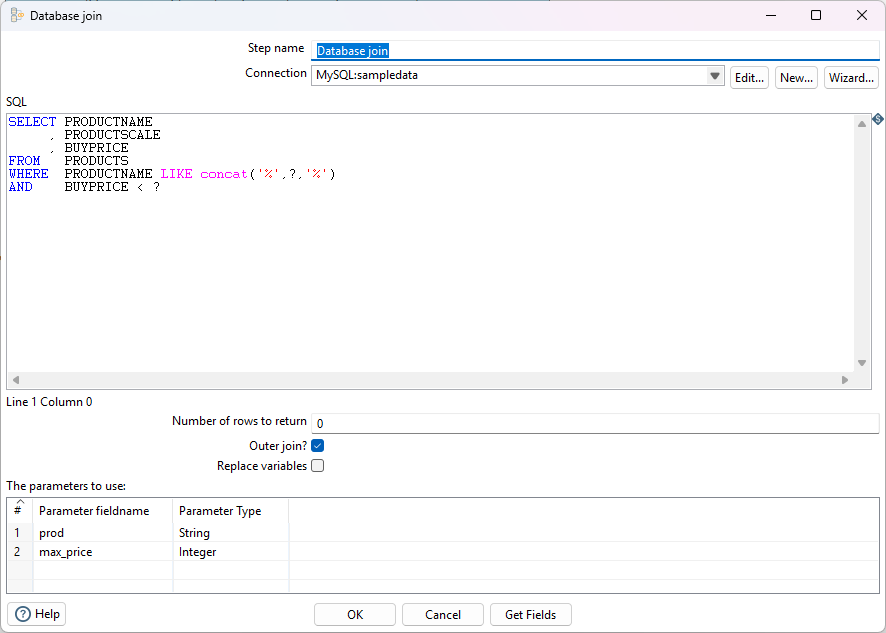
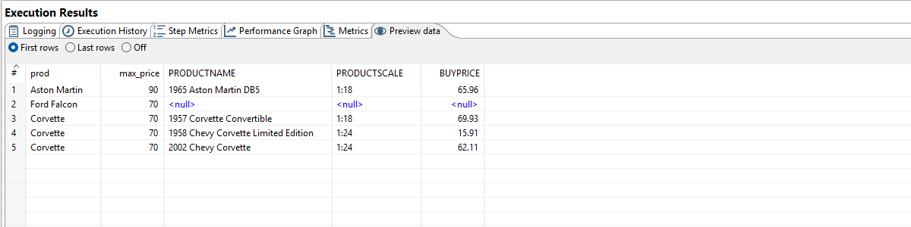

# Database Join

> **Warning:**
>
> #### Workshop - Database Join
> 
> **Database join** runs a query for each row in the stream, with values from that row as its parameters, and adds the query's results to the row. It doesn't join two tables in the database; it joins a stream to a query result.\
> In this workshop, three search rows find products in the `PRODUCTS` table below a maximum buy price.
> 
> **What you'll do**
> 
> * Provide search rows with **Data grid**
> * Query the database once per row with **Database join**
> * See an outer join keep a row with no match, and one row return several
> 
> **Prerequisites:** [Review Joins](../topic-mod4-joins-review/guide.md); the `MySQL:sampledata` connection from [Connecting to Database](../12-mod3-connecting-to-database/guide.md)
> 
> **Estimated time:** 20 minutes

<figure>


<div align="center">
<figcaption><em>What you build</em></figcaption>
</div>
</figure>

<figure><figcaption><p>Database Join</p></figcaption></figure>

> **Note:** **Create a new transformation**
> 
> Select **File > New > Transformation**, or press `Ctrl+N` (`Cmd+N` on macOS). Save it as `tr_database_join.ktr` in the lab folder, `C:\Workshop-DI-Practitioner\04-enriching-the-dataset\02-joins\22-mod4-database-join`.

:::: tabs

### 1. Data grid

> **Note:**
>
> #### Data grid
> 
> **Data grid** holds rows typed into the step itself: handy for tests, reference values and demonstrations. Here each row is one search.

1. Start Spoon.

::: tabs

### Windows (PowerShell)

> 
> ```powershell
> Set-Location C:\Pentaho\design-tools\data-integration
> .\spoon.bat
> ```
> 
>

### macOS / Linux

> 
> ```bash
> cd ~/Pentaho/design-tools/data-integration
> ./spoon.sh
> ```
> 
>

:::

<button data-launch="spoon" data-path="">Start PDI</button>

2. From the **Input** folder, drag **Data grid** onto the canvas and name it `some conditions`.
3. On the **Meta** tab, add `prod` (String) and `max_price` (Integer). On the **Data** tab, enter three rows:

| prod           | max_price |
| -------------- | --------- |
| `Aston Martin` | 90        |
| `Ford Falcon`  | 70        |
| `Corvette`     | 70        |

<div><figure><figcaption><p>Meta tab</p></figcaption></figure> <figure><figcaption><p>Data tab</p></figcaption></figure></div>

4. Select **OK**.

### 2. Database join

> **Note:**
>
> #### Database join
> 
> The query's parameters are question marks (`?`) in the SQL. For each row, **Database join** replaces them, in order, with the fields listed in **The parameters to use**.

1. From the **Lookup** folder, drag **Database join** onto the canvas and hop **some conditions** to it.
2. Double-click the step and set **Connection** to `MySQL:sampledata` and the **SQL** to:

   ```sql
   SELECT PRODUCTNAME
        , PRODUCTSCALE
        , BUYPRICE
   FROM   PRODUCTS
   WHERE  PRODUCTNAME LIKE concat('%',?,'%')
   AND    BUYPRICE < ?
   ```

3. Keep **Number of rows to return** at `0` (all of them) and select **Outer join?**.
4. Under **The parameters to use**, add `prod` (String) and then `max_price` (Integer): the first `?` gets `prod`, the second `max_price`.

<figure><figcaption><p>Two markers, two parameters, in order</p></figcaption></figure>

5. Select **OK**.

> **Note:** **What each row runs**
> 
> For the first row, the query becomes `... WHERE PRODUCTNAME LIKE concat('%','Aston Martin','%') AND BUYPRICE < 90`. The other two rows run the same query with their own values. **LIKE** with `%` on both sides matches the name anywhere in `PRODUCTNAME`.
> 
> **Outer join?** keeps an input row whose query finds nothing, with nulls for the returned fields: the stream-side rows are always kept, as in a left outer join from the stream to the query result.

### 3. Run

> **Note:**
>
> #### Run the transformation
> 
> Run it and look at what each search row returned.

1. Save the transformation, select **Run** in the toolbar, then **Run** in **Run Options**.
2. Select **Database join**, then the **Preview data** tab in **Execution Results**.

<figure><figcaption><p>One search row can return several rows</p></figcaption></figure>

> **Success:** Checkpoint: 5 rows from 3 searches.
>
> | prod           | PRODUCTNAME                          | BUYPRICE |
> | -------------- | ------------------------------------ | -------- |
> | `Aston Martin` | 1965 Aston Martin DB5                | 65.96    |
> | `Ford Falcon`  | (null)                               | (null)   |
> | `Corvette`     | 1957 Corvette Convertible            | 69.93    |
> | `Corvette`     | 1958 Chevy Corvette Limited Edition  | 15.91    |
> | `Corvette`     | 2002 Chevy Corvette                  | 62.11    |

> **Note:** The screenshot shows two Corvettes: it was taken against an older copy of the data. In the lab database the 1957 Corvette Convertible's buy price, 69.93, is also under 70.

> **Note:** **Database join or Database lookup?** A database lookup returns at most one row per input row. Database join returns every row the query finds: Corvette's three matches become three output rows. If you expect one match per row, [Database Lookups](../26-mod4-database-lookups/guide.md) is the simpler step.

> **Under the hood:**
>
> #### One prepared statement, executed once per row
>
> **Database join** compiled your `SELECT ... WHERE PRODUCTNAME LIKE ...
> AND BUYPRICE < ?` once, at start-up, as a JDBC prepared statement.
> For each incoming row it then bound that row's `prod` and `max_price`
> to the two markers, in grid order, and executed it. Every result row
> the database returned was added to a copy of the input row; with
> **Outer join?** selected, no results still produced one row with
> nulls, which is why Ford Falcon came through at all. Three input rows
> meant three round trips, and Corvette's three matches became three
> output rows from one input. That fan-out is the feature; the round
> trip per row is the price.
>
> **Why it matters:** with a handful of driving rows this is the
> simplest way to enrich from a query. With a million, it is a million
> queries: at that scale, read both sides with **Table input** and use
> **Merge join**, or put the join in the SQL.

::::

## Lab Files

Click a file to download. For `.ktr` and `.kjb` files, **Open in Pentaho Data Integration** launches PDI with the file loaded. If PDI is already running, the path is copied to your clipboard — switch to PDI and use Ctrl+O, Ctrl+V, Enter.

### Solution <!-- no-step -->

The finished transformation for this lab. Open it alongside your own to compare, or run to see the expected result.

Also on disk at `C:\Workshop-DI-Practitioner\04-enriching-the-dataset\02-joins\22-mod4-database-join\solution`.

[tr_database_join.ktr](./files/tr_database_join.ktr) <button data-launch="spoon" data-path="files/tr_database_join.ktr">Open in Pentaho Data Integration</button> <button data-graph="files/tr_database_join.ktr">View graph</button>
