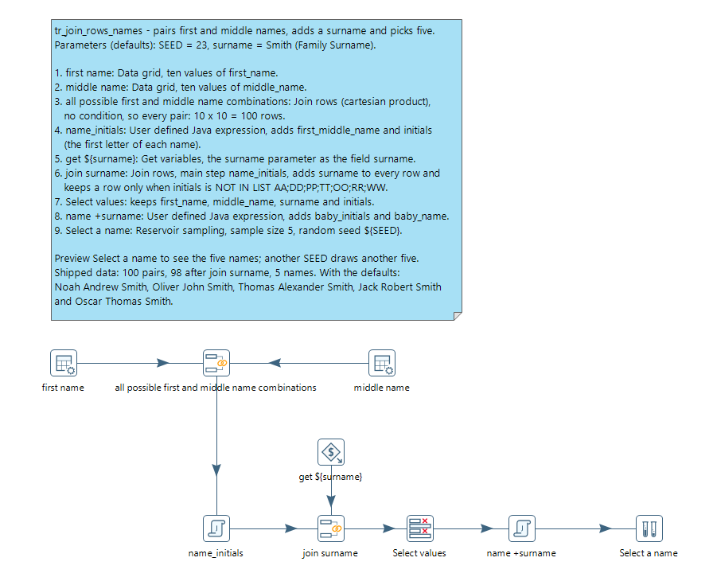

# Join Rows

> **Warning:**
>
> #### Workshop - Join Rows
> 
> Every pairing of two lists is a **cartesian product**, and **Join rows (cartesian product)** builds it, optionally filtered by a condition. In this workshop you generate baby names: every first name with every middle name, then the family surname on each, a few initials ruled out, and five names picked at random.
> 
> **What you'll do**
> 
> * Build a cartesian product of two Data grids
> * Compute new fields with a **User defined Java expression**
> * Join a parameter's value onto every row, with a filter condition
> * Pick a reproducible random sample with **Reservoir sampling**
> 
> **Prerequisites:** [Review Joins](../topic-mod4-joins-review/guide.md). The lab uses two named parameters; [Parameters](../34-mod5-parameters/guide.md), in Module 5, explains them in full.
> 
> **Estimated time:** 20 minutes

<figure>



<div align="center">
<figcaption><em>What you build</em></figcaption>
</div>
</figure>

:::: tabs

### 1. Parameters

> **Note:**
>
> #### Two named parameters
> 
> `surname` is the family name every baby gets; `SEED` fixes the random sample, so everyone who runs the lab picks the same five names.

1. Start Spoon with the **Start PDI** button below, or from a terminal:

::: tabs

### Windows (PowerShell)

```powershell
Set-Location C:\Pentaho\design-tools\data-integration
.\spoon.bat
```

### macOS / Linux

```bash
cd ~/Pentaho/design-tools/data-integration
./spoon.sh
```

:::

<button data-launch="spoon" data-path="">Start PDI</button>

2. Select **File > New > Transformation** (`Ctrl+N`).
3. Select **File > Save as** and save it as `tr_join_rows_names.ktr` in `C:\Workshop-DI-Practitioner\04-enriching-the-dataset\02-joins\23-mod4-join-rows`.
4. Double-click an empty part of the canvas, or select **Edit > Settings...**, to open **Transformation properties**.
5. Open the **Parameters** tab and fill the grid with two rows:

| Parameter | Default Value | Description      |
| --------- | ------------- | ---------------- |
| `SEED`    | `23`          |                  |
| `surname` | `Smith`       | `Family Surname` |

6. Select **OK**, and save the transformation (`Ctrl+S`).

### 2. Two lists

> **Note:**
>
> #### Two lists of names
> 
> Two **Data grid** steps hold the lists to combine: ten first names and ten middle names.

1. On the **Design** tab, open the **Input** folder and drag **Data grid** onto the canvas.
2. Double-click **Data grid**. Set **Step name** to `first name`.
3. On the **Meta** tab, add one field: **Name** `first_name`, **Type** `String`.
4. Open the **Data** tab and enter the ten first names from the table below, one per row, in that order. Select **OK**.
5. Drag a second **Data grid** onto the canvas. Double-click it and set **Step name** to `middle name`.
6. On the **Meta** tab, add one field: **Name** `middle_name`, **Type** `String`.
7. Open the **Data** tab and enter the ten middle names from the table below, one per row, in that order. Select **OK**.

| Row | `first_name` (first name) | `middle_name` (middle name) |
| --- | ------------------------- | --------------------------- |
| 1   | `Oliver`                  | `James`                     |
| 2   | `Jack`                    | `John`                      |
| 3   | `Harry`                   | `William`                   |
| 4   | `George`                  | `Thomas`                    |
| 5   | `Jacob`                   | `Alexander`                 |
| 6   | `Charlie`                 | `Robert`                    |
| 7   | `Noah`                    | `Michael`                   |
| 8   | `William`                 | `David`                     |
| 9   | `Thomas`                  | `Andrew`                    |
| 10  | `Oscar`                   | `Peter`                     |

### 3. Every combination

> **Note:**
>
> #### Join rows (cartesian product)
> 
> **Join rows (cartesian product)** pairs every row of one input with every row of the other. With no condition, it keeps every pair.

1. On the **Design** tab, open the **Joins** folder and drag **Join rows (cartesian product)** onto the canvas.
2. Create a hop from **first name** to **Join rows (cartesian product)**: hold `Shift` and drag from one step to the other.
3. Create a hop from **middle name** to **Join rows (cartesian product)**.
4. Double-click **Join rows (cartesian product)**. Set **Step name** to `all possible first and middle name combinations`.
5. Leave **Main step to read from** and **The condition** empty, keep the other settings as they are, and select **OK**.
6. Select **all possible first and middle name combinations** on the canvas, press `F10` (**Action > Preview**), and select **Quick Launch**.

> **Success:** Checkpoint: 100 rows, every first name with every middle name, in two fields: `first_name` and `middle_name`.

7. Select **Close**.

> **Under the hood:**
>
> #### Every row of one stream meets every row of the other
>
> Join rows reads every input except one into memory first (up to
> **Max. cache size (in rows)**, then into temporary files in **Temp
> directory**). Then it streams the remaining input, the **Main step to
> read from**, and for each of its rows emits one combined row per
> cached row. Ten first names times ten middle names is 100 rows.
>
> With a condition, it emits only the combinations that pass it, which
> is how the next part drops some pairs without a separate Filter rows.
>
> **Why it matters:** the output is the product of the input sizes.
> Ten by ten is harmless; a thousand by a million is a billion rows, so
> keep the cached side small and filter early.

### 4. Initials

> **Note:**
>
> #### User defined Java expression
> 
> **User defined Java expression** adds fields computed by Java expressions over the row's fields. Here it builds each pair's two names and its initials.

1. On the **Design** tab, open the **Scripting** folder and drag **User defined Java expression** onto the canvas.
2. Create a hop from **all possible first and middle name combinations** to **User defined Java expression**.
3. Double-click **User defined Java expression**. Set **Step name** to `name_initials`.
4. Fill the **Fields** grid with two rows:

| New field           | Java expression                                           | Value type |
| ------------------- | --------------------------------------------------------- | ---------- |
| `first_middle_name` | `first_name+" "+middle_name`                              | `String`   |
| `initials`          | `first_name.substring(0,1)+middle_name.substring(0,1)`    | `String`   |

5. Select **OK**.
6. Select **name_initials** on the canvas, press `F10` (**Action > Preview**), and select **Quick Launch**.

> **Success:** Checkpoint: 100 rows with two new fields. `Oliver` and `James`, for example, give `first_middle_name` `Oliver James` and `initials` `OJ`.

7. Select **Close**.

### 5. Add the surname

> **Note:**
>
> #### Get variables and a second Join rows
> 
> **Get variables** turns the `surname` parameter into a field on one row. A second **Join rows (cartesian product)** adds that row to every name, and its condition drops the pairs whose initials are on a list.

1. On the **Design** tab, open the **Job** folder and drag **Get variables** onto the canvas.
2. Double-click **Get variables**. Set **Step name** to `get ${surname}`.
3. Fill the **Fields** grid with one row:

| Name      | Variable     | Type     |
| --------- | ------------ | -------- |
| `surname` | `${surname}` | `String` |

4. Select **OK**.
5. On the **Design** tab, open the **Joins** folder and drag **Join rows (cartesian product)** onto the canvas.
6. Create a hop from **name_initials** to **Join rows (cartesian product)**, and another from **get ${surname}** to **Join rows (cartesian product)**.
7. Double-click **Join rows (cartesian product)**. Set **Step name** to `join surname`, and set **Main step to read from** to `name_initials`.
8. In **The condition**, select `<field>` on the left, then select `initials` in the list.
9. Select the function in the middle of the condition (it shows `=`), then select `IN LIST`.
10. Select `<value>`. In the **Enter value** dialog, set **Type** to `String` and **Value** to `AA;DD;PP;TT;OO;RR;WW`, then select **OK**.
11. Select **NOT** at the top left of the condition, to negate it: the step now keeps the rows whose initials are **not** in the list.
12. Select **OK**.
13. Select **join surname** on the canvas, press `F10` (**Action > Preview**), and select **Quick Launch**.

> **Success:** Checkpoint: 98 rows, each with `surname` `Smith`. The condition dropped `Thomas Thomas` (`TT`) and `William William` (`WW`), the only two pairs whose initials are in the list.

14. Select **Close**.

### 6. Build the name

> **Note:**
>
> #### Select values and the full name
> 
> **Select values** keeps the four fields the name needs. A second **User defined Java expression** builds the full name and its three initials.

1. On the **Design** tab, open the **Transform** folder and drag **Select values** onto the canvas.
2. Create a hop from **join surname** to **Select values**.
3. Double-click **Select values**. On the **Select & Alter** tab, select **Get fields to select**.
4. Right-click the `first_middle_name` row and select **Delete selected lines**. Then use **Move up** (`Ctrl+Up`) and **Move down** (`Ctrl+Down`) until the grid lists these four fields, in this order:

| #   | Fieldname     |
| --- | ------------- |
| 1   | `first_name`  |
| 2   | `middle_name` |
| 3   | `surname`     |
| 4   | `initials`    |

5. Select **OK**.
6. On the **Design** tab, open the **Scripting** folder and drag **User defined Java expression** onto the canvas.
7. Create a hop from **Select values** to **User defined Java expression**.
8. Double-click **User defined Java expression**. Set **Step name** to `name +surname`.
9. Fill the **Fields** grid with two rows:

| New field       | Java expression                                                                    | Value type |
| --------------- | ---------------------------------------------------------------------------------- | ---------- |
| `baby_initials` | `first_name.substring(0,1)+middle_name.substring(0,1)+surname.substring(0,1)`      | `String`   |
| `baby_name`     | `first_name+" "+middle_name+" "+surname`                                           | `String`   |

10. Select **OK**.
11. Select **name +surname** on the canvas, press `F10` (**Action > Preview**), and select **Quick Launch**.

> **Success:** Checkpoint: 98 rows with six fields: `first_name`, `middle_name`, `surname`, `initials`, `baby_initials` and `baby_name`. `Oliver`, `James` and `Smith`, for example, give `OJS` and `Oliver James Smith`.

12. Select **Close**.

### 7. Pick five

> **Note:**
>
> #### Reservoir sampling
> 
> **Reservoir sampling** picks a fixed number of rows at random from a stream of any length. The seed makes the pick repeatable.

1. On the **Design** tab, open the **Statistics** folder and drag **Reservoir sampling** onto the canvas.
2. Create a hop from **name +surname** to **Reservoir sampling**.
3. Double-click **Reservoir sampling** and set:
   * **Step name**: `Select a name`
   * **Sample size (rows)**: `5`
   * **Random seed**: `${SEED}`
4. Select **OK**.
5. Save the transformation (`Ctrl+S`).
6. Press `F9` (**Action > Run**), and select **Run** in the **Run Options** dialog.
7. Select **Select a name** on the canvas and open the **Preview data** tab.

> **Success:** Checkpoint: 5 rows. With the defaults (`Smith`, seed `23`) the five names are `Noah Andrew Smith`, `Oliver John Smith`, `Thomas Alexander Smith`, `Jack Robert Smith` and `Oscar Thomas Smith`.

8. Press `F9` (**Action > Run**) again. In the **Run Options** dialog, set the **Value** of `SEED` to `7` on the **Parameters** tab, and select **Run**.

> **Under the hood:**
>
> #### A fair sample in one pass, without knowing the row count
>
> Reservoir sampling keeps a "reservoir" of the first five rows, then
> for each later row decides at random whether it replaces one of
> them, with odds that shrink as more rows arrive. When the stream
> ends, every row has had the same chance of being in the five, and
> the step never needed to know there would be 98.
>
> The random choices come from a generator started with **Random
> seed**. The same seed over the same rows in the same order gives the
> same sample, which is why your five match the list above. Another
> seed, such as `7`, starts the generator elsewhere and gives its own
> repeatable five.
>
> **Why it matters:** you can sample a stream of any size in fixed
> memory, and a fixed seed makes the sample repeatable for tests.

9. Select **Select a name** on the canvas and open the **Preview data** tab.

> **Success:** Checkpoint: 5 rows: `Charlie Robert Smith`, `Thomas Michael Smith`, `William Michael Smith`, `Jacob John Smith` and `George Andrew Smith`. The same seed always draws the same names; a different seed draws a different five.

::::

## Lab Files

Click a file to download. For `.ktr` and `.kjb` files, **Open in Pentaho Data Integration** launches PDI with the file loaded. If PDI is already running, the path is copied to your clipboard — switch to PDI and press `Ctrl+O`, `Ctrl+V`, `Enter`.

### Solution <!-- no-step -->

The finished transformation for this lab. Preview `Select a name` to see the five names above.

Also on disk at `C:\Workshop-DI-Practitioner\04-enriching-the-dataset\02-joins\23-mod4-join-rows\solution`.

[tr_join_rows_names.ktr](./files/tr_join_rows_names.ktr) <button data-launch="spoon" data-path="files/tr_join_rows_names.ktr">Open in Pentaho Data Integration</button> <button data-graph="files/tr_join_rows_names.ktr">View graph</button>
