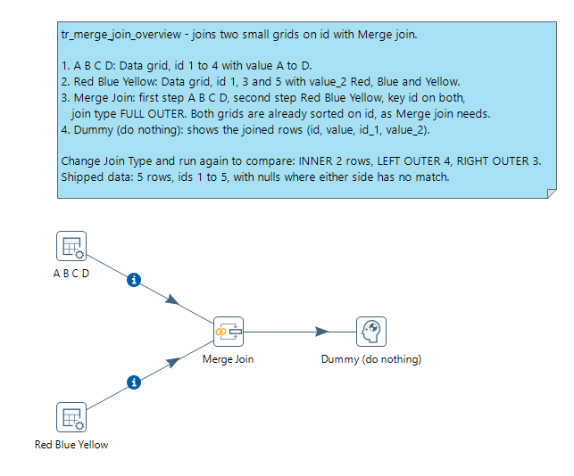
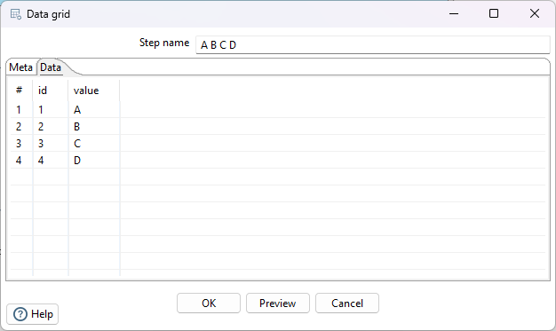
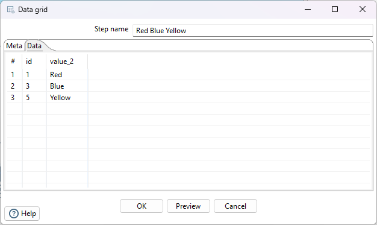
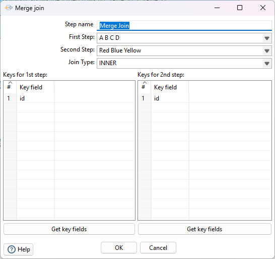
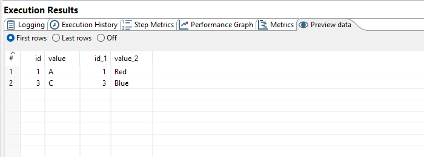
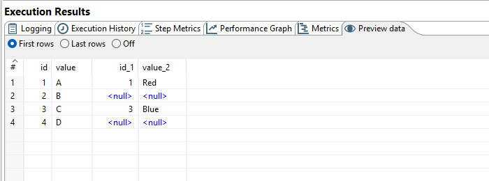
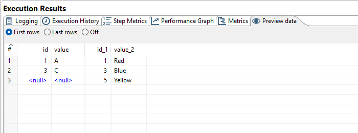
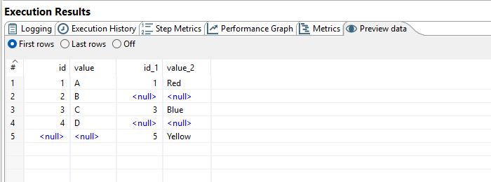
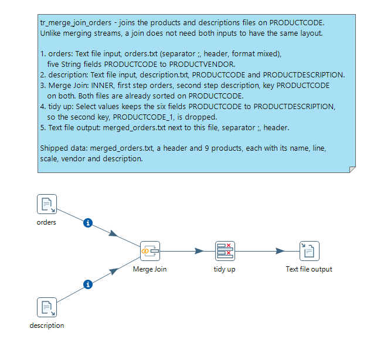

# Merge Join

> **Warning:**
>
> #### Workshop - Merge Join
> 
> **Merge join** joins two streams that are both sorted on the join key, the way a database joins two tables. It supports the four classic join types: INNER, LEFT OUTER, RIGHT OUTER and FULL OUTER.\
> First you compare the four types on two tiny grids; then you join two product files and write the result.
> 
> **What you'll do**
> 
> * Create test data with two **Data grid** steps
> * Join them with **Merge join** and compare the four join types
> * Join two files on `PRODUCTCODE` and write the result with **Text file output**
> 
> **Prerequisites:** [Review Joins](../topic-mod4-joins-review/guide.md)
> 
> **Estimated time:** 20 minutes

<figure>

<figcaption class="pcm-video-caption">Walkthrough: coming soon</figcaption>

</figure>

---

<div align="center">
<figure>

<figcaption>What you build first</figcaption>
</figure>
</div>

:::: tabs

### 1. Data grids

> **Note:**
>
> #### Data grid
> 
> **Data grid** holds rows typed into the step itself. Its **Meta** tab defines the fields and their types; its **Data** tab holds the values, typed as text and converted to those types.

1. Start Spoon with the **Start Pentaho Data Integration** button below, or from PowerShell:

```powershell
Set-Location C:\Pentaho\design-tools\data-integration
.\spoon.bat
```

<button data-launch="spoon" data-path="">Start Pentaho Data Integration</button>

2. Select **File > New > Transformation** (`Ctrl+N`).
3. Select **File > Save as** and save it as `tr_merge_join_overview.ktr` in `C:\Workshop-DI-Practitioner\04-enriching-the-dataset\02-joins\24-mod4-merge-join`.
4. On the **Design** tab, open the **Input** folder and drag **Data grid** onto the canvas.
5. Double-click **Data grid**. Set **Step name** to `A B C D`.
6. On the **Meta** tab, fill the grid with two fields:

| Name    | Type      |
| ------- | --------- |
| `id`    | `Integer` |
| `value` | `String`  |

7. Open the **Data** tab and enter four rows:

| id  | value |
| --- | ----- |
| `1` | `A`   |
| `2` | `B`   |
| `3` | `C`   |
| `4` | `D`   |

8. Select **OK**.
9. Drag a second **Data grid** onto the canvas. Double-click it and set **Step name** to `Red Blue Yellow`.
10. On the **Meta** tab, fill the grid with two fields:

| Name      | Type      |
| --------- | --------- |
| `id`      | `Integer` |
| `value_2` | `String`  |

11. Open the **Data** tab and enter three rows:

| id  | value_2  |
| --- | -------- |
| `1` | `Red`    |
| `3` | `Blue`   |
| `5` | `Yellow` |

12. Select **OK**.

Both grids are already in `id` order, as **Merge join** needs.

<div align="center">
<figure>

<figcaption>A B C D</figcaption>
</figure>
</div>

<div align="center">
<figure>

<figcaption>Red Blue Yellow</figcaption>
</figure>
</div>

### 2. Merge join

> **Note:**
>
> #### Merge join
> 
> **Merge join** takes a *first* and a *second* step, the key fields of each, and a join type.

1. On the **Design** tab, open the **Joins** folder and drag **Merge join** onto the canvas.
2. Create a hop from **A B C D** to **Merge join**: hold `Shift` and drag from one step to the other.
3. Create a hop from **Red Blue Yellow** to **Merge join**.
4. Double-click **Merge join** and set:
   * **Step name**: `Merge Join`
   * **First Step**: `A B C D`
   * **Second Step**: `Red Blue Yellow`
   * **Join Type**: `INNER`
5. Enter `id` in the **Key field** column of **Keys for 1st step**, and `id` in the **Key field** column of **Keys for 2nd step**.
6. Select **OK**. If a **Notice** about sorted input appears, select **Close**.

<div align="center">
<figure>

<figcaption>Keys from each side</figcaption>
</figure>
</div>

7. On the **Design** tab, open the **Flow** folder and drag **Dummy (do nothing)** onto the canvas.
8. Create a hop from **Merge Join** to **Dummy (do nothing)**. It gives you a step to look at the joined rows.

> **Warning:** Both inputs must be sorted on the key, and when a key repeats on both sides, every pair is joined, so the rows multiply.

### 3. Compare the join types

> **Note:**
>
> #### Run once per join type
> 
> Change **Join Type** between runs and look at **Dummy (do nothing)** each time. Missing values show as `<null>`.

1. Save the transformation (`Ctrl+S`).
2. Press `F9` (**Action > Run**), and select **Run** in the **Run Options** dialog.
3. Select **Dummy (do nothing)** on the canvas and open the **Preview data** tab.

<div align="center">
<figure>

<figcaption>INNER</figcaption>
</figure>
</div>

> **Success:** Checkpoint: 2 rows, ids `1` and `3`, the ids in both grids. The output has both sides' fields, `id`, `value`, `id_1` and `value_2`: Pentaho Data Integration adds `_1` to a second-step field whose name is already taken.

4. Double-click **Merge Join**, set **Join Type** to `LEFT OUTER`, and select **OK**. Then run again and open the **Preview data** tab of **Dummy (do nothing)**.
5. Repeat action 4 with `RIGHT OUTER`, then with `FULL OUTER`.

<div align="center">
<figure>

<figcaption>LEFT OUTER</figcaption>
</figure>
</div>

<div align="center">
<figure>

<figcaption>RIGHT OUTER</figcaption>
</figure>
</div>

<div align="center">
<figure>

<figcaption>FULL OUTER</figcaption>
</figure>
</div>

> **Success:** Checkpoint: each join type keeps these rows:
>
> | Join Type     | Rows | Which ids                                                      |
> | ------------- | ---- | -------------------------------------------------------------- |
> | `INNER`       | 2    | 1 and 3, in both grids                                         |
> | `LEFT OUTER`  | 4    | 1 to 4, all of the first grid; 2 and 4 with null `value_2`     |
> | `RIGHT OUTER` | 3    | 1, 3 and 5, all of the second grid; 5 with null `id`, `value`  |
> | `FULL OUTER`  | 5    | 1 to 5, everything from both                                   |

6. Save the transformation (`Ctrl+S`). The solution keeps **Join Type** `FULL OUTER`, as yours now does.

> **Under the hood:**
>
> #### Merge join never buffers a side, which is why both must be sorted
>
> The step keeps exactly one row from each input in hand and walks the
> two streams forward on the join key: equal, emit the combined row
> and advance; otherwise advance whichever side is behind, emitting a
> null-padded row on the way if the join type says so. `INNER` emits
> only matches, `LEFT OUTER` also emits unmatched first-step rows,
> `RIGHT OUTER` unmatched second-step rows, `FULL OUTER` both. Memory
> use is one row per side, whatever the volume.
>
> Two things follow. Both inputs must already be in key order: fed
> unsorted rows, it silently walks past matches. And when a key
> repeats on both sides, the step pairs every first-step row with
> every second-step row for that key: a small cartesian product per
> duplicate.
>
> **Why it matters:** this is the join to reach for when neither side
> fits in memory. Sort both inputs (or `ORDER BY` in the source) and it
> joins two very large files in constant memory.

### 4. Join two files

> **Note:**
>
> #### A real join
> 
> `orders.txt` has each product's name, line, scale and vendor; `description.txt` has its code and description. Join them into one row per product.

<div align="center">
<figure>

<figcaption>What you build in this part</figcaption>
</figure>
</div>

1. Select **File > New > Transformation** (`Ctrl+N`).
2. Select **File > Save as** and save it as `tr_merge_join_orders.ktr` in `C:\Workshop-DI-Practitioner\04-enriching-the-dataset\02-joins\24-mod4-merge-join`.
3. On the **Design** tab, open the **Input** folder and drag **Text file input** onto the canvas.
4. Double-click **Text file input**. Set **Step name** to `orders`.
5. On the **File** tab, enter `${Internal.Entry.Current.Directory}/orders.txt` in **File or directory**, then select **Add**.
6. On the **Content** tab, set **Separator** to `;`, keep **Header** selected, and set **Format** to `mixed`.
7. On the **Fields** tab, select **Get Fields**, select **OK** at the number of sample lines, and close the **Scan results**. The grid lists five String fields, `PRODUCTCODE` to `PRODUCTVENDOR`.
8. Select **Preview rows**, enter `100` rows, and select **OK**.

> **Success:** Checkpoint: 9 rows, `S10_1678` to `S12_1666`, in `PRODUCTCODE` order.

9. Select **Close**, then **OK**.
10. Drag a second **Text file input** onto the canvas. Double-click it and set **Step name** to `description`.
11. On the **File** tab, enter `${Internal.Entry.Current.Directory}/description.txt` in **File or directory**, then select **Add**.
12. On the **Content** tab, set **Separator** to `;`, keep **Header** selected, and set **Format** to `mixed`.
13. On the **Fields** tab, select **Get Fields**, select **OK** at the number of sample lines, and close the **Scan results**. The grid lists two String fields, `PRODUCTCODE` and `PRODUCTDESCRIPTION`.
14. Select **Preview rows**, enter `100` rows, and select **OK**.

> **Success:** Checkpoint: 9 rows with the same product codes, in the same order, each with its description. Both files are already sorted on `PRODUCTCODE`; for unsorted files you would add a **Sort rows** on each side before the join.

15. Select **Close**, then **OK**.
16. On the **Design** tab, open the **Joins** folder and drag **Merge join** onto the canvas.
17. Create a hop from **orders** to **Merge join**, and another from **description** to **Merge join**.
18. Double-click **Merge join** and set:
    * **Step name**: `Merge Join`
    * **First Step**: `orders`
    * **Second Step**: `description`
    * **Join Type**: `INNER`
19. Enter `PRODUCTCODE` in the **Key field** column of **Keys for 1st step**, and `PRODUCTCODE` in the **Key field** column of **Keys for 2nd step**.
20. Select **OK**. If a **Notice** about sorted input appears, select **Close**.
21. On the **Design** tab, open the **Transform** folder and drag **Select values** onto the canvas.
22. Create a hop from **Merge Join** to **Select values**.
23. Double-click **Select values**. Set **Step name** to `tidy up`.
24. On the **Select & Alter** tab, select **Get fields to select**. The join brings both files' fields: the grid lists `PRODUCTCODE`, `PRODUCTNAME`, `PRODUCTLINE`, `PRODUCTSCALE`, `PRODUCTVENDOR`, `PRODUCTCODE_1` and `PRODUCTDESCRIPTION`.
25. Right-click the `PRODUCTCODE_1` row and select **Delete selected lines**. These six remain:

| #   | Fieldname            |
| --- | -------------------- |
| 1   | `PRODUCTCODE`        |
| 2   | `PRODUCTNAME`        |
| 3   | `PRODUCTLINE`        |
| 4   | `PRODUCTSCALE`       |
| 5   | `PRODUCTVENDOR`      |
| 6   | `PRODUCTDESCRIPTION` |

26. Select **OK**.
27. On the **Design** tab, open the **Output** folder and drag **Text file output** onto the canvas.
28. Create a hop from **tidy up** to **Text file output**.
29. Double-click **Text file output**. On the **File** tab, set **Filename** to `${Internal.Entry.Current.Directory}/merged_orders`, and keep **Extension** at `txt`.
30. On the **Content** tab, keep **Separator** at `;` and **Header** selected.
31. On the **Fields** tab, select **Get Fields**, then **Minimal width**.
32. Select **OK**.
33. Save the transformation (`Ctrl+S`).
34. Press `F9` (**Action > Run**), and select **Run** in the **Run Options** dialog.
35. In **Execution Results**, open the **Step Metrics** tab.

> **Success:** Checkpoint: **Merge Join** shows 18 in **Read** and 9 in **Written**, and **Text file output** shows 9 in **Read** and 10 in **Output**: the header line and 9 products.

36. Open `merged_orders.txt` in the lab folder in a text editor.

> **Success:** Checkpoint: `merged_orders.txt` holds a header and 9 products, each with its name, line, scale, vendor and description, and no padded values. It matches `solution\merged_orders.txt`, the reference copy in the lab's `solution` folder.

::::

## Troubleshooting <!-- no-step -->

<details>

<summary>Rows are missing from the result</summary>

An input isn't sorted on the key. Add a **Sort rows** on the key before **Merge join**, on each side that needs it.

</details>

<details>

<summary>More rows than expected</summary>

A key repeats on both sides, and every pair is joined. Check the key is unique on at least one side.

</details>

<details>

<summary>Values in the output file are followed by spaces</summary>

Text file output pads to the field lengths. Select **Minimal width** on its **Fields** tab.

</details>

## Lab Files

Click a file to download. For `.ktr` and `.kjb` files, **Open in Pentaho Data Integration** launches Pentaho Data Integration with the file loaded. If Pentaho Data Integration is already running, the path is copied to your clipboard — switch to Pentaho Data Integration and press `Ctrl+O`, `Ctrl+V`, `Enter`.

[description.txt](./files/description.txt)

[merged_orders.txt](./files/merged_orders.txt)

[orders.txt](./files/orders.txt)

### Solution <!-- no-step -->

The finished transformations for this lab. Open them alongside your own to compare, or run to see the expected result.

Also on disk at `C:\Workshop-DI-Practitioner\04-enriching-the-dataset\02-joins\24-mod4-merge-join\solution`.

[tr_merge_join_orders.ktr](./files/tr_merge_join_orders.ktr) <button data-launch="spoon" data-path="files/tr_merge_join_orders.ktr">Open in Pentaho Data Integration</button> <button data-graph="files/tr_merge_join_orders.ktr">View graph</button>

[tr_merge_join_overview.ktr](./files/tr_merge_join_overview.ktr) <button data-launch="spoon" data-path="files/tr_merge_join_overview.ktr">Open in Pentaho Data Integration</button> <button data-graph="files/tr_merge_join_overview.ktr">View graph</button>
