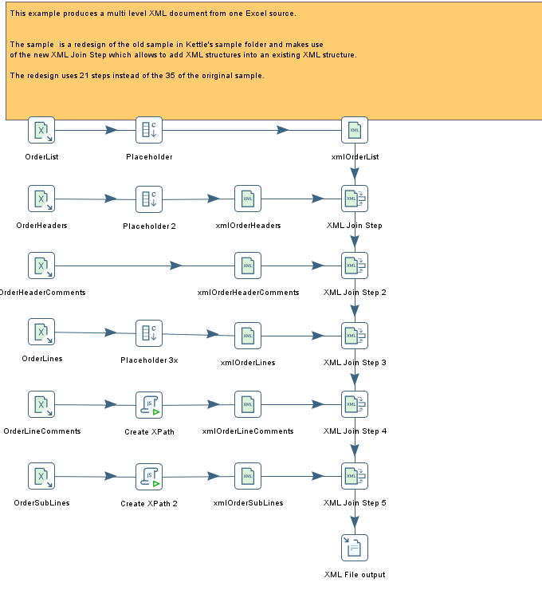

# XML Join

> **Warning:**
>
> #### Workshop - XML Join
> 
> A single flat stream can't express parent/child data like orders, their lines, and the comments on each line. **XML join** lets you assemble those levels into one nested XML document.
> 
> In this workshop, you build the Pentaho sample **"XML Join - Create a multilayer XML file"**: six related Excel sheets become XML fragments that are nested into a single multi-layer `XMLOrders.xml`.
> 
> **What you'll do**
> 
> * Read six related sheets from one workbook with **Microsoft Excel input**
> * Add placeholder fields that mark where child XML will nest
> * Build per-row XPaths with **Modified JavaScript value**
> * Build an XML fragment for each level with **Add XML**
> * Nest the fragments into one document with five **XML join** steps
> * Write the assembled multi-layer XML with **Text file output**
> 
> **Prerequisites:** [Review Joins](../topic-mod4-joins-review/guide.md); basic XML and XPath, as in [Read XML](../09-mod3-read-xml/guide.md).
> 
> **Estimated time:** 30 minutes

<figure>

<figcaption class="pcm-video-caption">Walkthrough: coming soon</figcaption>

</figure>

---

<div align="center">
<figure>

<figcaption>What you build: each join takes the document so far as its target and adds one level</figcaption>
</figure>
</div>

> **Note:**
>
> #### XML join in Pentaho Data Integration
> 
> **XML join** adds an XML stream into another XML stream as a new level, based on an XPath that points at the target location. It takes exactly two inputs: a **target** stream (the document you are building up) and a **source** stream (the fragments to insert). The target carries a single row, the document, while the source may contain many.
> 
> By chaining several **XML join** steps, each one inserting the next level at a deeper XPath, you assemble a deeply nested document: here, order list, order, header comments, lines, line comments and sub-lines.

<div align="center">
<figure>

<figcaption>XML Join</figcaption>
</figure>
</div>

> **Tip:** The finished transformation is installed in the lab's `solution` folder (see **Lab Files**). Open it in Spoon beside your own to compare the wiring as you work.

:::: tabs

### 1. Microsoft Excel Input

> **Note:**
>
> #### Microsoft Excel input
> 
> The workbook `xml_orders_source.xls` holds one sheet per level of the order hierarchy, plus a `Remark` sheet you don't read. `OrderList` is the root level. `OrderHeaders` are the orders, each with `OrderHeaderComments` and `OrderLines`; each line has `OrderLineComments` and `OrderSubLines`. Read each of the six sheets with its own **Microsoft Excel input** step.

1. Start Spoon with the **Start Pentaho Data Integration** button below, or from PowerShell:

```powershell
Set-Location C:\Pentaho\design-tools\data-integration
.\spoon.bat
```

<button data-launch="spoon" data-path="">Start Pentaho Data Integration</button>

2. Select **File > New > Transformation** (`Ctrl+N`).
3. Select **File > Save as** and save it as `tr_xml_join.ktr` in `C:\Workshop-DI-Practitioner\04-enriching-the-dataset\02-joins\25-mod4-xml-join`, the folder that holds `xml_orders_source.xls`.
4. On the **Design** tab, open the **Input** folder and drag **Microsoft Excel input** onto the canvas.
5. Double-click **Microsoft Excel input**. Set **Step name** to `OrderList`.
6. On the **Files** tab, check that **Spread sheet type (engine)** is **Excel 97-2003 XLS (JXL)**.
7. Enter this path in **File or directory**, then select **Add**. The path moves to **Selected files**.

   ```text
   ${Internal.Transformation.Filename.Directory}/xml_orders_source.xls
   ```

8. Open the **Sheets** tab. In **List of sheets to read**, set **Sheet name** to `OrderList`, **Start row** to `0` and **Start column** to `0`.
9. Open the **Content** tab and check that **Header** and **No empty rows** are selected.
10. Open the **Fields** tab and select **Get fields from header row...**. Make the grid match the step's table below: set each **Type** and **Format** as listed, and delete any other row.
11. Select **Preview rows**, then **OK** in **Enter preview size**. Compare the row count with the checkpoint below, then select **Close**.
12. Select **OK**.
13. Repeat steps 4 to 12 for the other five sheets, double-clicking each new step as you add it. Each step has its sheet's name: `OrderHeaders`, `OrderHeaderComments`, `OrderLines`, `OrderLineComments` and `OrderSubLines`.

Leave the other columns of each grid as they are.

**OrderList**

| Name             | Type   | Format     |
| ---------------- | ------ | ---------- |
| `source`         | String |            |
| `timestamp`      | Date   | `ddMMyyyy` |
| `businessUnitId` | String |            |
| `plantId`        | String |            |

**OrderHeaders**

| Name             | Type    | Format     |
| ---------------- | ------- | ---------- |
| `orderNumber`    | Integer |            |
| `originator`     | String  |            |
| `orderType`      | String  |            |
| `orderDate`      | Date    | `ddMMyyyy` |
| `customerNumber` | Integer |            |

**OrderHeaderComments**

| Name          | Type    | Format |
| ------------- | ------- | ------ |
| `orderNumber` | Integer |        |
| `lineNumber`  | Integer |        |
| `text`        | String  |        |

**OrderLines**

| Name              | Type    | Format |
| ----------------- | ------- | ------ |
| `orderNumber`     | Integer |        |
| `orderLineNumber` | Integer |        |
| `productNumber`   | String  | `#`    |
| `productText`     | String  |        |
| `quantity`        | Number  |        |
| `uom`             | String  |        |
| `principal`       | String  |        |

**OrderLineComments**

| Name              | Type    | Format |
| ----------------- | ------- | ------ |
| `orderNumber`     | Integer |        |
| `orderLineNumber` | Integer |        |
| `lineNumber`      | Integer |        |
| `Text`            | String  |        |

**OrderSubLines**

| Name                 | Type    | Format     |
| -------------------- | ------- | ---------- |
| `orderNumber`        | Integer |            |
| `orderLineNumber`    | Integer |            |
| `orderSubLineNumber` | Integer |            |
| `batch`              | String  |            |
| `quantity`           | Number  |            |
| `expiryDate`         | Date    | `ddMMyyyy` |

> **Success:** Checkpoint: six steps on the canvas, and their previews show these row counts. `orderNumber` is `4711` or `4712` in every sheet that has it.
>
> | Step                  | Rows |
> | --------------------- | ---- |
> | `OrderList`           | 1    |
> | `OrderHeaders`        | 2    |
> | `OrderHeaderComments` | 3    |
> | `OrderLines`          | 4    |
> | `OrderLineComments`   | 3    |
> | `OrderSubLines`       | 5    |

### 2. Add Constants

> **Note:**
>
> #### Add constants
> 
> Before a stream can receive a child level, its XML needs an empty element to nest into. Use **Add constants** to add an empty placeholder field whose name matches the child element you'll join in. Each empty field becomes an empty element in the next step's XML, the exact spot a later **XML join** targets with its XPath.

1. On the **Design** tab, open the **Transform** folder and drag **Add constants** onto the canvas.
2. Create a hop from **OrderList** to **Add constants**: hold `Shift` and drag from one step to the other.
3. Double-click **Add constants**. Set **Step name** to `Placeholder`.
4. Fill the **Fields** grid with the step's placeholder fields from the table below, in that order. For each, set **Type** to `String` and leave **Value** empty.
5. Select **OK**.
6. Repeat steps 1 to 5 for `Placeholder 2` and `Placeholder 3x`, double-clicking each new step as you add it.

| Step name        | Hop from       | Fields (Type String, no Value)       |
| ---------------- | -------------- | ------------------------------------ |
| `Placeholder`    | **OrderList**    | `OrderHeaders`                       |
| `Placeholder 2`  | **OrderHeaders** | `OrderLines`, `OrderHeaderComments`  |
| `Placeholder 3x` | **OrderLines**   | `OrderSubLines`, `OrderLineComments` |

7. Select **Placeholder 2** on the canvas, press `F10` (**Action > Preview**), and select **Quick Launch**.

> **Success:** Checkpoint: **Examine preview data** shows 2 rows, orders `4711` and `4712`, with the two new fields `OrderLines` and `OrderHeaderComments` empty.

8. Select **Close**.

### 3. Create XPath

> **Note:**
>
> #### Modified JavaScript value
> 
> The deepest levels (line comments and sub-lines) can't be targeted with a single static XPath, because the insert point depends on both the order number and the line number of the current row. Use **Modified JavaScript value** to build that XPath per row, in a field named `xPathStatement`.

1. On the **Design** tab, open the **Scripting** folder and drag **Modified JavaScript value** onto the canvas.
2. Create a hop from **OrderLineComments** to **Modified JavaScript value**.
3. Double-click **Modified JavaScript value**. Set **Step name** to `Create XPath`.
4. Select **Compatibility mode?**. The script calls `getInteger()` on the field values, which needs the field objects that compatibility mode hands to the script.
5. In the script tab, below the `//Script here` line, enter:

   ```javascript
   var xPathStatement;

   xPathStatement = "//OrderHeader[@orderNumber='" + orderNumber.getInteger() 
   +"']/OrderLines/OrderLine[@orderLineNumber='" 
   + orderLineNumber.getInteger()+"']/OrderLineComments";
   ```

6. Fill the **Fields** grid with one row:

   | Fieldname        | Rename to        | Type   | Replace value 'Fieldname' or 'Rename to' |
   | ---------------- | ---------------- | ------ | ---------------------------------------- |
   | `xPathStatement` | `xPathStatement` | String | N                                        |

7. Select **OK**.
8. Drag a second **Modified JavaScript value** onto the canvas and create a hop from **OrderSubLines** to it.
9. Double-click the new step. Set **Step name** to `Create XPath 2`, select **Compatibility mode?**, and fill the **Fields** grid as in step 6.
10. Below the `//Script here` line, enter this script. Only its last element differs: `OrderSubLines` instead of `OrderLineComments`.

    ```javascript
    var xPathStatement;

    xPathStatement = "//OrderHeader[@orderNumber='" + orderNumber.getInteger() 
    +"']/OrderLines/OrderLine[@orderLineNumber='" 
    + orderLineNumber.getInteger()+"']/OrderSubLines";
    ```

11. Select **OK**.
12. Select **Create XPath** on the canvas, press `F10` (**Action > Preview**), and select **Quick Launch**.

> **Success:** Checkpoint: 3 rows. The first row's `xPathStatement` reads `//OrderHeader[@orderNumber='4711']/OrderLines/OrderLine[@orderLineNumber='1']/OrderLineComments`.

13. Select **Close**.

### 4. Add XML

> **Note:**
>
> #### Add XML
> 
> **Add XML** encodes the fields of each row into a single XML field. **Root XML element** names the element each row becomes, and the **Fields** tab decides which fields go in, and whether each is an attribute or a child element.

1. On the **Design** tab, open the **Transform** folder and drag **Add XML** onto the canvas.
2. Create a hop from **Placeholder** to **Add XML**.
3. Double-click **Add XML**. Set **Step name** to `xmlOrderList`.
4. On the **Content** tab, set **Encoding** to `ISO-8859-1`, **Output Value** to `xmlOrderLists` and **Root XML element** to `OrderList`.
5. Clear **Omit XML header**. Leave **Omit null values from XML result** cleared.
6. Open the **Fields** tab and select **Get Fields**. Make the grid match the step's table below: delete the rows it doesn't list, then set **Format** and **Attribute**. **Element name** keeps the field's name, as **Get Fields** fills it.
7. Select **OK**.
8. Repeat steps 1 to 7 for the other five **Add XML** steps, double-clicking each new step as you add it. Use these settings:

| Step name                | Hop from                | Output Value             | Root XML element     | Omit XML header |
| ------------------------ | ----------------------- | ------------------------ | -------------------- | --------------- |
| `xmlOrderList`           | **Placeholder**         | `xmlOrderLists`          | `OrderList`          | Cleared         |
| `xmlOrderHeaders`        | **Placeholder 2**       | `xmlOrderHeaders`        | `OrderHeader`        | Selected        |
| `xmlOrderHeaderComments` | **OrderHeaderComments** | `xmlOrderHeaderComments` | `OrderHeaderComment` | Selected        |
| `xmlOrderLines`          | **Placeholder 3x**      | `xmlOrderLines`          | `OrderLine`          | Selected        |
| `xmlOrderLineComments`   | **Create XPath**        | `xmlOrderLineComments`   | `OrderLineComments`  | Selected        |
| `xmlOrderSubLines`       | **Create XPath 2**      | `xmlOrderSubLines`       | `OrderSubLine`       | Selected        |

**Encoding** is `ISO-8859-1` in all six. Every data field is an attribute; every placeholder field is a child element.

**xmlOrderList**

| Fieldname        | Type   | Format     | Attribute |
| ---------------- | ------ | ---------- | --------- |
| `source`         | String |            | Y         |
| `timestamp`      | Date   | `yyyyMMdd` | Y         |
| `businessUnitId` | String |            | Y         |
| `plantId`        | String |            | Y         |
| `OrderHeaders`   | String |            | N         |

**xmlOrderHeaders**

| Fieldname             | Type    | Format     | Attribute |
| --------------------- | ------- | ---------- | --------- |
| `orderNumber`         | Integer | `#`        | Y         |
| `originator`          | String  |            | Y         |
| `orderType`           | String  |            | Y         |
| `orderDate`           | Date    | `yyyyMMdd` | Y         |
| `customerNumber`      | Integer | `#`        | Y         |
| `OrderLines`          | String  |            | N         |
| `OrderHeaderComments` | String  |            | N         |

**xmlOrderHeaderComments** (delete `orderNumber`)

| Fieldname    | Type    | Format | Attribute |
| ------------ | ------- | ------ | --------- |
| `lineNumber` | Integer | `#`    | Y         |
| `text`       | String  |        | Y         |

**xmlOrderLines** (delete `orderNumber`)

| Fieldname           | Type    | Format | Attribute |
| ------------------- | ------- | ------ | --------- |
| `orderLineNumber`   | Integer | `#`    | Y         |
| `productNumber`     | String  |        | Y         |
| `productText`       | String  |        | Y         |
| `quantity`          | Number  | `#`    | Y         |
| `uom`               | String  |        | Y         |
| `principal`         | String  |        | Y         |
| `OrderSubLines`     | String  |        | N         |
| `OrderLineComments` | String  |        | N         |

**xmlOrderLineComments** (delete `orderNumber`, `orderLineNumber` and `xPathStatement`)

| Fieldname    | Type    | Format | Attribute |
| ------------ | ------- | ------ | --------- |
| `lineNumber` | Integer | `#`    | Y         |
| `Text`       | String  |        | Y         |

**xmlOrderSubLines** (delete `orderNumber`, `orderLineNumber` and `xPathStatement`)

| Fieldname            | Type    | Format     | Attribute |
| -------------------- | ------- | ---------- | --------- |
| `orderSubLineNumber` | Integer | `#`        | Y         |
| `batch`              | String  |            | Y         |
| `quantity`           | Number  | `#`        | Y         |
| `expiryDate`         | Date    | `yyyyMMdd` | Y         |

The parent keys you deleted stay out of the XML but stay in the stream: **Add XML** adds its output field to the row and passes the other fields on. The **XML join** steps read `orderNumber` and `xPathStatement` from there.

9. Select **xmlOrderHeaders** on the canvas, press `F10` (**Action > Preview**), and select **Quick Launch**.

> **Success:** Checkpoint: 2 rows. Each row's `xmlOrderHeaders` value is one `OrderHeader` element with the order's fields as attributes (`orderNumber="4711"` in the first row) and two empty child elements, `OrderLines` and `OrderHeaderComments`.

10. Select **Close**.

### 5. XML Join

> **Note:**
>
> #### XML join
> 
> Chain five **XML join** steps. Each takes the document built so far as the **target** and inserts the next fragment as the **source** at an XPath. The hops don't decide which input is which: **Target XML step** and **Source XML step** do.

1. On the **Design** tab, open the **Joins** folder and drag **XML join** onto the canvas.
2. Create a hop from **xmlOrderList** to **XML join**, and a hop from **xmlOrderHeaders** to **XML join**.
3. Double-click **XML join**. Set **Step name** to `XML Join Step`.
4. Set the streams and the join as in the first row of both tables below.
5. Set **Encoding** to `ISO-8859-1`, and leave **Omit null values from XML result** cleared.
6. Select **OK**.
7. Repeat steps 1 to 6 for `XML Join Step 2` to `XML Join Step 5`, double-clicking each new step as you add it. Each one's two hops come from its **Target XML step** and its **Source XML step**.

| Step name         | Target XML step   | Target XML field | Source XML step          | Source XML field         |
| ----------------- | ----------------- | ---------------- | ------------------------ | ------------------------ |
| `XML Join Step`   | **xmlOrderList**  | `xmlOrderLists`  | **xmlOrderHeaders**        | `xmlOrderHeaders`        |
| `XML Join Step 2` | **XML Join Step**   | `xmloutput1`     | **xmlOrderHeaderComments** | `xmlOrderHeaderComments` |
| `XML Join Step 3` | **XML Join Step 2** | `xmloutput2`     | **xmlOrderLines**          | `xmlOrderLines`          |
| `XML Join Step 4` | **XML Join Step 3** | `xmloutput3`     | **xmlOrderLineComments**   | `xmlOrderLineComments`   |
| `XML Join Step 5` | **XML Join Step 4** | `xmloutput4`     | **xmlOrderSubLines**       | `xmlOrderSubLines`       |

| Step name         | XPath Statement                                         | Complex join? | Join comparison field | Result XML field | Omit XML header |
| ----------------- | ------------------------------------------------------- | ------------- | --------------------- | ---------------- | --------------- |
| `XML Join Step`   | `//OrderHeaders`                                        | Cleared       |                       | `xmloutput1`     | Selected        |
| `XML Join Step 2` | `//OrderHeader[@orderNumber='?']/OrderHeaderComments` | Selected      | `orderNumber`         | `xmloutput2`     | Selected        |
| `XML Join Step 3` | `//OrderHeader[@orderNumber='?']/OrderLines`          | Selected      | `orderNumber`         | `xmloutput3`     | Selected        |
| `XML Join Step 4` | `?`                                                     | Selected      | `xPathStatement`      | `xmloutput4`     | Selected        |
| `XML Join Step 5` | `?`                                                     | Selected      | `xPathStatement`      | `xmlOutput`      | Cleared         |

With **Complex join?** selected, the step replaces the `?` in **XPath Statement** with the current source row's **Join comparison field**. In steps 4 and 5 the whole XPath is `?`, because `xPathStatement` already holds the complete path. Only the last step keeps its XML header, so the document gets one.

> **Under the hood:**
>
> #### The target is one document held in memory; the source streams into it
>
> Each **XML join** begins by taking a single row from its **Target
> XML step** and parsing that field into a DOM, the document being
> built. It then reads the **Source XML step** row by row: for each
> fragment it evaluates the **XPath Statement** against the DOM
> (replacing `?` with that row's **Join comparison field**), appends
> the fragment under the node it found, and moves on. When the source
> is exhausted it serializes the DOM back into one XML field and emits
> exactly one row.
>
> That is why the chain works: each join's single output row is the
> next join's target, and the source at every level can be as many
> rows as the sheet holds. Swap **Target XML step** and **Source XML
> step** and the step parses one *fragment* as the document instead.
>
> **Why it matters:** five chained joins turned six flat sheets into a
> nested document without a line of DOM code. The document does live
> in memory as a tree, though: right for order feeds and API
> payloads, not for gigabyte exports.

### 6. Text File Output

> **Note:**
>
> #### Text file output
> 
> The final **XML join** emits one row whose `xmlOutput` field holds the complete document. Write that field, and nothing else, to disk with **Text file output**.

1. On the **Design** tab, open the **Output** folder and drag **Text file output** onto the canvas.
2. Create a hop from **XML Join Step 5** to **Text file output**.
3. Double-click **Text file output**. Set **Step name** to `XML File output`.
4. On the **File** tab, set **Filename** to:

   ```text
   ${Internal.Transformation.Filename.Directory}/XMLOrders
   ```

   Set **Extension** to `xml`.

5. Open the **Content** tab. Delete the contents of **Separator** and **Enclosure**, so both are empty.
6. Select **Disable the enclosure fix?**, clear **Header**, and set **Encoding** to `ISO-8859-1`.
7. Open the **Fields** tab. In the first row, set **Name** to `xmlOutput` and **Type** to `String`. This is the only row: the other fields **XML Join Step 5** passes on stay out of the file.
8. Select **OK**.
9. Save the transformation (`Ctrl+S`).

<div align="center">
<figure>

<figcaption>The finished transformation in Spoon</figcaption>
</figure>
</div>

### 7. Run

> **Note:**
>
> #### Run the transformation
> 
> Run the transformation, then open the file it wrote.

1. Press `F9` (**Action > Run**), and select **Run** in the **Run Options** dialog.
2. In **Execution Results**, open the **Step Metrics** tab.

> **Success:** Checkpoint: every **XML join** step writes 1 row, and reads that one target row plus its source rows: 3 for **XML Join Step**, 4, 5, 4 and 6 for **XML Join Step 2** to **XML Join Step 5**. **XML File output** writes 1 row.

3. Open `XMLOrders.xml` from the lab folder in a browser or text editor.

> **Success:** Checkpoint: the file starts with an XML declaration naming `ISO-8859-1`, then one `OrderList` element holding two `OrderHeader` elements, orders `4711` and `4712`. Each child sits under the order and line it belongs to:
>
> | Order  | `OrderLine` elements | `OrderSubLine` elements | `OrderHeaderComment` elements | Line comments |
> | ------ | -------------------- | ----------------------- | ----------------------------- | ------------- |
> | `4711` | 2                    | 2, one per line         | 1                             | 2, on line 1  |
> | `4712` | 2                    | 3, two on line 1        | 2                             | 1, on line 1  |
>
> Line 2 of each order has no comments, so its `OrderLineComments` placeholder stays an empty element.

::::

## Lab Files

Click a file to download. For `.ktr` and `.kjb` files, **Open in Pentaho Data Integration** launches Pentaho Data Integration with the file loaded. If Pentaho Data Integration is already running, the path is copied to your clipboard — switch to Pentaho Data Integration and press `Ctrl+O`, `Ctrl+V`, `Enter`.

Keep `tr_xml_join.ktr` and `xml_orders_source.xls` in the **same folder** so the workbook path resolves when you run it.

[xml_orders_source.xls](./files/xml_orders_source.xls)

### Solution <!-- no-step -->

The finished transformation for this lab. Open it alongside your own to compare, or run to see the expected result.

Also on disk at `C:\Workshop-DI-Practitioner\04-enriching-the-dataset\02-joins\25-mod4-xml-join\solution`.

[tr_xml_join.ktr](./files/tr_xml_join.ktr) <button data-launch="spoon" data-path="files/tr_xml_join.ktr">Open in Pentaho Data Integration</button> <button data-graph="files/tr_xml_join.ktr">View graph</button>
