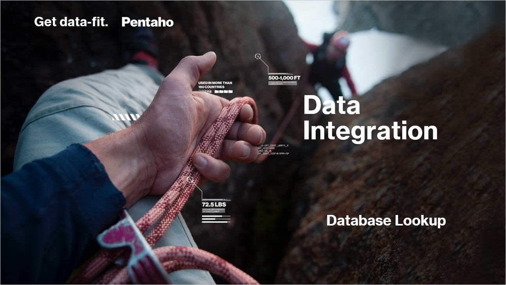

# Database Lookups

> **Warning:**
>
> #### Workshop - Database Lookups
> 
> **Database lookup** adds values from a database table to each row, found by key fields. It returns at most one row per input row.\
> In this workshop you look up products by a name pattern and a maximum price, then see what the step does when a lookup finds nothing, and when it finds more than one row.
> 
> **What you'll do**
> 
> * Build a search pattern with **User defined Java expression**
> * Configure a **Database lookup** with two key conditions and default values
> * Route failed lookups to the log with error handling, or drop them
> * Handle multiple matches with **Fail on multiple results?** and **Order by**
> 
> **Prerequisites:** [Review Lookups](../topic-mod4-lookups-review/guide.md); [Database Join](../22-mod4-database-join/guide.md), whose search rows this workshop reuses
> 
> **Estimated time:** 30 minutes

<figure>


<div align="center">
<figcaption><em>What you build: three variants of one lookup</em></figcaption>
</div>
</figure>

<figure><figcaption><p>Database Lookup</p></figcaption></figure>

> **Note:** **Create a new transformation**
> 
> Select **File > New > Transformation**, or press `Ctrl+N` (`Cmd+N` on macOS). Save it as `tr_database_lookup.ktr` in the lab folder, `C:\Workshop-DI-Practitioner\04-enriching-the-dataset\03-lookups\26-mod4-database-lookups`.

:::: tabs

### 1. Data grid

> **Note:**
>
> #### Data grid
> 
> The same three searches as [Database Join](../22-mod4-database-join/guide.md): a product name and a maximum buy price.

1. Start Spoon.

::: tabs

### Windows (PowerShell)

> 
> ```powershell
> Set-Location C:\Pentaho\design-tools\data-integration
> .\spoon.bat
> ```
> 
>

### macOS / Linux

> 
> ```bash
> cd ~/Pentaho/design-tools/data-integration
> ./spoon.sh
> ```
> 
>

:::

<button data-launch="spoon" data-path="">Start PDI</button>

2. From the **Input** folder, drag **Data grid** onto the canvas and name it `some conditions`. On **Meta** add `prod` (String) and `max_price` (Integer); on **Data** enter `Aston Martin` 90, `Ford Falcon` 70 and `Corvette` 70.

<div><figure><figcaption><p>Meta tab</p></figcaption></figure> <figure><figcaption><p>Data tab</p></figcaption></figure></div>

### 2. User defined Java expression

> **Note:**
>
> #### User defined Java expression
> 
> **User defined Java expression** calculates new fields with Java expressions, one per field, with the row's fields available by name. Here it wraps the product name in `%` signs, the wildcards a SQL `LIKE` needs.

1. From the **Scripting** folder, drag **User defined Java expression** onto the canvas, name it `like_statement`, and hop **some conditions** to it.
2. Add one field: **New field** `like_statement`, **Java expression** `"%"+prod+"%"`, **Value type** String.

<figure><figcaption><p>Aston Martin becomes %Aston Martin%</p></figcaption></figure>

> **Success:** Checkpoint: the preview shows `%Aston Martin%`, `%Ford Falcon%` and `%Corvette%`.

### 3. Database lookup

> **Note:**
>
> #### Database lookup
> 
> Each row in **The key(s) to look up the value(s)** compares a table column with a stream field; together they form the query's `WHERE` clause. Each row in **Values to return from the lookup table** becomes a new field, with a default for when nothing is found.

::: tabs

### 3.1 Simple

1. From the **Lookup** folder, drag **Database lookup** onto the canvas, name it `Database lookup (simple)`, and hop **like_statement** to it.
2. Set **Connection** `MySQL:sampledata` and **Lookup table** `PRODUCTS`. Leave **Enable cache?** clear.
3. In **The key(s) to look up the value(s)**, add two rows:

| Table field   | Comparator | Field1           |
| ------------- | ---------- | ---------------- |
| `BUYPRICE`    | `<`        | `max_price`      |
| `PRODUCTNAME` | `LIKE`     | `like_statement` |

4. In **Values to return from the lookup table**, add `PRODUCTNAME` with **Default** `not available`, then `PRODUCTSCALE` and `BUYPRICE`.

<figure><figcaption><p>Two key conditions, three return values</p></figcaption></figure>

5. Save, run, and preview **Database lookup (simple)**.

> **Success:** Checkpoint: one row out for each row in, 3 in all.
>
> | prod           | PRODUCTNAME               | PRODUCTSCALE | BUYPRICE |
> | -------------- | ------------------------- | ------------ | -------- |
> | `Aston Martin` | 1965 Aston Martin DB5     | 1:18         | 65.96    |
> | `Ford Falcon`  | `not available`           | (null)       | (null)   |
> | `Corvette`     | 1957 Corvette Convertible | 1:18         | 69.93    |
>
> Ford Falcon has no product under 70, so it gets the default. Corvette has three, and the lookup returns the first the database sends back.

> **Under the hood:**
>
> #### Cache off: one query per row. Cache on: a hash table
>
> As configured, **Database lookup** prepared `SELECT PRODUCTNAME,
> PRODUCTSCALE, BUYPRICE FROM PRODUCTS WHERE BUYPRICE < ? AND
> PRODUCTNAME LIKE ?` once and executed it for every incoming row,
> taking the first row the database returned and adding its columns
> (or your defaults) to the stream. Three rows, three round trips:
> harmless here, ruinous at a million.
>
> **Enable cache?** changes the engine, not the SQL: results are kept in
> an in-memory map keyed on the lookup values, so a repeated key costs a
> hash probe instead of a query. **Load all data from table** goes
> further and reads the whole table once at start-up, after which the
> database is never asked again; but PDI then does the comparisons
> itself, and it can't evaluate a `LIKE`. That is why both are off
> here.
>
> **Why it matters:** the same step is a per-row query or an in-memory
> join depending on two checkboxes. For a reference table that fits in
> memory and an equality key, "load all" turns an hour into seconds.

### 3.2 Error handling

1. Add a second **Database lookup**, `Database lookup (with error handling)`, configured as the first. Hop **like_statement** to it; when Spoon asks, choose **Copy**, so each lookup step gets every row rather than a share of them.
2. Add a **Write to log** step from the **Utility** folder.
3. Right-click the new lookup step, select **Error Handling...**, select **Enable the error handling?** and set the **Target step** to **Write to log**.
4. Disable the hop to **Database lookup (simple)**, then save and run.

<figure><figcaption><p>The failed lookup, in the log</p></figcaption></figure>

<figure><figcaption><p>Only the found rows carry on</p></figcaption></figure>

> **Success:** Checkpoint: with error handling on, a lookup that finds nothing is an error. The Ford Falcon row goes to **Write to log** (it appears in the **Logging** tab), and the step passes on 2 rows: Aston Martin and Corvette.

### 3.3 Do not pass

1. Add a third **Database lookup**, `Database lookup (do not pass)`, configured as the first, and select **Do not pass the row if the lookup fails**. Hop **like_statement** to it (choose **Copy**).
2. Disable the other two lookup hops, then save, run and preview it.

> **Success:** Checkpoint: 2 rows, Aston Martin and Corvette. The Ford Falcon row is dropped, silently: no default, no error.

### 3.4 Several matches

**Database lookup** is meant to find one row per input row. When the table has several (Corvette matches three products under 70), you choose what happens:

* **Fail on multiple results?** selected: the row is an error. Without error handling the step stops with "Only 1 row was expected as a result of a lookup, and at least 2 were found!"; with error handling, like 3.2, the Corvette row goes to **Write to log** alongside Ford Falcon.
* **Fail on multiple results?** clear: the step returns the first row, so decide which with **Order by**. With `PRODUCTSCALE DESC, PRODUCTNAME`, Corvette returns `1958 Chevy Corvette Limited Edition` (scale 1:24) instead of the 1957 Convertible.

To get *all* the matching rows, use [Database Join](../22-mod4-database-join/guide.md) instead: it returns every row the query finds.

:::

::::

<details>

<summary>Troubleshooting</summary>

**Each lookup step previews only some of the rows**\
The hops from `like_statement` distribute rows instead of copying them. Right-click **like_statement**, select **Data Movement**, then **Copy Data to Next Steps**.

**Every row gets the default value**\
Check the key rows: `BUYPRICE` `<` `max_price`, and `PRODUCTNAME` `LIKE` `like_statement` (with its `%` signs).

</details>

## Lab Files

Click a file to download. For `.ktr` and `.kjb` files, **Open in Pentaho Data Integration** launches PDI with the file loaded. If PDI is already running, the path is copied to your clipboard — switch to PDI and use Ctrl+O, Ctrl+V, Enter.

### Solution <!-- no-step -->

The finished transformation for this lab. Open it alongside your own to compare, or run to see the expected result.

Also on disk at `C:\Workshop-DI-Practitioner\04-enriching-the-dataset\03-lookups\26-mod4-database-lookups\solution`.

[tr_database_lookup.ktr](./files/tr_database_lookup.ktr) <button data-launch="spoon" data-path="files/tr_database_lookup.ktr">Open in Pentaho Data Integration</button> <button data-graph="files/tr_database_lookup.ktr">View graph</button>
