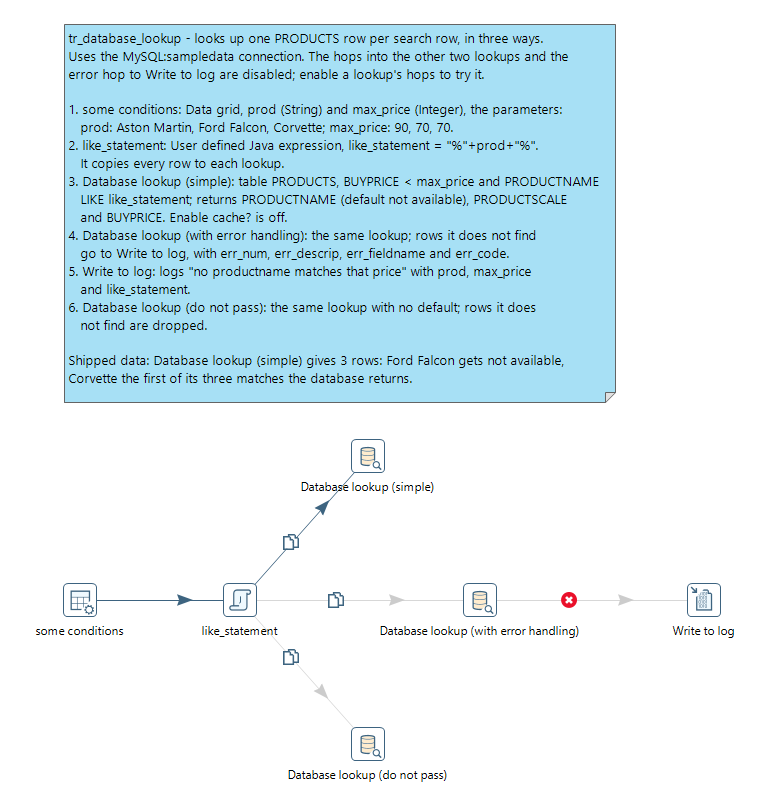
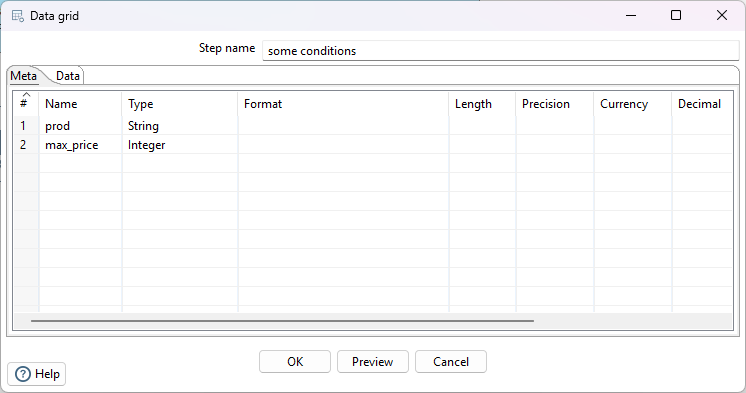
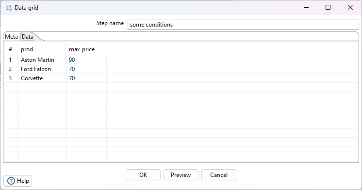
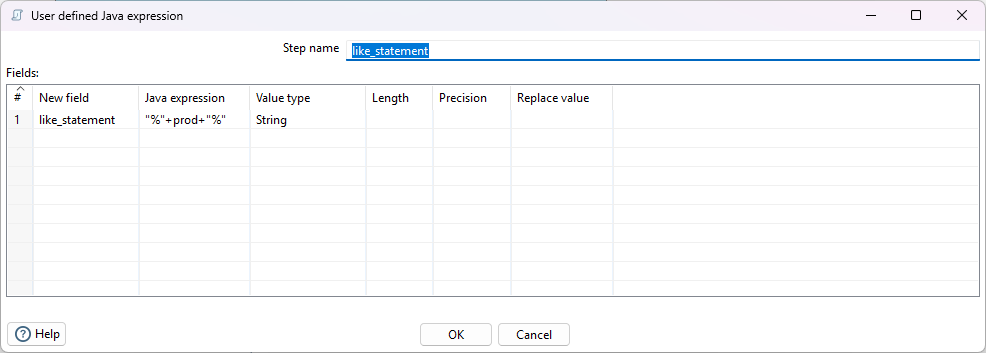
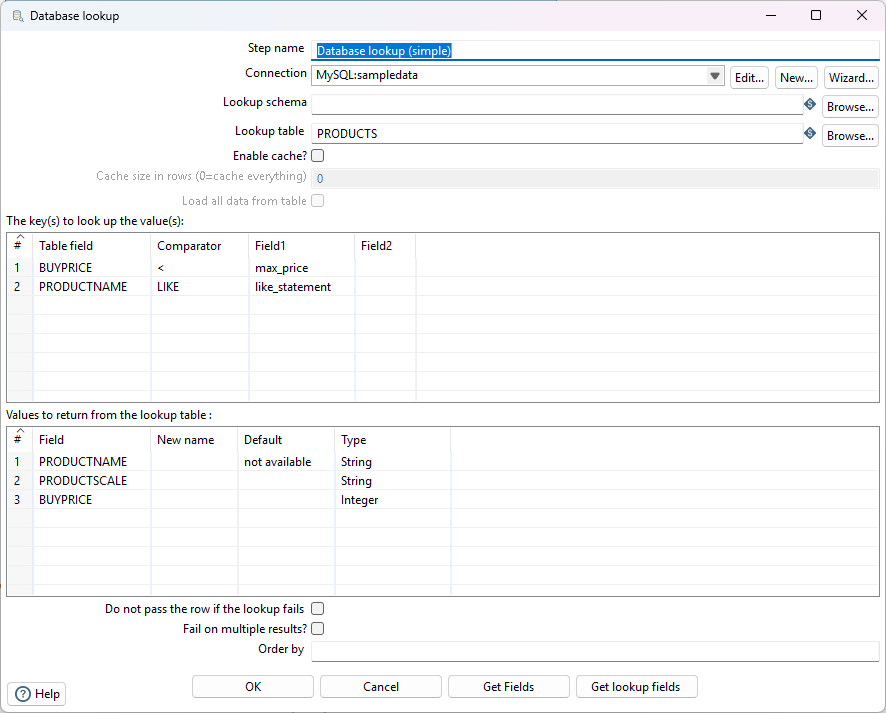
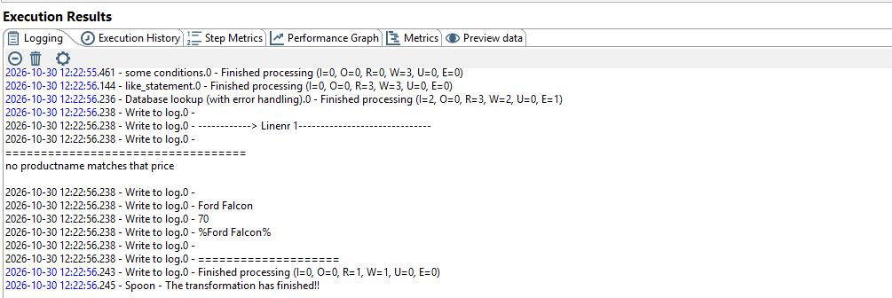
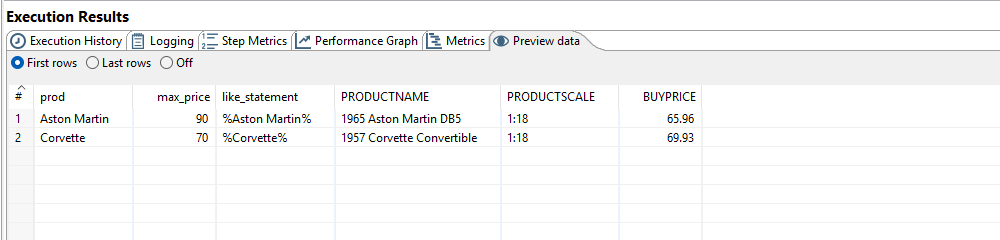

# Database Lookups

> **Warning:**
>
> #### Workshop - Database Lookups
> 
> **Database lookup** adds values from a database table to each row, found by key fields. It returns at most one row per input row.\
> In this workshop you look up products by a name pattern and a maximum price, then see what the step does when a lookup finds nothing, and when it finds more than one row.
> 
> **What you'll do**
> 
> * Build a search pattern with **User defined Java expression**
> * Configure a **Database lookup** with two key conditions and default values
> * Route failed lookups to the log with error handling, or drop them
> * Handle multiple matches with **Fail on multiple results?** and **Order by**
> 
> **Prerequisites:** [Review Lookups](../topic-mod4-lookups-review/guide.md); [Database Join](../22-mod4-database-join/guide.md), whose search rows this workshop reuses; the `MySQL:sampledata` connection from [Connecting to Database](../12-mod3-connecting-to-database/guide.md)
> 
> **Estimated time:** 30 minutes

<figure>

<figcaption class="pcm-video-caption">Walkthrough: coming soon</figcaption>

</figure>

---

<div align="center">
<figure>

<figcaption>What you build: three variants of one lookup</figcaption>
</figure>
</div>

:::: tabs

### 1. Data grid

> **Note:**
>
> #### Data grid
> 
> The same three searches as [Database Join](../22-mod4-database-join/guide.md): a product name and a maximum buy price.

1. Start Spoon with the **Start Pentaho Data Integration** button below, or from PowerShell:

```powershell
Set-Location C:\Pentaho\design-tools\data-integration
.\spoon.bat
```

<button data-launch="spoon" data-path="">Start Pentaho Data Integration</button>

2. Select **File > New > Transformation** (`Ctrl+N`).
3. Select **File > Save as** and save it as `tr_database_lookup.ktr` in `C:\Workshop-DI-Practitioner\04-enriching-the-dataset\03-lookups\26-mod4-database-lookups`.
4. On the **Design** tab, open the **Input** folder and drag **Data grid** onto the canvas.
5. Double-click **Data grid**. Set **Step name** to `some conditions`.
6. On the **Meta** tab, fill the grid:

   | Name        | Type    |
   | ----------- | ------- |
   | `prod`      | String  |
   | `max_price` | Integer |

7. Open the **Data** tab and fill the grid:

   | prod           | max_price |
   | -------------- | --------- |
   | `Aston Martin` | `90`      |
   | `Ford Falcon`  | `70`      |
   | `Corvette`     | `70`      |

<div align="center">
<figure>

<figcaption>Meta tab</figcaption>
</figure>
</div>

<div align="center">
<figure>

<figcaption>Data tab</figcaption>
</figure>
</div>

8. Select **Preview**, then **OK** in **Enter the preview size**.

> **Success:** Checkpoint: **Examine preview data** shows the 3 rows you typed.

9. Select **Close**, then **OK**.

### 2. User defined Java expression

> **Note:**
>
> #### User defined Java expression
> 
> **User defined Java expression** calculates new fields with Java expressions, one per field, with the row's fields available by name. Here it wraps the product name in `%` signs, the wildcards a SQL `LIKE` needs.

1. On the **Design** tab, open the **Scripting** folder and drag **User defined Java expression** onto the canvas.
2. Create a hop from **some conditions** to **User defined Java expression**: hold `Shift` and drag from one step to the other.
3. Double-click **User defined Java expression**. Set **Step name** to `like_statement`.
4. Fill the **Fields** grid with one row:

   | New field        | Java expression | Value type |
   | ---------------- | --------------- | ---------- |
   | `like_statement` | `"%"+prod+"%"`  | String     |

5. Select **OK**.

<div align="center">
<figure>

<figcaption>Aston Martin becomes %Aston Martin%</figcaption>
</figure>
</div>

6. Select **like_statement** on the canvas, press `F10` (**Action > Preview**), and select **Quick Launch**.

> **Success:** Checkpoint: 3 rows, with `like_statement` `%Aston Martin%`, `%Ford Falcon%` and `%Corvette%`.

7. Select **Close**.

### 3. Database lookup

> **Note:**
>
> #### Database lookup
> 
> Each row in **The key(s) to look up the value(s)** compares a table column with a stream field; together they form the query's `WHERE` clause. Each row in **Values to return from the lookup table** becomes a new field, with a default for when nothing is found.

::: tabs

### 3.1 Simple

1. On the **Design** tab, open the **Lookup** folder and drag **Database lookup** onto the canvas.
2. Create a hop from **like_statement** to **Database lookup**.
3. Double-click **Database lookup**. Set **Step name** to `Database lookup (simple)`.
4. Set **Connection** to `MySQL:sampledata` and **Lookup table** to `PRODUCTS`. Leave **Enable cache?** cleared.
5. Fill the **The key(s) to look up the value(s)** grid:

   | Table field   | Comparator | Field1           |
   | ------------- | ---------- | ---------------- |
   | `BUYPRICE`    | `<`        | `max_price`      |
   | `PRODUCTNAME` | `LIKE`     | `like_statement` |

6. Fill the **Values to return from the lookup table** grid. Leave **New name** empty.

   | Field          | Default         | Type    |
   | -------------- | --------------- | ------- |
   | `PRODUCTNAME`  | `not available` | String  |
   | `PRODUCTSCALE` |                 | String  |
   | `BUYPRICE`     |                 | Integer |

7. Select **OK**.

<div align="center">
<figure>

<figcaption>Two key conditions, three return values</figcaption>
</figure>
</div>

> **Under the hood:**
>
> #### Cache off: one query per row. Cache on: a hash table
>
> As configured, **Database lookup** prepares `SELECT PRODUCTNAME,
> PRODUCTSCALE, BUYPRICE FROM PRODUCTS WHERE BUYPRICE < ? AND
> PRODUCTNAME LIKE ?` once and executes it for every incoming row,
> taking the first row the database returns and adding its columns
> (or your defaults) to the stream. Three rows, three round trips:
> harmless here, ruinous at a million.
>
> **Enable cache?** changes the engine, not the SQL: results are kept in
> an in-memory map keyed on the lookup values, so a repeated key costs a
> hash probe instead of a query. **Load all data from table** goes
> further and reads the whole table once at start-up, after which the
> database is never asked again; but Pentaho Data Integration then does the comparisons
> itself, and it can't evaluate a `LIKE`. That is why both are off
> here.
>
> **Why it matters:** the same step is a per-row query or an in-memory
> join depending on two check boxes. For a reference table that fits in
> memory and an equality key, "load all" turns an hour into seconds.

8. Save the transformation (`Ctrl+S`).
9. Press `F9` (**Action > Run**), and select **Run** in the **Run Options** dialog.
10. Select **Database lookup (simple)** on the canvas and open the **Preview data** tab.

> **Success:** Checkpoint: one row out for each row in, 3 in all.
>
> | prod           | PRODUCTNAME | PRODUCTSCALE | BUYPRICE |
> | -------------- | ----------- | ------------ | -------- |
> | `Aston Martin` | `1965 Aston Martin DB5` | `1:18` | `65.96` |
> | `Ford Falcon`  | `not available` | no value | no value |
> | `Corvette`     | `1957 Corvette Convertible` | `1:18` | `69.93` |
>
> Ford Falcon has no product under 70 (the one Falcon in `PRODUCTS` costs 83.05), so it gets the default. Corvette has three, and the lookup returns the first the database sends back. `BUYPRICE` keeps its decimals although its **Type** is Integer: the value read from the table keeps the database column's type.

### 3.2 Error handling

1. Drag a second **Database lookup** onto the canvas and create a hop from **like_statement** to it. When Spoon asks, select **Copy**, so each lookup step gets every row rather than a share of them.
2. Double-click the new step. Set **Step name** to `Database lookup (with error handling)` and configure it as in steps 4 to 6 of 3.1. Select **OK**.
3. On the **Design** tab, open the **Utility** folder and drag **Write to log** onto the canvas.
4. Create a hop from **Database lookup (with error handling)** to **Write to log** and select **Error handling of step**.
5. Right-click **Database lookup (with error handling)** and select **Error Handling...**. Check that **Target step** is **Write to log** and **Enable the error handling?** is selected, then set the field names:

   | Setting                          | Value           |
   | -------------------------------- | --------------- |
   | **Nr of errors fieldname**       | `err_num`       |
   | **Error descriptions fieldname** | `err_descrip`   |
   | **Error fields fieldname**       | `err_fieldname` |
   | **Error codes fieldname**        | `err_code`      |

6. Select **OK**.
7. Double-click **Write to log**. Clear **Print header**.
8. Click in **Log message**, press `Enter` once, and type these two lines:

   ```text
   ==================================
   no productname matches that price
   ```

9. Fill the **Fields** grid with three rows: `prod`, `max_price` and `like_statement`.
10. Select **OK**.
11. Right-click the hop from **like_statement** to **Database lookup (simple)** and select **Disable**.
12. Save the transformation (`Ctrl+S`).
13. Press `F9` (**Action > Run**), and select **Run** in the **Run Options** dialog.
14. In **Execution Results**, open the **Logging** tab.

<div align="center">
<figure>

<figcaption>The failed lookup, in the log</figcaption>
</figure>
</div>

> **Success:** Checkpoint: with error handling on, a lookup that finds nothing is an error. **Write to log** prints your message, then the Ford Falcon row's values: `Ford Falcon`, `70` and `%Ford Falcon%`.

15. Select **Database lookup (with error handling)** on the canvas and open the **Preview data** tab.

<div align="center">
<figure>

<figcaption>Only the found rows carry on</figcaption>
</figure>
</div>

> **Success:** Checkpoint: 2 rows, Aston Martin and Corvette, with the values the simple lookup found. The Ford Falcon row went to **Write to log** instead.

### 3.3 Do not pass

1. Drag a third **Database lookup** onto the canvas and create a hop from **like_statement** to it. If Spoon asks, select **Copy**.
2. Double-click the new step. Set **Step name** to `Database lookup (do not pass)` and configure it as in steps 4 to 6 of 3.1, but leave **Default** empty for `PRODUCTNAME`.
3. Select **Do not pass the row if the lookup fails**, then select **OK**.
4. Right-click the hop from **like_statement** to **Database lookup (with error handling)** and select **Disable**.
5. Save the transformation (`Ctrl+S`).
6. Press `F9` (**Action > Run**), and select **Run** in the **Run Options** dialog.
7. Select **Database lookup (do not pass)** on the canvas and open the **Preview data** tab.

> **Success:** Checkpoint: 2 rows, Aston Martin and Corvette. The Ford Falcon row is dropped, silently: no default, no error.

### 3.4 Several matches

**Database lookup** is meant to find one row per input row. When the table has several (Corvette matches three products under 70), you choose what happens: fail, or decide which row comes first.

1. Right-click the hop from **like_statement** to **Database lookup (do not pass)** and select **Disable**.
2. Right-click the hop from **like_statement** to **Database lookup (simple)** and select **Enable**.
3. Double-click **Database lookup (simple)**. Select **Fail on multiple results?**, then select **OK**. **Order by** is grayed out while it is selected: the two settings are alternatives.
4. Save the transformation (`Ctrl+S`).
5. Press `F9` (**Action > Run**), and select **Run** in the **Run Options** dialog.

> **Success:** Checkpoint: the run stops with an error on **Database lookup (simple)**, at the Corvette row. The **Logging** tab shows `Only 1 row was expected as a result of a lookup, and at least 2 were found!`

6. Double-click **Database lookup (simple)**. Clear **Fail on multiple results?** and set **Order by** to `PRODUCTSCALE DESC, PRODUCTNAME`. Select **OK**.
7. Save the transformation (`Ctrl+S`).
8. Press `F9` (**Action > Run**), and select **Run** in the **Run Options** dialog.
9. Select **Database lookup (simple)** on the canvas and open the **Preview data** tab.

> **Success:** Checkpoint: the Corvette row now returns `1958 Chevy Corvette Limited Edition`, scale `1:24`, with **BUYPRICE** `15.91`. Scale `1:24` sorts before `1:18` in descending order, and of the two 1:24 Corvettes, its name sorts first.

10. Double-click **Database lookup (simple)**, delete the contents of **Order by**, and select **OK**. The step is back as the solution has it.

With error handling, as in 3.2, **Fail on multiple results?** sends the Corvette row to **Write to log** alongside Ford Falcon instead of stopping the run. To get *all* the matching rows, use [Database Join](../22-mod4-database-join/guide.md) instead: it returns every row the query finds.

:::

::::

## Troubleshooting <!-- no-step -->

<details>

<summary>Each lookup step previews only some of the rows</summary>

The hops from `like_statement` distribute rows instead of copying them. Right-click **like_statement**, select **Data Movement**, then **Copy Data to Next Steps**.

</details>

<details>

<summary>Every row gets the default value</summary>

Check the key rows: `BUYPRICE` `<` `max_price`, and `PRODUCTNAME` `LIKE` `like_statement` (with its `%` signs).

</details>

## Lab Files

Click a file to download. For `.ktr` and `.kjb` files, **Open in Pentaho Data Integration** launches Pentaho Data Integration with the file loaded. If Pentaho Data Integration is already running, the path is copied to your clipboard — switch to Pentaho Data Integration and press `Ctrl+O`, `Ctrl+V`, `Enter`.

### Solution <!-- no-step -->

The finished transformation for this lab. Open it alongside your own to compare, or run to see the expected result.

Also on disk at `C:\Workshop-DI-Practitioner\04-enriching-the-dataset\03-lookups\26-mod4-database-lookups\solution`.

[tr_database_lookup.ktr](./files/tr_database_lookup.ktr) <button data-launch="spoon" data-path="files/tr_database_lookup.ktr">Open in Pentaho Data Integration</button> <button data-graph="files/tr_database_lookup.ktr">View graph</button>
