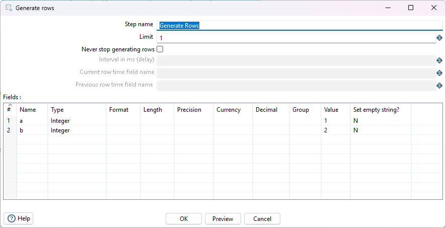
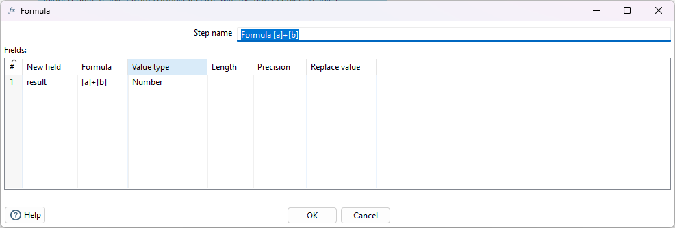
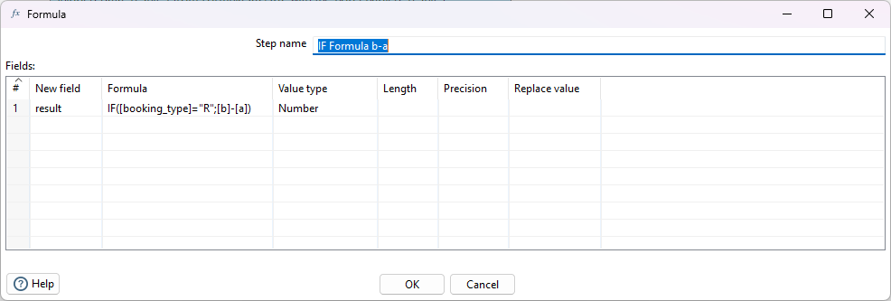

# Formula

> **Warning:**
>
> #### Workshop - Formula
> 
> The **Formula** step creates or replaces fields with spreadsheet-style expressions: arithmetic, text, dates and conditions.\
> In this workshop you generate a test row and build two formulas, a sum and a conditional.
> 
> **What you'll do**
> 
> * Generate a test row with **Generate rows**
> * Write a simple calculation in **Formula**, referring to fields as `[field]`
> * Add a condition with `IF`, and see why it needs all three arguments
> 
> **Prerequisites:** [Review Scripting](../topic-mod4-scripting-review/guide.md)
> 
> **Estimated time:** 20 minutes

<figure>

![The finished transformation: Generate Rows into Formula [a]+[b], and Generate Rows 2 into IF Formula b-a](../_assets/images/formula.png)

<div align="center">
<figcaption><em>What you build: two small flows</em></figcaption>
</div>
</figure>

:::: tabs

### 1. Generate rows

> **Note:**
>
> #### Generate rows
> 
> **Generate rows** outputs a set number of rows, each with the same fixed values. It is mostly for tests, or for one row that starts a flow, such as a row of parameters for a query.

1. Start Spoon with the **Start PDI** button below, or from PowerShell:

```powershell
Set-Location C:\Pentaho\design-tools\data-integration
.\spoon.bat
```

<button data-launch="spoon" data-path="">Start PDI</button>

2. Select **File > New > Transformation** (`Ctrl+N`).
3. Select **File > Save as** and save it as `tr_formula.ktr` in `C:\Workshop-DI-Practitioner\04-enriching-the-dataset\04-scripting\27-mod4-formula`.
4. On the **Design** tab, open the **Input** folder and drag **Generate rows** onto the canvas.
5. Double-click **Generate rows**. Set **Step name** to `Generate Rows` and **Limit** to `1`.
6. Fill the **Fields** grid:

   | Name | Type    | Value |
   | ---- | ------- | ----- |
   | `a`  | Integer | `1`   |
   | `b`  | Integer | `2`   |

<figure><figcaption><p>One row: a = 1, b = 2</p></figcaption></figure>

7. Select **Preview**, then **OK** in **Enter preview size**.

> **Success:** Checkpoint: **Examine preview data** shows 1 row: `a` 1, `b` 2.

8. Select **Close**, then **OK**.

### 2. Workflow 1: A Sum

> **Note:**
>
> #### Formula
> 
> Each row of the **Formula** step's grid creates a **New field** from a **Formula**. Fields of the row are written in square brackets, `[a]`, and functions take their arguments separated by semicolons: `IF(condition; then; else)`.

1. On the **Design** tab, open the **Scripting** folder and drag **Formula** onto the canvas.
2. Create a hop from **Generate Rows** to **Formula**: hold `Shift` and drag from one step to the other.
3. Double-click **Formula**. Set **Step name** to `Formula [a]+[b]`.
4. Fill the **Fields** grid with one row:

   | New field | Formula   | Value type |
   | --------- | --------- | ---------- |
   | `result`  | `[a]+[b]` | Number     |

5. Select **OK**.

<figure><figcaption><p>result = [a]+[b]</p></figcaption></figure>

6. Save the transformation (`Ctrl+S`).
7. Press `F9` (**Action > Run**), and select **Run** in the **Run Options** dialog.
8. Select **Formula [a]+[b]** on the canvas and open the **Preview data** tab.

> **Success:** Checkpoint: one row: `a` 1, `b` 2, and `result` 3.

### 3. Workflow 2: A Condition

> **Note:**
>
> #### IF
> 
> `IF` returns its second argument when the condition is true, and its third when it is false. This first version gives it only two.

1. Drag a second **Generate rows** onto the canvas. Double-click it, and set **Step name** to `Generate Rows 2` and **Limit** to `1`.
2. Fill the **Fields** grid, then select **OK**:

   | Name           | Type    | Value |
   | -------------- | ------- | ----- |
   | `a`            | Integer | `1`   |
   | `b`            | Integer | `2`   |
   | `booking_type` | String  | `R`   |

3. Drag a second **Formula** onto the canvas, and create a hop from **Generate Rows 2** to it.
4. Double-click the new step. Set **Step name** to `IF Formula b-a`.
5. Fill the **Fields** grid with one row:

   | New field | Formula                          | Value type |
   | --------- | -------------------------------- | ---------- |
   | `result`  | `IF([booking_type]="R";[b]-[a])` | Number     |

6. Select **OK**.

<figure><figcaption><p>A conditional formula</p></figcaption></figure>

> **Under the hood:**
>
> #### Same formula engine as Pentaho Reporting, parsed once per run
>
> The **Formula** step doesn't interpret your text row by row. On the
> first row it hands each expression to LibFormula, the OpenFormula
> engine that also powers Pentaho Report Designer, which parses it into
> an expression tree once. Per row the engine binds `[a]`, `[b]` and
> `[booking_type]` to the current row's values by name, walks the tree,
> and writes the result into the output field with the type you set.
>
> Because the parse happens once, on the first row, a typo in a formula
> fails the step on row 1, not on row 40,000. And because it is
> OpenFormula, the functions (`IF`, `AND`, `OR`, `CONCATENATE`,
> `TODAY` and many more) are the spreadsheet vocabulary your analysts
> already know. Not every spreadsheet function is there: PDI 11's
> Formula has no `ROUND`, for example; `INT([x]*100+0.5)/100` rounds to
> the cent instead.
>
> **Why it matters:** most business logic (conditional pricing, derived
> flags, string assembly) fits in a Formula step, without a script.

7. Save the transformation (`Ctrl+S`).
8. Press `F9` (**Action > Run**), and select **Run** in the **Run Options** dialog.
9. Select **IF Formula b-a** on the canvas and open the **Preview data** tab.

> **Success:** Checkpoint: `result` is 1, `b` minus `a`, because `booking_type` is `R`.

### 4. Give IF All Three Arguments

> **Note:**
>
> #### When the condition is false
> 
> The formula has no third argument, so `IF` has no value to return for a row whose `booking_type` isn't `R`. The OpenFormula specification says it then returns FALSE, a Boolean, which the Number field `result` can't hold.

1. Double-click **Generate Rows 2**. Set the **Value** of `booking_type` to `X`, then select **OK**.
2. Save the transformation (`Ctrl+S`).
3. Press `F9` (**Action > Run**), and select **Run** in the **Run Options** dialog.
4. In **Execution Results**, open the **Logging** tab.

> **Success:** Checkpoint: the run fails on **IF Formula b-a**. The log shows `Please specify a Boolean type for field [result] as a result of formula [IF([booking_type]="R";[b]-[a])]`.

5. Double-click **IF Formula b-a**. Change **Formula** to `IF([booking_type]="R";[b]-[a];0)`, then select **OK**.
6. Save the transformation (`Ctrl+S`).
7. Press `F9` (**Action > Run**), and select **Run** in the **Run Options** dialog.
8. Select **IF Formula b-a** on the canvas and open the **Preview data** tab.

> **Success:** Checkpoint: the run succeeds, and `result` is 0: the condition is false, so `IF` returns its third argument.

9. Double-click **Generate Rows 2**, set the **Value** of `booking_type` back to `R`, and select **OK**. A run now gives `result` 1 again. In your own formulas, give every `IF` its third argument.

<div class="pcm-embed-card" data-href="http://docs.oasis-open.org/office/v1.2/OpenDocument-v1.2-part2.html" data-title="OpenDocument formula specification (OASIS)"></div>

::::

## Lab Files

Click a file to download. For `.ktr` and `.kjb` files, **Open in Pentaho Data Integration** launches PDI with the file loaded. If PDI is already running, the path is copied to your clipboard — switch to PDI and press `Ctrl+O`, `Ctrl+V`, `Enter`.

### Solution <!-- no-step -->

The finished transformation for this lab. Open it alongside your own to compare, or run to see the expected result. Its hop into **IF Formula b-a** is disabled, so a run shows Workflow 1; enable the hop to run Workflow 2.

Also on disk at `C:\Workshop-DI-Practitioner\04-enriching-the-dataset\04-scripting\27-mod4-formula\solution`.

[tr_formula.ktr](./files/tr_formula.ktr) <button data-launch="spoon" data-path="files/tr_formula.ktr">Open in Pentaho Data Integration</button> <button data-graph="files/tr_formula.ktr">View graph</button>
