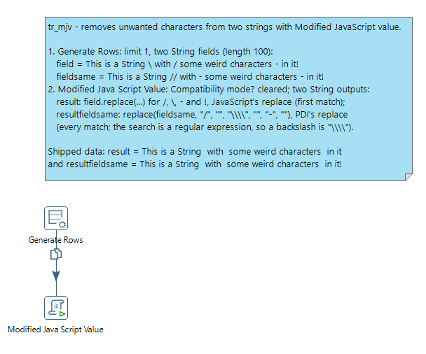
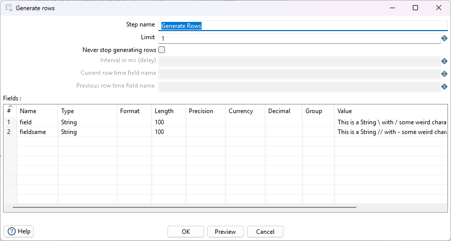
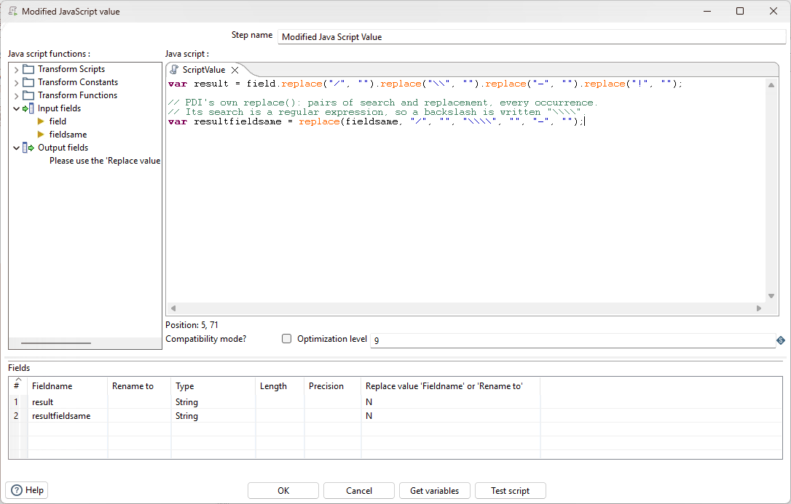

# Modified JavaScript Value

> **Warning:**
>
> #### Workshop - Modified JavaScript Value
> 
> **Modified JavaScript value** runs a JavaScript script once for each row, with the row's fields as variables. Use it for logic the other steps can't express: loops, state across rows, string handling of any complexity.\
> In this workshop you clean unwanted characters out of two strings, two ways.
> 
> **What you'll do**
> 
> * Generate a test row with **Generate rows**
> * Write a script in **Modified JavaScript value**
> * Return script variables as new fields
> * Compare JavaScript's `replace` with PDI's own `replace()` function
> 
> **Prerequisites:** [Review Scripting](../topic-mod4-scripting-review/guide.md); a little JavaScript
> 
> **Estimated time:** 20 minutes

<div align="center">
<figure>

<figcaption>What you build</figcaption>
</figure>
</div>

:::: tabs

### 1. Generate rows

> **Note:**
>
> #### Generate rows
> 
> One row with two messy strings to clean.

1. Start Spoon with the **Start PDI** button below, or from PowerShell:

```powershell
Set-Location C:\Pentaho\design-tools\data-integration
.\spoon.bat
```

<button data-launch="spoon" data-path="">Start PDI</button>

2. Select **File > New > Transformation** (`Ctrl+N`).
3. Select **File > Save as** and save it as `tr_mjv.ktr` in `C:\Workshop-DI-Practitioner\04-enriching-the-dataset\04-scripting\28-mod4-mjv`.
4. On the **Design** tab, open the **Input** folder and drag **Generate rows** onto the canvas.
5. Double-click **Generate rows**. Set **Step name** to `Generate Rows` and **Limit** to `1`.
6. Fill the **Fields** grid with two String fields:

   | Name        | Type   | Length | Value                                                       |
   | ----------- | ------ | ------ | ----------------------------------------------------------- |
   | `field`     | String | `100`  | `This is a String \ with / some weird characters - in it!`  |
   | `fieldsame` | String | `100`  | `This is a String // with - some weird characters - in it!` |

<div align="center">
<figure>

<figcaption>Two strings to clean</figcaption>
</figure>
</div>

7. Select **Preview**, then **OK** in **Enter preview size**.

> **Success:** Checkpoint: **Examine preview data** shows 1 row, with `field` and `fieldsame` as you typed them.

8. Select **Close**, then **OK**.

### 2. Modified JavaScript value

> **Note:**
>
> #### Modified JavaScript value
> 
> The script runs once per row. Each input field is a variable of the same name, and each variable you list in the **Fields** grid becomes an output field. The step needs an input stream: it doesn't create rows.

1. On the **Design** tab, open the **Scripting** folder and drag **Modified JavaScript value** onto the canvas.
2. Create a hop from **Generate Rows** to **Modified JavaScript value**: hold `Shift` and drag from one step to the other.
3. Double-click **Modified JavaScript value**. Set **Step name** to `Modified Java Script Value`.
4. Leave **Compatibility mode?** cleared.
5. In the script tab, replace the `//Script here` line with this script:

   ```javascript
   var result = field.replace("/", "").replace("\\", "").replace("-", "").replace("!", "");

   // PDI's own replace(): pairs of search and replacement, every occurrence.
   // Its search is a regular expression, so a backslash is written "\\\\".
   var resultfieldsame = replace(fieldsame, "/", "", "\\\\", "", "-", "");
   ```

6. Select **Get variables**. The **Fields** grid lists `result` and `resultfieldsame`, both String.
7. Select **OK**.

<div align="center">
<figure>

<figcaption>Script and output fields</figcaption>
</figure>
</div>

> **Under the hood:**
>
> #### Rhino compiles the script once; every row runs it again
>
> **Modified JavaScript value** embeds Mozilla Rhino, a JavaScript
> engine written in Java. When the step starts, it compiles your script
> once. For each row it then exposes the input fields as JavaScript
> variables (wrapping PDI's typed values), runs the compiled script,
> and reads back the variables listed in the **Fields** grid into output
> fields; that is why a variable's name is the field's name.
>
> Top-level variables survive between rows because the same scope is
> reused, so `var total = 0` in a **Start Script** and `total += amount`
> in the main script give a running total. The flexibility has a cost:
> each row crosses between Java and JavaScript twice, which makes this
> step slower than **Calculator**, **Formula** or **User defined Java
> expression** doing the same work.
>
> **Why it matters:** reach for JavaScript when you need loops,
> regular-expression logic or state across rows. For arithmetic and
> conditions, the other steps are faster and easier to read.

8. Save the transformation (`Ctrl+S`).
9. Press `F9` (**Action > Run**), and select **Run** in the **Run Options** dialog.
10. Select **Modified Java Script Value** on the canvas and open the **Preview data** tab.

> **Success:** Checkpoint: the two new fields read
>
> | Field             | Value                                                   |
> | ----------------- | ------------------------------------------------------- |
> | `result`          | `This is a String  with  some weird characters  in it`  |
> | `resultfieldsame` | `This is a String  with  some weird characters  in it!` |
>
> `result` lost its `\`, `/`, `-` and `!`. `resultfieldsame` lost both `/` and both `-`, but kept its `!`, which isn't in its list.
>
> The two `replace`s differ. JavaScript's `string.replace("-", "")` replaces only the *first* match; it works on `field` because each character appears once there. PDI's `replace(value, search, replacement, ...)` replaces *every* match, and takes several search-replacement pairs in one call.

::::

## Lab Files

Click a file to download. For `.ktr` and `.kjb` files, **Open in Pentaho Data Integration** launches PDI with the file loaded. If PDI is already running, the path is copied to your clipboard — switch to PDI and press `Ctrl+O`, `Ctrl+V`, `Enter`.

### Solution <!-- no-step -->

The finished transformation for this lab. Open it alongside your own to compare, or run to see the expected result.

Also on disk at `C:\Workshop-DI-Practitioner\04-enriching-the-dataset\04-scripting\28-mod4-mjv\solution`.

[tr_mjv.ktr](./files/tr_mjv.ktr) <button data-launch="spoon" data-path="files/tr_mjv.ktr">Open in Pentaho Data Integration</button> <button data-graph="files/tr_mjv.ktr">View graph</button>
