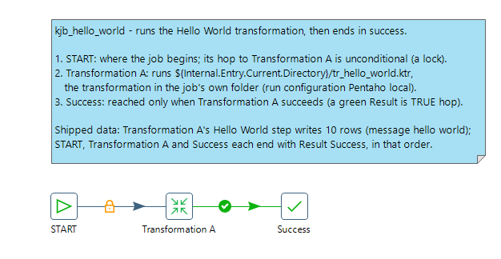
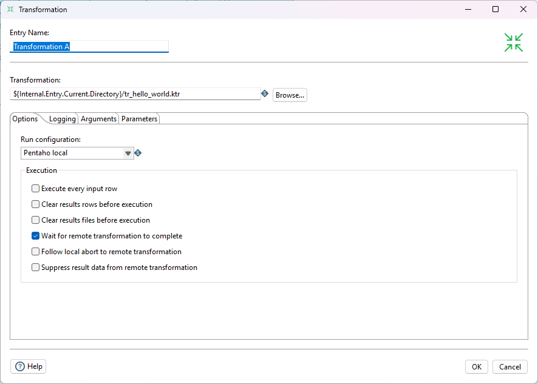
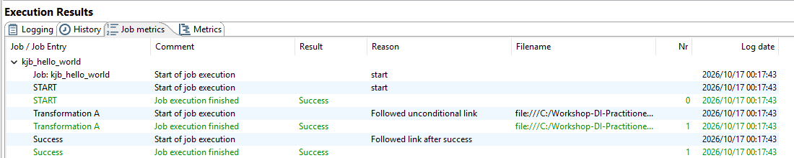
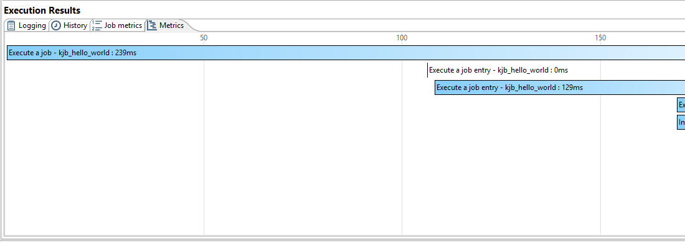

# Hello World (Job)

> **Warning:**
>
> #### Workshop - Hello World (Job)
> 
> A **job** orchestrates work: it runs transformations and other entries in an order you set, and decides what happens next from each one's success or failure.\
> In this workshop you build the simplest useful job: it runs the Hello World transformation and ends in a success state.
> 
> **What you'll do**
> 
> * Start a job with the **Start** entry
> * Run an existing transformation with a **Transformation** entry
> * End in a success state with **Success**
> * Run the job and read its **Job metrics**
> 
> **Prerequisites:** [Review Jobs](../topic-mod5-jobs-review/guide.md); the `tr_hello_world.ktr` transformation from [Hello World](../03-mod2-hello-world/guide.md), also in this lab's **Lab Files**
> 
> **Estimated time:** 20 minutes

<figure>

<figcaption class="pcm-video-caption">Walkthrough: coming soon</figcaption>

</figure>

---

<div align="center">
<figure>

<figcaption>What you build</figcaption>
</figure>
</div>

:::: tabs

### 1. Start

> **Note:**
>
> #### Start
> 
> **Start** is where a job begins. Every job has exactly one, and the hops leaving it are always unconditional. Its settings include a simple repeat schedule, but that only lasts while Spoon or Kitchen keeps running; schedule production jobs with the Pentaho Server instead.

1. Start Spoon with the **Start Pentaho Data Integration** button below, or from PowerShell:

```powershell
Set-Location C:\Pentaho\design-tools\data-integration
.\spoon.bat
```

<button data-launch="spoon" data-path="">Start Pentaho Data Integration</button>

2. Copy `tr_hello_world.ktr` from the lab's `solution` folder, `C:\Workshop-DI-Practitioner\05-enterprise-solution\01-jobs\29-mod5-hello-world-job\solution`, into the lab folder, `C:\Workshop-DI-Practitioner\05-enterprise-solution\01-jobs\29-mod5-hello-world-job`. The job you build looks for the transformation in its own folder.

> **Tip:** Your own `tr_hello_world.ktr` from [Hello World](../03-mod2-hello-world/guide.md) works too: copy it into the lab folder instead. Its first step is named `gr_hello-world` rather than `Hello World`.

3. Select **File > Open** (`Ctrl+O`) and open `tr_hello_world.ktr` from the lab folder.
4. Select **Hello World** on the canvas, press `F10` (**Action > Preview**), and select **Quick Launch**.

> **Success:** Checkpoint: **Examine preview data** shows 10 rows, and every row's `message` is `hello world`. This is the work the job runs.

5. Select **Close**.
6. Select **File > Close** (`Ctrl+W`) to close the transformation.
7. Select **File > New > Job** (`Ctrl+Alt+N`).
8. Select **File > Save as** and save it as `kjb_hello_world.kjb` in `C:\Workshop-DI-Practitioner\05-enterprise-solution\01-jobs\29-mod5-hello-world-job`.
9. On the **Design** tab, open the **General** folder and drag **Start** onto the canvas.

> **Note:** Spoon names the entry `Start`. The solution and the screenshots name it `START`; the name makes no difference to how the job runs.

### 2. Transformation

> **Note:**
>
> #### Transformation
> 
> The **Transformation** entry runs a transformation from a file, and its result (success or failure) becomes the entry's result.

1. On the **Design** tab, open the **General** folder and drag **Transformation** onto the canvas.
2. Double-click **Transformation**.
3. Set **Entry Name** to `Transformation A`.
4. Set **Transformation** to:

   ```text
   ${Internal.Entry.Current.Directory}/tr_hello_world.ktr
   ```

   `${Internal.Entry.Current.Directory}` is the job's own folder, so the job finds the transformation wherever the two are copied together.

<div align="center">
<figure>

<figcaption>The Transformation entry</figcaption>
</figure>
</div>

5. Leave **Run configuration** set to `Pentaho local`, and select **OK**. The label under the entry now reads **Transformation A**.

### 3. Success

> **Note:**
>
> #### Success
> 
> The **Success** entry clears any error state and ends the job as successful.

1. On the **Design** tab, open the **General** folder and drag **Success** onto the canvas. Keep its entry name, `Success`.
2. Create a hop from **Start** to **Transformation A**: hold `Shift` and drag from one entry to the other. It is an unconditional hop: it shows a lock.
3. Create a hop from **Transformation A** to **Success**. Spoon makes it a **Result is TRUE** hop: it is green, with a check mark, and the job follows it only when **Transformation A** succeeds. If it is not green, right-click the hop and select **Evaluation > Follow When Result is True**.
4. Save the job (`Ctrl+S`).

> **Success:** Checkpoint: your canvas matches the **What you build** figure: **Start**, a lock hop to **Transformation A**, a green hop to **Success**.

### 4. Run

> **Note:**
>
> #### Run the Job
> 
> Run it, then read what each entry did.

1. Press `F9` (**Action > Run**), and select **Run** in the **Run Options** dialog.
2. In **Execution Results**, open the **Job metrics** tab.

<div align="center">
<figure>

<figcaption>Job metrics: one entry after another</figcaption>
</figure>
</div>

> **Success:** Checkpoint: **Start**, **Transformation A** and **Success** each end with **Result** `Success`, in that order. **Transformation A** was reached by "Followed unconditional link", and **Success** by "Followed link after success".

3. Open the **Logging** tab. The job's log includes the lines the transformation wrote while it ran inside the job.

> **Success:** Checkpoint: the transformation's steps report their rows: `Hello World.0 - Finished processing (I=0, O=0, R=0, W=10, U=0, E=0)` and `Dummy (do nothing).0 - Finished processing (I=0, O=0, R=10, W=10, U=0, E=0)`, between `Starting entry [Transformation A]` and `Starting entry [Success]`.

4. Open the **Metrics** tab: a timeline of the job, its entry, and the transformation's initialization and steps inside it.

<div align="center">
<figure>

<figcaption>Metrics: where the time went</figcaption>
</figure>
</div>

> **Under the hood:**
>
> #### A job runs one entry at a time; a transformation runs every step at once
>
> This is a different engine. Where a transformation starts every step
> on its own thread and streams rows between them, a job walks its
> entries **in sequence**: Start, then the **Transformation** entry,
> then **Success**. Each entry returns a *result* (success or failure,
> plus lists of rows and files), and the hop colors are conditions on
> that result: green follows success, red follows failure, and a lock
> means unconditional.
>
> The Transformation entry did something more. It loaded
> `tr_hello_world.ktr`, started the full multithreaded transformation
> engine inside the job, waited for it to finish, and turned its outcome
> into the entry's result. **Success** then ended the job as successful.
>
> **Why it matters:** this split is Pentaho Data Integration's design rule. Rows and data
> logic belong in transformations; order, conditions, retries and
> notifications belong in jobs. Keep them apart and each stays simple.

::::

## Lab Files

Click a file to download. For `.ktr` and `.kjb` files, **Open in Pentaho Data Integration** launches Pentaho Data Integration with the file loaded. If Pentaho Data Integration is already running, the path is copied to your clipboard — switch to Pentaho Data Integration and press `Ctrl+O`, `Ctrl+V`, `Enter`.

### Solution <!-- no-step -->

The finished job and transformations for this lab. Open them alongside your own to compare, or run to see the expected result.

Also on disk at `C:\Workshop-DI-Practitioner\05-enterprise-solution\01-jobs\29-mod5-hello-world-job\solution`.

[kjb_hello_world.kjb](./files/kjb_hello_world.kjb) <button data-launch="spoon" data-path="files/kjb_hello_world.kjb">Open in Pentaho Data Integration</button> <button data-graph="files/kjb_hello_world.kjb">View graph</button>

[tr_hello_world.ktr](./files/tr_hello_world.ktr) <button data-launch="spoon" data-path="files/tr_hello_world.ktr">Open in Pentaho Data Integration</button> <button data-graph="files/tr_hello_world.ktr">View graph</button>
