# Onboarding to a Table

> **Warning:**
>
> #### Workshop - Onboarding to a Table
> 
> Onboarding a new file into a table usually means a new transformation: the same CSV input, select and table output, with a different field list. **Metadata injection** builds that transformation once, as a template with no fields, and fills the field list in at run time from data. Here you load `customers.txt` both ways and get the same table.
> 
> **What you'll do**
> 
> * Load `customers.txt` into a table with an ordinary transformation
> * Turn it into a template that knows no fields
> * Describe the fields, renames and removals in Data grids
> * Inject them with **ETL metadata injection** and run the result
> 
> **Prerequisites:** [Review Metadata Injection](../topic-mod5-metadata-injection-review/guide.md); [Writing to a Database](../14-mod3-writing-to-a-database/guide.md) (Table output) and the `MySQL:sampledata` connection from [Connecting to Database](../12-mod3-connecting-to-database/guide.md)
> 
> **Estimated time:** 25 minutes

<figure>

<figcaption class="pcm-video-caption">Walkthrough: coming soon</figcaption>

</figure>

---

<div align="center">
<figure>
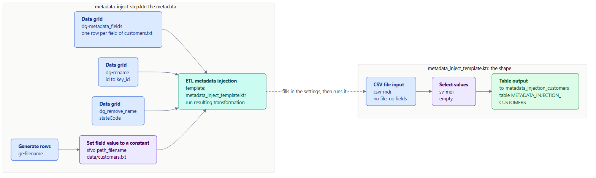
<figcaption>What you build: the metadata on the left fills the template on the right</figcaption>
</figure>
</div>

:::: tabs

### 1. The Target Table

> **Note:**
>
> #### The Target Table
>
> Both versions of the load write to one table, `METADATA_INJECTION_CUSTOMERS`. Its columns are `customers.txt`'s fields, with `id` renamed to `key_id` and `stateCode` removed.

1. In DBeaver, connected to `sampledata` as `pentaho_admin`, run the statement below. It is also in the lab folder as `create_metadata_injection_customers.sql`, and in **Lab Files**.

   ```sql
   CREATE TABLE IF NOT EXISTS METADATA_INJECTION_CUSTOMERS (
     key_id    VARCHAR(3),
     name      VARCHAR(10),
     firstname VARCHAR(13),
     zip       VARCHAR(5),
     city      VARCHAR(8),
     birthdate DATETIME,
     street    VARCHAR(11),
     housenr   VARCHAR(3),
     state     VARCHAR(30)
   );
   ```

2. In DBeaver, run:

   ```sql
   SELECT * FROM METADATA_INJECTION_CUSTOMERS;
   ```

> **Success:** Checkpoint: the result has the nine columns `key_id`, `name`, `firstname`, `zip`, `city`, `birthdate`, `street`, `housenr` and `state`, and no rows. (If you ran this workshop before, it holds that run's 100 rows: the loads below empty it first.)

### 2. csvi-customers

> **Note:**
>
> #### Load It by Hand First
>
> Build the ordinary version, so you know what the template has to become.

1. Start Spoon with the **Start Pentaho Data Integration** button below, or from PowerShell:

```powershell
Set-Location C:\Pentaho\design-tools\data-integration
.\spoon.bat
```

<button data-launch="spoon" data-path="">Start Pentaho Data Integration</button>

2. Select **File > New > Transformation** (`Ctrl+N`).
3. Select **File > Save as** and save it as `tr_onboard_customers_by_hand.ktr` in `C:\Workshop-DI-Practitioner\05-enterprise-solution\02-metadata-injection\31-mod5-onboarding-to-a-table`, next to the `data` folder.

4. On the **Design** tab, open the **Input** folder and drag **CSV file input** onto the canvas.
5. Double-click **CSV file input**.
6. Set **Step name** to `csvi-customers`.
7. Set **Filename** to:

   ```text
   ${Internal.Entry.Current.Directory}/data/customers.txt
   ```

8. Set **Delimiter** to `;`. Leave **Enclosure** `"`, and leave **Lazy conversion?** and **Header row present?** selected.
9. Select **Get Fields**. Spoon asks for the number of lines to sample: select **OK**, then close the **Scan results**.
10. Compare the **Fields** grid with this table, and correct any value that differs:

| Name        | Type    | Format       | Length | Precision | Trim type |
| ----------- | ------- | ------------ | ------ | --------- | --------- |
| `id`        | Integer | ` #`         | 15     | 0         | none      |
| `name`      | String  |              | 10     |           | none      |
| `firstname` | String  |              | 13     |           | none      |
| `zip`       | Integer | ` #`         | 15     | 0         | none      |
| `city`      | String  |              | 8      |           | none      |
| `birthdate` | Date    | `yyyy/MM/dd` |        |           | none      |
| `street`    | String  |              | 11     |           | none      |
| `housenr`   | Integer | ` #`         | 15     | 0         | none      |
| `stateCode` | String  |              | 9      |           | none      |
| `state`     | String  |              | 30     |           | none      |

   The format of the three Integer fields is a space followed by `#`: the file has a space before each number (` 13520`). The solution's fields also carry **Currency** `$`, **Decimal** `.` and **Group** `,`. Your **Currency** may show another symbol; none of these formats uses it.

<div align="center">
<figure>
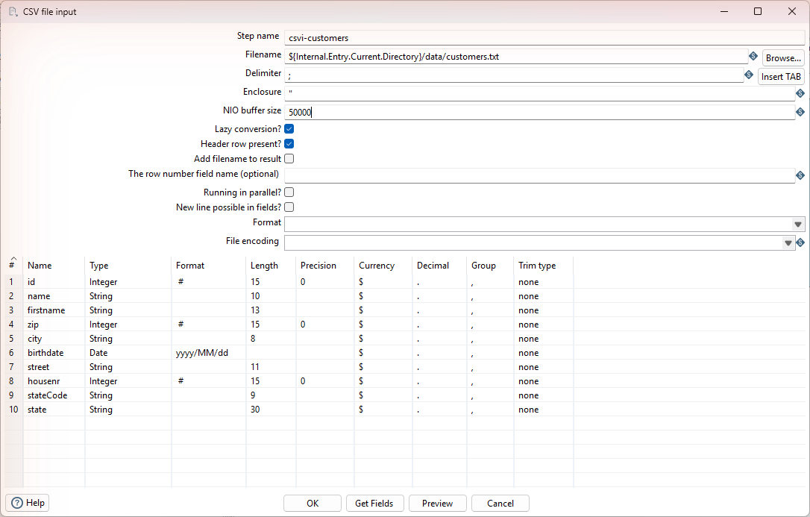
<figcaption>csvi-customers: the file, the delimiter and ten fields</figcaption>
</figure>
</div>

11. Select **Preview**, enter `100` rows, and select **OK**.

> **Success:** Checkpoint: **Examine preview data** shows 100 rows, the whole file. The first is customer `1`: `jwcdf-name`, `fsj-firstname`, from `oem-city`, state `AK`, `ALASKA`.

12. Select **Close**, then **OK**.

<div align="center">
<figure>
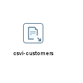
<figcaption>The canvas after csvi-customers</figcaption>
</figure>
</div>


### 3. sv-customers

> **Note:**
>
> #### sv-customers
>
> Add and set up **Select values**.

1. On the **Design** tab, open the **Transform** folder and drag **Select values** onto the canvas.
2. Create a hop from **csvi-customers** to **Select values**: hold `Shift` and drag from one step to the other.
3. Double-click **Select values**.
4. Set **Step name** to `sv-customers`.
5. On the **Select & Alter** tab, fill the **Fields** grid with one row:

| Fieldname | Rename to |
| --------- | --------- |
| `id`      | `key_id`  |

6. Select **Include unspecified fields, ordered by name**, so the other fields pass through too.

<div align="center">
<figure>
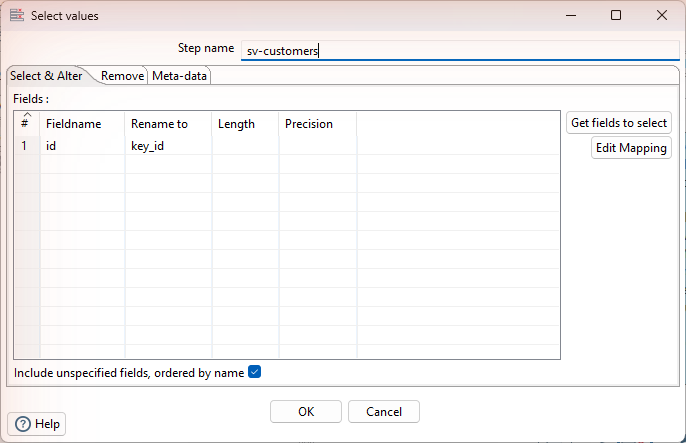
<figcaption>sv-customers, Select &amp; Alter: id becomes key_id</figcaption>
</figure>
</div>

7. Open the **Remove** tab and fill the grid with one row: **Fieldname** `stateCode`.

<div align="center">
<figure>
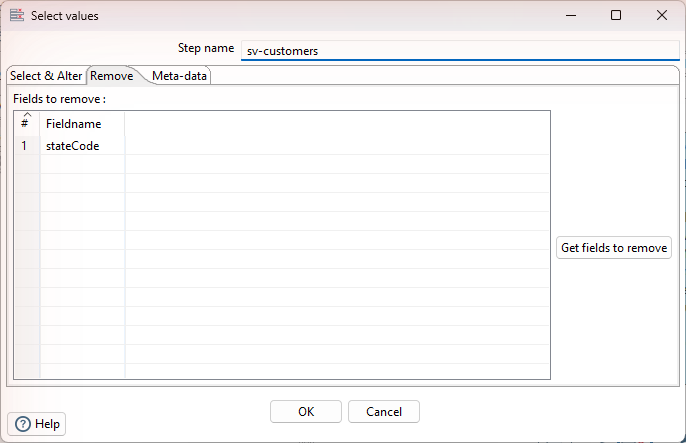
<figcaption>sv-customers, Remove: stateCode</figcaption>
</figure>
</div>

8. Select **OK**.

<div align="center">
<figure>
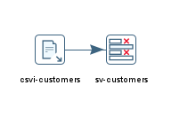
<figcaption>The canvas after sv-customers</figcaption>
</figure>
</div>


### 4. to-customers

> **Note:**
>
> #### to-customers
>
> Add **Table output**, then run the load and check the table.

1. On the **Design** tab, open the **Output** folder and drag **Table output** onto the canvas.
2. Create a hop from **sv-customers** to **Table output**.
3. Double-click **Table output**.
4. Set **Step name** to `to-customers`.
5. Set **Connection** to `MySQL:sampledata`.
6. Set **Target table** to `METADATA_INJECTION_CUSTOMERS`.
7. Select **Truncate table**, so every run starts from an empty table. Leave **Commit size** `1000` and **Use batch update for inserts** selected.

<div align="center">
<figure>
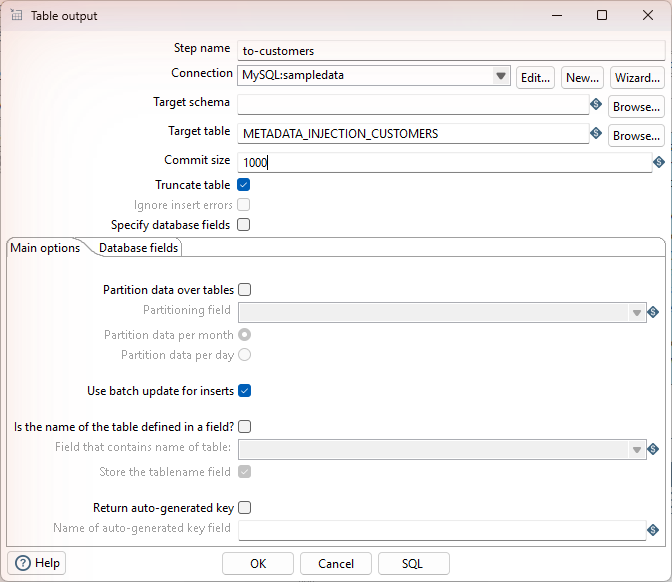
<figcaption>to-customers: truncate, then load METADATA_INJECTION_CUSTOMERS</figcaption>
</figure>
</div>

8. Select **OK**.

<div align="center">
<figure>
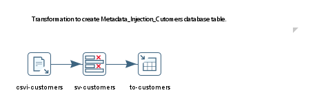
<figcaption>The hand-built load: csvi-customers, sv-customers, to-customers</figcaption>
</figure>
</div>

9. Save the transformation (`Ctrl+S`).
10. Press `F9` (**Action > Run**), and select **Run** in the **Run Options** dialog.
11. In **Execution Results**, open the **Step Metrics** tab.

> **Success:** Checkpoint: **to-customers** shows 100 in **Output**: one row per customer.

12. In DBeaver, run:

   ```sql
   SELECT COUNT(*) FROM METADATA_INJECTION_CUSTOMERS;

   SELECT key_id, name, firstname, zip, city, street, housenr, state
   FROM METADATA_INJECTION_CUSTOMERS
   WHERE key_id = '1';
   ```

> **Success:** Checkpoint: the count is `100`, and customer `1` reads `1`, `jwcdf-name`, `fsj-firstname`, `13520`, `oem-city`, `amrb-street`, `145`, `ALASKA`.

Every one of those settings is metadata: a file name, ten field definitions, one rename, one removal. That list is what injection supplies.

### 5. Make the Template

> **Note:**
>
> #### Make the Template
>
> Strip out everything that belongs to `customers.txt`: the file name, the fields, the rename and the removal. What is left is the shape of the load.

1. Select **File > Save as** and save it as `metadata_inject_template.ktr` in `C:\Workshop-DI-Practitioner\05-enterprise-solution\02-metadata-injection\31-mod5-onboarding-to-a-table`.
2. Double-click **csvi-customers**.
3. Set **Step name** to `csvi-mdi`.
4. Delete the text in **Filename**, so it is empty.
5. Clear **Lazy conversion?**.
6. Select **New line possible in fields?**.
7. Set **File encoding** to `UTF-8`.
8. Right-click the **Fields** grid and select **Clear all**.

<div align="center">
<figure>
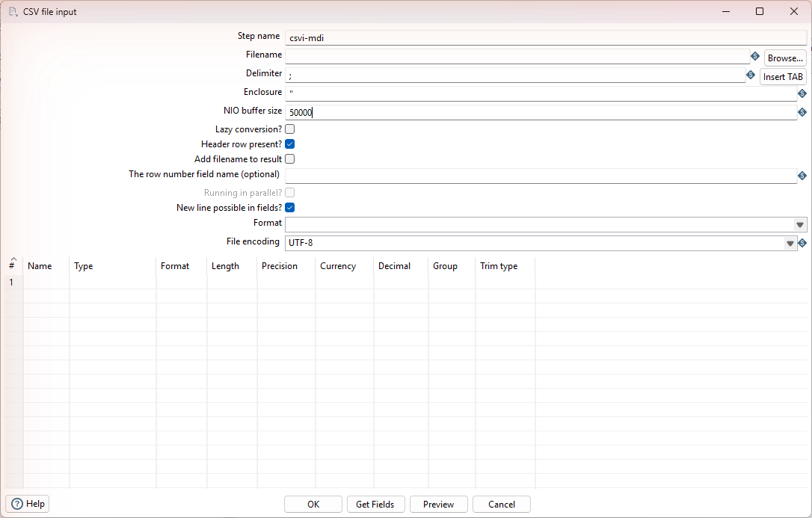
<figcaption>csvi-mdi: no file and no fields, waiting for metadata</figcaption>
</figure>
</div>

9. Select **OK**.
10. Double-click **sv-customers**.
11. Set **Step name** to `sv-mdi`.
12. On the **Select & Alter** tab, select the `id` row, right-click it, and select **Delete selected lines**.
13. Clear **Include unspecified fields, ordered by name**.
14. Open the **Remove** tab, select the `stateCode` row, right-click it, and select **Delete selected lines**.

<div align="center">
<figure>
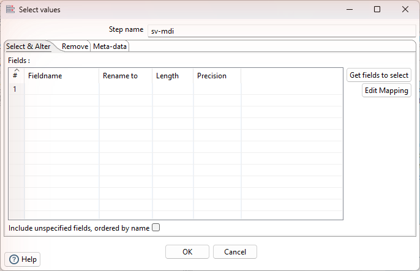
<figcaption>sv-mdi: empty, its Remove tab too</figcaption>
</figure>
</div>

15. Select **OK**.
16. Double-click **to-customers**.
17. Set **Step name** to `to-metadata_injection_customers`.
18. Clear **Use batch update for inserts**, as the solution's template has it. Leave the connection, **Target table** and **Truncate table** as they are.

<div align="center">
<figure>
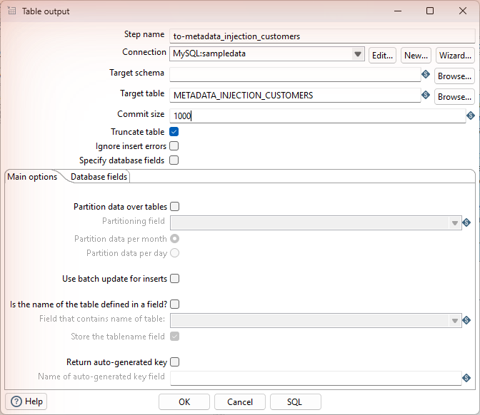
<figcaption>to-metadata_injection_customers: batch update cleared</figcaption>
</figure>
</div>

19. Select **OK**.
20. Save the transformation (`Ctrl+S`).

> **Success:** Checkpoint: the canvas shows **csvi-mdi**, **sv-mdi** and **to-metadata_injection_customers**, hopped in that order, and the **Fields** grid of **csvi-mdi** is empty.

The template can no longer run on its own: it has no file and no fields. It is a shape waiting for metadata.

<div align="center">
<figure>
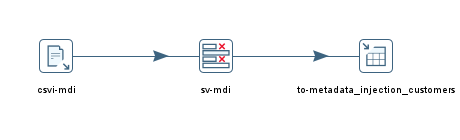
<figcaption>The canvas after csvi-mdi, sv-mdi, to-metadata_injection_customers</figcaption>
</figure>
</div>


### 6. dg-metadata_fields

> **Note:**
>
> #### Describe the Metadata in Data Grids
>
> A second transformation holds the metadata as rows: one row per field of the file, one for the rename, one for the removal, and one for the file name.

1. Select **File > New > Transformation** (`Ctrl+N`).
2. Select **File > Save as** and save it as `metadata_inject_step.ktr` in `C:\Workshop-DI-Practitioner\05-enterprise-solution\02-metadata-injection\31-mod5-onboarding-to-a-table`.

3. On the **Design** tab, open the **Input** folder and drag **Data grid** onto the canvas.
4. Double-click **Data grid**.
5. Set **Step name** to `dg-metadata_fields`.
6. On the **Meta** tab, fill the grid with nine fields, all of **Type** String: `name`, `type`, `format`, `length`, `precision`, `currency`, `decimal`, `group` and `trimtype`, in that order.

<div align="center">
<figure>
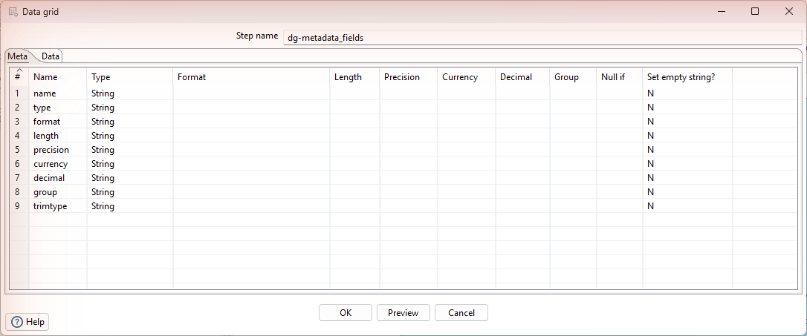
<figcaption>dg-metadata_fields, Meta tab: nine String fields</figcaption>
</figure>
</div>

7. Open the **Data** tab and fill it with one row per column of the file. Leave the empty cells empty:

| name        | type   | format       | length | precision | currency | decimal | group | trimtype |
| ----------- | ------ | ------------ | ------ | --------- | -------- | ------- | ----- | -------- |
| `id`        | String |              | 3      | 0         | `$`      | `,`     | `.`   | `left`   |
| `name`      | String |              | 10     |           |          |         |       | `none`   |
| `firstname` | String |              | 13     |           |          |         |       | `none`   |
| `zip`       | String |              | 5      | 0         | `$`      | `,`     | `.`   | `left`   |
| `city`      | String |              | 8      |           |          |         |       | `none`   |
| `birthdate` | Date   | `yyyy/MM/dd` | 10     |           | `$`      | `,`     | `.`   | `none`   |
| `street`    | String |              | 11     |           |          |         |       | `none`   |
| `housenr`   | String |              | 3      | 0         | `$`      | `,`     | `.`   | `left`   |
| `stateCode` | String |              | 9      |           |          |         |       | `none`   |
| `state`     | String |              | 30     |           |          |         |       | `none`   |

<div align="center">
<figure>
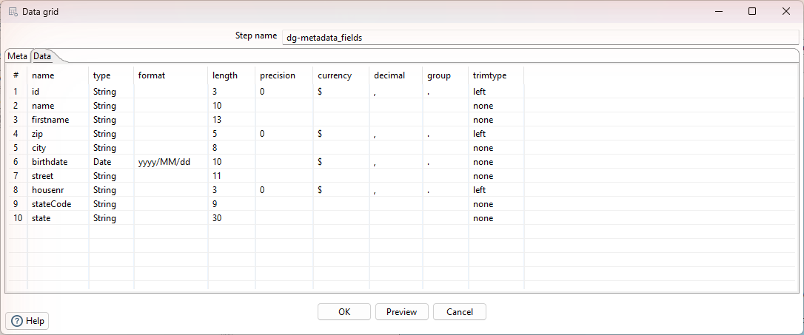
<figcaption>dg-metadata_fields, Data tab: one row per column of the file</figcaption>
</figure>
</div>

8. Select **Preview**, enter `100` rows, and select **OK**.

> **Success:** Checkpoint: **Examine preview data** shows 10 rows, from `id` to `state`, with the values you entered.

9. Select **Close**, then **OK**.

> **Note:** `trimtype` `left` strips the leading space the file has before numbers (` 13520`). Here `id`, `zip` and `housenr` are read as String, not Integer as in tab 2: the table's columns are `VARCHAR`, so the trimmed text is what they store. The currency, decimal and group symbols have no effect on these fields: the String fields are read as text, and `birthdate` with its format.

<div align="center">
<figure>
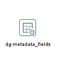
<figcaption>The canvas after dg-metadata_fields</figcaption>
</figure>
</div>


### 7. dg-rename

> **Note:**
>
> #### dg-rename
>
> Add and set up **Data grid**.

1. On the **Design** tab, open the **Input** folder and drag a second **Data grid** onto the canvas, then double-click it.
2. Set **Step name** to `dg-rename`.
3. On the **Meta** tab, add two String fields, `name` and `rename`.
4. On the **Data** tab, enter one row: `id`, `key_id`. Select **OK**.

<div align="center">
<figure>
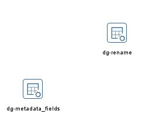
<figcaption>The canvas after dg-rename</figcaption>
</figure>
</div>


### 8. dg_remove_name

> **Note:**
>
> #### dg_remove_name
>
> Add and set up **Data grid**.

1. On the **Design** tab, open the **Input** folder and drag a third **Data grid** onto the canvas, then double-click it.
2. Set **Step name** to `dg_remove_name`.
3. On the **Meta** tab, add one String field, `remove_name`.
4. On the **Data** tab, enter one row: `stateCode`. Select **OK**.

<div align="center">
<figure>
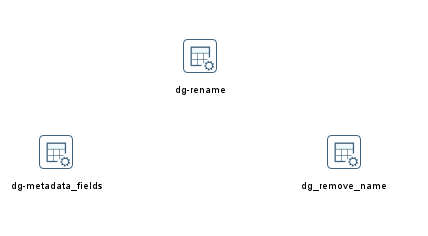
<figcaption>The canvas after dg_remove_name</figcaption>
</figure>
</div>


### 9. gr-filename

> **Note:**
>
> #### gr-filename
>
> Add and set up **Generate rows**.

1. On the **Design** tab, open the **Input** folder and drag **Generate rows** onto the canvas.
2. Double-click **Generate rows**.
3. Set **Step name** to `gr-filename`.
4. Set **Limit** to `1`.
5. Fill the **Fields** grid with one row: **Name** `filename`, **Type** String, and no **Value**. Select **OK**.

<div align="center">
<figure>
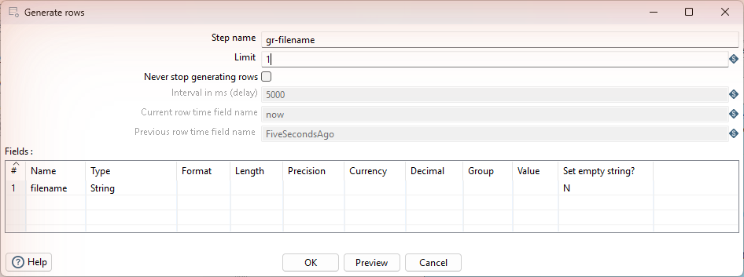
<figcaption>gr-filename: one row, one empty field</figcaption>
</figure>
</div>

<div align="center">
<figure>
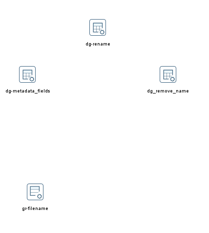
<figcaption>The canvas after gr-filename</figcaption>
</figure>
</div>


### 10. sfvc-path_filename

> **Note:**
>
> #### sfvc-path_filename
>
> Add and set up **Set field value to a constant**.

1. On the **Design** tab, open the **Transform** folder and drag **Set field value to a constant** onto the canvas.
2. Create a hop from **gr-filename** to **Set field value to a constant**.
3. Double-click **Set field value to a constant**.
4. Set **Step name** to `sfvc-path_filename`.
5. Select **Use variable in constant**, so the variable in the value is replaced.
6. Fill the **Fields** grid with one row: **Field** `filename`, **Replace by value** `${Internal.Entry.Current.Directory}/data/customers.txt`.

<div align="center">
<figure>
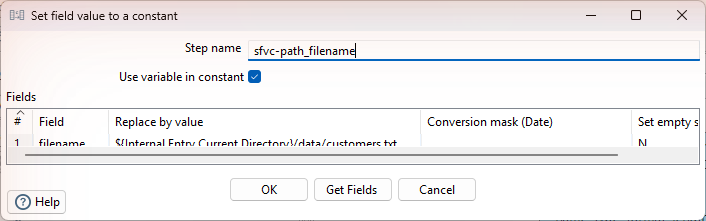
<figcaption>sfvc-path_filename: the path, with its variable resolved</figcaption>
</figure>
</div>

7. Select **OK**.
8. Save the transformation (`Ctrl+S`).
9. Select **sfvc-path_filename** on the canvas, press `F10` (**Action > Preview**), and select **Quick Launch**.

> **Success:** Checkpoint: **Examine preview data** shows 1 row. Its `filename` is the full path of your lab folder followed by `/data/customers.txt`: the variable has been replaced.

10. Select **Close**.

<div align="center">
<figure>
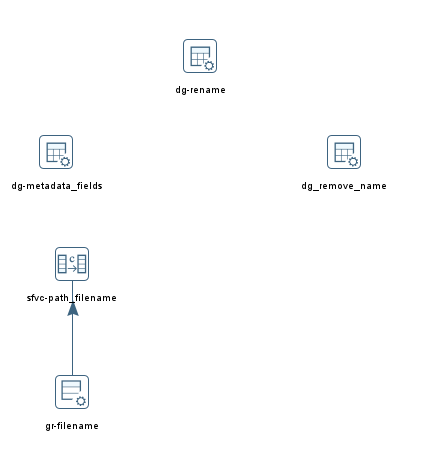
<figcaption>The canvas after sfvc-path_filename</figcaption>
</figure>
</div>


### 11. Inject and Run

> **Note:**
>
> #### Inject and Run
>
> **ETL metadata injection** reads the rows from the four sources, writes them into the template's settings, and runs the result.

1. On the **Design** tab, open the **Flow** folder and drag **ETL metadata injection** onto the canvas.
2. Create a hop from each of the four sources to **ETL metadata injection**: from **dg-metadata_fields**, **dg-rename**, **dg_remove_name** and **sfvc-path_filename**.
3. Double-click **ETL metadata injection**.
4. Set **Step name** to `emi-onboarding_csv` (spelled as in the solution).
5. Set **Transformation** to:

   ```text
   ${Internal.Entry.Current.Directory}/metadata_inject_template.ktr
   ```

6. Open the **Inject Metadata** tab. It lists the template's steps, each with every setting that can be injected, under **Target injection step key**.
7. Map the 13 keys below. For each one, double-click its row under its target step, select the source step and field in the **Source field** dialog, and select **OK**:

| Target step | Target injection step key | Source step           | Source field  |
| ----------- | ------------------------- | --------------------- | ------------- |
| `csvi-mdi`  | `FILENAME`                | `sfvc-path_filename`  | `filename`    |
| `csvi-mdi`  | `FIELD_NAME`              | `dg-metadata_fields` | `name`        |
| `csvi-mdi`  | `FIELD_TYPE`              | `dg-metadata_fields` | `type`        |
| `csvi-mdi`  | `FIELD_FORMAT`            | `dg-metadata_fields` | `format`      |
| `csvi-mdi`  | `FIELD_LENGTH`            | `dg-metadata_fields` | `length`      |
| `csvi-mdi`  | `FIELD_PRECISION`         | `dg-metadata_fields` | `precision`   |
| `csvi-mdi`  | `FIELD_CURRENCY`          | `dg-metadata_fields` | `currency`    |
| `csvi-mdi`  | `FIELD_DECIMAL`           | `dg-metadata_fields` | `decimal`     |
| `csvi-mdi`  | `FIELD_GROUP`             | `dg-metadata_fields` | `group`       |
| `csvi-mdi`  | `FIELD_TRIM_TYPE`         | `dg-metadata_fields` | `trimtype`    |
| `sv-mdi`    | `META_NAME`               | `dg-rename`           | `name`        |
| `sv-mdi`    | `META_RENAME`             | `dg-rename`           | `rename`      |
| `sv-mdi`    | `REMOVE_NAME`             | `dg_remove_name`      | `remove_name` |

   `META_NAME` and `META_RENAME` (**Target description** **Fieldname** and **Rename to**) fill the **Meta-data** tab of **sv-mdi**, not **Select & Alter**. With **Select & Alter** empty, every field passes through: `REMOVE_NAME` drops `stateCode`, and the **Meta-data** row renames `id` to `key_id`.

<div align="center">
<figure>
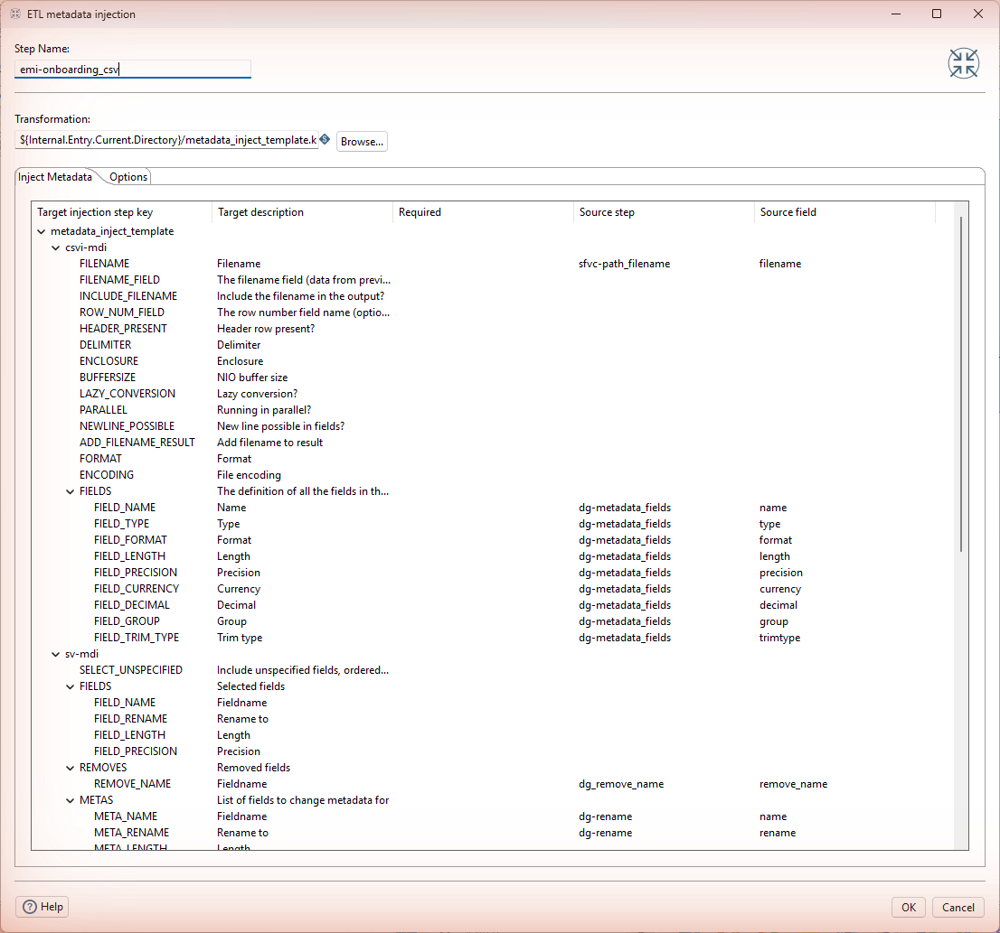
<figcaption>emi-onboarding_csv: the 13 mappings</figcaption>
</figure>
</div>

8. Open the **Options** tab and leave **Run resulting transformation** selected.
9. Select **OK**.

<div align="center">
<figure>
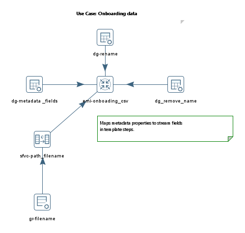
<figcaption>The metadata transformation: three Data grids and the file name feed emi-onboarding_csv</figcaption>
</figure>
</div>

10. Save the transformation (`Ctrl+S`).
11. In DBeaver, run the statement below. It empties the table, so the next check shows what the injected run loads.

   ```sql
   DELETE FROM METADATA_INJECTION_CUSTOMERS;
   ```

12. In Spoon, press `F9` (**Action > Run**), and select **Run** in the **Run Options** dialog.
13. In DBeaver, run the two queries from tab 4 again:

   ```sql
   SELECT COUNT(*) FROM METADATA_INJECTION_CUSTOMERS;

   SELECT key_id, name, firstname, zip, city, street, housenr, state
   FROM METADATA_INJECTION_CUSTOMERS
   WHERE key_id = '1';
   ```

> **Success:** Checkpoint: the count is `100` again, and customer `1` reads exactly as the hand-built load wrote it: `1`, `jwcdf-name`, `fsj-firstname`, `13520`, `oem-city`, `amrb-street`, `145`, `ALASKA`.

14. Select **File > Open** (`Ctrl+O`), open `metadata_inject_template.ktr`, and double-click **csvi-mdi**. Its **Filename** and **Fields** are still empty. Select **Cancel**.

> **Under the hood:**
>
> #### Injection edits the template in memory, then runs the edited copy
>
> ETL metadata injection waits for all its source steps to finish,
> loads the template, and writes the incoming values into the template
> steps' settings: each `dg-metadata_fields` row becomes one field of
> the CSV file input, the single `filename` row becomes its file name,
> and so on. Then it runs that modified copy. The template file on
> disk is never changed, as step 14 showed.
>
> To see what it built, set **Optional target file (ktr after
> injection)** on the **Options** tab: the filled-in transformation is
> saved there, and opening it shows the template's steps with the file
> name, the fields, the rename and the removal filled in.
>
> **Why it matters:** onboarding the next file is now data, not
> development. A new feed means new rows in the grids (or in a table
> or spreadsheet they are read from), and the same template loads it.

::::

## Lab Files

Click a file to download. For `.ktr` and `.kjb` files, **Open in Pentaho Data Integration** launches Pentaho Data Integration with the file loaded. If Pentaho Data Integration is already running, the path is copied to your clipboard — switch to Pentaho Data Integration and press `Ctrl+O`, `Ctrl+V`, `Enter`.

[data/customers.txt](./files/data/customers.txt)

[create_metadata_injection_customers.sql](./files/create_metadata_injection_customers.sql)

### Solution <!-- no-step -->

The finished transformations for this lab. Run `metadata_inject_step.ktr` (it loads the template itself) or `tr_onboard_customers_by_hand.ktr`: either writes the same 100 rows to `METADATA_INJECTION_CUSTOMERS`.

Also on disk at `C:\Workshop-DI-Practitioner\05-enterprise-solution\02-metadata-injection\31-mod5-onboarding-to-a-table\solution`.

[metadata_inject_step.ktr](./files/metadata_inject_step.ktr) <button data-launch="spoon" data-path="files/metadata_inject_step.ktr">Open in Pentaho Data Integration</button> <button data-graph="files/metadata_inject_step.ktr">View graph</button>

[metadata_inject_template.ktr](./files/metadata_inject_template.ktr) <button data-launch="spoon" data-path="files/metadata_inject_template.ktr">Open in Pentaho Data Integration</button> <button data-graph="files/metadata_inject_template.ktr">View graph</button>

[tr_onboard_customers_by_hand.ktr](./files/tr_onboard_customers_by_hand.ktr) <button data-launch="spoon" data-path="files/tr_onboard_customers_by_hand.ktr">Open in Pentaho Data Integration</button> <button data-graph="files/tr_onboard_customers_by_hand.ktr">View graph</button>
