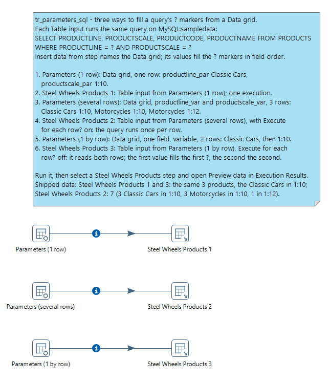
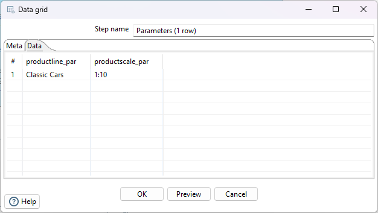
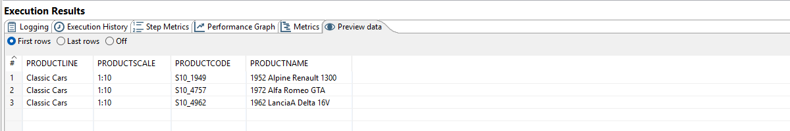
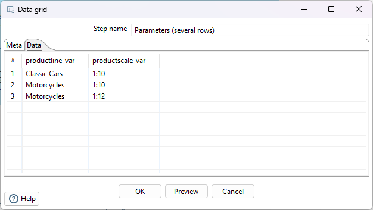
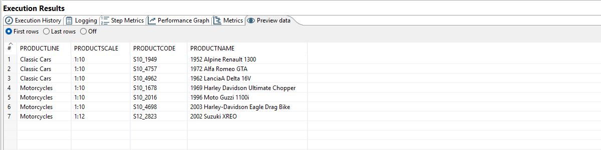
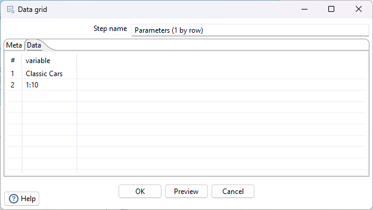
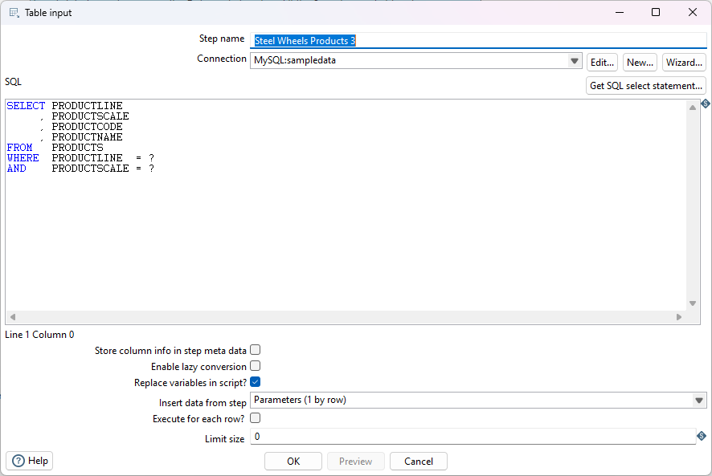

# Parameters SQL

> **Warning:**
>
> #### Workshop - Parameters SQL
> 
> Queries often need values that arrive in the data, such as the product line and scale to list. This workshop passes them to a `SELECT` as `?` markers, which the database driver binds as values.
> 
> In this workshop, you build a transformation that drives a parameterized Table input query from a Data grid, using three different ways of supplying the parameter values.
> 
> **What you'll do**
> 
> * Pass parameters to a Table input query as a single row
> * Pass several rows of parameters in one run
> * Pass parameter values one parameter per row
> * Read the results for each approach
> 
> **Prerequisites:** [Parameters](../34-mod5-parameters/guide.md) (named parameters and `${}` substitution) and the `MySQL:sampledata` connection from [Connecting to Database](../12-mod3-connecting-to-database/guide.md).
> 
> **Estimated time:** 20 minutes

<figure>



<div align="center">
<figcaption><em>Three ways to feed the same query</em></figcaption>
</div>
</figure>

:::: tabs

### 1. Parameters (1 Row)

> **Note:**
>
> #### Parameters (1 Row)
> 
> A **Table input** with a fixed `SELECT` needs nothing else. When the query needs values from the stream, the step reads them from the step named in **Insert data from step** and puts them in place of the `?` markers. Here one row carries both values, in the same order as the markers: product line first, then scale.

1. Start Spoon with the **Start PDI** button below, or from a terminal:

::: tabs

### Windows (PowerShell)

```powershell
Set-Location C:\Pentaho\design-tools\data-integration
.\spoon.bat
```

### macOS / Linux

```bash
cd ~/Pentaho/design-tools/data-integration
./spoon.sh
```

:::

<button data-launch="spoon" data-path="">Start PDI</button>

2. Select **File > New > Transformation** (`Ctrl+N`).
3. Select **File > Save as** and save it as `tr_parameters_sql.ktr` in `C:\Workshop-DI-Practitioner\05-enterprise-solution\03-parameters\35-mod5-parameters-sql`.
4. On the **Design** tab, open the **Input** folder and drag **Data grid** onto the canvas.
5. Double-click **Data grid**.
6. Set **Step name** to `Parameters (1 row)`.
7. On the **Meta** tab, fill the grid with two fields:

| Name               | Type   |
| ------------------ | ------ |
| `productline_par`  | String |
| `productscale_par` | String |

8. Open the **Data** tab and enter one row:

| productline_par | productscale_par |
| --------------- | ---------------- |
| `Classic Cars`  | `1:10`           |

9. Select **OK**.

<figure><figcaption><p>Data grid - Parameters (1 row)</p></figcaption></figure>

10. On the **Design** tab, open the **Input** folder and drag **Table input** onto the canvas.
11. Create a hop from **Parameters (1 row)** to **Table input**: hold `Shift` and drag from one step to the other.
12. Double-click **Table input**.
13. Set **Step name** to `Steel Wheels Products 1`.
14. Set **Connection** to `MySQL:sampledata`.
15. Enter the query in **SQL**:

```sql
SELECT PRODUCTLINE
     , PRODUCTSCALE
     , PRODUCTCODE
     , PRODUCTNAME
FROM   PRODUCTS
WHERE  PRODUCTLINE  = ?
AND    PRODUCTSCALE = ?
```

16. Select **Replace variables in script?**, as the solution has it. This query has no `${}`, so it changes nothing here.
17. Set **Insert data from step** to `Parameters (1 row)`.
18. Leave **Execute for each row?** cleared, and select **OK**.

<figure><figcaption><p>Table input - parameters ? - single row</p></figcaption></figure>

> **Note:** How the `?` markers are filled:
>
> * In the order of the incoming fields: the first field fills the first `?`, the second the second.
> * The incoming values are used up by the query; they don't continue in the stream.
> * A `?` can only stand where a value can. Table names, column names and keywords can't be `?` markers; use `${VARIABLE}` substitution for those, as in [Parameters](../34-mod5-parameters/guide.md).

19. Save the transformation (`Ctrl+S`).
20. Press `F9` (**Action > Run**), and select **Run** in the **Run Options** dialog. The Data grid runs with the transformation and feeds the query. (The **Preview** button in the **Table input** dialog is not available once **Insert data from step** is set.)
21. Select **Steel Wheels Products 1** on the canvas and open the **Preview data** tab in **Execution Results**.

> **Success:** Checkpoint: 3 products, the Classic Cars in 1:10 scale: `1952 Alpine Renault 1300`, `1972 Alfa Romeo GTA` and `1962 LanciaA Delta 16V`.

<figure><figcaption><p>One row of values, one query</p></figcaption></figure>

> **Under the hood:**
>
> #### The `?` markers are JDBC bind parameters, so order is everything
>
> **Table input** prepared the query with the two `?` left open,
> read the single row from *Parameters (1 row)* via **Insert data from
> step**, and bound its fields to the markers **in field order**:
> first field to first `?`, second to second. The database received
> values, not text spliced into SQL: the driver quotes and types them,
> so a product line called `O'Brien` can't break the query and can't
> inject anything.
>
> That is also the limit. A bind parameter can only stand where a
> *value* can, never a table name, column or keyword, which is what
> the note above is telling you. Those come from `${VARIABLE}`
> substitution with **Replace variables in script?** selected, which
> really is text replacement, applied before the statement is
> prepared.
>
> **Why it matters:** values by `?`, identifiers by `${}`. Keep the
> rule and your queries stay both safe and portable.

### 2. Parameters (Several Rows)

> **Note:**
>
> #### Parameters (Several Rows)
> 
> Suppose that you want to list not only the Classic Cars in 1:10 scale, but also the Motorcycles in 1:10 and 1:12 scales. You don't have to run the transformation three times: a Data grid with three rows, one per set of values, runs the query once for each.

1. On the **Design** tab, open the **Input** folder and drag a second **Data grid** onto the canvas.
2. Double-click the new **Data grid**.
3. Set **Step name** to `Parameters (several rows)`.
4. On the **Meta** tab, fill the grid with two fields:

| Name               | Type   |
| ------------------ | ------ |
| `productline_var`  | String |
| `productscale_var` | String |

5. Open the **Data** tab and enter three rows:

| productline_var | productscale_var |
| --------------- | ---------------- |
| `Classic Cars`  | `1:10`           |
| `Motorcycles`   | `1:10`           |
| `Motorcycles`   | `1:12`           |

6. Select **OK**.

<figure><figcaption><p>Three sets of values</p></figcaption></figure>

7. From the **Input** folder, drag a second **Table input** onto the canvas.
8. Create a hop from **Parameters (several rows)** to the new **Table input**.
9. Double-click the new **Table input**.
10. Set **Step name** to `Steel Wheels Products 2`.
11. Set **Connection** to `MySQL:sampledata`, and enter the same query as **Steel Wheels Products 1** in **SQL**.
12. Select **Replace variables in script?**.
13. Set **Insert data from step** to `Parameters (several rows)`.
14. Select **Execute for each row?**, and select **OK**.

<figure><figcaption><p>Table input - parameters ? - several rows</p></figcaption></figure>

15. Save the transformation (`Ctrl+S`).
16. Press `F9` (**Action > Run**), and select **Run** in the **Run Options** dialog.
17. Select **Steel Wheels Products 2** on the canvas and open the **Preview data** tab in **Execution Results**.

> **Success:** Checkpoint: 7 products, 3 Classic Cars in 1:10, 3 Motorcycles in 1:10 and 1 Motorcycle in 1:12, from three executions of the one query. The markers are filled as in tab 1: in field order, values only.

<figure><figcaption><p>One query per row, one result</p></figcaption></figure>

> **Under the hood:**
>
> #### Three rows in: the query runs three times
>
> The difference between this tab and the last is a single check box on
> the Table input step: **Execute for each row?** With it selected, the
> step runs the query once for every row the data grid sends, binding
> that row's values to the markers: three rows, three executions, one
> result set after another flowing into the same output stream.
>
> With it cleared (as in the next tab, *1 by row*), the step instead reads
> *all* incoming rows before running anything, flattens their values
> into one list in arrival order, and fills the `?` markers from that
> list in a single execution. Same query, same markers, two very
> different contracts, which is why the third approach can't mix
> types across rows.
>
> **Why it matters:** a Table input driven by a stream is a loop in
> disguise. That is ideal for a few hundred parameter sets; for a
> million, the loop is a million queries, and a join in SQL beats it
> every time.

### 3. Parameters (1 by Row)

> **Note:**
>
> #### Parameters (1 by Row)
> 
> The values can also arrive one per row: instead of one row with two fields, two rows with one field each.

1. On the **Design** tab, open the **Input** folder and drag a third **Data grid** onto the canvas.
2. Double-click the new **Data grid**.
3. Set **Step name** to `Parameters (1 by row)`.
4. On the **Meta** tab, fill the grid with one field: **Name** `variable`, **Type** String.
5. Open the **Data** tab and enter two rows, in this order:

| variable       |
| -------------- |
| `Classic Cars` |
| `1:10`         |

6. Select **OK**.

<figure><figcaption><p>Data grid - Parameters (1 by row)</p></figcaption></figure>

7. From the **Input** folder, drag a third **Table input** onto the canvas.
8. Create a hop from **Parameters (1 by row)** to the new **Table input**.
9. Double-click the new **Table input**.
10. Set **Step name** to `Steel Wheels Products 3`.
11. Set **Connection** to `MySQL:sampledata`, and enter the same query in **SQL**.
12. Select **Replace variables in script?**.
13. Set **Insert data from step** to `Parameters (1 by row)`.
14. Leave **Execute for each row?** cleared, and select **OK**.

<figure><figcaption><p>Table input - parameters ? - 1 by row</p></figcaption></figure>

15. Save the transformation (`Ctrl+S`).
16. Press `F9` (**Action > Run**), and select **Run** in the **Run Options** dialog.
17. Select **Steel Wheels Products 3** on the canvas and open the **Preview data** tab in **Execution Results**.

> **Success:** Checkpoint: the same 3 products as tab 1. The first row's value fills the first `?`, the second row's value the second.

<figure><figcaption><p>The same result as one row</p></figcaption></figure>

> **Note:** This approach is less flexible than one row: every value shares one column, so values of different types (a String and a Date, say) can't be passed this way.

::::

## Lab Files

Click a file to download. For `.ktr` and `.kjb` files, **Open in Pentaho Data Integration** launches PDI with the file loaded. If PDI is already running, the path is copied to your clipboard — switch to PDI and press `Ctrl+O`, `Ctrl+V`, `Enter`.

### Solution <!-- no-step -->

The finished transformation for this lab. Run it to see all three approaches at once (on the MySQL `sampledata`):

* **Steel Wheels Products 1** (1 row): 3 products, the Classic Cars in 1:10.
* **Steel Wheels Products 2** (several rows): 7 products, Classic Cars 1:10 plus Motorcycles 1:10 and 1:12.
* **Steel Wheels Products 3** (1 by row): the same 3 products as the first.

Also on disk at `C:\Workshop-DI-Practitioner\05-enterprise-solution\03-parameters\35-mod5-parameters-sql\solution`.

[tr_parameters_sql.ktr](./files/tr_parameters_sql.ktr) <button data-launch="spoon" data-path="files/tr_parameters_sql.ktr">Open in Pentaho Data Integration</button> <button data-graph="files/tr_parameters_sql.ktr">View graph</button>
