# Run Configurations

> **Warning:**
>
> #### Workshop - Run Configurations
> 
> A run configuration decides *where* a transformation runs: on this machine, on a Carte server, or across a Carte cluster.\
> In this guided demonstration you start three Carte servers on this machine, register them in Spoon, and run the Hello World transformation on one of them, then across all three.
> 
> **What you'll do**
> 
> * Start a master and two slave Carte servers
> * Register them in Spoon as slave servers
> * Run a transformation on one server with a run configuration
> * Define a cluster schema and run a step across the cluster
> 
> **Prerequisites:** [Review Scalability](../topic-mod5-scalability-review/guide.md); `tr_hello_world.ktr` from [Hello World](../03-mod2-hello-world/guide.md)
> 
> **Estimated time:** 20 minutes

<div align="center">
<figure>

<figcaption>The transformation you run on the servers</figcaption>
</figure>
</div>

:::: tabs

### 1. Start the Carte servers

> **Note:**
>
> #### Master and slave servers
>
> Each server (node) is a Carte instance, in one of two roles. A **slave** runs the jobs and transformations, or the parts of them, that it is sent. The **master** is the slave server a cluster names as its master: in a clustered run it runs the steps that are not clustered and receives the rows the other slaves send it. Here all three run on this machine, on different ports; in production each is a separate server. Each Carte instance keeps its terminal busy, so you need three terminals, and you keep all three open until the end of the workshop: closing a terminal stops its server.

1. Start the master on port `12000`. In PowerShell, run:

```powershell
Set-Location C:\Pentaho\design-tools\data-integration
.\Carte.bat localhost 12000
```

<div align="center">
<figure>
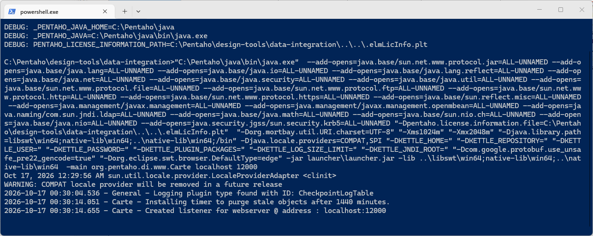
<figcaption>Master node - port 12000</figcaption>
</figure>
</div>

> **Success:** Checkpoint: Carte keeps running, and its last line reads `Carte - Created listener for webserver @ address : localhost:12000`.

2. Open a second terminal and start Slave A on port `12100`. In PowerShell, run:

```powershell
Set-Location C:\Pentaho\design-tools\data-integration
.\Carte.bat localhost 12100
```

<div align="center">
<figure>
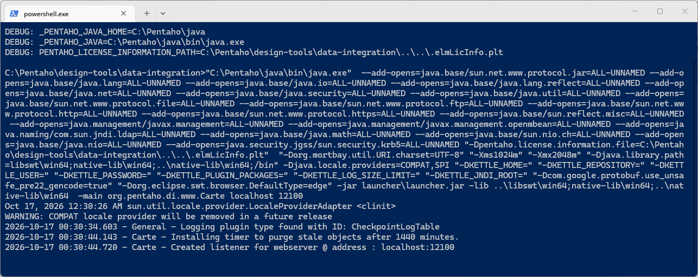
<figcaption>Slave node A - port 12100</figcaption>
</figure>
</div>

3. Open a third terminal and start Slave B on port `12200`. In PowerShell, run:

```powershell
Set-Location C:\Pentaho\design-tools\data-integration
.\Carte.bat localhost 12200
```

<div align="center">
<figure>
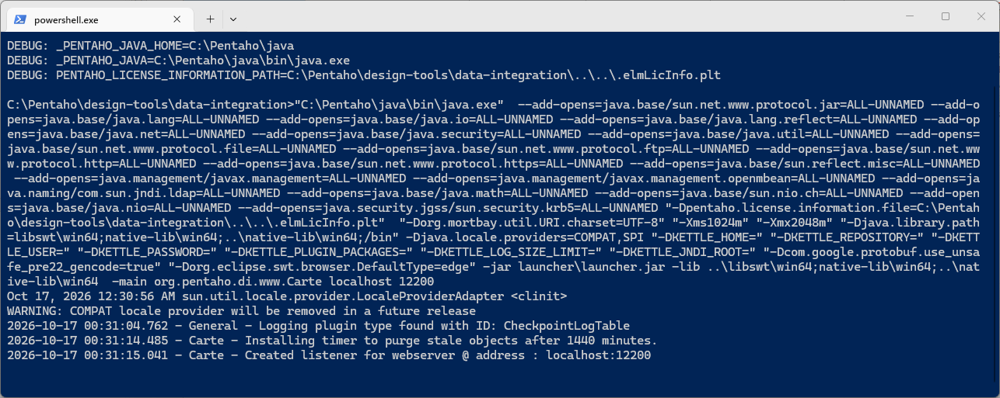
<figcaption>Slave node B - port 12200</figcaption>
</figure>
</div>

> **Success:** Checkpoint: three terminals are running Carte. The second ends with `Created listener for webserver @ address : localhost:12100`, the third with `localhost:12200`.

### 2. Register the servers in Spoon

> **Note:**
>
> #### Slave servers
>
> Spoon reaches a Carte server through a slave server entry: its address, port and login. You add one for each of the three servers, in the transformation you will run.

1. Start Spoon with the **Start PDI** button below, or from PowerShell:

```powershell
Set-Location C:\Pentaho\design-tools\data-integration
.\spoon.bat
```

<button data-launch="spoon" data-path="">Start PDI</button>

2. Select **File > Open** (`Ctrl+O`) and open `tr_hello_world.ktr`, the transformation you built in [Hello World](../03-mod2-hello-world/guide.md). If you don't have it, open the solution copy, `C:\Workshop-DI-Practitioner\02-components-concepts\02-key-concepts\03-mod2-hello-world\solution\tr_hello_world.ktr`.
3. Select **File > Save as** and save it as `tr_hello_world.ktr` in `C:\Workshop-DI-Practitioner\05-enterprise-solution\04-scalability\36-mod5-run-configurations`. Everything you add in this workshop goes into this copy; your Hello World stays as it was.
4. Select the **View** tab.
5. Under **Configurations**, right-click **Slave server** and select **New...**. The **Slave Server dialog** opens on its **Service** tab.

<div align="center">
<figure>
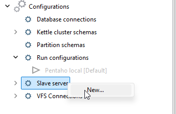
<figcaption>Configure Nodes</figcaption>
</figure>
</div>

6. Fill the **Service** tab with the **Master** column of the table below, and select **OK**. Leave the **Proxy** tab as it is.
7. Repeat steps 5 and 6 for **Slave A** and for **Slave B**, with their columns.

A Carte server started with only a host and a port accepts the user `cluster` with the password `cluster`: they are in `pwd\kettle.pwd` in the PDI folder.

| Setting | Master | Slave A | Slave B |
| --- | --- | --- | --- |
| **Server name** | `Master` | `Slave A` | `Slave B` |
| **Hostname or IP address** | `localhost` | `localhost` | `localhost` |
| **Port (empty is port 80)** | `12000` | `12100` | `12200` |
| **Web App Name (required for Pentaho Server)** | empty | empty | empty |
| **Username** | `cluster` | `cluster` | `cluster` |
| **Password** | `cluster` | `cluster` | `cluster` |
| **Is the master** | selected | cleared | cleared |
| **Use https protocol** | cleared | cleared | cleared |

<div align="center">
<figure>

<figcaption>Master Node</figcaption>
</figure>
</div>

<div align="center">
<figure>
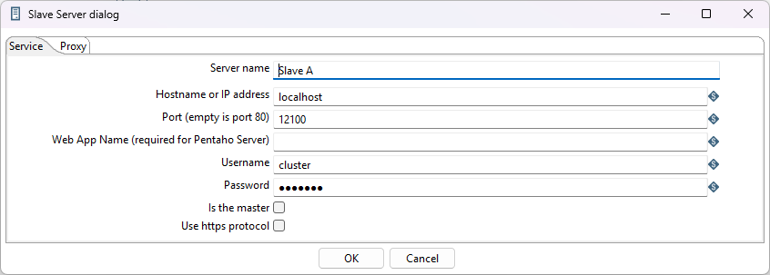
<figcaption>Slave Node A</figcaption>
</figure>
</div>

<div align="center">
<figure>

<figcaption>Slave Node B</figcaption>
</figure>
</div>

> **Success:** Checkpoint: in the **View** tab, **Slave server** lists **Master [File]**, **Slave A [File]** and **Slave B [File]**. `[File]` means the entry is saved in this transformation's file.

<div align="center">
<figure>
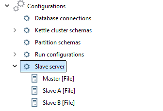
<figcaption>Slave Nodes</figcaption>
</figure>
</div>

### 3. Run on the servers

> **Note:** With three servers running, create run configurations that send the transformation to a particular server.
> 
> Light work, such as loading a small file or filtering a few rows, runs well on your own machine with the default configuration, **Pentaho local**. Heavier work can run on a server dedicated to it, with the same Pentaho engine; that is what a run configuration pointing at a Carte server does.

<div align="center">
<figure>
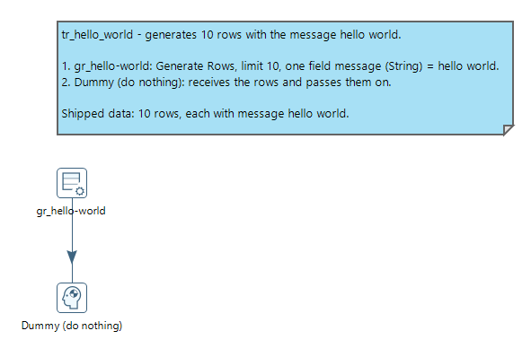
<figcaption>tr_hello_world</figcaption>
</figure>
</div>

::: tabs

### 3.1 Run on the master

> **Note:** **Pentaho local** is the default run configuration. It runs transformations with the Pentaho engine on your local machine. You cannot edit this default configuration.

1. In the **View** tab, right-click **Run configurations** and select **New...**.

<div align="center">
<figure>
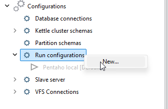
<figcaption>Run configuration</figcaption>
</figure>
</div>

2. In the **Run configuration** dialog, set **Name** to `Master`. **Description** is optional.
3. Leave **Engine** as **Pentaho**.
4. Under **Settings**, select **Slave server**, and set **Location** to `Master`. Leave **Send resources to this server** cleared.
5. Select **OK**. **Master** appears under **Run configurations**.

<div align="center">
<figure>
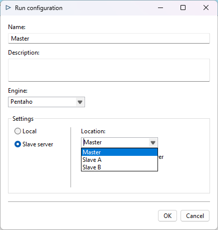
<figcaption>Master - Run configuration</figcaption>
</figure>
</div>

6. Press `F9` (**Action > Run**). In the **Run Options** dialog, set **Run configuration** to `Master`, and select **Run**.

<div align="center">
<figure>
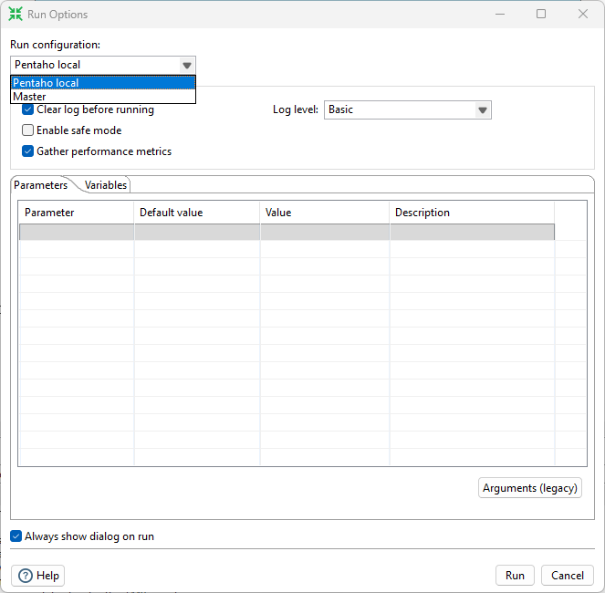
<figcaption>Run configuration - Master</figcaption>
</figure>
</div>

7. Spoon opens a **Slave server: Master** tab with the transformation's steps and log, as the server reports them.

> **Success:** Checkpoint: on the **Slave server: Master** tab, `tr_hello_world` is **Finished**. **gr_hello-world** wrote 10 rows and **Dummy (do nothing)** read 10, and the log ends with `Dummy (do nothing).0 - Finished processing (I=0, O=0, R=10, W=10, U=0, E=0)`.

<div align="center">
<figure>
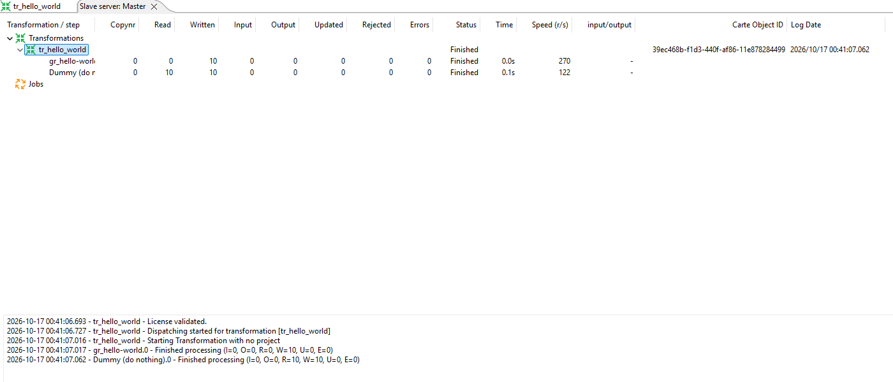
<figcaption>Run configuration - Master</figcaption>
</figure>
</div>

8. Look at the master's terminal: the same log lines appear there.

<div align="center">
<figure>
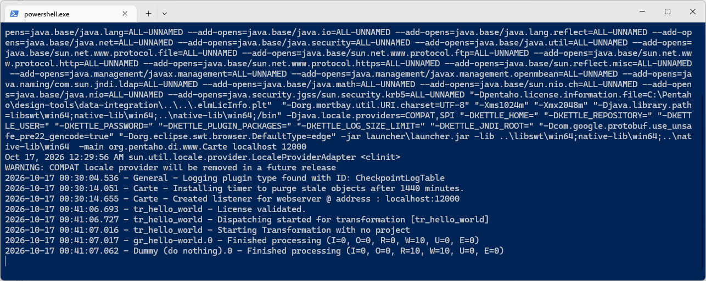
<figcaption>Master Terminal</figcaption>
</figure>
</div>

> **Under the hood:**
>
> #### Spoon shipped the XML over HTTP; Carte ran the same engine
>
> Selecting the *Master* run configuration changed where, not what.
> Spoon serialized the transformation to its XML, posted it to the
> Carte instance on port 12000 at `/kettle/registerTrans`, then called
> `/kettle/prepareExec` and `/kettle/startExec`. Carte — a small Jetty
> web server wrapped around exactly the engine you have been running
> locally — parsed the XML, allocated the same threads and row sets,
> and ran it. The Step Metrics you watched arrived because Spoon then
> polled `/kettle/transStatus` every few seconds.
>
> Nothing was installed on the node and nothing was compiled. The
> terminal shows the same log lines you would see in Spoon because it
> *is* the same code.
>
> **Why it matters:** "deploy to the server" is an HTTP call with a
> file in it. Pentaho Server's scheduler, Kitchen on a cron box and
> this dialog all drive the same API, so what runs in the run dialog is
> what runs in production.

9. Optionally, create run configurations for Slave A and Slave B the same way, with **Location** set to `Slave A` and `Slave B`, and run the transformation on each.

### 3.2 Define the cluster schema

> **Note:**
>
> #### Cluster schema
>
> A cluster schema is a named set of slave servers, one of which is the master. When you run a transformation on it, Spoon splits the transformation: the master runs the steps that are not clustered, each other slave runs the clustered steps, and rows move between them over sockets.

1. In the **View** tab, right-click **Kettle cluster schemas** and select **New...**. The **Clustering schema dialog** opens.

<div align="center">
<figure>
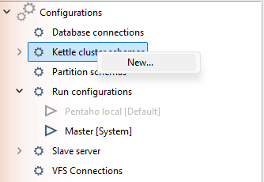
<figcaption>Kettle cluster schema</figcaption>
</figure>
</div>

2. Set **Schema name** to `Pentaho`, and check the other settings against this table:

| Setting | Value | What it does |
| --- | --- | --- |
| **Schema name** | `Pentaho` | The name you pick the schema by |
| **Port** | `40000` | The first port of the range the nodes' sockets use; each clustered step on a slave takes another |
| **Sockets buffer size** | `2000` | The buffer each socket uses |
| **Sockets flush interval (rows)** | `5000` | After this many rows the buffer is sent over the network and emptied |
| **Sockets data compressed?** | selected | Rows are compressed before they cross the network |
| **Dynamic cluster** | cleared | This schema lists its servers itself |

3. Select **Select slave servers**. In the list, select `Master`, `Slave A` and `Slave B` (hold `Ctrl` to select more than one), and select **OK**.

> **Success:** Checkpoint: the **Slave servers** grid lists **Master** with **Master?** `Y`, and **Slave A** and **Slave B** with `N`.

<div align="center">
<figure>
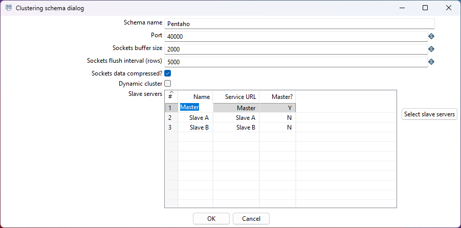
<figcaption>Pentaho Cluster schema</figcaption>
</figure>
</div>

4. Select **OK**.
5. Right-click **Run configurations** and select **New...**.
6. Set **Name** to `Clustered`, and optionally **Description** to `Run on cluster`. Leave **Engine** as **Pentaho**.
7. Under **Settings**, select **Slave server**, and set **Location** to `Clustered`.
8. Select **Log remote execution locally** and **Show transformations**. **Show transformations** opens the transformation generated for each node, which shows how the work was split.
9. Select **OK**.

<div align="center">
<figure>
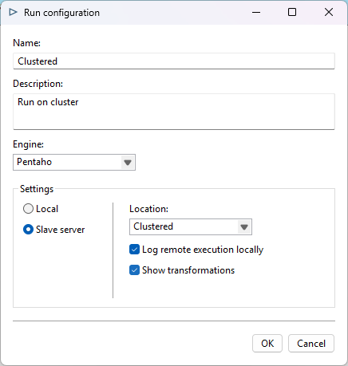
<figcaption>Clustered - Run configuration</figcaption>
</figure>
</div>

### 3.3 Run on the cluster

> **Note:**
>
> #### Clustered steps
>
> A step assigned to a cluster schema runs on each slave server in it that is not the master; the steps you leave unassigned run on the master. This schema is static: it lists its servers. A dynamic one gets the list of slave servers from the first master it can contact, and that master monitors which slaves are available.

1. On the canvas, right-click **gr_hello-world** and select **Clusters...**.

<div align="center">
<figure>
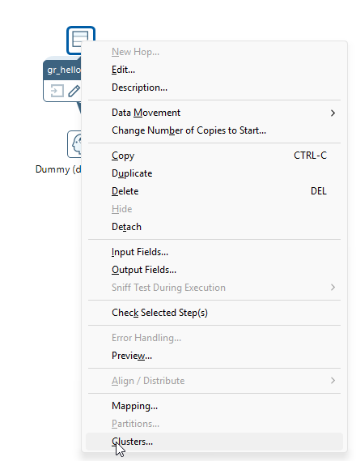
<figcaption>Clusters</figcaption>
</figure>
</div>

2. In the **Cluster schema** dialog, select `Pentaho`, and select **OK**.
3. Save the transformation (`Ctrl+S`). Spoon runs a transformation on a cluster only once it is saved: unsaved, the run stops at `Please save your transformation first!`.

<div align="center">
<figure>
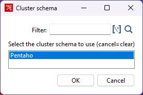
<figcaption>Pentaho - Cluster schema</figcaption>
</figure>
</div>

> **Success:** Checkpoint: **gr_hello-world** shows `Cx2` above its icon: it runs on the two slaves that are not the master. **Dummy (do nothing)** has no mark: it runs on the master.

<div align="center">
<figure>
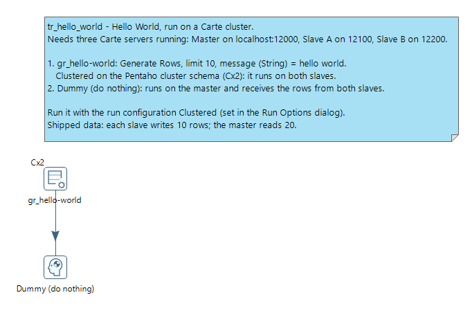
<figcaption>The step shows its slave-node count</figcaption>
</figure>
</div>

4. Press `F9` (**Action > Run**). In the **Run Options** dialog, set **Run configuration** to `Clustered`, and select **Run**.

<div align="center">
<figure>
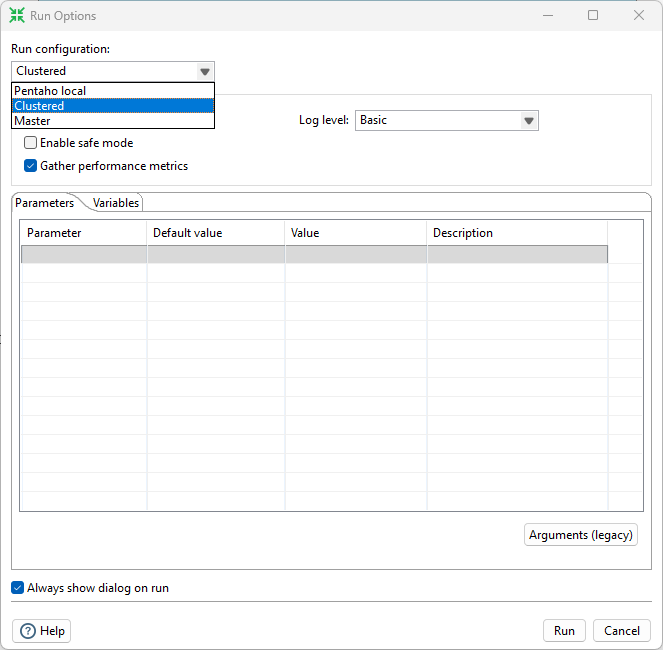
<figcaption>Run configuration - Clustered</figcaption>
</figure>
</div>

5. Spoon opens a tab for each generated transformation (the master's, Slave A's and Slave B's) and a **Slave server** tab for each node. Select the tab of the transformation generated for Slave A: its note reads `This is a generated slave transformation. It will be run on slave server: Slave A`.
6. Hover over the small square at the end of the step's outgoing hop. The tooltip lists the step's **Remote output steps**: from Slave A to **Dummy (do nothing)** on the master, through `localhost:40000`.

<div align="center">
<figure>
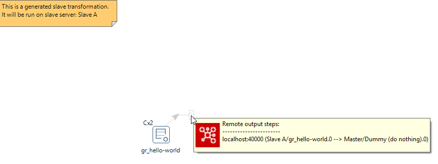
<figcaption>Metadata transformation: Slave A</figcaption>
</figure>
</div>

7. Select the **Slave server: Slave A** tab. It shows the step that ran on Slave A and the rows it sent on.

<div align="center">
<figure>
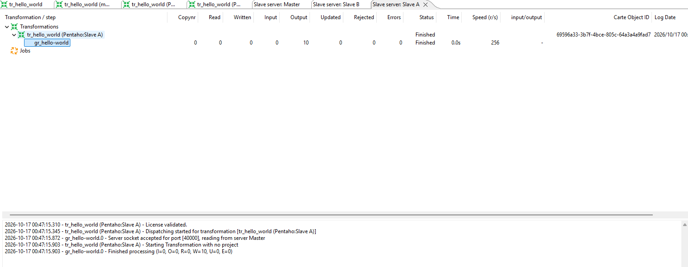
<figcaption>Metrics - Slave A</figcaption>
</figure>
</div>

> **Success:** Checkpoint: the transformation is **Finished** on all three nodes. On **Slave server: Slave A**, **gr_hello-world** shows **Output** 10; on **Slave server: Slave B**, also **Output** 10; on **Slave server: Master**, **Dummy (do nothing)** shows **Input** 20. The rows left each slave over a socket, which counts as output there and as input on the master. Each slave ran its own copy of the 10-row generator, so the master received 20 rows, not 10: clustering an input step that is not partitioned repeats its data on every slave.

8. Look at Slave A's terminal. It logged the generated transformation: the step took its socket on port `40000`, sent its rows to the master, and finished.

<div align="center">
<figure>
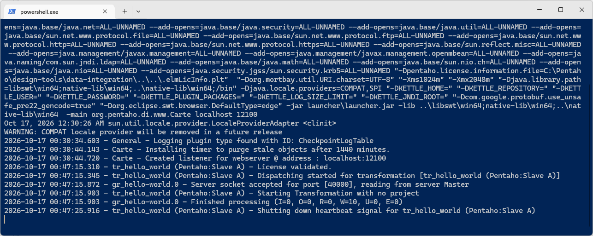
<figcaption>Logs - Slave A</figcaption>
</figure>
</div>

> **Under the hood:**
>
> #### Spoon split the transformation and posted each piece to its node
>
> The split happens in Spoon, the client, not on the master. With the
> *Clustered* configuration, Spoon read the cluster schema and rewrote
> the transformation in memory: one transformation for the master, with
> the steps that are not clustered, and one for each slave, with the
> clustered step. Where rows must cross between nodes it attached a
> remote output to the sending step and a matching remote input to the
> receiving one: the tooltip you hovered over. Spoon then posted each
> piece over HTTP to its own Carte, exactly as in 3.1, started them all,
> and monitored all three. The rows moved between the nodes directly,
> over TCP sockets on ports counted up from the schema's `40000`.
>
> The generated transformations are ordinary transformations: the
> terminal on Slave A shows that node running its piece, and the master
> runs its own piece, **Dummy (do nothing)** reading what the slaves send.
>
> **Why it matters:** you scaled a step across two servers by
> right-clicking it. The split, the network plumbing and the reassembly
> were generated at run time; the transformation you designed changed
> by one cluster assignment, nothing more.

9. When you have finished, close the transformation: select **File > Close** (`Ctrl+W`).
10. Stop each Carte server: press `Ctrl+C` in its terminal.

:::

::::

## Lab Files

Click a file to download. For `.ktr` and `.kjb` files, **Open in Pentaho Data Integration** launches PDI with the file loaded. If PDI is already running, the path is copied to your clipboard — switch to PDI and press `Ctrl+O`, `Ctrl+V`, `Enter`.

### Solution <!-- no-step -->

The Hello World transformation as this lab leaves it: the slave servers **Master** (port `12000`), **Slave A** (`12100`) and **Slave B** (`12200`), the **Pentaho** cluster schema, and **gr_hello-world** clustered. Run configurations are kept in Spoon's own settings, not in the file, so create **Master** and **Clustered** as the steps say. Start the three Carte servers before you run it clustered.

Also on disk at `C:\Workshop-DI-Practitioner\05-enterprise-solution\04-scalability\36-mod5-run-configurations\solution`.

[tr_hello_world.ktr](./files/tr_hello_world.ktr) <button data-launch="spoon" data-path="files/tr_hello_world.ktr">Open in Pentaho Data Integration</button> <button data-graph="files/tr_hello_world.ktr">View graph</button>
