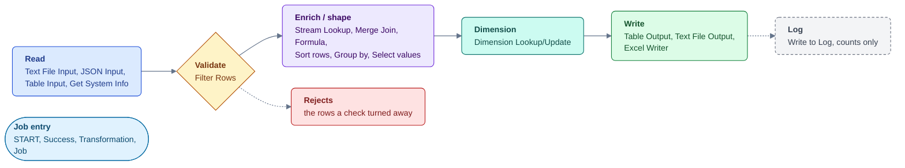
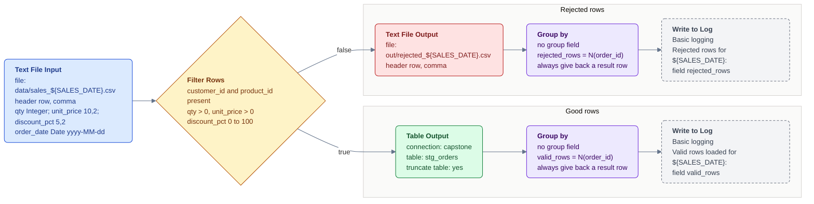
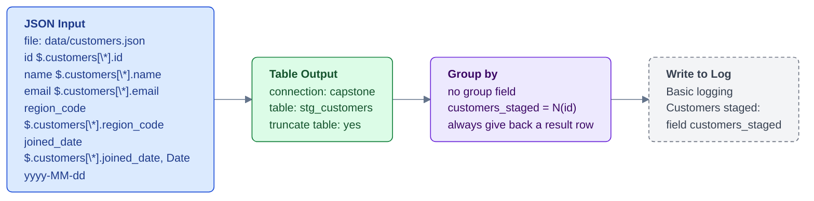
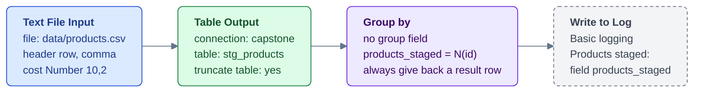
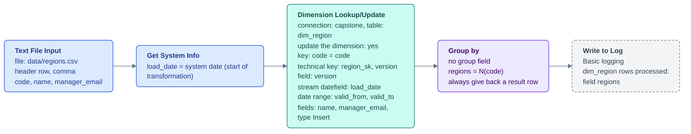
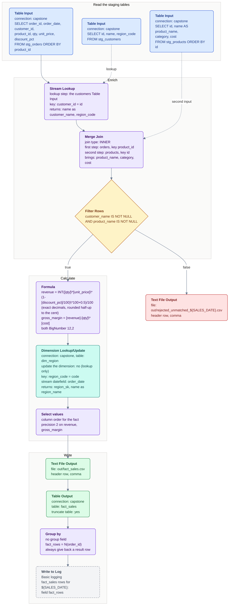
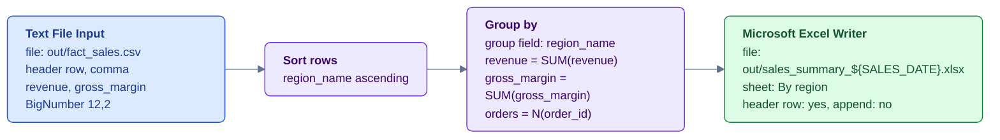
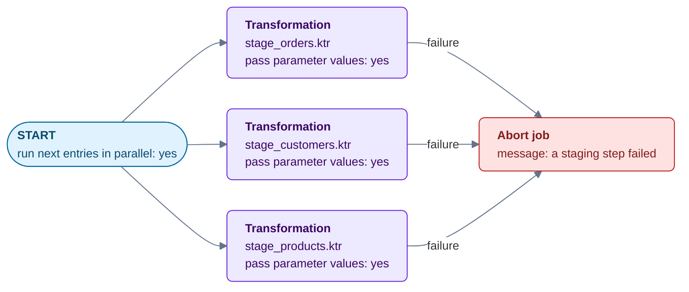
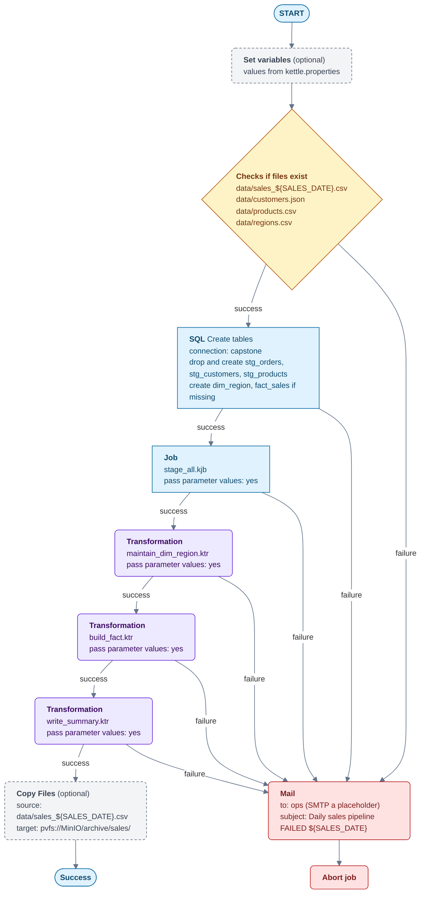

# Daily Sales Pipeline - step diagrams

One diagram per transformation and job in the reference solution. Every
step is coloured by what it does (see the legend), carries its step type
in bold and, left-aligned under it, the settings that matter. Mermaid
renders in GitHub and VS Code; the course guide shows the source.

Parameters on every file: `WORKSHOP_HOME`, `SALES_DATE`, `OUTPUT_PATH`
(defaults `C:/Workshop-DI-Practitioner/capstone`, `20260101`,
`${WORKSHOP_HOME}/out`). Database connection `capstone`: `127.0.0.1:3306`,
database `sampledata`, user `pentaho_admin`, defined inside each file.

## Legend

Hop labels: **true / false** out of a Filter Rows, **success / failure**
out of a job entry. A dotted hop is a second input to a step (a lookup
or join), not the main flow.

Two PDI habits the diagrams rely on:

- A step with two outgoing hops **distributes** rows between them by
  default (round robin). Where one row must reach two outputs the steps
  are chained, so nothing needs the Copy data movement setting.
- Merge Join needs **both** inputs sorted on the join key; the Table
  Input queries carry the `ORDER BY`, so no Sort rows is needed there.

## stage_orders.ktr

Reads the day's sales, keeps the rows a fact can use, stages them, and
writes the rest to an audit file. 40 in, 37 staged, 3 rejected.

## stage_customers.ktr

20 customers from the JSON feed into a staging table.

## stage_products.ktr

13 products from the catalogue CSV into a staging table.

## maintain_dim_region.ktr

The Type 2 dimension. 5 regions the first time; change a `manager_email`
in `regions.csv` and run again to see a version 2 row appear with
`valid_from` set to the run date. The main job's Create tables entry
creates `dim_region` when it is missing; in Spoon the step's SQL button
does the same.

## build_fact.ktr

Joins the staged orders to customers and products, calculates the money
fields, picks up the region's dimension key, and writes the fact twice:
the CSV the accreditation checks, then the table. 37 rows, 0 unmatched
with the shipped data.

## write_summary.ktr

One line per region from the fact CSV, into the workbook. 5 rows.

## stage_all.kjb

The three stagings in parallel. The parent job moves on only when all
three have finished; one failure fails the sub-job, which the parent's
failure hop catches. Running them one after another in the main job is
just as valid.

## daily_sales_pipeline.kjb

The orchestrator. Every Transformation entry has **Pass parameter values
to sub transformation** ticked, and the job declares the same three
parameters with the same defaults, so
`Kitchen.bat -file=daily_sales_pipeline.kjb "-param:SALES_DATE=20260101"`
reaches every step. The dimension runs before the fact so the fact can
carry `region_sk`.

