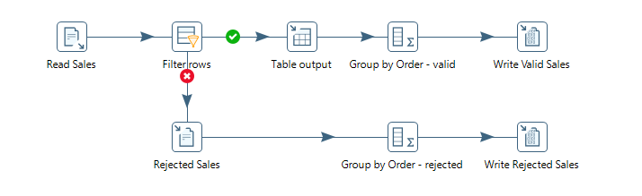
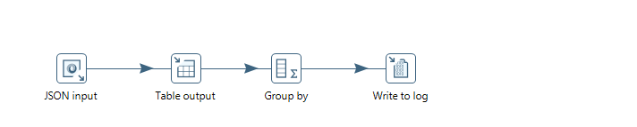
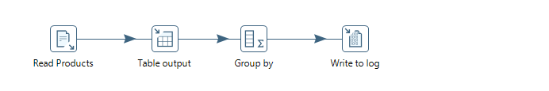
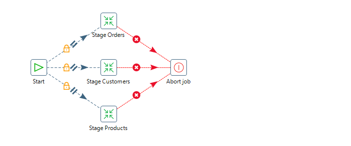
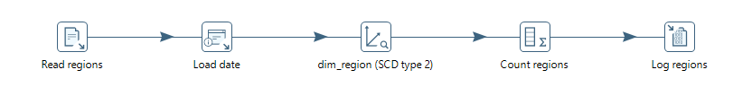
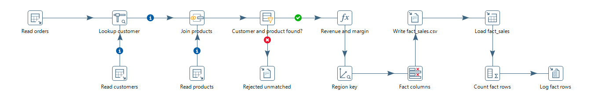
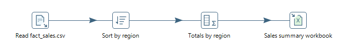
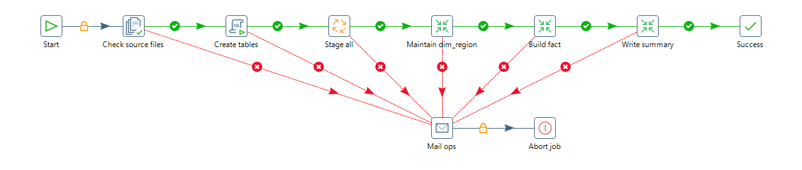

# Daily Sales Pipeline

> **Capstone Project — bring it all together.**

You're a freshly-onboarded data engineer at a regional retailer. The
analytics team needs **yesterday's sales** ready by 9am every morning,
joined with customer and product master data, with historical
attribute changes tracked, validated, and loaded into a dimensional
model the BI tools can query.

This capstone asks you to build that pipeline. It exercises every
module of the course — from variables and steps through to jobs,
scheduling, and scaling.

> **Objectives:**
>
> - Build a parameterized PDI **job** that ingests three data sources, validates them, enriches with master data, and loads a fact + dimension table.
> - Demonstrate **production-readiness**: error handling, logging, parameters, scheduled execution.
> - Produce a complete artifact you can show in interviews ("I built this for my Practitioner course accreditation").
>
> **Estimated time:** 90-120 minutes for a clean, well-named solution. Re-shape and revisit as you'd like.

---

> **Warning:**
>
> #### Required for your course accreditation: four checks on your own folders
>
> The course accreditation is issued only when all four of these checks
> pass. They read your workshop folder, so save (or copy and paste) your
> work into exactly these places **before you take the exam**:
>
> | # | What must be there | Where |
> | --- | --- | --- |
> | 1 | Your fact output, `fact_sales.csv` | `C:\Workshop-DI-Practitioner\capstone\out\` |
> | 2 | Your summary workbook, `sales_summary_20260101.xlsx` | `C:\Workshop-DI-Practitioner\capstone\out\` |
> | 3 | Your job, `daily_sales_pipeline.kjb`, running your transformations | `C:\Workshop-DI-Practitioner\capstone\solution\` |
> | 4 | Your `README.md`: how to run your job | `C:\Workshop-DI-Practitioner\capstone\solution\` |
>
> Files 1 and 2 are written by your job when it runs with
> `WORKSHOP_HOME` set to `C:/Workshop-DI-Practitioner/capstone`.
> Anywhere else, the checks cannot find your work and no accreditation
> is issued. Select **Run checks** under **Verification checks** to see
> where you stand.
>
> Your `solution\` folder starts with a **blank** transformation or job
> for each file below, already named: build each one in place and save
> it there (`Ctrl+S`). A blank file passes no check.

## Inputs

Download the four files from **Lab Files** at the bottom of this
page, and put them in a `data/` folder under the workshop root you
will point `${WORKSHOP_HOME}` at (for example
`C:/Workshop-DI-Practitioner/capstone/data/`; they are already there if the installer laid out `C:\Workshop-DI-Practitioner`). Every path in this capstone is written
as `${WORKSHOP_HOME}/data/...`, so once the variable is set the
transformations resolve without further edits.

Each file represents a realistic feed you'd see in a small retail
environment.

| File | What | How to read it |
| --- | --- | --- |
| `sales_20260101.csv` | Yesterday's orders (40 rows, 3 with intentionally missing keys for the validation step) | **Text file input** — header row, comma delimiter |
| `customers.json` | Customer master (20 rows under `$.customers[*]`) | **JSON input** — field paths under `$.customers[*]` |
| `products.csv` | Product catalog (13 SKUs across 4 categories) | **Text file input** — header row, comma delimiter |
| `regions.csv` | Region reference (5 regions) | **Text file input** — header row, comma delimiter |

Three of the sales rows have intentionally missing keys (two missing
`customer_id`, one missing `product_id`) — they're there to give your
validation step something real to catch.

---

## Required behavior

Build a job (`.kjb`) that runs the following stages, end to end.
Each numbered stage maps to a module in the course — the capstone is
explicit about which skills it's exercising so you can double-check
yourself.

### 1. Parameterize the run *(Module 1)*

Create a `kettle.properties` (or transformation parameters) for:

- `${WORKSHOP_HOME}` — root path containing the `data/` folder
- `${SALES_DATE}` — the date suffix on the CSV (`20260101`)
- `${OUTPUT_PATH}` — where to write the fact + summary outputs

Nothing in the transformations should be hard-coded. The verification
checks look in fixed folders, so use these values:

```properties
WORKSHOP_HOME=C:/Workshop-DI-Practitioner/capstone
SALES_DATE=20260101
OUTPUT_PATH=C:/Workshop-DI-Practitioner/capstone/out
```

### 2. Read the three sources *(Module 3)*

Three transformations, each reading one source:

- `stage_orders.ktr` — **Text file input** → `sales_${SALES_DATE}.csv`
- `stage_customers.ktr` — **JSON input** → `customers.json`, field paths under `$.customers[*]`
- `stage_products.ktr` — **Text file input** → `products.csv`

### 3. Validate *(Module 2)*

Add a **Filter rows** step that routes any sale missing `customer_id` OR
`product_id` to an **error stream**. Log the count of rejected rows
with **Write to log** at level `Basic`. Pass the valid rows
downstream.

### 4. Enrich *(Module 4)*

- **Stream lookup** — bring in customer name + region_code from the staged customers
- **Merge join** (sort both sides on `product_id` first) — bring in product name + cost
- **Stream lookup** — bring in region name from `regions.csv`

### 5. Calculate *(Module 4)*

Use a **Formula** step to compute:

```text
revenue       = qty * unit_price * (1 - discount_pct / 100)
gross_margin  = revenue - (qty * cost)
```

### 6. SCD Type 2 on regions *(Module 3)*

If you have a database connection available, use **Dimension
lookup/update** against a `dim_region` table so a region's
`manager_email` change is tracked with valid-from / valid-to dates.

If no DB is wired up, write the dimension to `${OUTPUT_PATH}/dim_region.csv`
with the SCD columns (`valid_from`, `valid_to`, `is_current`)
maintained manually using a Combination Lookup-style pattern.

### 7. Write outputs *(Module 3)*

- **Text file output** to `${OUTPUT_PATH}/fact_sales.csv` (required: the accreditation check looks for it), plus **Table output** to a `fact_sales` table if you want it in MySQL too
- **Microsoft Excel writer** to `${OUTPUT_PATH}/sales_summary_${SALES_DATE}.xlsx` — by region: revenue, gross margin, order count

### 8. Job orchestration *(Module 5)*

Wrap the transformations in a job:

```text
Start
  → Set Variables          optional: read kettle.properties values into job variables
  → stage_orders.ktr
  → stage_customers.ktr
  → stage_products.ktr
  → maintain_dim_region.ktr
  → build_fact.ktr
  → write_summary.ktr
  → Success

every entry's failure hop → Mail (notify ops) → Abort job
```

> **Warning:** Want the three stage transformations to run in parallel? Put them in a **sub-job** whose START has **Run Next Entries in Parallel**, and call that sub-job where the three entries are above. The parent job moves on to `build_fact.ktr` only when the sub-job has finished. Don't run them in parallel in the main job and hop each one into `build_fact.ktr`: a job has no "wait for all" hop, so `build_fact.ktr` would run three times (see [Order of Execution](../30-mod5-order-of-execution/guide.md)).

Use a **Mail** job entry on the failure hop so the on-call engineer gets
notified when something breaks (you can leave the SMTP server stubbed
out — the structure matters).

### 9. Logging *(Module 2)*

Log key counts at the start and end of each major step:

- Rows read from each source
- Rows valid / rejected after validation
- Rows in fact_sales after the joins
- Rows written to dim_region (versioned vs unchanged)

### 10. Run Configuration *(Module 5)*

Define a **Carte** Run Configuration for the job and document — in a
`README.md` next to your `.kjb` — how to invoke it from Kitchen with
parameters. On Windows the launcher batch files split arguments at `=`,
so the arguments must reach them in quotes; in PowerShell, `--%` passes
the rest of the line through untouched:

```powershell
Set-Location C:\Pentaho\design-tools\data-integration
.\Kitchen.bat --% "-file=C:\Workshop-DI-Practitioner\capstone\solution\daily_sales_pipeline.kjb" "-param:SALES_DATE=20260101" -level=Basic
```

---

## Suggested architecture

Every `.ktr` and `.kjb` here is waiting for you in `solution\` as a
blank file, with no steps, parameters or connections: the names are
given, what goes in them is yours. `kettle.properties` and `README.md`
you create.

```text
solution/
├── daily_sales_pipeline.kjb      ← the orchestrator
├── stage_orders.ktr              ← ingest + validate sales
├── stage_customers.ktr           ← ingest customers
├── stage_products.ktr            ← ingest products
├── build_fact.ktr                ← joins + Formula → fact_sales
├── maintain_dim_region.ktr       ← SCD Type 2
├── write_summary.ktr             ← Excel by region
├── kettle.properties
└── README.md                     ← invocation + assumptions
```

---

## Hints for the tricky bits

- **JSONPath**: **JSON input** has no loop path - give each field a full path that matches every customer, e.g. `$.customers[*].id`, `$.customers[*].name`, `$.customers[*].region_code`.
- **Sorting before Merge join**: both inputs MUST be sorted on the join key. Add a **Sort rows** step on each side, or `ORDER BY` in the source query.
- **Rejects**: **Filter rows** has no error handling; it has two outputs instead. In its dialog set **Send 'true' data to step** to the good-rows path and **Send 'false' data to step** to a **Write to log** + **Text file output**, to keep an audit trail.
- **Stream lookup vs Database lookup**: **Stream lookup** is in-memory and fastest for small dimensions (regions, customers). **Database lookup** hits the DB per row but works for big dimensions that don't fit in memory.
- **SCD Type 2**: **Dimension lookup/update** manages the technical key + valid-from / valid-to dates automatically. Configure the surrogate key, version field, and date fields once; the step does the bookkeeping.
- **Microsoft Excel writer**: **If output file exists** decides what a daily run does to yesterday's workbook. **replace with new output file** writes a fresh workbook on every run; **Use existing file for writing**, together with **Start writing at end of sheet (appending lines)**, keeps the file rolling.
- **Two outputs, same rows**: a step with two outgoing hops distributes its rows between them (round robin) unless you select **Copy** when Spoon asks. Chaining the two outputs one after the other sends every row to both without that choice.

---

## Lab Files

Click a file to download. Put all four in `${WORKSHOP_HOME}/data/`
before you start. Beyond these and the blank files in `solution\`,
nothing in the capstone is supplied: the pipeline itself is yours to
build.

[sales_20260101.csv](./files/sales_20260101.csv)

[customers.json](./files/customers.json)

[products.csv](./files/products.csv)

[regions.csv](./files/regions.csv)

---

## Verification checks

> **Warning:** These four checks decide your course accreditation, and
> they look only in `C:\Workshop-DI-Practitioner\capstone\`: your
> `fact_sales.csv` and `sales_summary_20260101.xlsx` in `out\`, and in
> `solution\` your `daily_sales_pipeline.kjb`, running at least one
> transformation, and your `README.md`. Save or copy your work there
> before you take the exam.

After running your job, select **Run checks** below to confirm each
output landed where expected. The checks assume these paths
(`WORKSHOP_HOME=C:/Workshop-DI-Practitioner/capstone`, outputs under
`${WORKSHOP_HOME}/out`). Use exactly these paths, or the checks (and the accreditation) cannot find your work.

The checks confirm that the two outputs and your README exist and that
your job runs a transformation. Check the numbers yourself: with
the shipped data, a correct run reads 40 sales rows, rejects 3 for a
missing customer or product key, and writes 37 rows to
`fact_sales.csv`. The summary workbook holds these totals:

| Region | Revenue | Gross margin | Orders |
| --- | ---: | ---: | ---: |
| Midwest | 1619.31 | 613.81 | 7 |
| North East | 1742.19 | 769.79 | 6 |
| North West | 3426.14 | 1529.94 | 11 |
| South East | 2655.46 | 1235.46 | 7 |
| South West | 670.21 | 326.61 | 6 |
| **Total** | **10113.31** | **4475.61** | **37** |

---

## Deliverables

Save your work in the `solution/` folder under your workshop root —
`${WORKSHOP_HOME}/solution/`, e.g. `C:/Workshop-DI-Practitioner/capstone/solution/`,
where the blank files are. Reinstalling or upgrading the course never
replaces a file you have saved there; it only puts back a blank file
you have deleted.

> **Warning:** Don't save it inside the course folder itself. Course
> content is refreshed from the repository on every launch, so
> anything you leave there will be overwritten.

Your `solution/` folder should contain:

1. `daily_sales_pipeline.kjb` — the orchestrator
2. `stage_*.ktr`, `build_fact.ktr`, `maintain_dim_region.ktr`, `write_summary.ktr`
3. `kettle.properties` showing your variable values (with secrets replaced by placeholders)
4. `README.md` describing how to invoke + any assumptions

This becomes a portfolio piece — keep it tidy, name things clearly, and document your decisions.

---

## Build outline and hints <!-- no-step -->

One section per file, in the order you build them. Each says what the
file must do, what it reads and writes, which requirement it meets, and
what a correct run shows. The hints name a step or a technique; the
settings are yours to work out. Each file starts blank in `solution\`:
open it in Spoon (**File > Open**), build it, and save it (`Ctrl+S`).

**One design decision first: how the staging transformations hand their
rows to the fact build.** A job holds a single "rows to result" set, so
three stagings cannot pass their rows to one transformation that way.
Tables can: the reference stages each source into a table in the
workshop's MySQL (`stg_orders`, `stg_customers`, `stg_products`) and
the fact build reads them back. That is the server the database labs
use: host `localhost`, port `3306`, database `sampledata`, user
`pentaho_admin`, with the password from
[Connecting to Database](../12-mod3-connecting-to-database/guide.md).

### 1. Parameters and the connection

**Must do:** give every file the three variables of requirement 1, and
one database connection to the workshop's MySQL.

<details>
<summary>Hints</summary>

- Declare `WORKSHOP_HOME`, `SALES_DATE` and `OUTPUT_PATH` on the **Parameters** tab of **Transformation properties** in every transformation, and of **Job properties** in every job, with the same defaults. A parameter's default is what Spoon uses when you run one file on its own.
- On every **Transformation** and **Job** entry, select **Pass parameter values to sub transformation** (**Pass parameter values to sub job**), so one Kitchen `-param:` override reaches every step.
- A connection defined inside a file travels with that file, so each one runs on its own.

</details>

### 2. stage_orders.ktr

**Must do:** read `${WORKSHOP_HOME}/data/sales_${SALES_DATE}.csv`, keep
the rows a fact can use, stage them, write the rest to an audit file in
`${OUTPUT_PATH}`, and log both counts. Requirements 2, 3 and 9.

> **Success:** Checkpoint: 40 rows read, 37 staged, 3 rejected (the three rows with a missing key).

<details>
<summary>Hints</summary>

- Choose the field types with the arithmetic in mind: a money value read as a decimal type with two places (**BigNumber**) keeps every later sum exact to the cent.
- **Filter rows** splits the stream in two; the false branch is your audit trail. Beyond the two keys you may also reject non-positive quantities or prices, or a discount outside 0 to 100: none of the shipped rows fails those.
- To log a count: a **Group by** with no group field and **Always give back a result row** selected, then **Write to log** at `Basic`. The result row means a day with no rejects still logs a 0.

</details>

### 3. stage_customers.ktr

**Must do:** read `${WORKSHOP_HOME}/data/customers.json` and stage the
customers, logging the count. Requirements 2 and 9.

> **Success:** Checkpoint: 20 customers staged.

<details>
<summary>Hints</summary>

- See **JSONPath** in the hints above: one full path per field.
- `joined_date` is a date in the file; read it as one.

</details>

### 4. stage_products.ktr

**Must do:** read `${WORKSHOP_HOME}/data/products.csv` and stage the
products, logging the count. Requirements 2 and 9.

> **Success:** Checkpoint: 13 products staged.

<details>
<summary>Hints</summary>

- The same shape as the customers, from a text file. Give `cost` the same decimal treatment as the prices.

</details>

### 5. maintain_dim_region.ktr

**Must do:** load `${WORKSHOP_HOME}/data/regions.csv` into a Type 2
dimension, `dim_region`, and log how many regions it processed. It runs
before the fact, so the fact can carry each region's surrogate key.
Requirements 6 and 9.

> **Success:** Checkpoint: after the first run `dim_region` holds 6 rows: the five regions, plus the "unknown" row that **Dimension lookup/update** adds.

<details>
<summary>Hints</summary>

- **Dimension lookup/update** keeps history. Decide which fields are versioned (a change makes a new row) and which are overwritten in place: that is the **Type of dimension update** of each field.
- The step stamps each new version with a date from the stream. **Get system info** can supply one.
- To see the Type 2 behavior, change one `manager_email` in `regions.csv` and run again: that region gets a second version row, and the earlier one is closed.

</details>

### 6. build_fact.ktr

**Must do:** read the three staging tables, join customers and
products onto each order, compute `revenue` and `gross_margin`, attach
the region's surrogate key and name, and write
`${OUTPUT_PATH}/fact_sales.csv` (and, if you like, a `fact_sales`
table). Orders that find no customer or product go to a rejects file.
Requirements 4, 5, 7 and 9.

> **Success:** Checkpoint: 37 rows in `fact_sales.csv`.

<details>
<summary>Hints</summary>

- **Stream lookup** for the customers; **Merge join** for the products, with both inputs sorted on the join key. A **Table input** can sort in its query.
- PDI 11's **Formula** step has no ROUND function. To round each row's revenue half-up to the cent, scale it, truncate with `INT`, and scale back, in a **BigNumber** result. Then the CSV, the table and the summary agree to the cent.
- The region key comes from `dim_region`: **Dimension lookup/update** with **Update the dimension?** cleared only looks rows up, and the order date picks the version that was current then.

</details>

### 7. write_summary.ktr

**Must do:** write `${OUTPUT_PATH}/sales_summary_${SALES_DATE}.xlsx`:
one row per region with total revenue, total gross margin and the
number of orders. Requirement 7.

> **Success:** Checkpoint: 5 rows, one per region, matching the figures in **Verification checks** above.

<details>
<summary>Hints</summary>

- Reading `fact_sales.csv` back means this transformation needs no database.
- **Group by** expects its input sorted on the group field: put a **Sort rows** in front of it.
- See **Microsoft Excel writer** in the hints above for what a re-run does to the workbook.

</details>

### 8. stage_all.kjb (optional)

**Must do:** run the three staging transformations together, and fail
as a whole if any one fails. Requirement 8.

<details>
<summary>Hints</summary>

- Right-click the START entry and select **Run Next Entries in Parallel**.
- Give each **Transformation** entry a failure hop to **Abort job**. The parent job's **Job** entry waits for the sub-job to finish, so the next stage starts once, after all three.

</details>

### 9. daily_sales_pipeline.kjb

**Must do:** run the whole pipeline in order with the three parameters,
and on any failure notify ops and abort. Requirements 8 and 10.

> **Success:** Checkpoint: a Kitchen run ends successfully and every check under **Verification checks** passes.

<details>
<summary>Hints</summary>

- A **Checks if files exist** entry before anything else makes a missing feed fail the run before a single table is truncated.
- An **SQL** entry at the start can create the tables: recreate the staging tables on every run, and create `dim_region` and `fact_sales` only when they are missing.
- Hop every entry's failure output to one **Mail** entry, and that to **Abort job**. The SMTP server can be a placeholder; the structure is what matters.

</details>

---

## Optional: Screenshots of One Solution

> **Note:**
>
> #### Use these only if you are stuck
>
> These are the canvases of one working solution, as Spoon shows them,
> in the order you build the files. They show which steps each file uses
> and how they connect, not how each step is configured: the settings
> are yours to work out from the outline and hints above. Your solution
> may look different and still pass every check.

<details>
<summary>Show the screenshots of one solution</summary>

<div align="center">
<figure>

<figcaption>stage_orders.ktr</figcaption>
</figure>
</div>

<div align="center">
<figure>

<figcaption>stage_customers.ktr</figcaption>
</figure>
</div>

<div align="center">
<figure>

<figcaption>stage_products.ktr</figcaption>
</figure>
</div>

<div align="center">
<figure>

<figcaption>stage_all.kjb</figcaption>
</figure>
</div>

<div align="center">
<figure>

<figcaption>maintain_dim_region.ktr</figcaption>
</figure>
</div>

<div align="center">
<figure>

<figcaption>build_fact.ktr</figcaption>
</figure>
</div>

<div align="center">
<figure>

<figcaption>write_summary.ktr</figcaption>
</figure>
</div>

<div align="center">
<figure>

<figcaption>daily_sales_pipeline.kjb</figcaption>
</figure>
</div>

</details>
