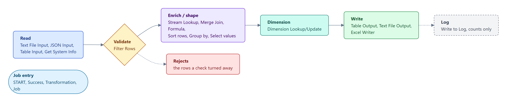
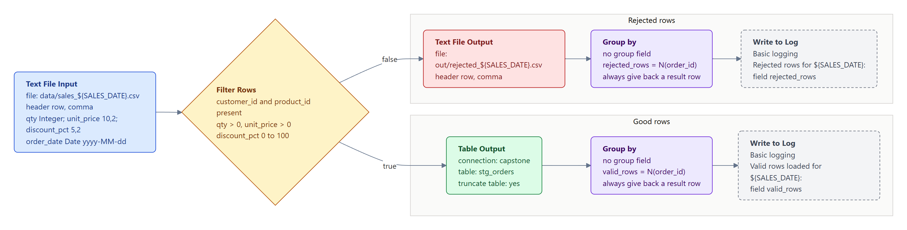
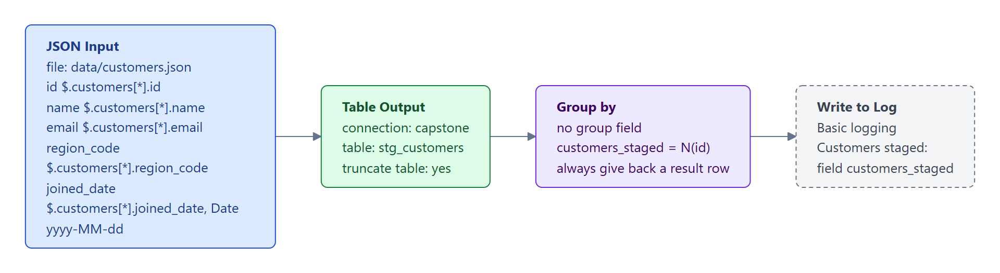
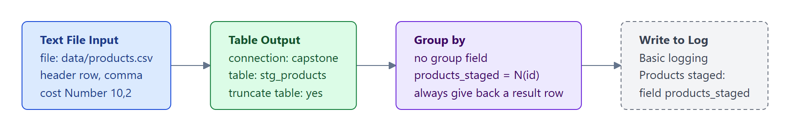
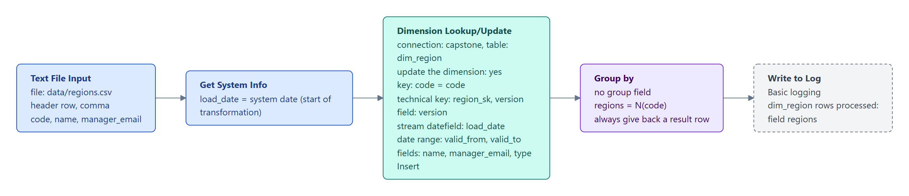
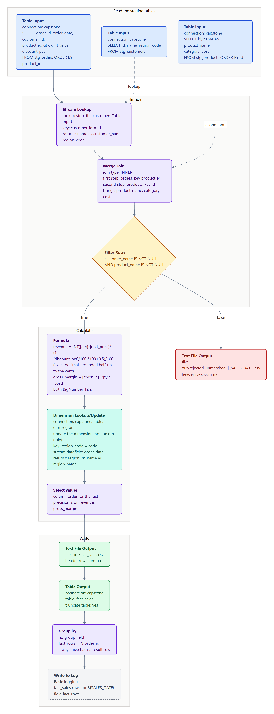
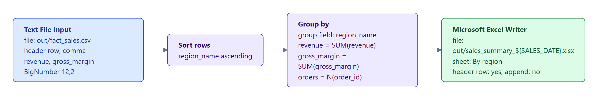
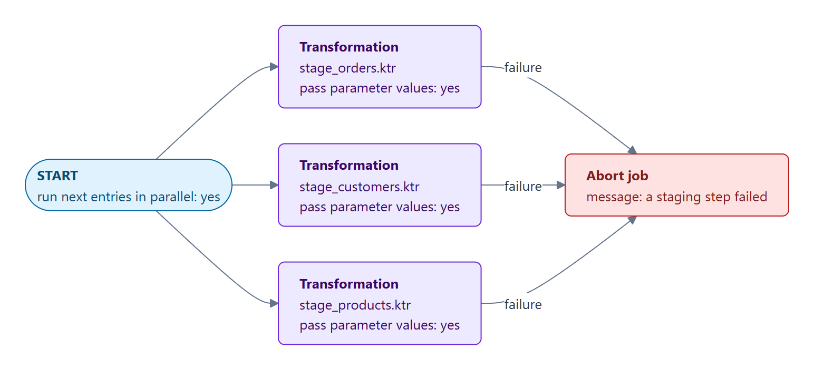
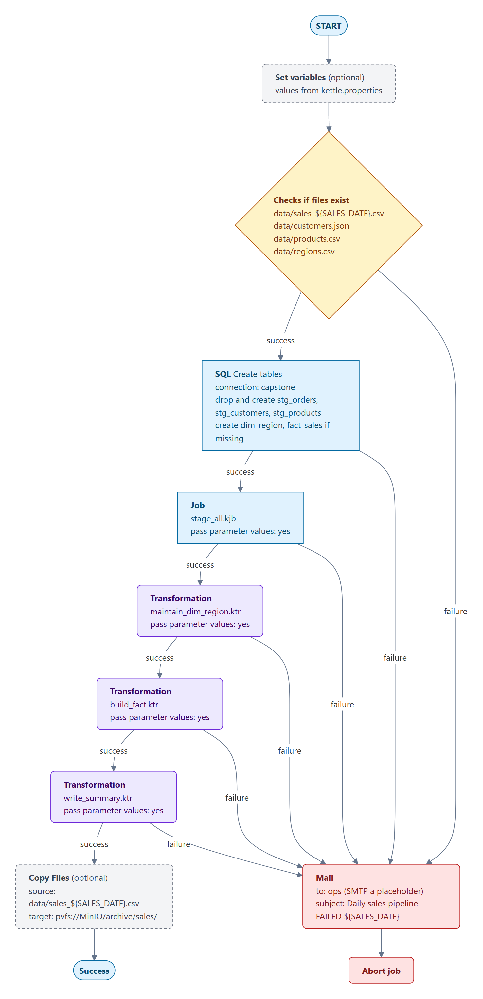

# Daily Sales Pipeline

> **Capstone Project — bring it all together.**

You're a freshly-onboarded data engineer at a regional retailer. The
analytics team needs **yesterday's sales** ready by 9am every morning,
joined with customer and product master data, with historical
attribute changes tracked, validated, and loaded into a dimensional
model the BI tools can query.

This capstone asks you to build that pipeline. It exercises every
module of the course — from variables and steps through to jobs,
scheduling, and scaling.

> **Objectives:**
>
> - Build a parameterised PDI **job** that ingests three data sources, validates them, enriches with master data, and loads a fact + dimension table.
> - Demonstrate **production-readiness**: error handling, logging, parameters, scheduled execution.
> - Produce a complete artefact you can show in interviews ("I built this for my Practitioner course accreditation").
>
> **Estimated time:** 90-120 minutes for a clean, well-named solution. Re-shape and revisit as you'd like.

---

## Inputs

Download the four files from **Lab Files** at the bottom of this
page, and put them in a `data/` folder under the workshop root you
will point `${WORKSHOP_HOME}` at (for example
`C:/Workshop-DI-Practitioner/capstone/data/`; they are already there if the installer laid out `C:\Workshop-DI-Practitioner`). Every path in this capstone is written
as `${WORKSHOP_HOME}/data/...`, so once the variable is set the
transformations resolve without further edits.

Each file represents a realistic feed you'd see in a small retail
environment.

| File | What | How to read it |
| --- | --- | --- |
| `sales_20260101.csv` | Yesterday's orders (40 rows, 3 with intentionally missing keys for the validation step) | **Text File Input** — header row, comma delimiter |
| `customers.json` | Customer master (20 rows under `$.customers[*]`) | **JSON Input** — field paths under `$.customers[*]` |
| `products.csv` | Product catalogue (13 SKUs across 4 categories) | **Text File Input** — header row, comma delimiter |
| `regions.csv` | Region reference (5 regions) | **Text File Input** — header row, comma delimiter |

Three of the sales rows have intentionally missing keys (two missing
`customer_id`, one missing `product_id`) — they're there to give your
validation step something real to catch.

---

## Required behaviour

Build a job (`.kjb`) that runs the following stages, end to end.
Each numbered stage maps to a module in the course — the capstone is
explicit about which skills it's exercising so you can double-check
yourself.

### 1. Parameterise the run *(Module 1)*

Create a `kettle.properties` (or transformation parameters) for:

- `${WORKSHOP_HOME}` — root path containing the `data/` folder
- `${SALES_DATE}` — the date suffix on the CSV (`20260101`)
- `${OUTPUT_PATH}` — where to write the fact + summary outputs

Nothing in the transformations should be hard-coded.

### 2. Read the three sources *(Module 3)*

Three transformations, each reading one source:

- `stage_orders.ktr` — Text File Input → `sales_${SALES_DATE}.csv`
- `stage_customers.ktr` — JSON Input → `customers.json`, field paths under `$.customers[*]`
- `stage_products.ktr` — Text File Input → `products.csv`

### 3. Validate *(Module 2)*

Add a Filter Rows step that routes any sale missing `customer_id` OR
`product_id` to an **error stream**. Log the count of rejected rows
with **Write to Log** at level `Basic`. Pass the valid rows
downstream.

### 4. Enrich *(Module 4)*

- **Stream Lookup** — bring in customer name + region_code from the staged customers
- **Merge Join** (sort both sides on `product_id` first) — bring in product name + cost
- **Stream Lookup** — bring in region name from `regions.csv`

### 5. Calculate *(Module 4)*

Use a **Formula** step to compute:

```
revenue       = qty * unit_price * (1 - discount_pct / 100)
gross_margin  = revenue - (qty * cost)
```

### 6. SCD Type 2 on regions *(Module 3)*

If you have a database connection available, use **Dimension
Lookup/Update** against a `dim_region` table so a region's
`manager_email` change is tracked with valid-from / valid-to dates.

If no DB is wired up, write the dimension to `${OUTPUT_PATH}/dim_region.csv`
with the SCD columns (`valid_from`, `valid_to`, `is_current`)
maintained manually using a Combination Lookup-style pattern.

### 7. Write outputs *(Module 3)*

- **Text File Output** to `${OUTPUT_PATH}/fact_sales.csv` (required: the accreditation check looks for it), plus **Table Output** to a `fact_sales` table if you want it in MySQL too
- **Excel Writer** to `${OUTPUT_PATH}/sales_summary_${SALES_DATE}.xlsx` — by region: revenue, gross margin, order count

### 8. Job orchestration *(Module 5)*

Wrap the transformations in a job:

```text
Start
  → Set Variables          read kettle.properties values into job variables
  → stage_orders.ktr
  → stage_customers.ktr
  → stage_products.ktr
  → maintain_dim_region.ktr
  → build_fact.ktr
  → write_summary.ktr
  → Success

every entry's failure hop → Mail (notify ops) → Abort job
```

> **Warning:** Want the three stage transformations to run in parallel? Put them in a **sub-job** whose START has **Run Next Entries in Parallel**, and call that sub-job where the three entries are above. The parent job moves on to `build_fact.ktr` only when the sub-job has finished. Don't run them in parallel in the main job and hop each one into `build_fact.ktr`: a job has no "wait for all" hop, so `build_fact.ktr` would run three times (see [Order of Execution](../30-mod5-order-of-execution/guide.md)).

Use a **Mail** step on the failure hop so the on-call engineer gets
notified when something breaks (you can leave the SMTP server stubbed
out — the structure matters).

### 9. Logging *(Module 2)*

Log key counts at the start and end of each major step:

- Rows read from each source
- Rows valid / rejected after validation
- Rows in fact_sales after the joins
- Rows written to dim_region (versioned vs unchanged)

### 10. Run Configuration *(Module 5)*

Define a **Carte** Run Configuration for the job and document — in a
`README.md` next to your `.kjb` — how to invoke it from Kitchen with
parameters:

```
Kitchen.bat -file=daily_sales_pipeline.kjb "-param:SALES_DATE=20260101"
```

(On Linux/macOS: `./kitchen.sh -file=daily_sales_pipeline.kjb -param:SALES_DATE=20260101`. On Windows the parameter goes in quotes, because the batch files split arguments at `=`.)

---

## Suggested architecture

```
solution/
├── daily_sales_pipeline.kjb      ← the orchestrator
├── stage_orders.ktr              ← ingest + validate sales
├── stage_customers.ktr           ← ingest customers
├── stage_products.ktr            ← ingest products
├── build_fact.ktr                ← joins + Formula → fact_sales
├── maintain_dim_region.ktr       ← SCD Type 2
├── write_summary.ktr             ← Excel by region
├── kettle.properties
└── README.md                     ← invocation + assumptions
```

---

## Hints for the tricky bits

- **JSONPath**: JSON Input has no loop path - give each field a full path that matches every customer, e.g. `$.customers[*].id`, `$.customers[*].name`, `$.customers[*].region_code`.
- **Sorting before Merge Join**: both inputs MUST be sorted on the join key. Add a Sort Rows step on each side, or `ORDER BY` in the source query.
- **Rejects**: Filter rows has no error handling; it has two outputs instead. In its dialog set **Send 'true' data to step** to the good-rows path and **Send 'false' data to step** to a Write to Log + Text File Output, to keep an audit trail.
- **Stream Lookup vs Database Lookup**: Stream Lookup is in-memory and fastest for small dimensions (regions, customers). Database Lookup hits the DB per row but works for big dimensions that don't fit in memory.
- **SCD Type 2**: Dimension Lookup/Update manages the technical key + valid-from / valid-to dates automatically. Configure the surrogate key, version field, and date fields once; the step does the bookkeeping.
- **Excel Writer**: use the **Append** option set to "Yes" if you're running daily and want to keep the file rolling; "No" creates a fresh file each run.

---

## Lab Files

Click a file to download. Put all four in `${WORKSHOP_HOME}/data/`
before you start — nothing else in the capstone is supplied, the
pipeline itself is yours to build.

[sales_20260101.csv](./files/sales_20260101.csv)

[customers.json](./files/customers.json)

[products.csv](./files/products.csv)

[regions.csv](./files/regions.csv)

---

## Verification checks

After running your job, click **Run checks** below to confirm each
output landed where expected. The checks assume the worked example
paths (`WORKSHOP_HOME=C:/Workshop-DI-Practitioner/capstone`, outputs under
`${WORKSHOP_HOME}/out`) — use exactly these paths, or the checks (and the accreditation) cannot find your work.

---

## Deliverables

Save your work in a `solution/` folder under your workshop root —
`${WORKSHOP_HOME}/solution/`, e.g. `C:/Workshop-DI-Practitioner/capstone/solution/`.

> **Warning:** Don't save it inside the course folder itself. Course
> content is refreshed from the repository on every launch, so
> anything you leave there will be overwritten.

Your `solution/` folder should contain:

1. `daily_sales_pipeline.kjb` — the orchestrator
2. `stage_*.ktr`, `build_fact.ktr`, `maintain_dim_region.ktr`, `write_summary.ktr`
3. `kettle.properties` showing your variable values (with secrets replaced by placeholders)
4. `README.md` describing how to invoke + any assumptions

This becomes a portfolio piece — keep it tidy, name things clearly, and document your decisions.

---

## Optional — Solution walkthrough (spoilers)

<details>
<summary>Click to see a step-by-step walkthrough of one valid solution. Try the capstone yourself first.</summary>

> **Note:** A worked reference solution — the job, the transformations
> and a README with the numbers a correct run produces — is laid out at
> `C:\Workshop-DI-Practitioner\capstone\reference\`. Open it after you
> have built your own. Your work stays in `capstone\solution\`; that is
> the folder the accreditation checks read, and the reference folder is
> never looked at.

The three staging transformations write to **staging tables** in the
workshop's MySQL (`stg_orders`, `stg_customers`, `stg_products`, through
one connection named `capstone`), and the fact build reads them back. A
job holds a single "rows to result" set, so three stagings cannot hand
their rows to one transformation that way; tables can. Every diagram
below uses the same colours:

<figure><figcaption><p>How to read the diagrams</p></figcaption></figure>

### `stage_orders.ktr`

Steps in order:

1. **Text File Input**: `${WORKSHOP_HOME}/data/sales_${SALES_DATE}.csv`. Comma delimiter. Header row. 7 fields with types — `qty` Integer, `unit_price` Number(10,2), `discount_pct` Number(5,2), `order_date` Date `yyyy-MM-dd`, the rest String.
2. **Filter Rows**: `customer_id IS NOT NULL AND product_id IS NOT NULL`, and while you are there `qty > 0`, `unit_price > 0`, `discount_pct` between 0 and 100. Set **Send 'true' data to step** to the Table Output and **Send 'false' data to step** to:
3. **Text File Output**: `${OUTPUT_PATH}/rejected_${SALES_DATE}.csv` (the audit trail), then a **Group by** with no group field and one aggregate, `rejected_rows` = Number of Values of `order_id`, with **Always give back a result row** on, then **Write to Log** (Basic): `Rejected rows for ${SALES_DATE}:` with `rejected_rows` in its fields.
4. The good rows go to **Table Output** `stg_orders` with **Truncate table** on, then the same Group by and Write to Log pair counting `valid_rows`.

<figure><figcaption><p>stage_orders.ktr</p></figcaption></figure>

### `stage_customers.ktr`

1. **JSON Input**: `${WORKSHOP_HOME}/data/customers.json`. Fields `id`, `name`, `email`, `region_code`, `joined_date`, each with a full path such as `$.customers[*].id` — all String except `joined_date` (Date with format `yyyy-MM-dd`).
2. **Table Output** `stg_customers`, truncate on, then **Group by** (`customers_staged` = Number of Values of `id`) and **Write to Log**.

<figure><figcaption><p>stage_customers.ktr</p></figcaption></figure>

### `stage_products.ktr`

1. **Text File Input**: `${WORKSHOP_HOME}/data/products.csv`. Header, 4 fields, `cost` as Number(10,2).
2. **Table Output** `stg_products`, truncate on, then **Group by** (`products_staged` = Number of Values of `id`) and **Write to Log**.

<figure><figcaption><p>stage_products.ktr</p></figcaption></figure>

### `maintain_dim_region.ktr`

Runs **before** the fact, so the fact can carry the region's key.

1. **Text File Input**: `${WORKSHOP_HOME}/data/regions.csv`.
2. **Get System Info**: one field, `load_date` = system date (start of transformation), the stream date for the dimension.
3. **Dimension Lookup/Update** against `dim_region`, **Update the dimension** on —
   - Key: `code` = `code`.
   - Technical key: `region_sk` (auto-increment). Version field: `version`.
   - Stream datefield: `load_date`. Date range: `valid_from`, `valid_to`.
   - Fields `name` and `manager_email` with type **Insert** (SCD type 2: a new version on change).
   - The main job's **Create tables** entry creates `dim_region` when it is missing; in Spoon the step's **SQL** button does the same.
4. **Group by** and **Write to Log** as before, counting `code`.

<figure><figcaption><p>maintain_dim_region.ktr</p></figcaption></figure>

### `build_fact.ktr`

1. **Table Input** `SELECT ... FROM stg_orders ORDER BY product_id` — the main stream, already sorted for the join.
2. **Stream Lookup** against a second **Table Input** (`SELECT id, name, region_code FROM stg_customers`): key `customer_id` = `id`, returning `name` as `customer_name` and `region_code`.
3. **Merge Join**, INNER, first step the orders on `product_id`, second step a third **Table Input** (`SELECT id, name AS product_name, category, cost FROM stg_products ORDER BY id`) on `id`, bringing `product_name`, `category`, `cost`. Both inputs are sorted by their queries.
4. **Filter Rows**: `customer_name IS NOT NULL AND product_name IS NOT NULL`; the false branch writes `${OUTPUT_PATH}/rejected_unmatched_${SALES_DATE}.csv`.
5. **Formula** —
   - `revenue = INT([qty] * [unit_price] * (1 - [discount_pct] / 100) * 100 + 0.5) / 100`
   - `gross_margin = [revenue] - ([qty] * [cost])`
   - Both as BigNumber(12,2). PDI 11's Formula step has no ROUND function, so `INT(x * 100 + 0.5) / 100` rounds each row half-up to the cent, in exact decimals. That keeps the CSV, the table and the summary agreeing to the cent.
6. **Dimension Lookup/Update** against `dim_region` with **Update the dimension** off (lookup only): key `region_code` = `code`, stream datefield `order_date`, returning `region_sk` and `name` as `region_name`.
7. **Select values** to order the columns and set precision 2 on the money fields.
8. **Text File Output** to `${OUTPUT_PATH}/fact_sales.csv` (required by the accreditation check), then **Table Output** `fact_sales` (truncate on) — chained, so one stream feeds both.
9. **Group by** and **Write to Log**: the fact's row count.

<figure><figcaption><p>build_fact.ktr</p></figcaption></figure>

### `write_summary.ktr`

1. **Text File Input** from `${OUTPUT_PATH}/fact_sales.csv` (`revenue` and `gross_margin` as BigNumber(12,2)), so this step needs no database.
2. **Sort rows** on `region_name`, then **Group by** `region_name`: `revenue` = SUM, `gross_margin` = SUM, `orders` = Number of Values of `order_id`.
3. **Microsoft Excel Writer** → `${OUTPUT_PATH}/sales_summary_${SALES_DATE}.xlsx`. One sheet, headers, append=No (fresh file every run).

<figure><figcaption><p>write_summary.ktr</p></figcaption></figure>

### `stage_all.kjb`

A sub-job whose START has **Run Next Entries in Parallel** and three **Transformation** entries, each with **Pass parameter values to sub transformation** ticked. The parent moves on only when all three have finished; a failure in any one fails the sub-job.

<figure><figcaption><p>stage_all.kjb</p></figcaption></figure>

### `daily_sales_pipeline.kjb`

```text
Start
 ↓
Set Variables            optional: kettle.properties values into job variables
 ↓
Checks if files exist    the four data files, so a missing feed fails here
 ↓
Create tables            SQL entry: drop and create the three staging tables,
 ↓                       create dim_region and fact_sales if they are missing
stage_all.kjb            sub-job: START (Run Next Entries in Parallel)
 ↓                         ├─ stage_orders.ktr
 ↓                         ├─ stage_customers.ktr
 ↓                         └─ stage_products.ktr
maintain_dim_region.ktr  the dimension first, so the fact can carry region_sk
 ↓
build_fact.ktr
 ↓
write_summary.ktr
 ↓
Success
```

The job declares the same three parameters as the transformations, with the same defaults, and every Transformation entry has **Pass parameter values to sub transformation** ticked, so a Kitchen `-param:` override reaches every step. The sub-job is what lets the three staging transformations run together and still be followed by one `maintain_dim_region.ktr`. Running them one after another in the main job (as in **8. Job orchestration**) is just as valid, and simpler.

On any **failure** hop: Mail step → notify ops, then Abort job.

<figure><figcaption><p>daily_sales_pipeline.kjb</p></figcaption></figure>

### `kettle.properties` example

```properties
WORKSHOP_HOME=C:/Workshop-DI-Practitioner/capstone
SALES_DATE=20260101
OUTPUT_PATH=C:/Workshop-DI-Practitioner/capstone/out
```

### Kitchen invocation

On Windows: `Kitchen.bat -file=daily_sales_pipeline.kjb -level=Basic "-param:SALES_DATE=20260101"`.

On Linux:

```
kitchen.sh \
  -file=daily_sales_pipeline.kjb \
  -level=Basic \
  -param:SALES_DATE=20260101 \
  -param:WORKSHOP_HOME=/var/workshop/capstone \
  -param:OUTPUT_PATH=/var/workshop/capstone/out
```

</details>
