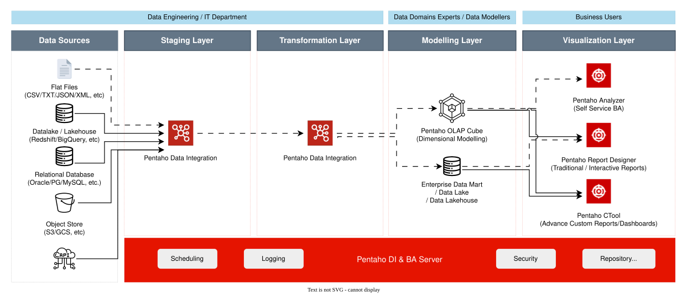
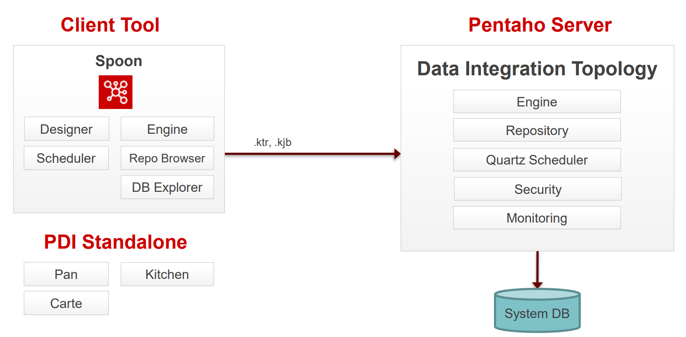
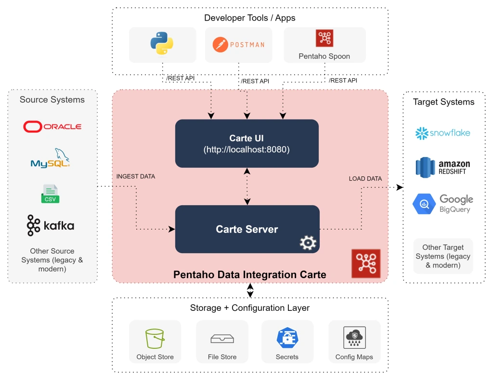
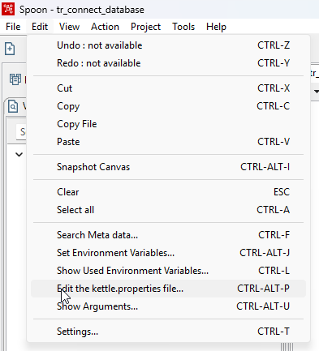
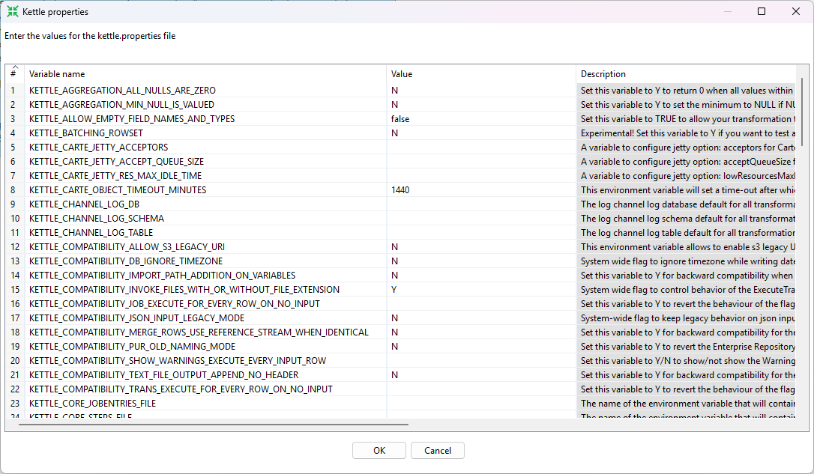
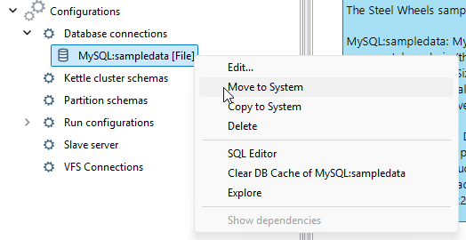

# Components
<div class="pcm-intro">

Before you build anything in Pentaho Data Integration (PDI), you need to know your way around Spoon. This module gets you set up: perspectives, options, and the kettle.properties file that drives variables across every transformation. By the time you finish, you'll feel at home in the design tool.

</div>

Understanding the architecture and components of Pentaho Data Integration (PDI) is fundamental to becoming an effective Pentaho developer and administrator. This section will familiarize you with the building blocks that make up the Pentaho Data Integration ecosystem and how they work together to deliver enterprise-grade data integration capabilities.

**What You'll Learn**

Pentaho Data Integration operates on a **client-server architecture** that separates design-time activities from runtime execution and administration. In this section, you'll explore:

* **Enterprise Components**: The server-side infrastructure that handles execution, security, content management, and scheduling
* **Client Tools**: The desktop applications used to design, test, and deploy your data integration solutions
* **Configuration Framework**: The KETTLE configuration files that control system behavior and store critical settings
* **Repository Management**: How PDI manages versioning, collaboration, and content organization
* **Database Connectivity**: The process of integrating JDBC drivers to connect to various data sources
<figure>



<div align="center">
<figcaption><em>Pentaho Ecosystem</em></figcaption>
</div>
</figure>

---

Browse to learn about the components:

:::: tabs

### 1. Components
<div align="center">
<figure>



<figcaption><em>Pentaho Architecture - Client / Server</em></figcaption>
</figure>
</div>

::: tabs

### 1. Data Integration
> **Note:**
>
> #### **Data Integration**
>
> **Spoon**
>
> Graphical modeling environment for developing, testing, debugging and monitoring jobs and transformations.
>
> **Designer**
>
> Drag & Drop 'objects' to design your pipelines and workflows.
>
> **Scheduler**
>
> Connects to the Quartz scheduler on the Pentaho Server. Jobs and transformations must be saved to the repository first.
>
> **Engine**
>
> The Kettle (Pentaho) engine runs jobs and transformations; Spark is also available as an engine.
>
> **Repository Browser**
>
> Connects to the Pentaho Repository (Apache Jackrabbit), which stores its content in a supported database:
>
> * PostgreSQL
> * MSSQL Server
> * Oracle
> * MySQL
> * MariaDB
>
> **DB Explorer**
>
> Browses a connection's schemas and tables and runs simple queries.

<div class="pcm-embed-card" data-href="https://docs.pentaho.com/pdia-data-integration" data-title="Pentaho Data Integration 11.0 | Pentaho" data-thumb="../_assets/embeds/df6e513be97b.png"></div>

### 2. Pentaho Server
> **Note:**
>
> #### **Pentaho Server**
>
> The Pentaho Server hosts Pentaho-created and user-created content. It is a core component for executing data integration transformations and jobs using the Pentaho Data Integration (PDI) Engine. It allows you to manage users and roles (default security) or integrate security to your existing security provider such as LDAP or Active Directory.

The primary functions of the Pentaho Server are:

| Function                    | Description                                                                                                                                                                                                                        |
| --------------------------- | ---------------------------------------------------------------------------------------------------------------------------------------------------------------------------------------------------------------------------------- |
| **Execution**               | Executes ETL jobs and transformations using the Pentaho Data Integration engine                                                                                                                                                    |
| **Security**                | Allows you to manage users and roles (default security) or integrate security to your existing security provider such as LDAP or Active Directory                                                                                  |
| **Content Management**      | Provides a centralized repository that allows you to manage your ETL jobs and transformations. This includes full revision history on content and features such as sharing and locking for collaborative development environments. |
| **Scheduling & Monitoring** | Provides the services allowing you to schedule and monitor activities on the Data Integration Server from within the Spoon design environment (Quartz).                                                                            |

<div class="pcm-embed-card" data-href="https://docs.pentaho.com/install/components-reference" data-title="Components reference | Pentaho" data-thumb="../_assets/embeds/99d6d0253453.png"></div>

### 3. Carte
> **Note:**
>
> #### **Carte Server**
>
> Carte is a lightweight web server that runs transformations and jobs remotely. It receives work from Spoon, Kitchen or the Pentaho Server, runs it in its own Java process, and reports status and logs back. Several Carte servers together form a cluster.

<div align="center">
<figure>



<figcaption><em>Carte Ecosystem</em></figcaption>
</figure>
</div>

> **Note:** **What Carte gives you**
>
> * **A small footprint** - one Java process, started with `carte.bat` or `carte.sh`, with no application server around it.
> * **Remote execution** - run a transformation or job on the machine that holds the data, from Spoon's **Run Options** or from Kitchen.
> * **The same steps everywhere** - Carte runs the PDI engine, so every step and connection that works in Spoon works there too.
> * **Scale-out** - deploy several Carte servers (on VMs, in Docker or on Kubernetes) and spread work across them as a cluster.
> * **A status page** - a browser view of the transformations and jobs running on the server, with their status and logs.

<div class="pcm-embed-card" data-href="https://docs.pentaho.com/pdia-data-integration/advanced-topics-pentaho-data-integration-overview/use-carte-clusters" data-title="Use Carte Clusters | Pentaho" data-thumb="../_assets/embeds/b2bee0a6a9e0.png"></div>

### 4. Command Line and APIs
> **Note:**
>
> #### **Command line tools and REST APIs**
>
> Pan and Kitchen run transformations and jobs from the command line, outside Spoon - typically from a script or a scheduler such as cron or Windows Task Scheduler. Carte and the Pentaho Server also expose REST APIs for starting and monitoring work remotely.

> **Note:** **Pan**
>
> Runs a transformation (`.ktr`) from the command line, with the same engine Spoon uses.
>
> ```bash
> ./pan.sh -file=/home/pentaho/transformations/example.ktr -level=Basic
> ```

> **Note:** **Kitchen**
>
> Runs a job (`.kjb`) from the command line, from a file or a repository. Jobs are usually scheduled to run in batch at regular intervals.
>
> ```bash
> ./kitchen.sh -file=/home/pentaho/jobs/example.kjb -level=Basic
> ```

<div class="pcm-embed-card" data-href="https://docs.pentaho.com/pdia-data-integration/loading-data-from-pdi#run-transformations-and-jobs-from-the-command-line" data-title="Run transformations and jobs from the command line | Pentaho Documentation"></div>

:::

### 2. PDI UI
> **Note:** **User Interface**
>
> Within the UI, you can author, edit, run, and debug transformations and jobs. You can also enter license keys, add data connections, and define security (default options - Pentaho or LDAP).
>
> The Welcome page contains useful links to documentation, community links for getting involved in the Pentaho Data Integration project, and links to blogs from some of the top contributors to the Pentaho Data Integration project.

<div align="center">
<figure>


<figcaption><em>Welcome Page</em></figcaption>
</figure>
</div>

> **Note:** There are a few different ways to start PDI. The method that you should use depends on the way you installed Pentaho Data Integration (PDI).

| OS: Windows / Unix       | Action                           |
| ------------------------ | -------------------------------- |
| spoon.bat / spoon.sh     | Starts Spoon                     |
| kitchen.bat / kitchen.sh | Command Line for Jobs            |
| pan.bat / pan.sh         | Command Line for Transformations |

**Launch Data Integration**

1. If Pentaho Data Integration is not up and running:

```powershell
Start-Process "C:\Pentaho\design-tools\data-integration\spoon.bat"
```

### 3. Configuration Files
> **Note:** **Configuration Files**
>
> The PDI home directory is the `.kettle` folder in the user's home directory. It holds the main PDI configuration files.
>
> * **Windows:** `C:\Users\<username>\.kettle`
> * **Linux:** `$HOME/.kettle`
>
> Because the folder belongs to the user who is signed in, two users can see different settings for the same transformations and jobs. The same applies when PDI runs inside the Pentaho Server.
>
> Set the `KETTLE_HOME` environment variable to point every user (and the server) at one `.kettle` folder, so the configuration no longer depends on who is signed in.

| File              | Description                                   |
| ----------------- | --------------------------------------------- |
| kettle.properties | Main configuration file with global variables |
| shared.xml        | Shared objects: connections, steps, servers   |
| db.cache          | Cached database metadata                      |
| repositories.xml  | The repositories Spoon can connect to         |
| .spoonrc          | Spoon's preferences and state                 |
| .languageChoice   | Language settings                             |

::: tabs

### 1. kettle.properties
> **Note:** **kettle.properties**
>
> `kettle.properties` holds the global variables for PDI. Every transformation and job can use them - for example a database host, a folder path, or a value you pass as a parameter.
>
> * **Windows:** `C:\Users\<username>\.kettle\kettle.properties`
> * **Linux:** `$HOME/.kettle/kettle.properties`
>

Edit `kettle.properties` in a text editor, or in Spoon select **Edit > Edit the kettle.properties file**:

<div align="center">
<figure>



<figcaption><em>Edit kettle.properties</em></figcaption>
</figure>
</div>

**Kettle Variables**
<figure>



<div align="center">
<figcaption><em>kettle.properties file</em></figcaption>
</div>
</figure>

### 2. shared.xml
> **Note:** **shared.xml**
>
> Objects you share are stored in a shared objects file on the local machine. The default location is:
>
> * **Windows:** `C:\Users\<username>\.kettle\shared.xml`
> * **Linux:** `$HOME/.kettle/shared.xml`
>
> Objects that can be shared using this method include:
>
> * Database connections
> * Steps
> * Slave servers
> * Partition schemas
> * Cluster schemas
>
> You can point a transformation at a different shared objects file on the **Miscellaneous** tab of its **Transformation properties**.

1. To share an object, right-click it in the **View** tab and select **Share**.

<div align="center">
<figure>



<figcaption><em>Shared connection</em></figcaption>
</figure>
</div>


> **Note:** A shared object is shown in **bold** in the **View** tab.

### 3. repositories.xml
> **Note:** **repositories.xml**
>
> Lists the repositories Spoon can connect to, such as the Pentaho Repository on a Pentaho Server. The default location is:
>
> * **Windows:** `C:\Users\<username>\.kettle\repositories.xml`
> * **Linux:** `$HOME/.kettle/repositories.xml`

```xml
<repositories>
<repository>
<id>PentahoEnterpriseRepository</id>
<name>Pentaho</name>
<description/>
<is_default>false</is_default>
<repository_location_url>http://localhost:8080/pentaho</repository_location_url>
<version_comment_mandatory>N</version_comment_mandatory>
</repository>
</repositories>
```

### 4. .spoonrc
> **Note:** **.spoonrc**
>
> Used to store preferences and program state of Spoon. Other Kettle programs do not use this file.
>
> * General settings and defaults
> * User interface settings
> * The last opened transformation/job
>
> The default location is:
>
> * **Windows:** `C:\Users\<username>\.kettle\.spoonrc`
> * **Linux:** `$HOME/.kettle/.spoonrc`

```properties
#Kettle Properties file
#Wed Sep 16 17:00:56 BST 2026
AskAboutReplacingDatabases=N
AutoCollapseCoreObjectsTree=Y
AutoSave=N
AutoSplit=N
BackgroundColorB=255
BackgroundColorG=255
BackgroundColorR=255
CustomParameterMergeJoinSortWarning=Y
DefaultPreviewSize=1000
DisableBrowserEnvironmentCheck=N
EnableAntiAliasing=N
FontDefaultName=Segoe UI
FontDefaultSize=9
FontDefaultStyle=0
...
```

> **Note:** Set these options in Spoon from **Tools > Options**.

:::

### 4. JDBC
> **Note:** **Adding JDBC Drivers**
>
> PDI and the Pentaho Server need a JDBC driver for each kind of database they connect to. Your database administrator can usually provide it; otherwise download it from the database vendor's website.
>
> Copy the driver `.jar` to:
>
> * **Pentaho Server:** /pentaho/server/pentaho-server/tomcat/lib/
> * **PDI client:**     /data-integration/lib

> **Warning:** Restart Spoon (and the Pentaho Server) after adding a driver.
>
> Keep one driver per database in each folder. If an older version of the same vendor's driver is there, back it up and remove it, or the two versions conflict.

<div class="pcm-embed-card" data-href="https://docs.pentaho.com/pdia-try-pdia/jdbc-drivers-reference" data-title="JDBC Drivers"></div>

### 5. Repository

> **Note:** **Pentaho Repository**
>
> The Pentaho+ platform implements its repository using [**Apache Jackrabbit**](http://jackrabbit.apache.org), a fully conforming implementation of the content repository for Java technology API (JCR, specified in JSR 170 and JSR 283)
>
> Apache Jackrabbit needs two pieces of information to set up a runtime content repository instance:
>
> * **Repository home directory** - the folder that holds the repository's content, search indexes and internal configuration. Jackrabbit fills it in the first time the repository starts.
> * **Repository configuration file** - the XML file that names the Jackrabbit components (persistence managers and so on) the repository uses. Jackrabbit reads it when the repository starts.

> **Note:** [**Hibernate**](https://hibernate.org/) is an open-source object-relational mapping (ORM) framework that the Pentaho Server uses to store Java objects in a relational database.

> **Note:** [**Quartz**](http://www.quartz-scheduler.org/) is the open-source Java job scheduler behind the Pentaho Server's schedules.

---

> **Note:** **Versioning & Comments (Dev only)**
>
> Pentaho Data Integration (PDI) can track versions and comments for jobs, transformations, and connection information when you save them. You can turn version control and comment tracking on or off by modifying their related statements in the repository.spring.properties text file.
>
> By default, version control and comment tracking are disabled (set to `false`). Best practice: keep your transformations and jobs in a version-control system such as Git, and upload only the production version to the repository.

1. Exit Spoon.
2. Stop the Pentaho Server.
3. Open `repository.spring.properties` in the server's `pentaho-solutions\system` folder.

::: tabs

### Windows (PowerShell)

```powershell
notepad C:\Pentaho\server\pentaho-server\pentaho-solutions\system\repository.spring.properties
```

### macOS / Linux

```bash
nano ~/Pentaho/server/pentaho-server/pentaho-solutions/system/repository.spring.properties
```

:::

4. Set `versioningEnabled` and `versionCommentsEnabled` to `true`, save the file, and start the Pentaho Server again:

```
versioningEnabled=true
versionCommentsEnabled=true
```

::::

