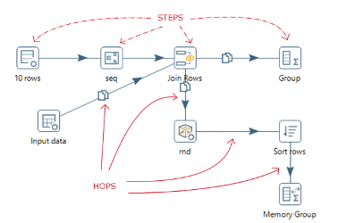
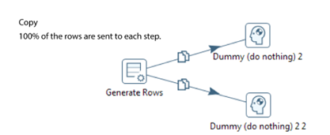
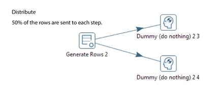
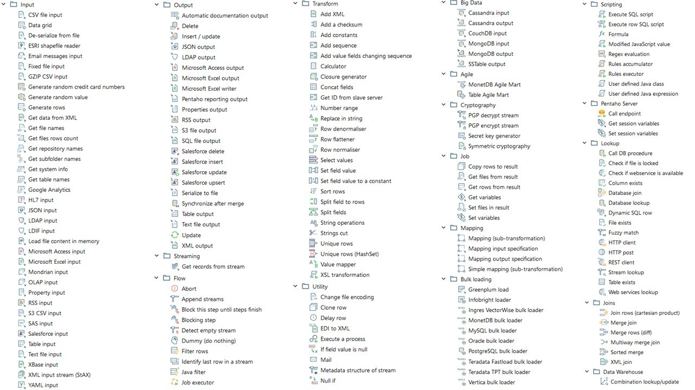
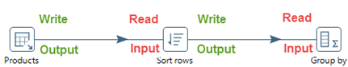
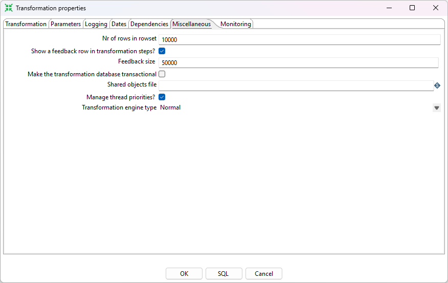
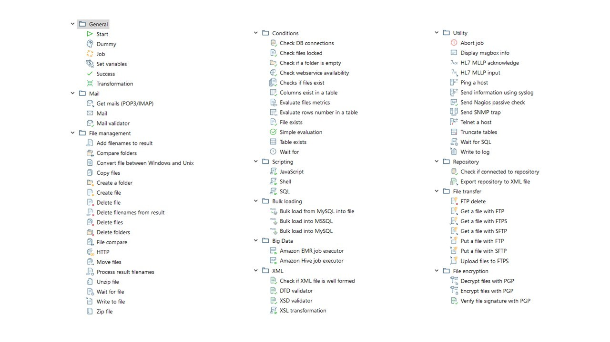

# Key Concepts

Now that Pentaho Data Integration is configured, build something with it. You'll create a 'Hello World' transformation — the simplest pipeline possible — and pick up the vocabulary the rest of the course leans on: steps, hops, rows, and the run/preview cycle.

> **Note:**
>
> #### Concepts & Terminology
> 
> The Data Integration perspective allows you to create two basic workflow types:
> 
> **Transformations**
> 
> A transformation describes a data flow: reading from a source, transforming the data, and loading it into a target.
> 
> **Jobs**
> 
> A job coordinates the work around those data flows: which transformations run, in what order, and what has to be true first - for example "Is my source file available?" or "Does the table exist?"

### Transformations & Jobs

::: tabs

### 1. Transformation

> **Note:**
>
> #### **Transformation**
> 
> Transformations are the workhorses of ETL. They are made of two things:
> 
> **Steps**
> 
> Each step does one job, from reading a text file to maintaining a slowly changing dimension. All the steps in a transformation run at the same time.
> 
> **Hops**
> 
> A hop carries rows from one step to the next. Each hop is a row buffer between one step's output and the next step's input. In the transformation below, every arrow is a hop: **10 rows** feeds **seq**, which **Join Rows** joins with **Input data**; from there rows go on to **Group**, and through **rnd** and **Sort rows** to **Memory Group**.

<figure>

<figcaption>Steps &#x26; Hops = Transformation</figcaption>
</figure>

***

> **Note:**
>
> #### **Steps**
> 
> Key characteristics of steps:
> 
> * A step's name must be unique within its transformation.
> * Almost every step reads rows and writes rows. **Generate Rows** is an exception: it only writes.
> * A step can have several outgoing hops. It either **copies** each row to every one of them, or **distributes** the rows among them in turn (round robin).
> * Each step runs in its own thread. For performance tuning you can run several copies of a step, each in its own thread.
> * All steps run in parallel, so you can't set an order of execution inside a transformation. Use a job for that.

As well as steps and hops, a transformation can hold **notes**, which document it on the canvas.

<figure>

<figcaption>Copy rows</figcaption>
</figure>

<figure>

<figcaption>Distribute rows</figcaption>
</figure>

<figure>

<figcaption>Steps</figcaption>
</figure>

### 2. Parallelism

> **Note:**
>
> #### **Parallelism**
> 
> When a transformation starts, all its steps start at the same time. Each hop is a buffer that holds 10,000 rows by default.
> 
> As soon as the first step has read some rows, it writes them into its outgoing hop. The next step reads them from there while the first step is still reading, and writes its own output into the next hop, and so on down the line. Rows stream through; no step waits for the one before it to finish. You set the buffer size on the **Miscellaneous** tab of **Transformation properties**.

<figure>

<figcaption>parallelism</figcaption>
</figure>

> **Note:**
>
> #### **Adjusting the Queue Size**
> 
> When you tune performance, especially on a machine with plenty of RAM, you may want a larger buffer. It is the **Nr of rows in rowset** setting in **Transformation properties**, and it applies to every hop in the transformation. A larger buffer can let the first steps finish sooner, freeing CPU time for the steps after them.

<figure>

<figcaption>Changing buffer row set</figcaption>
</figure>

### 3. Data Types

> **Note:**
>
> #### **Data Types**
> 
> Each Pentaho Data Integration data type maps to a Java type, so the field, parameter or variable behaves the way that Java type does.

The following table describes these mappings:

| PDI Data Type | Java Data Type | Description | Example |
| --- | --- | --- | --- |
| BigNumber | BigDecimal | An arbitrary unlimited precision number. | 3.141592653589793238462643383279502884197169399375105820974944 |
| Binary | Byte[] | An array of bytes that contain any type of binary data. | An image file or a compressed file can be stored as Binary data |
| Boolean | Boolean | A boolean value `true` or `false`. | A boolean value true or false |
| Date | Date | A date-time value with millisecond precision. | 2023-10-20T10:48:51.123 |
| Hierarchical EE Plugin 9.5+ | BinaryTree | Data items that are related to each other by hierarchical relationships | A family tree |
| Integer | Long | A signed long 64-bit integer. | 42 |
| Internet Address | InetAddress | An Internet Protocol (IP) address. | 192.168.0.1 |
| Number | Double | A double precision floating point value (64bits). | 2.7182818284590452353602874713526624977572470936999 |
| String | String | A variable unlimited length text encoded in UTF-8 (Unicode). | “Hello world!” |
| Timestamp | Timestamp | Allows the specification of fractional seconds to a precision of nanoseconds. | 2023-10-20T10:48:51.123456789 |

### 4. Jobs

> **Note:**
>
> #### **Jobs**
> 
> A job runs transformations and other jobs in a defined order, with conditions between them, to carry out a business process.
>
> **Job Entries**
> 
> Each job entry is one task in the job: run a transformation, run a shell script, execute SQL, copy or check files, and more. Each entry has its own options and parameters.
> 
> Job entries run one after another, following the hops. (An entry can also be set to start the entries after it in parallel.)

<figure>

<figcaption>Job Entries</figcaption>
</figure>

:::

