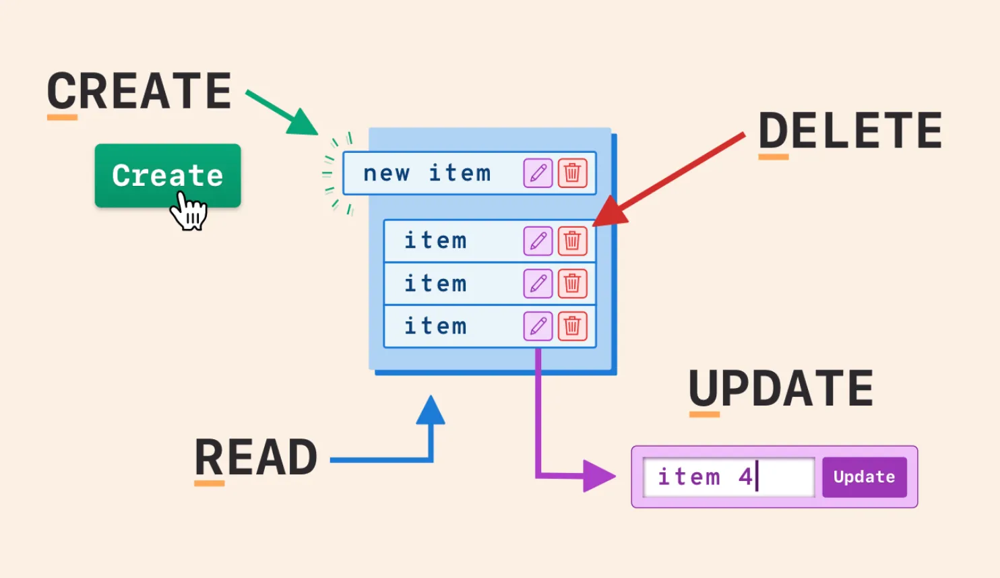

# Review CRUID

> **Note:**
>
> #### Database Operations
>
> CRUD names the four basic database operations: create, read, update and delete. This course adds a fifth, **insert-update**, so it says CRUID. The workshops that follow run each one against the Steel Wheels `sampledata` database.
>
> **Create** operations add new records to a database. This might involve inserting a new customer profile, product listing, or transaction record. In SQL, this is typically done using the INSERT statement, while in NoSQL databases, it might use methods like insertOne() or save().
>
> **Read** operations retrieve existing data from the database. This could be fetching a single record by its unique identifier or querying multiple records based on specific criteria. SQL uses SELECT statements for this purpose, while NoSQL databases might use find() or get() methods.
>
> **Update** operations modify existing records in the database. This could involve changing a customer's address, updating a product's price, or modifying any stored information. SQL uses the UPDATE statement, while NoSQL databases might use methods like updateOne() or save() on an existing document.
>
> **Insert-update** (an "upsert") updates a record when its key already exists and inserts it when it doesn't, so one load can both add and change data. PDI's **Insert / update** step does it with a lookup on the key, then an `UPDATE` or an `INSERT`; some databases have a single statement for it, such as `MERGE` or MySQL's `INSERT ... ON DUPLICATE KEY UPDATE`.
>
> **Delete** operations remove records from the database. This might involve permanently removing a user account or archiving old data. SQL uses the DELETE statement, while NoSQL databases typically use methods like deleteOne() or remove().

<figure>

<figcaption>CRUID in PDI</figcaption>
</figure>

