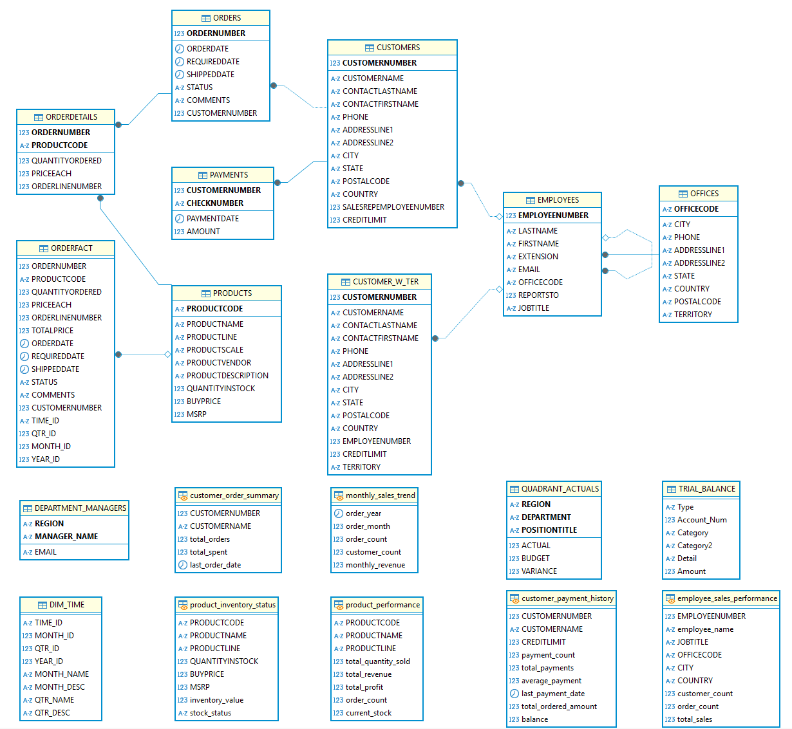

# Review Databases

Relational databases are what Pentaho Data Integration works with most. This topic covers the full CRUID set - Create, Read, Update, Insert-Update and Delete - plus slowly changing dimensions for loading a data warehouse.

> **Note:**
>
> #### Steel Wheels - sampledata
> 
> Steel Wheels runs a simple Enterprise Resource Planning (ERP) system for its business units: Human Resources, Marketing, Finance, Supply Chain and others. The workshops in this section run each CRUID operation against its database, `sampledata`.

<figure>

<figcaption>Steel Wheels: the sampledata ERP database</figcaption>
</figure>

> **Warning:**
>
> #### Why these workshops use MySQL, not the bundled sampledata
>
> Pentaho ships a `sampledata` database running on **HSQLDB
> (Hypersonic)**. It is fine for reading: Table input, lookups and
> joins.
>
> It will **not** work for the workshops in this module. The admin
> account has been removed from the bundled HSQLDB instance, so it is
> effectively read-only: you cannot insert, update or delete against
> it.
>
> Every CRUID workshop from here on writes to the database:
>
> * [Writing to a Database](../14-mod3-writing-to-a-database/guide.md) - Table output (insert)
> * [Table Update](../15-mod3-table-update/guide.md) - update
> * [Table Insert - Update](../16-mod3-table-insert-update/guide.md) - upsert
> * [Deleting Records](../17-mod3-deleting-records/guide.md) - delete
> * [Slowly Changing Dimensions](../18-mod3-slowly-changing-dimensions/guide.md) - Dimension lookup/update
>
> That is why [Connecting to Database](../12-mod3-connecting-to-database/guide.md)
> connects to a **MySQL** copy of Steel Wheels `sampledata` on port
> `3306`. Set that connection up once and the rest of the module reuses
> it. Pointed at the HSQLDB instance instead, these workshops fail on
> the first write.
>
> **Steel Wheels - Schema**
> 
> The Steel Wheels schema models a company that sells and distributes scale-model products. It centers on order processing - orders and their line items - with customer profiles that hold contact details, territories and credit limits.
> 
> It also tracks inventory (quantities, prices, vendors) and employees, with sales performance by office.
> 
> For reporting it adds summary tables, a time dimension and views for product performance, payment history and sales trends.
> 
> **Tables**
> 
> **OFFICES**: Stores company office locations with address details
> 
> **EMPLOYEES**: Contains employee information with relationships to offices and reporting structure
> 
> **CUSTOMERS**: Stores customer information including contact details and credit limits
> 
> **PRODUCTS**: Contains product catalog with inventory and pricing information
> 
> **ORDERS**: Tracks customer orders with status and dates
> 
> **ORDERDETAILS**: Contains line items for each order with quantity and price
> 
> **PAYMENTS**: Records customer payments with amounts and dates
> 
> **ORDERFACT**: A fact table for order analytics
> 
> **CUSTOMER\_W\_TER**: Extended customer information with territory
> 
> **DIM\_TIME**: Time dimension table for reporting
> 
> **DEPARTMENT\_MANAGERS**: Stores department manager information
> 
> **QUADRANT\_ACTUALS**: Contains budget vs. actual financial data with a generated VARIANCE column
> 
> **TRIAL\_BALANCE**: Financial accounting data
> 
> **Views**
> 
> **customer\_order\_summary**: Summarizes orders and spending by customer
> 
> **product\_performance**: Analyzes product sales metrics including revenue and profit
> 
> **employee\_sales\_performance**: Tracks sales performance by employee
> 
> **monthly\_sales\_trend**: Shows sales trends over time by month
> 
> **product\_inventory\_status**: Categorizes products by inventory levels
> 
> **customer\_payment\_history**: Summarizes customer payment activity and balances
> 
> **Stored Procedures**
> 
> **GetCustomerOrders**: Retrieves orders for a specific customer
> 
> **UpdateProductStock**: Updates product inventory levels
> 
> **GetProductSalesByQuarter**: Analyzes quarterly product sales
> 
> **GetTopCustomersByRegion**: Identifies top customers by region
> 
> **GetInventoryValueByProductLine**: Calculates inventory metrics by product line
> 
> **Triggers**
> 
> **before\_order\_insert**: Validates date constraints on orders
> 
> **before\_payment\_insert**: Ensures payment amounts are positive
> 
> **Events**
> 
> * **daily\_maintenance**: Scheduled task for database maintenance

