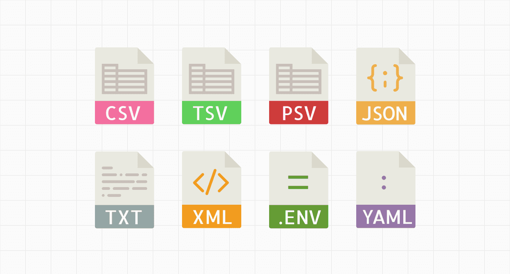

# Review Flat Files

The bread and butter of any pipeline. You'll cover the four formats you'll see most often: delimited text, JSON, XML, and Excel.

> **Note:**
>
> #### **Flat files**
>
> A flat file holds data as text in a single file, with no database around it. Flat files come in four kinds.

* **Structured** - a consistent, predictable layout with defined fields and delimiters. The most common in data integration, and the easiest for Pentaho Data Integration: each row maps to a record and each column to a field.
  * **CSV** (comma-separated values), e.g. `CustomerID,Name,Email,Purchase_Date`
  * **TSV** (tab-separated values)
  * **Fixed-width**, where each field takes a set number of characters - common in legacy mainframe systems
* **Semi-structured** - some structure, but not a database's rigid schema. Self-describing and flexible, which is why APIs and web services use them.
  * **JSON** (JavaScript Object Notation): key-value pairs and nested objects, e.g. `{"customer": {"id": 123, "orders": [{"item": "laptop", "price": 899}]}}`
  * **XML** (eXtensible Markup Language): hierarchical tags
* **Unstructured** - free-form text with no schema: documents, email bodies, raw application logs. Getting data out of them takes text parsing or natural language processing.
* **Metadata** - information about the data: header rows with column names, schema definitions with types and constraints, notes on where a file came from.

<figure>

<figcaption>Common flat-file formats</figcaption>
</figure>

> **Under the hood:**
>
> #### Pentaho Data Integration reads the metadata first
>
> Before a file step reads a single row, it settles each field's name, type and format - from a header row, from **Get Fields** (which samples the file and guesses), or from what you type in. Every value is then converted as it is read, so a date that doesn't match its format fails in the input step, where the log names it, rather than three steps later.
>
> **Why it matters:** most flat-file problems are metadata problems: a wrong delimiter, a date format, a number with a thousands separator. Check the field list before you blame the data.
