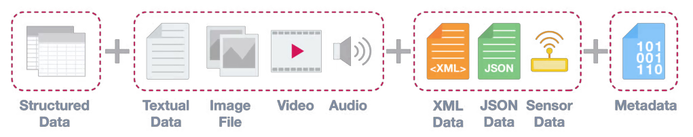
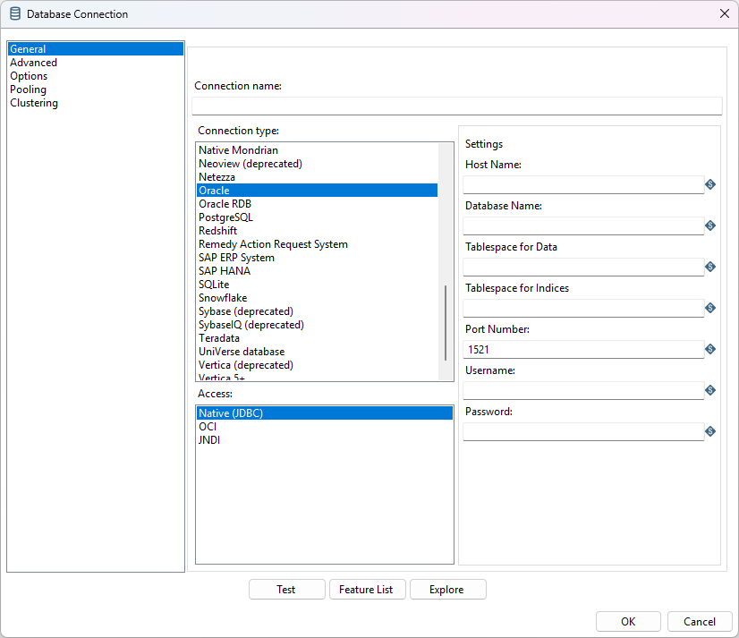
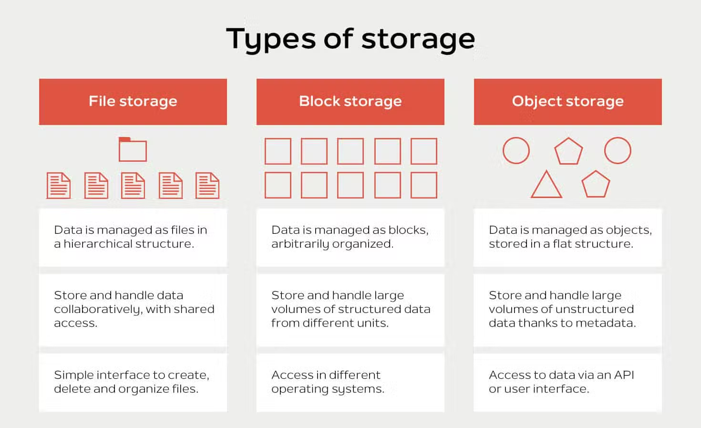
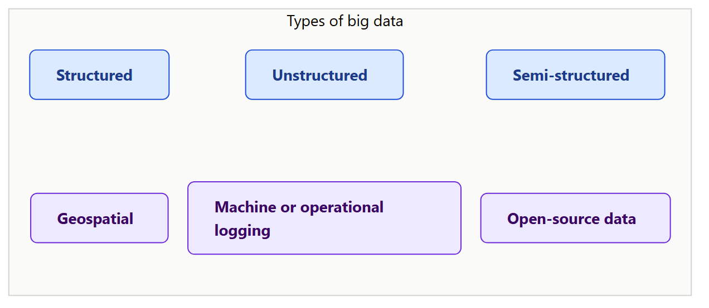
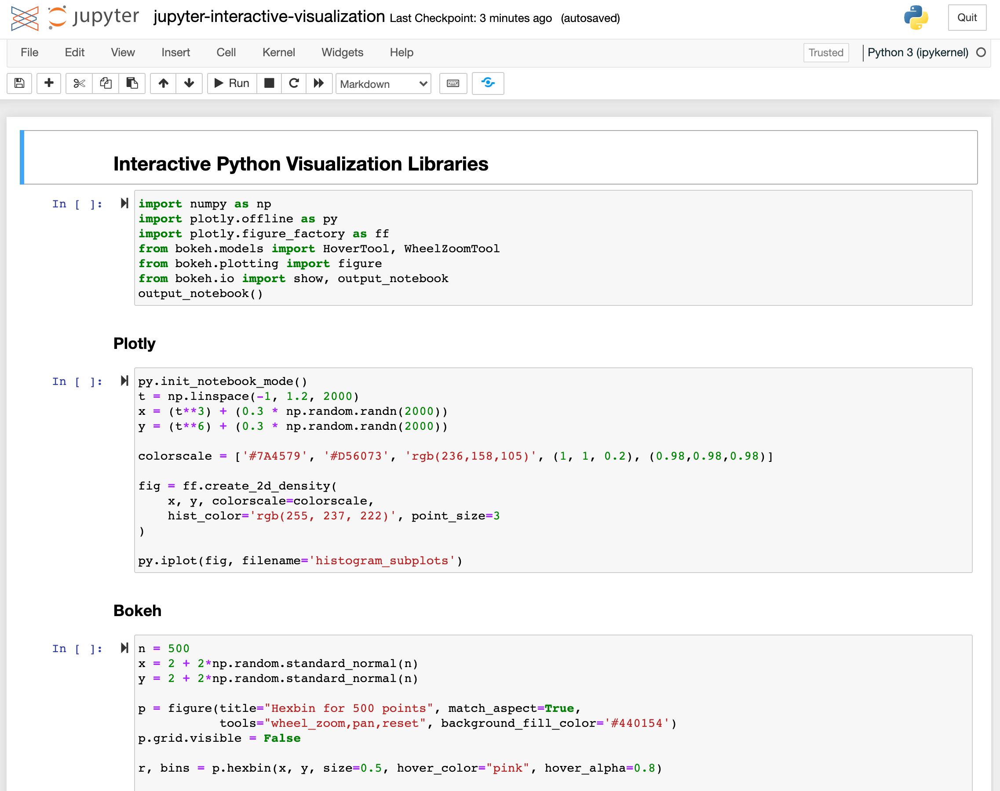

# Overview

Every Pentaho Data Integration pipeline starts and ends at a data source. This module's workshops cover the ones you'll meet most: flat files (text, JSON, XML and Excel), relational databases (create, read, update, insert and delete, plus slowly changing dimensions) and object storage (MinIO, which speaks the Amazon S3 protocol). The last two tabs below introduce big-data platforms and notebooks, which Pentaho Data Integration also works with.

### Choose a data source

Use this page to find your way, then open the section you need.

> **Note:**
>
> #### What “data source” means in Pentaho Data Integration
> 
> In practice, a data source is either:
> 
> * A file format you parse (CSV, Excel, JSON, XML).
> * A service you connect to (a DB, object store, cluster, or API).

:::: tabs

### Flat Files

> **Note:**
>
> #### Flat files
> 
> Flat files are how data most often arrives: CSV, other delimited text, fixed-width, JSON, XML or Excel.
> 
> Start here: [Flat Files](../topic-mod3-flat-files-review/guide.md).

<figure>

<figcaption>Kinds of flat file</figcaption>
</figure>

::: tabs

### Structured

> **Note:**
>
> #### Structured
> 
> Structured data follows a predefined model of tables, rows and columns, so it is easy to validate and query. Examples: SQL databases and well-formed CSV files.

### Unstructured

> **Note:**
>
> #### Unstructured
> 
> Unstructured data has no consistent schema - PDFs, images, video, free-form text. Using it usually takes parsing, extraction or machine learning.

### Semi-structured

> **Note:**
>
> #### Semi-structured
> 
> Semi-structured data has a loose schema: tags or keys describe the fields and their hierarchy. JSON and XML are the common formats.

### Metadata

> **Note:**
>
> #### Metadata
> 
> Metadata is data about data: header rows, schemas and data dictionaries.

:::

### Databases

> **Note:**
>
> #### Databases
> 
> Pentaho Data Integration connects to relational databases through JDBC drivers, one for each kind of database.
> 
> Start here: [Databases](../topic-mod3-databases-review/guide.md).

<figure>

<figcaption>Database connections</figcaption>
</figure>

### Storage

> **Note:**
>
> #### Storage
> 
> Storage sources are cloud or network file stores, such as Amazon S3, Azure Blob Storage and Google Cloud Storage. Pentaho Data Integration reaches them through a VFS (virtual file system) connection, so the same steps read and write files on any of them.
> 
> Start here: [Storage](../topic-mod3-storage-review/guide.md).

<figure>

<figcaption>Storage types</figcaption>
</figure>

### Big Data

> **Note:**
>
> #### Big Data
> 
> Big data sources need distributed compute: Hadoop (HDFS, Hive, HBase), Spark, NoSQL stores and Kafka. Pentaho Data Integration has dedicated steps and adapters for these platforms, so it can transform data where it lives. This course has no workshop on them; the Pentaho documentation covers each one.

<figure>

<figcaption>Types of big data</figcaption>
</figure>

### Jupyter Notebook

> **Note:**
>
> #### Jupyter Notebook
> 
> Jupyter is a web-based notebook that mixes code, charts and narrative text, which suits exploratory analysis and prototyping. In a typical setup the notebook does the advanced analysis and Pentaho Data Integration runs the production pipelines and schedules around it.

<figure>

<figcaption>Jupyter Notebook</figcaption>
</figure>

::::

