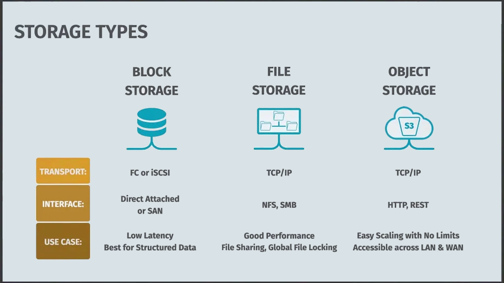

# Review Storage

Object storage as a first-class data source. Read from and write to MinIO over the S3 protocol, the same pattern you'd use for Amazon S3 in production.

**What You'll Learn**

* The three ways storage is presented: block, file and object
* Why object storage suits data pipelines, and the products you'll meet: MinIO, Amazon S3, Hitachi Content Platform
* How PDI reaches object storage: a **VFS connection** and a `pvfs://` path, used by ordinary file steps

> **Note:**
>
> #### **Overview**
> 
> **Block storage** presents raw disk volumes to a server, over Fibre Channel or iSCSI, either attached directly or through a storage area network (SAN). The server's operating system puts its own file system on them. Latency is low and consistent, which suits databases and virtual machine disks.
> 
> **File storage** shares a file system over the network with NFS or SMB: folders, files, permissions and locking, which many users and applications can open at once. It suits shared folders and application files.
> 
> **Object storage** keeps each file as an *object* in a flat *bucket*, addressed by a key and reached over HTTP(S) with a REST API, usually the Amazon S3 API. It scales almost without limit, works across networks and clouds, and adds features such as versioning, lifecycle rules and replication. It suits data lakes, backups and analytics: the data a pipeline reads and writes.

<figure>

<figcaption><em>Block, file and object storage</em></figcaption>

</figure>

**Object storage you'll meet**

| Product                            | What it is                                                                                                                                                     |
| ---------------------------------- | -------------------------------------------------------------------------------------------------------------------------------------------------------------- |
| **MinIO**                          | Open-source object storage with the S3 API, run on premises, in any cloud or in a container. The workshop that follows uses it.                                  |
| **Amazon S3**                      | Amazon's object storage service, the origin of the S3 API. Storage classes from Standard to Glacier trade cost against how quickly and often data is read.      |
| **Hitachi Content Platform (HCP)** | Hitachi's enterprise object storage, built for governance and compliance: retention policies, write-once (WORM) storage and data classification. It speaks S3 too. |

Because all three speak the S3 API, a transformation built against MinIO in the lab works against S3 or HCP once the connection points there.

**How PDI reaches it**

PDI talks to object storage through its virtual file system (VFS). You define a **VFS connection** once, with its endpoint and credentials. Steps then address files in it with a `pvfs://<connection>/<bucket>/<path>` address, so ordinary file steps such as **Text file input** read from a bucket as if it were a folder. The [MinIO](../19-mod3-minio/guide.md) workshop sets one up.

