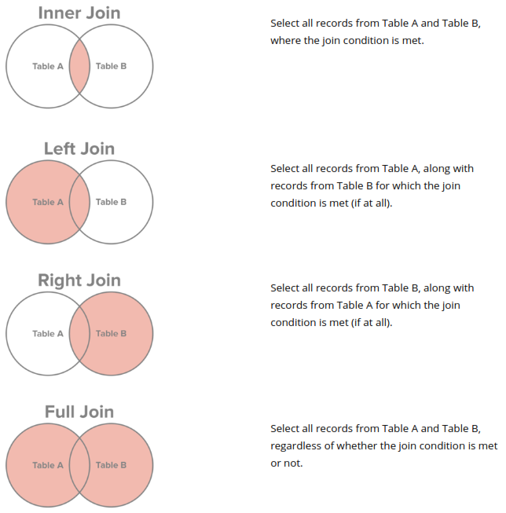
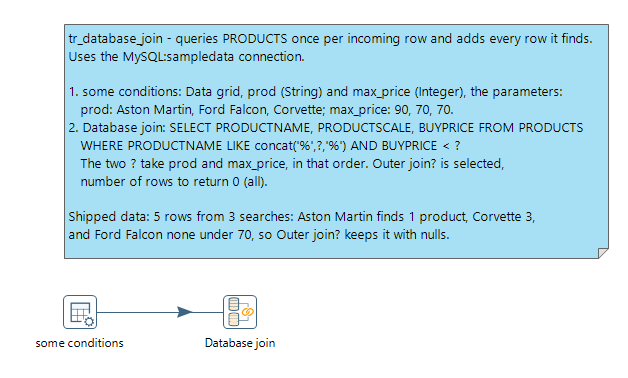
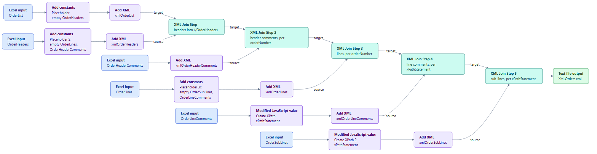

# Review Joins

Bringing two streams together by key. Database joins, join rows (cartesian-style), merge join (sorted), and XML join: pick the right one for the data you have and the size you're working at.

**What You'll Learn**

* The four join steps in PDI, and what each needs from its inputs
* The four join types (inner, left outer, right outer, full outer)
* How to choose a join by the size and shape of your data

> **Note:** **Introduction**
>
> A join combines rows from two sources into one row, matched on a key or a condition. In PDI the join happens in the transformation, between streams, so the sources can be files, tables, web services or anything else a step can read. Each join step suits a different situation:
>
> | Step | Joins | Needs | Use it when |
> | --- | --- | --- | --- |
> | **Merge join** | Two streams, on key fields | Both inputs sorted on the key | Both sides are large; it holds one row per side in memory |
> | **Join rows (cartesian product)** | Every row of one stream with every row of the others, optionally filtered by a condition | Nothing; all but one input are held in memory | You need every combination, or a join on a condition other than equality |
> | **Database join** | Each stream row with the rows a parameterized query returns | A database connection | A small stream needs rows from a table, and one row can match several |
> | **XML join** | XML fragments from one stream into an XML document from another, at an XPath | XML on both sides | You are building a nested XML document |
>
> **Multiway merge join** joins more than two sorted streams at once. To add a few fields from a reference set to each row, a lookup is often simpler than a join: see [Review Lookups](../topic-mod4-lookups-review/guide.md).

::: tabs

### Join rows

> **Note:** **Join rows (cartesian product)**
>
> **Join rows (cartesian product)** combines every row of one stream with every row of the other: 10 rows by 10 rows give 100. A condition keeps only the combinations that pass it. The output is the product of the input sizes, so keep the smaller side small and filter early.
>
> Workshop: [Join Rows](../23-mod4-join-rows/guide.md).

<figure><figcaption>
Join rows in the Join Rows workshop
</figcaption></figure>

### Merge join

> **Note:** **Merge join and the four join types**
>
> **Merge join** matches two sorted streams on key fields, with one of the four classic join types. An outer join keeps the unmatched rows of one or both sides, with nulls for the other side's fields.
>
> Workshop: [Merge Join](../24-mod4-merge-join/guide.md).

<figure><figcaption>
The four join types
</figcaption></figure>

### Database join

> **Note:** **Database join**
>
> **Database join** runs a query for each incoming row, with values from that row as the query's parameters (the `?` markers in the SQL), and adds the rows the query returns. One input row can return several, or, with **Outer join?** selected, none and still pass on. Each row costs a round trip to the database, so it suits a small driving stream; for large volumes, put the join in the SQL or use **Merge join**.
>
> Workshop: [Database Join](../22-mod4-database-join/guide.md).

<figure><figcaption>
Database join
</figcaption></figure>

### XML join

> **Note:** **XML join**
>
> **XML join** inserts XML fragments from a *source* stream into the XML document of a *target* stream, at the node an XPath selects. Chaining several builds a nested document, one level at a time.
>
> Workshop: [XML Join](../25-mod4-xml-join/guide.md).

<figure><figcaption>
Five XML joins build one nested document
</figcaption></figure>

:::
