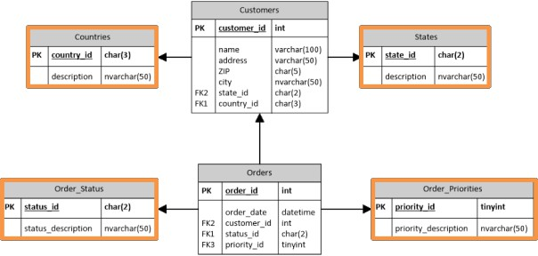

# Review Lookups

Enriching one stream with values from another. Database Lookup is the most common: point at a reference table, fetch one or more columns by key, cache for performance.

**What You'll Learn**

* What a lookup adds to a row, and where the values come from
* The difference between a lookup and a join
* When to cache a lookup, or load the whole reference table

> **Note:** **Introduction**
>
> Besides transforming data, a pipeline often needs values from somewhere else. For example:
>
> * Orders carry a product code, and the report needs the product's name.
> * Customers carry a country code, and the dashboard needs the country's name and region.
>
> A lookup takes a key from each row, finds the matching row in a reference set, and adds the fields you ask for. If nothing matches, it adds a default, or none.

<figure>

<figcaption>Reference (lookup) tables around a sales schema</figcaption>
</figure>

> **Note:** Reference tables like these are usually small: a handful of statuses, a few hundred countries. That makes them ideal for a lookup that is cached, or read into memory once.

**Lookup steps**

| Step | Looks up in | Returns | Use it when |
| --- | --- | --- | --- |
| **Database lookup** | A database table, by key conditions | At most one row per input row, with defaults when nothing matches | The reference data is in a database; cache it, or load it all, when it fits in memory |
| **Stream lookup** | Another stream in the same transformation, read into memory first | At most one row per input row | The reference data comes from a file or another step, as in the [MinIO](../19-mod3-minio/guide.md) Sales Dashboard |

**A lookup or a join?** A lookup adds fields from *one* matching row. When a key can match several rows and you want them all, use a join: **Database join** returns every row a query finds. See [Review Joins](../topic-mod4-joins-review/guide.md).

Workshop: [Database Lookups](../26-mod4-database-lookups/guide.md).
