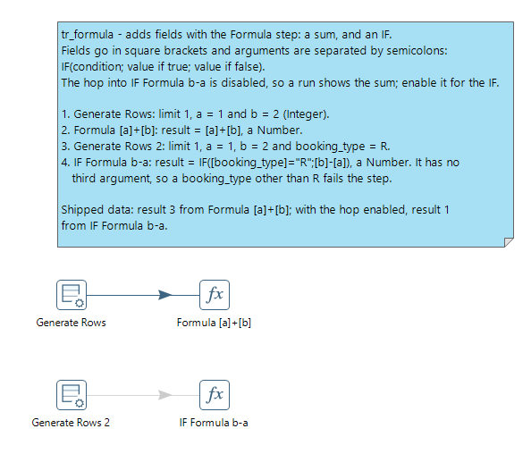
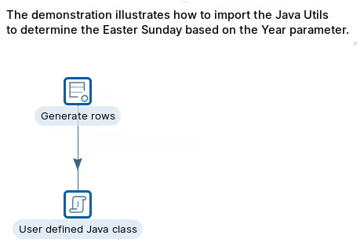

# Review Scripting

When the visual steps don't quite fit. Formula handles spreadsheet-style expressions; Modified JavaScript Value lets you write per-row logic in JavaScript when the transformation needs procedural code.

**What You'll Learn**

* The five ways to calculate in a transformation, from no code to a Java class
* When a formula is enough, and when you need a script
* What each costs in speed and in readability

> **Note:** **Introduction**
>
> Most calculations need no code at all. Pentaho Data Integration offers a ladder of steps, and the rule of thumb is to use the lowest rung that does the job: the higher you go, the more you can express, and the harder the transformation is for the next person to read.
>
> | Step | You write | Good for |
> | --- | --- | --- |
> | **Calculator** | Nothing: pick a function from a list | Arithmetic, dates, string functions on up to three fields |
> | **Formula** | A spreadsheet-style expression, `[a]+[b]` | Conditions, text assembly, anything an analyst would write in a spreadsheet |
> | **User defined Java expression** | One Java expression per field | Java string and math methods, compiled for speed |
> | **Modified JavaScript value** | A JavaScript script, run for each row | Loops, regular expressions, state carried from row to row |
> | **User defined Java class** | A Java class that is the step | Logic too large for an expression, with full control of the rows |

::: tabs

### Formula

> **Note:** **Formula**
>
> **Formula** evaluates OpenFormula expressions, the language of spreadsheet formulas, with the row's fields in square brackets and arguments separated by semicolons:
>
> * `[a]+[b]`
> * `IF([booking_type]="R";[b]-[a];0)`
> * `CONCATENATE([first_name];" ";[last_name])`
> * `INT([amount]*100+0.5)/100`, rounding to the cent (Pentaho Data Integration 11's Formula has no `ROUND`)
>
> Each formula creates a new field, or replaces one with **Replace value**.
>
> Workshop: [Formula](../27-mod4-formula/guide.md).

<figure>

<figcaption>A calculation and a condition</figcaption>
</figure>

### Modified JavaScript value

> **Note:** **Modified JavaScript value**
>
> **Modified JavaScript value** runs a script once for each input row. The row's fields are JavaScript variables, and the variables you list in the step's **Fields** grid become output fields. Variables declared at the top level keep their values from one row to the next, which makes running totals and comparisons with the previous row possible.
>
> Workshop: [Modified JavaScript Value](../28-mod4-mjv/guide.md).

<figure>

<figcaption>A script that cleans a string</figcaption>
</figure>

### User defined Java class

> **Note:** **User defined Java class**
>
> **User defined Java class** lets you write the logic of a whole step in Java: you define the methods that process each row, and Pentaho Data Integration compiles the class when the transformation starts, with the [Janino](https://janino-compiler.github.io/janino/) compiler. It is for logic that is too large for an expression, not for building full plugins inside a step.

<figure>

<figcaption>A Java class that calculates Easter Sunday</figcaption>
</figure>

:::
