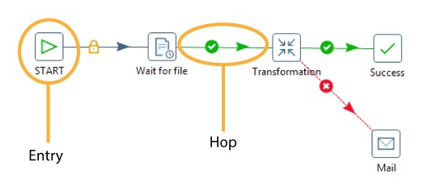
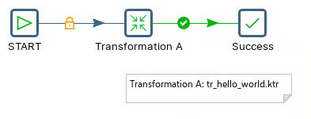
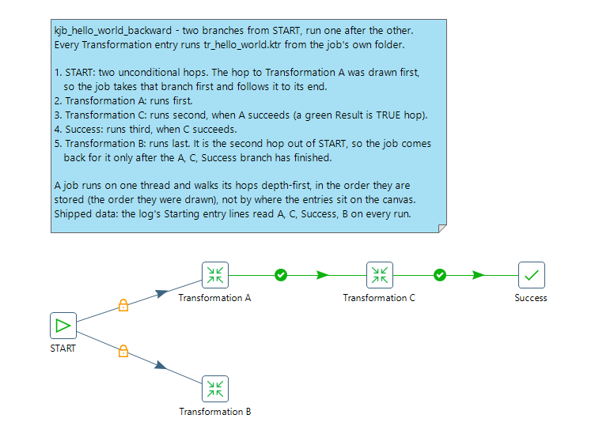
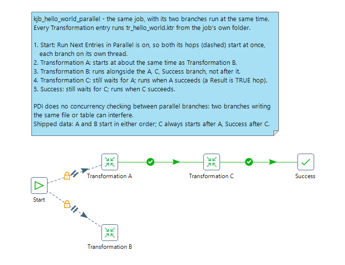

# Review Jobs

Transformations move rows; jobs orchestrate transformations. You'll build a Hello World job, then learn how to control the order of execution: the foundation for any scheduled production pipeline.

**What You'll Learn**

* What a job entry and a job hop are
* How hop conditions route a job on success or failure
* In what order a job runs its entries, and how to run branches in parallel

> **Note:** **Jobs**
>
> Pipelines need more than data flow: tasks that prepare and clean up, transformations run in the right order, and handling of errors and retries. Jobs do that. A job is a set of **job entries** joined by **job hops**. Compared with a transformation's steps:
>
> * A job runs its entries one after another (unless you ask for parallel branches); a transformation runs all its steps at once.
> * An entry passes a *result* to the next: success or failure, and lists of rows and files, handed over all at once rather than streamed.
> * You can place a copy of the same entry in several places in a job.

<figure>

<figcaption>Entries and hops</figcaption>
</figure>

> **Note:** A hop decides whether the next entry runs. A lock means **unconditional**: it is always followed. Green means it is followed when the previous entry succeeds, red when it fails. Right-click a hop to change its **Evaluation** mode.

::: tabs

### Hello World (Job)

> **Note:** **Hello World (Job)**
>
> The smallest useful job: **START**, a **Transformation** entry that runs `tr_hello_world.ktr`, and **Success**.
>
> Workshop: [Hello World (Job)](../29-mod5-hello-world-job/guide.md).

<figure>

<figcaption>START, a transformation, Success</figcaption>
</figure>

### Order of execution

> **Note:** **Order of execution**
>
> A job follows each branch to its end before it starts the next: from START it runs Transformation A, then C and Success, and only then goes back for Transformation B. The order of the branches is the order the hops are stored in, not their position on the canvas, so anything that must run in sequence belongs on one branch.
>
> Workshop: [Order of Execution](../30-mod5-order-of-execution/guide.md).

<figure>

<figcaption>Two branches, run one after the other</figcaption>
</figure>

### Parallel

> **Note:** **Parallel branches**
>
> **Run Next Entries in Parallel**, on an entry's right-click menu, starts its outgoing branches at the same time, each on its own thread. It saves time when the branches are independent; PDI does no locking between them, so branches that write the same file or table must stay in sequence.
>
> Workshop: [Order of Execution](../30-mod5-order-of-execution/guide.md), part 3.

<figure>

<figcaption>Branches started together</figcaption>
</figure>

:::
