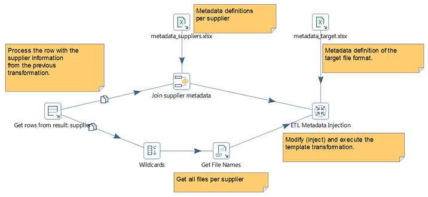

# Review Metadata Injection

Build a transformation once and feed it its settings at run time. Metadata injection turns a repetitive load (one transformation per file or supplier) into one template and a table of metadata.

**What You'll Learn**

* What a template transformation is
* How **ETL metadata injection** fills a template's settings from data, then runs it
* Where injection saves work, and how to see what it built

> **Note:**
>
> #### **Introduction**
>
> Metadata injection fills a transformation's settings (file names, field lists, renames, target tables) from data at run time, instead of typing them into the steps.
>
> Suppose you load transaction files from several suppliers: read, filter, write. The steps are the same for every supplier; only the file layouts differ. Without injection you build one transformation per supplier. With injection you build one **template** transformation, with the steps but without the supplier-specific settings, and a second transformation whose **ETL metadata injection** step reads each supplier's settings, writes them into the template, and runs it.
>
> The template file is never changed: the injection fills a copy in memory and runs that.

<figure>

<figcaption><em>Metadata in, template filled, template run</em></figcaption>

</figure>

Workshop: [Onboarding to a table](../31-mod5-onboarding-to-a-table/guide.md).

