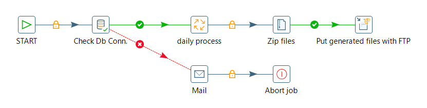
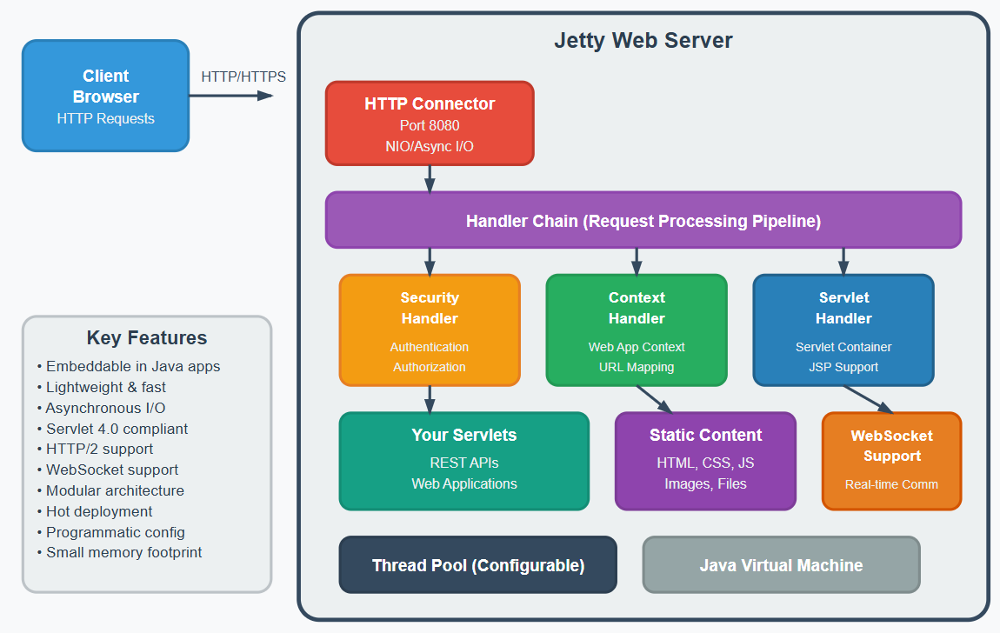

# Overview

Standalone transformations don't survive contact with production. This module is about going from 'it works on my machine' to a maintainable, scheduled, parameterized pipeline that scales: jobs, metadata injection, parameters and variables, and Carte servers and clusters.

**What You'll Learn**

* How jobs put transformations and other tasks in order, and react to success and failure
* How one template transformation can serve many sources, with metadata injection
* How parameters and variables configure a pipeline without editing it
* How Carte servers run work remotely, and clusters share it out

> **Note:** **Jobs & Carte Servers**
>
> A **job** orchestrates tasks: it runs them in an order you set, and each hop decides what happens next from the result of the entry before it. The entries prepare the ground for the work or clean up after it: they move and check files, transfer them by FTP or SSH, check that a table exists or holds data, send mail, and run transformations and other jobs. Jobs that call jobs build up large processes from small, tested parts.

<figure>

<figcaption>Job entries joined by hops</figcaption>
</figure>

> **Note:** **Carte** is a small web server that runs transformations and jobs remotely. Spoon, Kitchen or the Pentaho Server sends it the transformation or job to run, and can then monitor, start and stop it over HTTP. One Carte server is a remote execution engine; several, as a **Carte cluster**, can share one transformation's work between them.

<figure>

<figcaption>Carte runs on an embedded Jetty web server</figcaption>
</figure>

| Topic | Workshops |
| --- | --- |
| [Jobs](../topic-mod5-jobs-review/guide.md) | [Hello World (Job)](../29-mod5-hello-world-job/guide.md), [Order of Execution](../30-mod5-order-of-execution/guide.md) |
| [Metadata Injection](../topic-mod5-metadata-injection-review/guide.md) | [Onboarding to a table](../31-mod5-onboarding-to-a-table/guide.md) |
| [Parameters](../topic-mod5-parameters-and-variables-review/guide.md) | [Parameters](../34-mod5-parameters/guide.md), [Parameters SQL](../35-mod5-parameters-sql/guide.md) |
| [Scalability](../topic-mod5-scalability-review/guide.md) | [Run Configurations](../36-mod5-run-configurations/guide.md) |
