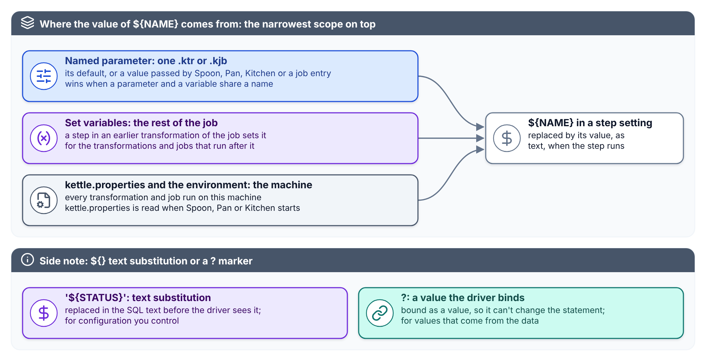

# Review Parameters

Make pipelines configurable without editing them. Parameters are passed in at runtime; variables resolve from the environment or kettle.properties. Together they're how you ship the same .ktr to dev, staging, and prod.

**What You'll Learn**

* The difference between a named parameter and a variable
* Where variables come from, and how far they reach
* When to use `${}` substitution, and when a `?` marker

> **Note:** Variables and parameters both let one transformation or job behave differently from run to run, without editing it.
>
> A **named parameter** belongs to one transformation or job. It is declared there, with a default value and a description, and whoever runs it (Spoon, Pan, Kitchen, or a job entry) can pass a different value for that run.
>
> A **variable** is a name with a value, set outside the file: in `kettle.properties`, by a **Set variables** step in an earlier transformation of a job, or by the environment. Variables reach every transformation and job that runs in that scope. A database host, used by every transformation, is a typical variable.
>
> At run time a parameter becomes a variable too, so steps read both the same way, as `${NAME}`. When a parameter and a variable share a name, the parameter wins.

The layers a `${NAME}` value can come from, narrowest on top:

<figure>

<figcaption>Where a value comes from, and how far it reaches</figcaption>
</figure>

Each layer reaches less far than the one below it: the machine, the rest of a job, one file. The side note is the choice the tabs below explain: `${}` rewrites the text before the step runs, while a `?` marker is bound by the driver as a value.

<figure>

<figcaption class="pcm-video-caption">Walkthrough: coming soon</figcaption>

</figure>

#### Workshops

::: tabs

### Parameters

> **Note:** **Named parameters and `${}` substitution**
>
> A parameter's value replaces `${NAME}` in a step's settings, including the text of a SQL query, before the step runs. It suits configuration you control: a status, a date, a schema name.
>
> Workshop: [Parameters](../34-mod5-parameters/guide.md).

### Values from the data

> **Note:** **`?` markers**
>
> When the values come from the data, pass them to a query as `?` markers instead. The database driver binds them as values, so a value can't change the statement.
>
> Workshop: [Parameters SQL](../35-mod5-parameters-sql/guide.md).

### Variables

> **Note:** **Variables**
>
> Set variables in `kettle.properties` (**Edit > Edit the kettle.properties file**) for values every run on a machine shares, or with **Set variables** in a job's first transformation for values the rest of the job uses. Read them anywhere a setting shows the `$` icon, or into the stream with **Get variables**.
>
> See [Kettle Variables](../02-mod1-kettle-variables/guide.md) in Module 1.

:::
