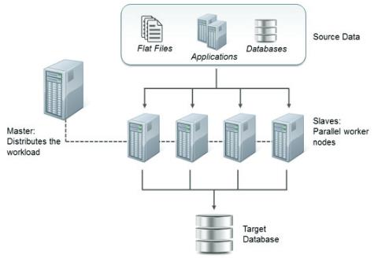

# Review Scalability

<div class="pcm-intro">

Two ways to make PDI go faster: Carte clusters, which share a transformation's work across machines, and partitioning, which splits a stream into parallel pipelines. When one transformation isn't enough.

</div>

**What You'll Learn**

* What a Carte server is, and how Spoon sends it work
* How a cluster schema groups Carte servers, static or dynamic
* What partitioning does with a stream

> **Note:** **Introduction**
>
> To speed up heavy transformations, run them on a **Carte cluster**: two or more Carte *slave* servers and one Carte *master*. The master splits the transformation, sends each slave its part, and tracks the progress, while the slaves do the work in parallel.

<figure>



<div align="center">
<figcaption><em>A master and its slave servers</em></figcaption>
</div>
</figure>

::: tabs

### Slave server

> **Note:** **Carte servers**
>
> A Carte server is a small embedded web server, started with the `Carte` script in your PDI folder, with at least a host name or IP address and a port:
>
> ```powershell
> .\carte.bat localhost 8081
> ```
>
> In Spoon, you register each server under **Slave server** in the **View** tab, then send transformations and jobs to it with a run configuration.
>
> Workshop: [Run Configurations](../36-mod5-run-configurations/guide.md).

### Cluster schema

> **Note:** **Cluster schemas**
>
> A **cluster schema** is a named set of slave servers, one of them the master. There are two kinds:
>
> * **Static**: the master and slaves are listed in the schema at design time. It suits a small, fixed set of machines.
> * **Dynamic**: the schema names only the master; slaves register with it when they start, and the master checks every 30 seconds which are available. It suits environments where nodes come and go, such as a cloud.

**Set up a static Carte cluster**

1. Copy the JDBC drivers and PDI plugins your transformations need from your development PDI to each Carte machine.
2. On each machine, start Carte with that machine's address and a port:

   ```powershell
   .\carte.bat <IP address> <port>
   ```

3. If the transformations come from a Pentaho Repository, copy `repositories.xml` from the `.kettle` folder on your workstation to the same place on each Carte machine; without it, Carte can't read the repository.
4. Check that each Carte server is running, reachable from your development machine, and runs your transformations and jobs.
5. To start Carte when the machine boots, create a startup script with the same options.

<div class="pcm-embed-card" data-href="https://docs.pentaho.com/pdia-data-integration/advanced-topics-pentaho-data-integration-overview/use-carte-clusters" data-title="Use Carte Clusters | Pentaho"></div>

### Partitioning

> **Note:** **Partitioning**
>
> Partitioning divides a stream's rows into distinct subsets by a rule, such as the remainder of a key, so that every row lands in exactly one partition and rows with the same key land in the same one. Each partition is then processed by its own copy of a step. That lets a step that groups or sorts by key run in parallel: on several CPU cores of one server (scaling up), or across the servers of a cluster (scaling out).

<div class="pcm-embed-card" data-href="https://docs.pentaho.com/pdia-data-integration/advanced-topics-pentaho-data-integration-overview/partitioning-data" data-title="Partitioning data | Pentaho"></div>

:::
