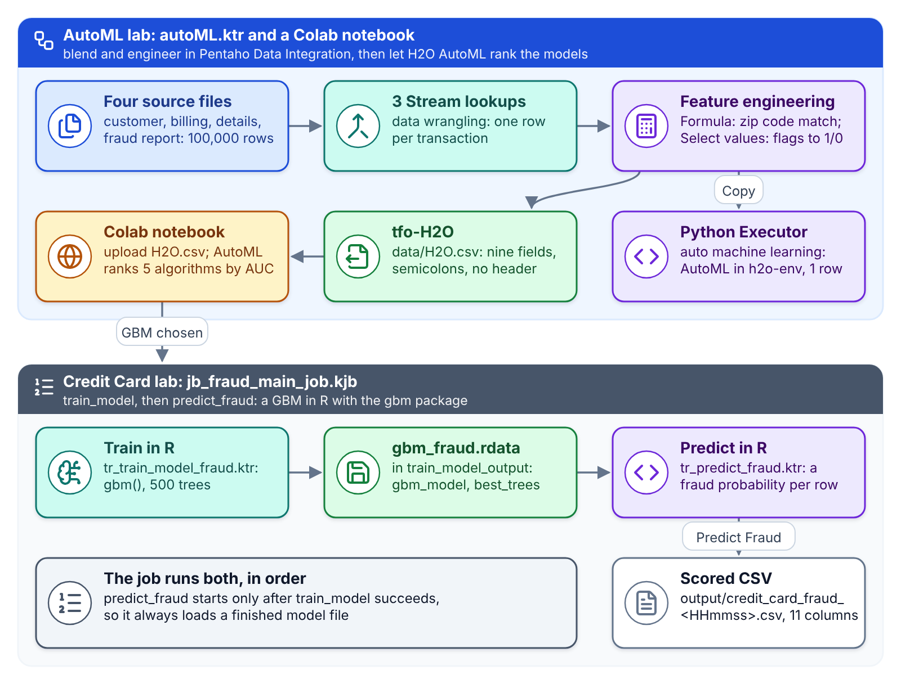

# Overview

> **Note:**
>
> #### Machine Learning
> 
> The machine learning use case in Pentaho Data Integration addresses credit card fraud detection, a critical business challenge where organizations typically lose about 5% of their yearly revenue to fraudulent activities\*.
> 
> The workshops take two approaches to fraud detection:
> 
> First, H2O AutoML trains and ranks several machine learning models, so you find a well-performing algorithm without extensive manual tuning.
> 
> Second, a supervised learning algorithm, a Gradient Boosting Machine trained in R, learns the patterns of historical fraud cases and scores new transactions with a fraud probability.
> 
> A key focus of this use case is handling imbalanced datasets, which is essential since fraudulent transactions are rare compared to legitimate ones. The use case provides practical techniques for properly classifying data when dealing with this common real-world challenge, ensuring that machine learning models can effectively identify fraud without being overwhelmed by the volume of normal transactions.
> 
> \*Association of Certified Fraud Examiners (ACFE) "Occupational Fraud 2024: A Report to the Nations," published in March 2024

<figure>

<figcaption>From four files to a scored CSV: AutoML picks the algorithm, R trains and runs it</figcaption>
</figure>

Read the diagram top to bottom. In the [AutoML](../03-automl/guide.md) workshop, Pentaho Data Integration joins the four files into one row per transaction, derives a zip code match flag and turns the flags into numbers, then sends every row both to `H2O.csv` and to a **Python Executor** step that runs H2O AutoML. You upload `H2O.csv` to a Colab notebook, where AutoML trains five algorithms and ranks them by AUC. The results point to a Gradient Boosting Machine (GBM), which the [Credit Card](../04-credit-card/guide.md) workshop trains in R and saves as `gbm_fraud.rdata`; a second transformation loads that file and writes a fraud probability for every transaction to a CSV file, and a job runs the two in order.

**🎥 Embed:** [Lab Overview](<https://www.loom.com/share/cc869ef3f59a412b8cdfd53baaba2ea6?hideEmbedTopBar=true&hide_owner=true&hide_share=true&hide_title=true>)
