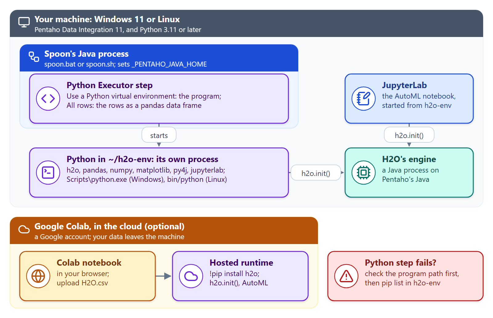
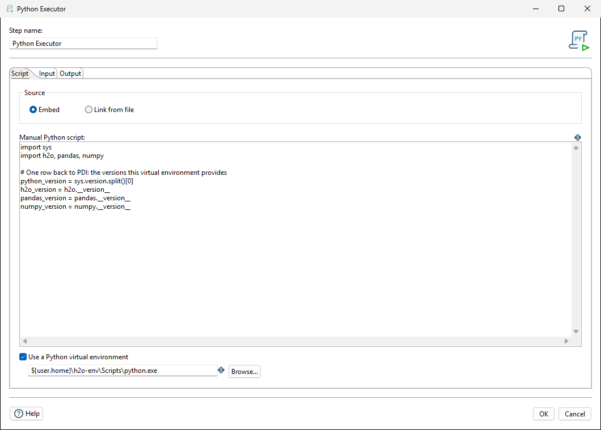
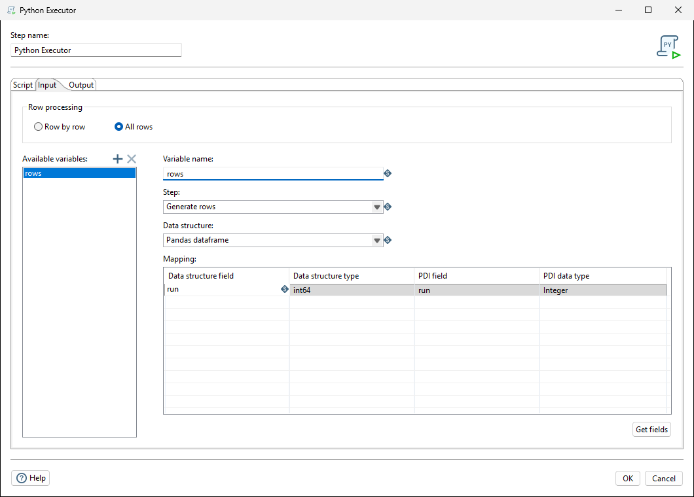
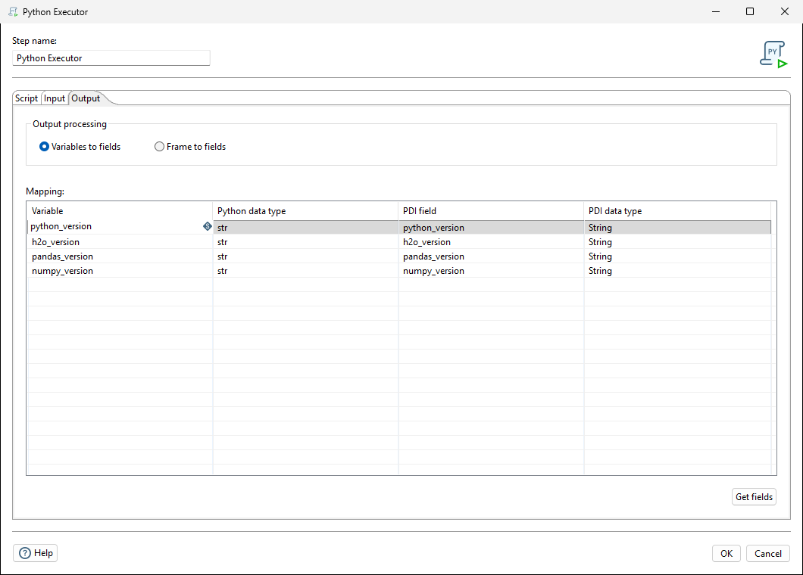
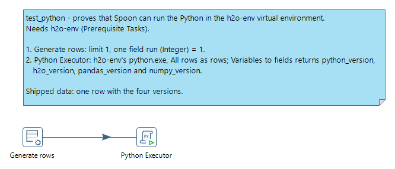

# Prerequisite Tasks

> **Warning:**
>
> #### Workshop - Prerequisite Tasks
>
> Set up the tools the machine learning workshops run on: Python with the H2O library in a virtual environment, which the **Python Executor** step and the AutoML notebook both use. Then prove that Pentaho Data Integration can run Python from that environment. If you want the optional cloud notebook, you can also sign in to Google Colab.
>
> **What you'll do**
>
> * Install Python and the machine learning libraries in a virtual environment
> * Sign in to Google Colab (optional)
> * Prove the setup with a two-step Python transformation
>
> **Prerequisites:** Pentaho Data Integration 11, and Python 3.11 or later
>
> **Estimated time:** 30 minutes, most of it the first download of the libraries

<div align="center">
<figure>

<figcaption>Where each part of the course runs, and what this lab sets up for it</figcaption>
</figure>
</div>

Read the diagram as a map of what this lab installs. Spoon is one Java process. The **Python Executor** step starts the Python program in the `h2o-env` virtual environment as a process of its own and hands it the rows. H2O's engine is a Java program too: the course's scripts start it on Pentaho's own Java. The same environment runs JupyterLab, where you work through the AutoML notebook. Colab is the optional cloud route: it needs only a browser and a Google account.

:::: tabs

### 1. Python and ML Libraries

> **Note:**
>
> #### Python and machine learning libraries
>
> The **Python Executor** step and the AutoML notebook need Python 3 with H2O, pandas, NumPy, Matplotlib and Py4J, and JupyterLab for the notebook. Install them in a virtual environment named `h2o-env` in your home folder, so they don't change any other Python on the machine.

::: tabs

### Lab machine

The course installer put a setup script at `C:\ML\setup-ml.ps1`. It creates `h2o-env`, installs the libraries, checks every part, and checks that H2O starts on Pentaho's Java. It is safe to run again.

1. Open PowerShell as yourself, not as an administrator: the script builds the environment in your home folder. Run the script:

   ```powershell
   powershell -ExecutionPolicy Bypass -File C:\ML\setup-ml.ps1
   ```

   `-ExecutionPolicy Bypass` runs this one script without changing the machine's policy. The first run downloads about 300 MB of libraries. To check the environment later without changing it, add `-Status`.

> **Success:** Checkpoint: the script ends with `Machine Learning setup is complete.`, after an `OK` line for the libraries and `OK    H2O ... starts its engine on C:\Pentaho\java`. It names the environment's Python, `C:\Users\<you>\h2o-env\Scripts\python.exe`: the **Python Executor** step asks for this program.

### Your own machine

1. In PowerShell, check the Python version:

   ```powershell
   python --version
   ```

> **Success:** Checkpoint: PowerShell prints `Python 3.` and a minor version of 11 or later. If it prints `Python was not found`, install Python with `winget install -e --id Python.Python.3.12`, open a new PowerShell window, and check again. If `python` is still not found, use the Python launcher, `py -3.12`, in place of `python` in the next step.

2. Create the virtual environment, install the libraries in it, and list them:

   ```powershell
   python -m venv $HOME\h2o-env
   & $HOME\h2o-env\Scripts\python.exe -m pip install h2o pandas numpy matplotlib py4j jupyterlab
   & $HOME\h2o-env\Scripts\python.exe -m pip list | Select-String "^(h2o|pandas|numpy|matplotlib|py4j|jupyterlab) "
   ```

> **Success:** Checkpoint: `pip list` shows `h2o`, `jupyterlab`, `matplotlib`, `numpy`, `pandas` and `py4j` with their versions. The environment's Python is `C:\Users\<you>\h2o-env\Scripts\python.exe`: the **Python Executor** step asks for this program.

:::

H2O's engine is a Java program. The course's transformations and notebook start it on Pentaho's own Java, `C:\Pentaho\java`, by setting `H2O_JAVA_HOME`; without it, H2O would start on whichever Java comes first on the machine's `PATH`.

> **Note:**
>
> #### Running it on a server
>
> The course runs on Windows 11. To run its transformations on a Linux server in production, build the same environment there with `python3 -m venv` in the home folder of the user who runs Pentaho Data Integration, install the same libraries with its `pip`, and give the **Python Executor** step the environment's `bin/python` program. This is beyond the course's labs.

To look up a `pip` command or option, see the [pip user guide](https://pip.pypa.io/en/stable/user_guide/).

### 2. Google Colab (optional)

> **Note:**
>
> #### Google Colab
>
> Colab runs Jupyter notebooks in your browser, with common machine learning libraries already installed. The [AutoML](../03-automl/guide.md) workshop can run its notebook there instead of in JupyterLab on your machine; your data then leaves the machine for Google's cloud.

1. Open [Google Colab](https://colab.research.google.com/) in your browser and sign in with your Google account.

<div align="center">
<figure>

<figcaption>Colab after you sign in</figcaption>
</figure>
</div>

> **Success:** Checkpoint: Colab opens the **Welcome To Colab** notebook, with **Connect** at the top right.

### 3. Validate with a Python Transformation

> **Note:**
>
> #### Validate with a Python transformation
>
> A two-step transformation proves that Spoon can run Python from the virtual environment: a **Generate rows** step makes one row, and a **Python Executor** step imports H2O, pandas and NumPy and returns their versions.

1. Start Spoon with the **Start Pentaho Data Integration** button below, or from a terminal:

```powershell
Set-Location C:\Pentaho\design-tools\data-integration
.\spoon.bat
```

<button data-launch="spoon" data-path="">Start Pentaho Data Integration</button>

2. Select **File > New > Transformation** (`Ctrl+N`).
3. On the **Design** tab, open the **Input** folder and drag **Generate rows** onto the canvas. Double-click it, set **Limit** to `1`, and add one field: **Name** `run`, **Type** `Integer`, **Value** `1`. Select **OK**.
4. Open the **Scripting** folder and drag **Python Executor** onto the canvas. Create a hop from **Generate rows** to **Python Executor**: hold `Shift` and drag from one step to the other.
5. Double-click **Python Executor**. On the **Script** tab, under **Source**, select **Embed**. Select **Use a Python virtual environment**, and enter the Python program of `h2o-env`:

   ```text
   ${user.home}\h2o-env\Scripts\python.exe
   ```

   `${user.home}` is your home folder. Enter the program, not the folder: the step runs what you enter, and a folder fails with `CreateProcess error=5, Access is denied`.

6. Enter this script in **Manual Python script**:

   ```python
   import sys
   import h2o, pandas, numpy

   # One row back to PDI: the versions this virtual environment provides
   python_version = sys.version.split()[0]
   h2o_version = h2o.__version__
   pandas_version = pandas.__version__
   numpy_version = numpy.__version__
   ```

<div align="center">
<figure>

<figcaption>The Script tab</figcaption>
</figure>
</div>

7. Open the **Input** tab. Under **Row processing**, select **All rows**. Under **Available variables**, add a variable with the plus sign button: **Variable name** `rows`, **Step** `Generate rows`, **Data structure** `Pandas dataframe`. Make sure the **Mapping** grid holds one row: **Data structure field** `run`, **Data structure type** `int64`, **Pentaho Data Integration field** `run`, **Pentaho Data Integration data type** Integer.
<div align="center">
<figure>

<figcaption>The Input tab</figcaption>
</figure>
</div>

8. Open the **Output** tab. Under **Output processing**, select **Variables to fields**, and fill the **Mapping** grid. Each is a `str` in Python and a String in Pentaho Data Integration:

| Variable         | Python data type | Pentaho Data Integration field | Pentaho Data Integration data type |
| ---------------- | ---------------- | ------------------------------ | ---------------------------------- |
| `python_version` | `str`            | `python_version`               | String                             |
| `h2o_version`    | `str`            | `h2o_version`                  | String                             |
| `pandas_version` | `str`            | `pandas_version`               | String                             |
| `numpy_version`  | `str`            | `numpy_version`                | String                             |

<div align="center">
<figure>

<figcaption>The Output tab</figcaption>
</figure>
</div>

9. Select **OK**. Select **File > Save as** and save the transformation as `test_python.ktr` in your `Documents` folder.
<div align="center">
<figure>

<figcaption>test_python.ktr</figcaption>
</figure>
</div>

10. Select **Python Executor** on the canvas, press `F10` (**Action > Preview**), and select **Quick Launch**.

> **Success:** Checkpoint: **Examine preview data** shows one row with four versions: `python_version` (`3.11` or later), `h2o_version` (`3.46` or later), `pandas_version` and `numpy_version`.

11. Select **Close**.

> **Under the hood:**
>
> #### Spoon started the virtual environment's Python as a process of its own
>
> The **Python Executor** step runs the program you named in **Use a
> Python virtual environment** as a separate process, sends it the rows
> as a pandas data frame named after the variable, `rows`, runs the
> script, and reads back the variables you mapped on the **Output** tab.
> Python never runs inside Spoon's Java process, and nothing has to be
> copied into Pentaho Data Integration's folders.
>
> **Why it matters:** when a Python step fails, check the program path
> and the packages in that environment first: the step uses exactly that
> Python, whatever else is installed on the machine.

::::

## Troubleshooting <!-- no-step -->

<details>
<summary>Cannot run program ... h2o-env: CreateProcess error=5, Access is denied</summary>

**Use a Python virtual environment** names the folder. Enter the Python program inside it, as the table in step 5 shows.

</details>

<details>
<summary>No module named h2o</summary>

The step runs a Python without H2O: either **Use a Python virtual environment** is cleared, or it names another Python. Check the path, then list the environment's packages with `pip list`, as in the first tab.

</details>

## Lab Files

_No bundled files for this lab._

### Solution <!-- no-step -->

The finished transformation, `test_python.ktr`, ships with the next workshop: open it from the **Lab Files** of [AutoML](../03-automl/guide.md).

Also on disk at `C:\Workshop-ML-Specialty\02-machine-learning\03-automl\solution`.
