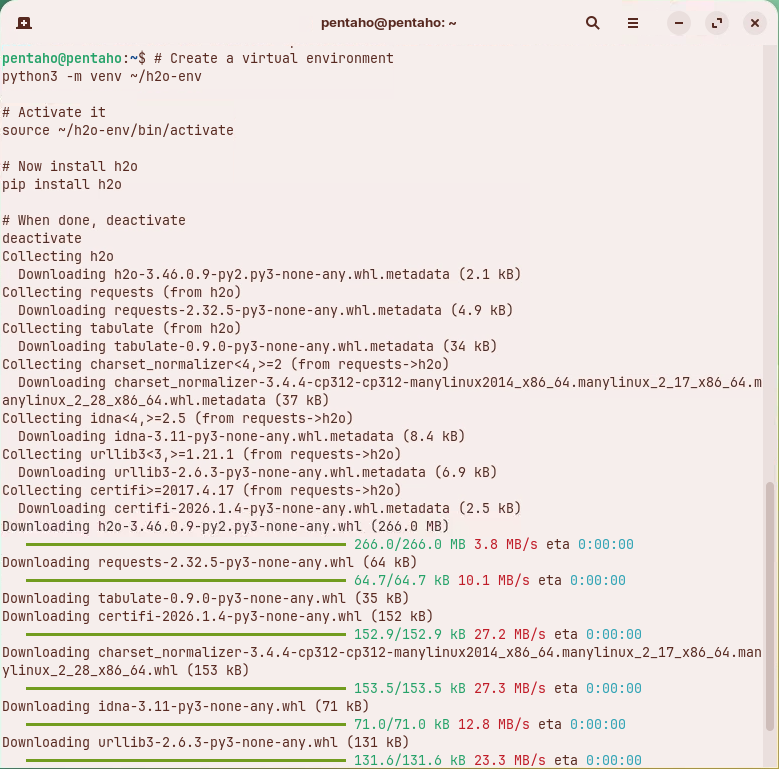
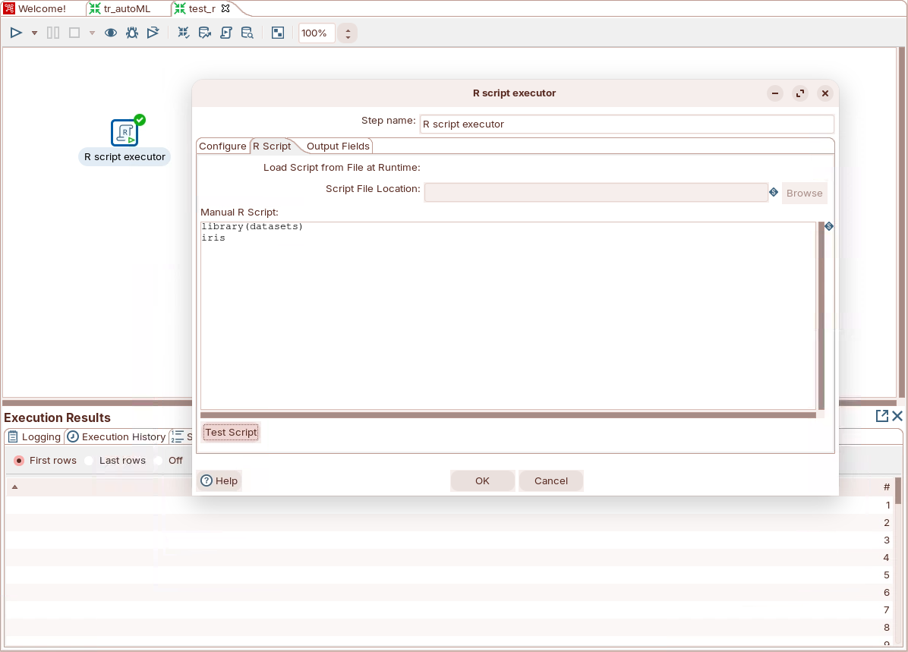
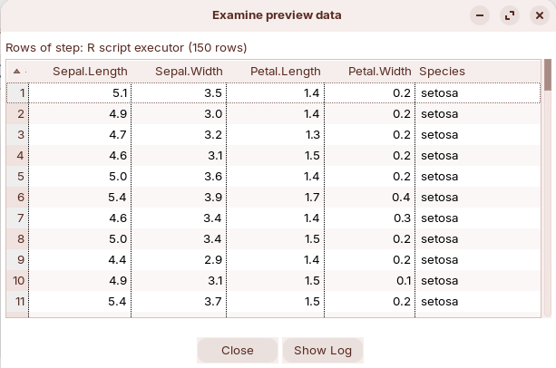

# Prerequisite Tasks

> **Warning:**
>
> #### Workshop - Prerequisite Tasks
>
> Set up the tools the machine learning workshops run on: a Google Colab account, Python with the H2O library, and R with rJava, wired into Pentaho Data Integration so the **R script executor** step can start R. The commands are for Ubuntu or Debian Linux, which install software with `apt`.
>
> **What you'll do**
>
> * Sign in to Google Colab
> * Install Python and the machine learning libraries in a virtual environment
> * Install R and rJava
> * Point Pentaho Data Integration at R
> * Prove the setup with a one-step R transformation
>
> **Prerequisites:** Pentaho Data Integration 11 in `~/Pentaho/design-tools/data-integration`, a Google account, and `sudo` rights on the machine
>
> **Estimated time:** 15 minutes

:::: tabs

### 1. Google Colab

> **Note:**
>
> #### Google Colab
>
> Colab runs Jupyter notebooks in your browser, with common machine learning libraries already installed. The [AutoML](../03-automl/guide.md) workshop trains and compares its models there.

1. Open Colab and sign in with your Google account:

**🎥 Embed:** [Google Colab](<https://colab.research.google.com/#scrollTo=5fCEDCU_qrC0>)

<div align="center">
<figure>

<figcaption>Colab after you sign in</figcaption>
</figure>
</div>

> **Success:** Checkpoint: Colab opens the **Welcome To Colab** notebook, with **Connect** at the top right.

### 2. Python and ML Libraries

> **Note:**
>
> #### Python and machine learning libraries
>
> The AutoML transformation's **Python Executor** step needs Python 3 with H2O, pandas, NumPy, Matplotlib and Py4J. Install them in a virtual environment, so they don't change the system's own Python.

1. In a terminal, update the package lists and the installed packages:

   ```bash
   sudo apt update && sudo apt upgrade -y
   ```

2. Check the Python version:

   ```bash
   python3 --version
   ```

> **Success:** Checkpoint: the terminal prints `Python 3.` and a minor version. [Before You Start](../00-before-you-start/guide.md) asks for 3.11 or later.

<details>

<summary>Optional: install a newer Python version (deadsnakes PPA)</summary>

Do this only if you must upgrade Python.

```bash
sudo apt install dirmngr ca-certificates software-properties-common apt-transport-https -y
sudo gpg --no-default-keyring --keyring /usr/share/keyrings/deadsnakes.gpg --keyserver keyserver.ubuntu.com --recv-keys F23C5A6CF475977595C89F51BA6932366A755776
echo "deb [signed-by=/usr/share/keyrings/deadsnakes.gpg] https://ppa.launchpadcontent.net/deadsnakes/ppa/ubuntu $(lsb_release -cs) main" | sudo tee /etc/apt/sources.list.d/pythonppa-deadsnakes.list
sudo apt-get update
apt-cache search python3.12
sudo apt install python3.12-full -y
```

If you need several versions side by side, choose between them with `update-alternatives`:

```bash
ls -ls /usr/bin/python*
sudo update-alternatives --install /usr/bin/python python /usr/bin/python3.10 1
sudo update-alternatives --install /usr/bin/python python /usr/bin/python3.12 2
sudo update-alternatives --config python
```

</details>

3. Create a virtual environment named `h2o-env` in your home folder, install the five libraries in it, and list them:

   ```bash
   python3 -m venv ~/h2o-env
   source ~/h2o-env/bin/activate
   pip install h2o pandas numpy matplotlib py4j
   pip list | grep -E "h2o|pandas|numpy|matplotlib|py4j"
   which python
   deactivate
   ```

<div align="center">
<figure>

<figcaption>pip installs h2o and its dependencies (this capture installs h2o alone)</figcaption>
</figure>
</div>

> **Success:** Checkpoint: `pip list` shows `h2o`, `matplotlib`, `numpy`, `pandas` and `py4j` with their versions, and `which python` prints the `python` inside `h2o-env`, such as `/home/pentaho/h2o-env/bin/python`.

To look up a package or a `pip` option, see this reference:

**🎥 Embed:** [Python package reference](<https://apmonitor.com/pds/index.php/Main/InstallPythonPackages>)

### 3. R and rJava

> **Note:**
>
> #### R and rJava
>
> R trains and runs the fraud model in the [Credit Card](../04-credit-card/guide.md) workshop. rJava, and the JRI library that comes with it, let a Java program such as Spoon start R and pass data frames to it. You need them only for the R steps.

1. Install R:

   ```bash
   sudo apt update && sudo apt upgrade -y
   sudo apt install r-base r-base-dev -y
   ```

2. Check the R version:

   ```bash
   R --version
   ```

> **Success:** Checkpoint: the first line starts `R version`, followed by the version number and its release date.

Running `R` without `sudo` installs packages for your user only. To install a package for every user, start R with `sudo -i R`.

3. Install a Java Development Kit (JDK) and the `libtirpc` headers, then let R detect Java. `R CMD javareconf` finds the current Java installation and updates R's configuration files to match it:

   ```bash
   java --version
   sudo apt-get update
   sudo apt-get install default-jdk libtirpc-dev -y
   sudo R CMD javareconf
   ```

4. Download rJava's source, configure it against the default JDK and install it:

   ```bash
   cd /tmp
   wget https://cloud.r-project.org/src/contrib/rJava_1.0-14.tar.gz
   tar -xzf rJava_1.0-14.tar.gz
   cd rJava
   ./configure --with-java-home=/usr/lib/jvm/default-java JAVA_LIBS="-L/usr/lib/jvm/default-java/lib/server -ljvm"
   cd /tmp
   sudo R CMD INSTALL rJava
   ```

5. Check that R can load rJava and start a Java virtual machine:

   ```bash
   R -e "library(rJava); .jinit(); system.file(package='rJava')"
   ```

> **Success:** Checkpoint: R prints no error and ends with the folder rJava is installed in, `[1] "/usr/local/lib/R/site-library/rJava"`. The next part copies a file from that folder.

<details>

<summary>Optional: install RStudio</summary>

Use RStudio only if you want an IDE for R.

1. Download a `.deb` package from the [RStudio downloads page](https://posit.co/download/rstudio-desktop/).
2. Install it:

```bash
sudo apt install -f ./rstudio-*.deb
```

</details>

### 4. Configure Pentaho Data Integration for R

> **Note:**
>
> #### Configure Pentaho Data Integration for R
>
> Spoon needs to know where R is: two environment variables, `R_HOME` and `R_LIBS_USER`, and R's `bin` folder on `PATH`. It also needs JRI's native library in its own native library folder.

1. Print the two values R uses on this machine:

   ```bash
   R -e "Sys.getenv('R_HOME'); Sys.getenv('R_LIBS_USER')"
   ```

> **Success:** Checkpoint: R prints two paths, such as `[1] "/usr/lib/R"` and `[1] "/home/pentaho/R/x86_64-pc-linux-gnu-library/4.3"`. Yours depend on your user name and R version.

2. Open `/etc/environment` in an editor:

   ```bash
   sudo nano /etc/environment
   ```

3. Add `:/usr/lib/R/bin` to the end of the `PATH` line, and add `R_HOME` and `R_LIBS_USER` with the two values R printed. For the lab machine's user, `pentaho`, the file reads:

   ```text
   PATH="/usr/local/sbin:/usr/local/bin:/usr/sbin:/usr/bin:/sbin:/bin:/usr/games:/usr/local/games:/snap/bin:/usr/lib/R/bin"

   # R variables
   R_HOME=/usr/lib/R
   R_LIBS_USER=/home/pentaho/R/x86_64-pc-linux-gnu-library/4.3
   ```

4. Save the file and close the editor: in `nano`, press `Ctrl+O`, `Enter`, then `Ctrl+X`.
5. Copy `libjri.so` from rJava into Spoon's native library folder, and make your user its owner:

   ```bash
   cd /usr/local/lib/R/site-library/rJava/jri
   cp libjri.so ~/Pentaho/design-tools/data-integration/native-lib/linux/x86_64/
   sudo chown "$(id -un):$(id -gn)" ~/Pentaho/design-tools/data-integration/native-lib/linux/x86_64/libjri.so
   ```

6. Sign out and sign back in, or restart the machine, so that the new variables in `/etc/environment` reach Spoon.

### 5. Validate with an R Transformation

> **Note:**
>
> #### Validate with an R transformation
>
> A one-step transformation proves that Spoon can start R: its script loads R's built-in `iris` data set and returns it as rows.

1. Start Spoon with the **Start Pentaho Data Integration** button below, or from a terminal:

::: tabs

### Windows (PowerShell)

```powershell
Set-Location C:\Pentaho\design-tools\data-integration
.\spoon.bat
```

### macOS / Linux

```bash
cd ~/Pentaho/design-tools/data-integration
./spoon.sh
```

:::

<button data-launch="spoon" data-path="">Start Pentaho Data Integration</button>

2. Select **File > New > Transformation** (`Ctrl+N`).
3. On the **Design** tab, open the **Statistics** folder and drag **R script executor** onto the canvas.
4. Double-click **R script executor**. Keep its step name, `R script executor`.
5. On the **Configure** tab, check that **Number of Rows to Process** is `All`, and set **Logging Level for R Messages** to `Detailed`.
6. Open the **R Script** tab and enter this script in **Manual R Script**:

   ```r
   library(datasets)
   iris
   ```

<div align="center">
<figure>

<figcaption>The test script on the R Script tab</figcaption>
</figure>
</div>

7. Select **Test Script**. Spoon warns that this runs the script without running the transformation: confirm it.

<div align="center">
<figure>

<figcaption>R returns the iris data set</figcaption>
</figure>
</div>

> **Success:** Checkpoint: **Examine preview data** shows `Rows of step: R script executor (150 rows)`, with the columns `Sepal.Length`, `Sepal.Width`, `Petal.Length`, `Petal.Width` and `Species`. The first row is `5.1`, `3.5`, `1.4`, `0.2`, `setosa`.

8. Select **Close**, then select **OK**.
9. Select **File > Save as** and save it as `test_r.ktr`.

> **Under the hood:**
>
> #### Spoon loaded JRI from its own library path and started R inside its process
>
> `spoon.sh` starts Java with `-Djava.library.path` set to Pentaho Data Integration's
> `libswt/linux/x86_64` and `native-lib/linux/x86_64` folders (on 64-bit
> Linux). The **R script executor** step talks to R through JRI: its Java
> half ships with the step, in `plugins/pentaho-r-plugin/lib`, and its
> native half, `libjri.so`, comes from rJava. Java loads that native
> library only from a folder on its library path, which is why you copied
> it into `native-lib`. JRI then runs R inside Spoon's own Java process,
> and R finds its installation through `R_HOME`.
>
> **Why it matters:** when an R step can't start R, the cause is the
> setup, not the script. Check the copied `libjri.so` and the variables in
> `/etc/environment` before you change a line of R.

::::

## Lab Files

_No bundled files for this lab._

### Solution <!-- no-step -->

The finished transformation, `test_r.ktr`, ships with the next workshop: open it from the **Lab Files** of [AutoML](../03-automl/guide.md).

Also on disk at `C:\Workshop-ML-Specialty\02-machine-learning\03-automl\solution`.
