# AutoML

> **Warning:**
>
> #### Workshop - AutoML
>
> Juniper & Vale, a direct retailer of homewares, takes orders by phone and on its website and ships the goods to the customer. It keeps its customers' details and their orders in a database, and its fraud team keeps a CSV report of past orders that turned out to be fraudulent. To reduce its losses from orders paid with stolen credit cards, the fraud team wants a model that flags likely fraud, and first asks whether one can, and which kind. Blend its files into one training set in Pentaho Data Integration, then let H2O AutoML train several algorithms and rank them.
>
> **What you'll do**
>
> * Join four files with **Stream lookup** steps (data wrangling)
> * Derive a billing and shipping zip code match flag with **Formula** (feature engineering)
> * Write the training set, `H2O.csv`, and run H2O AutoML from a **Python Executor** step
> * Train, rank and evaluate models in a JupyterLab notebook, or in Colab
> * Learn how a Gradient Boosting Machine works, for the [Credit Card](../04-credit-card/guide.md) workshop
>
> **Prerequisites:** Complete [Prerequisite Tasks](../02-prerequisite-tasks/guide.md): Python with `h2o` in the `h2o-env` virtual environment, and optionally a Google account for Colab
>
> **Estimated time:** 1 hour 30 minutes: about an hour to build the transformation, and half an hour for the notebook

<figure>

<figcaption class="pcm-video-caption">Walkthrough: coming soon</figcaption>

</figure>

<div align="center">
<figure>
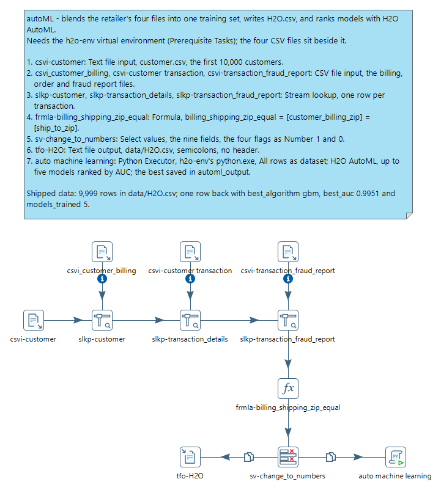
<figcaption>What you build: blend, derive, then write the training set and run AutoML</figcaption>
</figure>
</div>

<div align="center">
<figure>
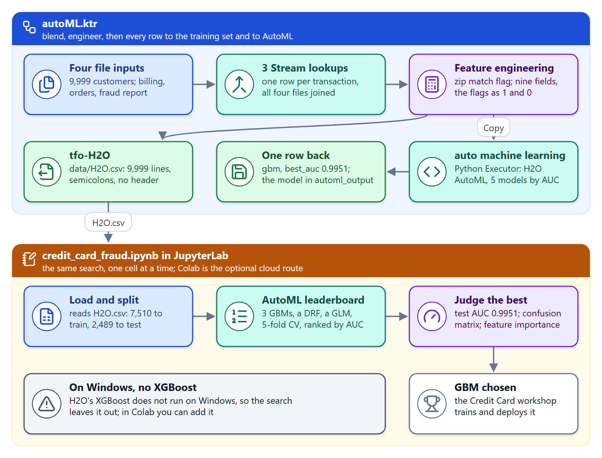
<figcaption>The workshop in one picture: the transformation searches in Pentaho Data Integration, the notebook repeats the search a cell at a time</figcaption>
</figure>
</div>

Read the diagram top to bottom. The transformation joins the four files into one row per transaction and turns them into nine numeric fields. A **Copy** hop then sends every row two ways: to `H2O.csv`, the training set, and to a **Python Executor** step that runs H2O AutoML and returns one row describing the best model. The notebook reads the same `H2O.csv` and runs the same search a cell at a time, so you can see the leaderboard, the confusion matrix and the feature importance. Both point to a Gradient Boosting Machine, which the [Credit Card](../04-credit-card/guide.md) workshop trains and deploys.

:::: tabs

### 1. Data Wrangling

> **Note:**
>
> #### Data wrangling
>
> The retailer's data is in four files of 100,000 rows each. `customer.csv` holds each customer's name and billing zip code; `customer_billing.csv` names the transaction and card each customer used; `transaction_details.csv` describes each order (shipping address, amount, number of items, the customer's age, whether it was a web order, the customer's transactions to date and the hour of day); and `transaction_fraud_report.csv` says whether each transaction was reported as fraud. Join them into one row per transaction.

1. Start Spoon with the **Start Pentaho Data Integration** button below, or from a terminal:

```powershell
Set-Location C:\Pentaho\design-tools\data-integration
.\spoon.bat
```

<button data-launch="spoon" data-path="">Start Pentaho Data Integration</button>

2. Select **File > New > Transformation** (`Ctrl+N`).
3. Select **File > Save as** and save it as `autoML.ktr` in `C:\Workshop-ML-Specialty\02-machine-learning\03-automl`, the folder that holds the four CSV files. Saving first gives `${Internal.Entry.Current.Directory}` a value. (On your own machine, download the four files from **Lab Files** below into the folder you save in.)

**The customers**

4. On the **Design** tab, open the **Input** folder and drag **Text file input** onto the canvas.
5. Double-click **Text file input**.
6. Set **Step name** to `csvi-customer`.
7. On the **File** tab, enter `${Internal.Entry.Current.Directory}/customer.csv` in **File or directory** and select **Add**.
8. On the **Content** tab, set **Separator** to `,`, **Format** to `mixed` and **Limit** to `50000`, so the step stops after the first 50,000 lines of the file. The header is one of them, so 49,999 customers go on: enough for about 500 frauds, at one order in a hundred. Leave **Header** selected, with **Number of header lines** `1`.
9. On the **Fields** tab, select **Get Fields**. Spoon asks for the number of lines to sample: select **OK**, then close **Scan results**.
10. Change the **Fields** grid to match this table:

| Name                   | Type    | Format | Length | Precision | Trim type |
| ---------------------- | ------- | ------ | ------ | --------- | --------- |
| `customer_name`        | String  |        | 22     |           | none      |
| `customer_id`          | Integer | `#`    | 15     | 0         | none      |
| `customer_billing_zip` | Integer | `#`    | 15     | 0         | none      |

11. Select **Preview rows**, enter `100` rows, and select **OK**. The rows show in **Examine preview data**.

The first rows of **Examine preview data**:

| customer_name | customer_id | customer_billing_zip |
| --- | --- | --- |
| Cooper Bush | 10000 | 70674 |
| Rhona Daniel | 10001 | 78946 |
| Ivy Nguyen | 10002 | 83887 |
| Hamilton Valenzuela | 10003 | 79627 |

> **Success:** Checkpoint: 100 rows. The first is `Cooper Bush`, customer `10000`, billing zip `70674`; the second is `Rhona Daniel`, `10001`, `78946`.

12. Select **Close**, then select **OK**.

**The billing, transaction and fraud files**

13. From the **Input** folder, drag **CSV file input** onto the canvas.
14. Double-click **CSV file input**.
15. Set **Step name** to `csvi_customer_billing`.
16. Set **Filename** to `${Internal.Entry.Current.Directory}/customer_billing.csv`. Keep **Delimiter** `,` and leave **Lazy conversion?** and **Header row present?** selected.
17. Select **Get Fields**, then change the **Fields** grid to match this table:

| Name             | Type    | Format | Length | Precision |
| ---------------- | ------- | ------ | ------ | --------- |
| `customer_id`    | Integer | `#`    | 15     | 0         |
| `transaction_id` | Integer | `#`    | 15     | 0         |
| `card_number`    | Integer | `#`    | 15     | 0         |
| `expiry_date`    | Integer | `#`    | 15     | 0         |

18. Select **OK**.
19. Drag a second **CSV file input** onto the canvas and double-click it.
20. Set **Step name** to `csvi-customer transaction` (with a space before `transaction`, as the solution has it).
21. Set **Filename** to `${Internal.Entry.Current.Directory}/transaction_details.csv`. Leave **Lazy conversion?** and **Header row present?** selected.
22. Select **Get Fields**, then change the **Fields** grid to match this table. Leave **Trim type** at `none`.

| Name                         | Type    | Format | Length | Precision |
| ---------------------------- | ------- | ------ | ------ | --------- |
| `customer_id`                | Integer | `#`    | 15     | 0         |
| `transaction_id`             | Integer | `#`    | 15     | 0         |
| `ship_to_address`            | String  |        | 1      |           |
| `ship_to_address_1`          | String  |        | 62     |           |
| `ship_to_city`               | String  |        | 22     |           |
| `ship_to_country`            | String  |        | 3      |           |
| `ship_to_customer_number`    | Integer | `#`    | 15     | 0         |
| `ship_to_email`              | String  |        | 27     |           |
| `ship_to_name`               | String  |        | 23     |           |
| `ship_to_phone`              | String  |        | 12     |           |
| `ship_to_state`              | String  |        | 2      |           |
| `ship_to_zip`                | Integer | `#`    | 15     | 0         |
| `first_time_customer`        | Boolean |        |        |           |
| `order_dollar_amount`        | Number  | `#.#`  | 6      | 1         |
| `num_items`                  | Integer | `#`    | 15     | 0         |
| `age`                        | Number  | `#.#`  | 5      | 1         |
| `web_order`                  | Boolean |        |        |           |
| `total_transactions_to_date` | Integer | `#`    | 15     | 0         |
| `hour_of_day`                | Integer | `#`    | 15     | 0         |

23. Select **Preview**, enter `100` rows, and select **OK**.

The first rows of **Examine preview data**:

| customer_id | transaction_id | ship_to_zip | first_time_customer | order_dollar_amount | num_items | age | web_order | total_transactions_to_date | hour_of_day |
| --- | --- | --- | --- | --- | --- | --- | --- | --- | --- |
| 10000 | 1 | 70674 | N | 56.1 | 2 | 44 | N | 5 | 8 |
| 10001 | 2 | 79457 | Y | 37.6 | 4 | 50 | Y | 1 | 23 |
| 10002 | 3 | 83887 | N | 26.9 | 1 | 44 | Y | 2 | 16 |
| 10003 | 4 | 79627 | N | 12.3 | 1 | 37 | Y | 4 | 15 |

> **Success:** Checkpoint: 100 rows. The first is customer `10000`, transaction `1`: `ship_to_zip` `70674`, `first_time_customer` `N`, `order_dollar_amount` `56.1`, `num_items` `2`, `age` `44`, `web_order` `N`, `total_transactions_to_date` `5` and `hour_of_day` `8`.

24. Select **Close**, then select **OK**.
25. Drag a third **CSV file input** onto the canvas and double-click it.
26. Set **Step name** to `csvi-transaction_fraud_report`.
27. Set **Filename** to `${Internal.Entry.Current.Directory}/transaction_fraud_report.csv`, and clear **Lazy conversion?**.
28. Select **Get Fields**, then change the **Fields** grid to match this table. Every `transaction_id` in this file starts with a space (` 1`, ` 2`, ...): **Trim type** `both` removes it before the value converts to an Integer.

| Name                         | Type    | Format | Length | Precision | Trim type |
| ---------------------------- | ------- | ------ | ------ | --------- | --------- |
| `transaction_id`             | Integer | `#`    | 15     | 0         | both      |
| `reported_as_fraud_historic` | Boolean |        |        |           | none      |

29. Select **Preview**, enter `100` rows, and select **OK**.

The first rows of **Examine preview data**:

| transaction_id | reported_as_fraud_historic |
| --- | --- |
| 1 | N |
| 2 | Y |
| 3 | N |
| 4 | N |

> **Success:** Checkpoint: 100 rows. Transaction `1` shows `N` in `reported_as_fraud_historic`, `2` shows `Y`, and the next `Y` is `15`. Over the whole file about one order in a hundred is fraud, as in real card data.

30. Select **Close**, then select **OK**.

**Join the files**

31. On the **Design** tab, open the **Lookup** folder and drag **Stream lookup** onto the canvas.
32. Create a hop from **csvi-customer** to **Stream lookup**: hold `Shift` and drag from one step to the other.
33. Create a hop from **csvi_customer_billing** to **Stream lookup**.
34. Double-click **Stream lookup**.
35. Set **Step name** to `slkp-customer` and **Lookup step** to `csvi_customer_billing`. Make sure **Preserve memory (costs CPU)** is selected.
36. Fill **The key(s) to look up the value(s)** grid with one row:

| Field         | LookupField   |
| ------------- | ------------- |
| `customer_id` | `customer_id` |

37. Fill the **Specify the fields to retrieve** grid:

| Field            | New name         | Type    |
| ---------------- | ---------------- | ------- |
| `transaction_id` | `transaction_id` | Integer |
| `card_number`    | `card_number`    | Integer |
| `expiry_date`    | `expiry_date`    | Integer |

38. Select **OK**.
39. Drag a second **Stream lookup** onto the canvas. Create a hop from **slkp-customer** to it, and a hop from **csvi-customer transaction** to it.
40. Double-click the new step. Set **Step name** to `slkp-transaction_details` and **Lookup step** to `csvi-customer transaction`.
41. Fill **The key(s) to look up the value(s)** grid:

| Field            | LookupField      |
| ---------------- | ---------------- |
| `transaction_id` | `transaction_id` |
| `customer_id`    | `customer_id`    |

42. Select **Get lookup fields**, then right-click the `customer_id` row of the fields to retrieve and select **Delete selected lines**. Do the same for `transaction_id`. The grid keeps these 17 fields, each with **New name** the same as **Field**: `ship_to_address`, `ship_to_address_1`, `ship_to_city`, `ship_to_country`, `ship_to_customer_number`, `ship_to_email`, `ship_to_name`, `ship_to_phone`, `ship_to_state`, `ship_to_zip`, `first_time_customer`, `order_dollar_amount`, `num_items`, `age`, `web_order`, `total_transactions_to_date` and `hour_of_day`.
43. Select **OK**.
44. Drag a third **Stream lookup** onto the canvas. Create a hop from **slkp-transaction_details** to it, and a hop from **csvi-transaction_fraud_report** to it.
45. Double-click the new step. Set **Step name** to `slkp-transaction_fraud_report` and **Lookup step** to `csvi-transaction_fraud_report`.
46. Fill the two grids:

| Field            | LookupField      |
| ---------------- | ---------------- |
| `transaction_id` | `transaction_id` |

| Field                        | New name                     | Type    |
| ---------------------------- | ---------------------------- | ------- |
| `reported_as_fraud_historic` | `reported_as_fraud_historic` | Boolean |

47. Select **OK**, and save the transformation (`Ctrl+S`).

<div align="center">
<figure>
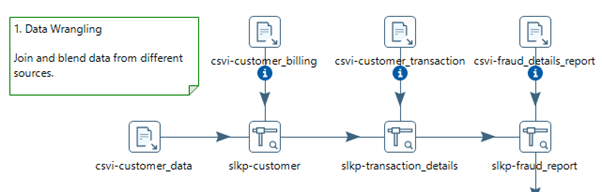
<figcaption>Three lookups, one row per transaction (an earlier capture, with the Credit Card lab's step names)</figcaption>
</figure>
</div>

48. Select **slkp-transaction_fraud_report** on the canvas, press `F10` (**Action > Preview**), and select **Quick Launch**. The rows show in **Examine preview data**.

> **Success:** Checkpoint: each row now carries the fields of all four files. The first is customer `10000`, `Cooper Bush`, transaction `1`: billing zip `70674`, `ship_to_zip` `70674`, `order_dollar_amount` `56.1`, and `reported_as_fraud_historic` `N`.

49. Select **Close**.

> **Under the hood:**
>
> #### Each lookup read its whole lookup file into memory before the first customer arrived
>
> A **Stream lookup** step has two inputs. Before it handles the first
> row of its main stream, it reads every row from its **Lookup step** and
> keeps them in memory, keyed on the lookup fields. Each main row is then
> a single lookup in memory: no sorting, no database. The **Limit** you
> set on **csvi-customer** applies to the main stream only, so each of
> the three lookup files is read in full, 100,000 rows each.
> **Preserve memory (costs CPU)** stores those rows in a compact form and
> unpacks them on each match.
>
> **Why it matters:** a stream lookup joins files of different shapes
> without a database or a sort, but its lookup side has to fit in Spoon's
> memory. For lookup data much larger than this, a database join is the
> better tool.

### 2. Feature Engineering

> **Note:**
>
> #### Feature engineering
>
> Feature engineering creates fields that give a model more signal. The transaction data already holds the customer's age and the hour of the order; this part adds a flag that says whether the billing and shipping zip codes are the same. Then it turns the `Y`/`N` flags into `1` and `0`, the numbers many algorithms, such as Random Forest, need.

1. On the **Design** tab, open the **Scripting** folder and drag **Formula** onto the canvas.
2. Create a hop from **slkp-transaction_fraud_report** to **Formula**.
3. Double-click **Formula**. Set **Step name** to `frmla-billing_shipping_zip_equal`.
4. Fill the **Fields** grid with one row:

| New field                    | Formula                                  | Value type |
| ---------------------------- | ---------------------------------------- | ---------- |
| `billing_shipping_zip_equal` | `[customer_billing_zip] = [ship_to_zip]` | Boolean    |

<div align="center">
<figure>
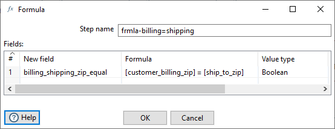
<figcaption>The zip code match flag (the step was named frmla-billing=shipping in this capture)</figcaption>
</figure>
</div>

5. Select **OK**.
6. On the **Design** tab, open the **Transform** folder and drag **Select values** onto the canvas.
7. Create a hop from **frmla-billing_shipping_zip_equal** to **Select values**.
8. Double-click **Select values**. Set **Step name** to `sv-change_to_numbers`.
9. On the **Select & Alter** tab, fill the **Fields** grid with these nine fields, in this order. The step drops every other field.

| Fieldname                    |
| ---------------------------- |
| `first_time_customer`        |
| `order_dollar_amount`        |
| `num_items`                  |
| `age`                        |
| `web_order`                  |
| `total_transactions_to_date` |
| `hour_of_day`                |
| `billing_shipping_zip_equal` |
| `reported_as_fraud_historic` |

10. On the **Meta-data** tab, fill the grid:

| Fieldname                    | Rename to                    | Type   | Length |
| ---------------------------- | ---------------------------- | ------ | ------ |
| `first_time_customer`        | `first_time_customer`        | Number | 1      |
| `web_order`                  | `web_order`                  | Number | 1      |
| `billing_shipping_zip_equal` | `billing_shipping_zip_equal` | Number | 1      |
| `reported_as_fraud_historic` | `reported_as_fraud_historic` | Number | 1      |

11. Select **OK**.
12. Select **sv-change_to_numbers** on the canvas, press `F10` (**Action > Preview**), and select **Quick Launch**.

> **Success:** Checkpoint: nine fields. The first row has `order_dollar_amount` `56.1`, `num_items` `2` and `age` `44`, and its four flags are now numbers: `billing_shipping_zip_equal` is 1 (the zips match), and `first_time_customer`, `web_order` and `reported_as_fraud_historic` are 0.

13. Select **Close**.

> **Under the hood:**
>
> #### Two new kinds of field, made from the ones you had
>
> **Formula** compared two fields and wrote the answer, a Boolean, into
> a new field: neither zip code on its own says anything about fraud,
> but whether they match does. **Select values** then changed the type of
> four fields on its **Meta-data** tab, and the Booleans became the
> numbers `1` and `0`. Every row passed through both steps once, in
> memory, as the stream went by.
>
> **Why it matters:** models learn from numbers, and from the
> relationships you put in front of them. Making features in the
> pipeline, rather than by hand in a spreadsheet, means the same steps
> make them again for every new order: in [Credit Card](../04-credit-card/guide.md)
> they move into one sub-transformation that training and scoring share.

### 3. Training Set

> **Note:**
>
> #### The training set
>
> Write the nine fields to `H2O.csv`, the file the notebook reads: semicolon-separated, with no header line, the flags written as `0` and `1`.

1. On the **Design** tab, open the **Output** folder and drag **Text file output** onto the canvas.
2. Create a hop from **sv-change_to_numbers** to **Text file output**.
3. Double-click **Text file output**. Set **Step name** to `tfo-H2O`.
4. On the **File** tab, set **Filename** to `${Internal.Entry.Current.Directory}/data/H2O` and **Extension** to `csv`. Make sure **Create Parent folder** is selected: the step creates `data` on its first run.
5. On the **Content** tab, set **Separator** to `;`, clear **Header**, set **Format** to `CR+LF terminated (Windows, DOS)` and set **Encoding** to `UTF-8`.
6. On the **Fields** tab, select **Get Fields**, then change the grid to match this table. An empty cell means an empty cell in the grid.

| Name                         | Type    | Format | Length | Precision |
| ---------------------------- | ------- | ------ | ------ | --------- |
| `first_time_customer`        | Number  | `0`    | 1      |           |
| `order_dollar_amount`        | Number  | `#.#`  | 6      | 1         |
| `num_items`                  | Integer | `#`    | 15     | 0         |
| `age`                        | Number  | `#.#`  | 5      | 1         |
| `web_order`                  | Number  | `0`    | 1      |           |
| `total_transactions_to_date` | Integer | `#`    | 15     | 0         |
| `hour_of_day`                | Integer | `#`    | 15     | 0         |
| `billing_shipping_zip_equal` | Number  | `0`    | 1      |           |
| `reported_as_fraud_historic` | Number  | `0`    | 1      |           |

7. Select **OK**, and save the transformation (`Ctrl+S`).

> **Under the hood:**
>
> #### The field formats decide what the file holds
>
> **Text file output** writes each field through the format on its
> **Fields** tab: `0` writes a flag as a bare `0` or `1`, and `#.#` keeps
> one decimal. With **Header** cleared, the file holds only values, and
> the notebook names the columns when it reads them. **Create Parent
> folder** makes `data` the first time the step runs.
>
> **Why it matters:** a file is a contract between the tool that writes
> it and the tool that reads it. Fixing the separator, the header and
> each field's format in the step means the notebook reads exactly the
> same layout on every run, on any machine.

### 4. AutoML in Pentaho Data Integration

> **Note:**
>
> #### Python Executor
>
> The **Python Executor** step runs Python code inside a transformation, so Pentaho Data Integration can do the connecting, joining and filtering while Python does the analytics. It hands the data to Python in one of two ways: **Row by row**, where each incoming row's fields become Python variables and the script runs once per row, or **All rows**, where the whole stream arrives at once as a pandas data frame, a NumPy array or a Python list of dictionaries. It supports the CPython runtime only. This step runs H2O AutoML on the same nine fields the file gets, and returns one row that describes the best model.

1. On the **Design** tab, open the **Scripting** folder and drag **Python Executor** onto the canvas.
2. Create a hop from **sv-change_to_numbers** to **Python Executor**. When Spoon asks, select **Copy**: both **tfo-H2O** and the new step need every row.
3. Double-click **Python Executor**. Set **Step name** to `auto machine learning`.
4. On the **Script** tab, under **Source**, select **Embed**. Select **Use a Python virtual environment**, and enter the Python program of the virtual environment you created in [Prerequisite Tasks](../02-prerequisite-tasks/guide.md):

   ```text
   ${user.home}\h2o-env\Scripts\python.exe
   ```

   Enter the program, not the folder: the step runs what you enter.

5. Enter this script in **Manual Python script**. It reads the rows from the `dataset` variable, runs AutoML with up to five models and 15 minutes (`max_runtime_secs=900`), saves the best model in `automl_output` in the lab folder, and leaves ten variables behind for Pentaho Data Integration:

   ```python
   import os
   from urllib.parse import urlparse, unquote
   import h2o
   from h2o.automl import H2OAutoML


   def local_path(url):
       # PDI hands folders over as file:/// URLs; turn one into a path
       if url.startswith("file:"):
           p = unquote(urlparse(url).path)
           if os.name == "nt" and p[:1] == "/" and p[2:3] == ":":
               p = p[1:]
           return p
       return url


   # The lab folder, and the folder the best model is saved in
   lab_dir = local_path("${Internal.Transformation.Filename.Directory}")
   model_dir = os.path.join(lab_dir, "automl_output")

   # Start H2O on the Java Pentaho Data Integration runs on. H2O_JAVA_HOME
   # wins over any java on PATH; Spoon, Pan and Kitchen set _PENTAHO_JAVA_HOME.
   if os.environ.get("_PENTAHO_JAVA_HOME"):
       os.environ["H2O_JAVA_HOME"] = os.environ["_PENTAHO_JAVA_HOME"]
   h2o.init(nthreads=-1, max_mem_size="4G", verbose=False)

   # The rows from sv-change_to_numbers, as a pandas data frame
   frame = h2o.H2OFrame(dataset)
   y = "reported_as_fraud_historic"
   frame[y] = frame[y].asfactor()          # a class label: train classifiers
   x = [c for c in frame.columns if c != y]

   # 75% to train on, 25% to test the best model on
   train, test = frame.split_frame(ratios=[0.75], seed=42)

   aml = H2OAutoML(
       max_models=5,                 # at most five models...
       max_runtime_secs=900,         # ...and at most 15 minutes
       seed=42,
       balance_classes=True,         # fraud is the smaller class
       nfolds=5,                     # 5-fold cross-validation
       sort_metric="AUCPR",          # rank by AUCPR: fraud is rare
       include_algos=["GBM", "GLM", "DRF", "DeepLearning"],
       verbosity="warn",
   )
   aml.train(x=x, y=y, training_frame=train)

   best = aml.leader
   perf = best.model_performance(test)
   saved = h2o.save_model(best, path=model_dir, force=True)

   # One row back to PDI, from these ten variables
   best_model_id = str(best.model_id)
   best_algorithm = str(best.algo)
   best_auc = f"{perf.auc():.4f}"
   best_aucpr = f"{perf.aucpr():.4f}"
   # Precision, recall and F1 at the threshold that gives the best F1
   threshold = perf.find_threshold_by_max_metric("f1")
   best_precision = f"{perf.precision(thresholds=[threshold])[0][1]:.4f}"
   best_recall = f"{perf.recall(thresholds=[threshold])[0][1]:.4f}"
   best_f1 = f"{perf.F1(thresholds=[threshold])[0][1]:.4f}"
   models_trained = int(aml.leaderboard.nrows)
   test_rows = int(test.nrows)
   model_path = str(saved)

   h2o.cluster().shutdown()
   ```

The script does four things:

* **Finds the lab folder.** Pentaho Data Integration replaces `${Internal.Transformation.Filename.Directory}` before Python runs, with a URL such as `file:///C:/Workshop-ML-Specialty/...`; `local_path` turns it into a path.
* **Starts H2O on Pentaho's Java.** H2O's engine is a Java program. Spoon sets `_PENTAHO_JAVA_HOME` to the Java it runs on, and the script passes it to H2O as `H2O_JAVA_HOME`, which H2O reads before it looks for a `java` on `PATH`.
* **Searches and ranks.** It holds back 25% of the rows, lets AutoML train up to five models on the rest with 5-fold cross-validation, ranks them by AUCPR, and scores the best one on the held-back rows.
* **Saves and reports.** It saves the best model under `automl_output` and leaves ten variables for Pentaho Data Integration to read.

> **Note:** H2O's XGBoost does not run on Windows, so the script leaves it out of `include_algos`.

<div align="center">
<figure>
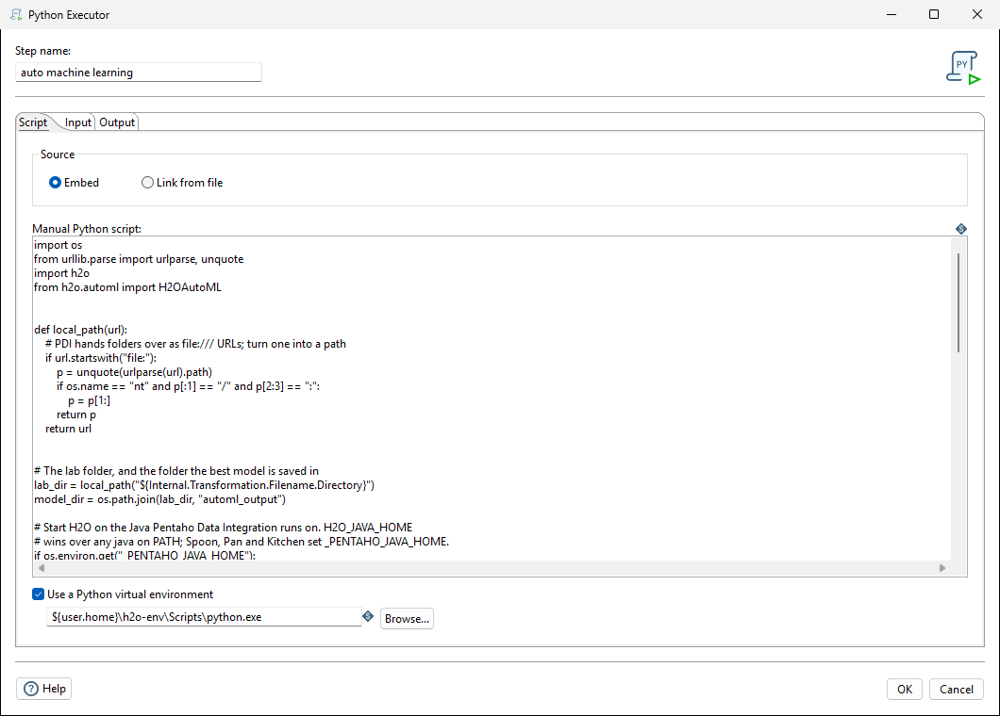
<figcaption>auto machine learning, Script tab</figcaption>
</figure>
</div>

6. Open the **Input** tab and, under **Row processing**, select **All rows**.
7. Under **Available variables**, add a variable with the plus sign button. Set **Variable name** to `dataset`, **Step** to `sv-change_to_numbers` and **Data structure** to `Pandas dataframe`.
8. Fill the **Mapping** grid so it matches this table:

| Data structure field         | Data structure type | Pentaho Data Integration field | Pentaho Data Integration data type |
| ---------------------------- | ------------------- | ------------------------------ | ---------------------------------- |
| `first_time_customer`        | `float64`           | `first_time_customer`          | Number                             |
| `order_dollar_amount`        | `float64`           | `order_dollar_amount`          | Number                             |
| `num_items`                  | `int64`             | `num_items`                    | Integer                            |
| `age`                        | `float64`           | `age`                          | Number                             |
| `web_order`                  | `float64`           | `web_order`                    | Number                             |
| `total_transactions_to_date` | `int64`             | `total_transactions_to_date`   | Integer                            |
| `hour_of_day`                | `int64`             | `hour_of_day`                  | Integer                            |
| `billing_shipping_zip_equal` | `float64`           | `billing_shipping_zip_equal`   | Number                             |
| `reported_as_fraud_historic` | `float64`           | `reported_as_fraud_historic`   | Number                             |

<div align="center">
<figure>
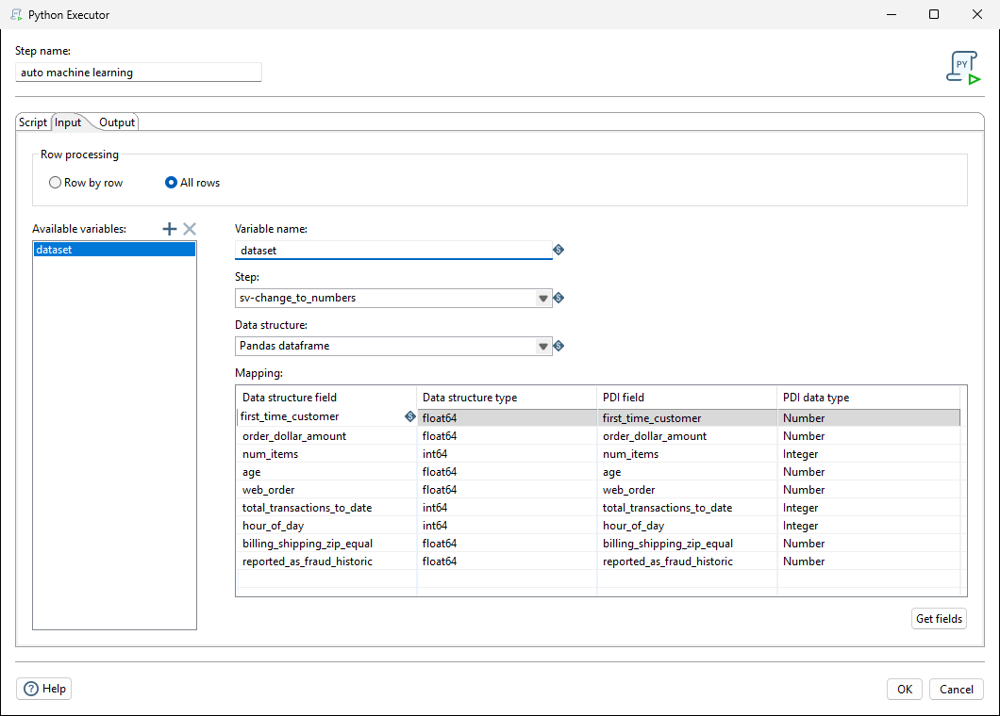
<figcaption>auto machine learning, Input tab</figcaption>
</figure>
</div>

9. Open the **Output** tab and, under **Output processing**, select **Variables to fields**.
10. Fill the **Mapping** grid with the ten variables the script leaves behind:

| Variable         | Python data type | Pentaho Data Integration field | Pentaho Data Integration data type |
| ---------------- | ---------------- | ------------------------------ | ---------------------------------- |
| `best_model_id`  | `str`            | `best_model_id`                | String                             |
| `best_algorithm` | `str`            | `best_algorithm`               | String                             |
| `best_auc`       | `str`            | `best_auc`                     | String                             |
| `best_aucpr`     | `str`            | `best_aucpr`                   | String                             |
| `best_precision` | `str`            | `best_precision`               | String                             |
| `best_recall`    | `str`            | `best_recall`                  | String                             |
| `best_f1`        | `str`            | `best_f1`                      | String                             |
| `models_trained` | `int`            | `models_trained`               | Integer                            |
| `test_rows`      | `int`            | `test_rows`                    | Integer                            |
| `model_path`     | `str`            | `model_path`                   | String                             |

<div align="center">
<figure>
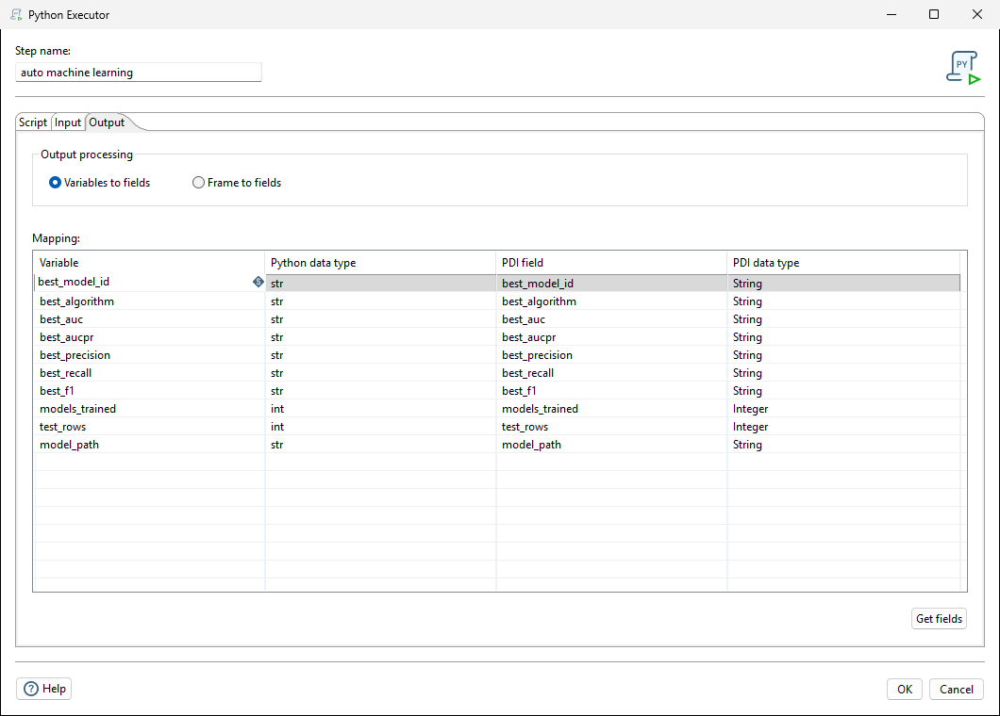
<figcaption>auto machine learning, Output tab</figcaption>
</figure>
</div>

11. Select **OK**, and save the transformation (`Ctrl+S`).

**Run it**

12. Press `F9` (**Action > Run**), and select **Run** in the **Run Options** dialog. AutoML runs inside the **auto machine learning** step; on the lab machine the run takes about a minute.

> **Under the hood:**
>
> #### The step gathers every row into one data frame and returns one row
>
> With **All rows**, the **Python Executor** step waits for the whole
> stream from **sv-change_to_numbers**, builds one pandas data frame from
> the nine mapped fields, and hands it to the script as `dataset`. The
> script runs once, in a Python process of its own. **Variables to
> fields** then reads the ten variables the script leaves behind and
> turns them into the fields of one row. Meanwhile the **Copy** hop sends
> the same rows to **tfo-H2O**.
>
> **Why it matters:** Pentaho Data Integration does the joins and conversions, Python does the
> modeling, and the result comes back as an ordinary row. A later step
> could write it to a table of experiments or check `best_auc` against a
> threshold, which turns a notebook experiment into a scheduled job.

13. When the run finishes, open the **Step Metrics** tab in **Execution Results**.

> **Success:** Checkpoint: every step finishes without errors. **csvi-customer** stops at its **Limit**, and **tfo-H2O** and **auto machine learning** each read the same 49,999 rows: with **Copy**, every row goes to both. **auto machine learning** writes 1 row.

14. Select **auto machine learning** on the canvas and open the **Preview data** tab.

> **Success:** Checkpoint: 1 row with the ten fields from `best_model_id` to `model_path`: `best_algorithm` `gbm`, `best_auc` `0.9134`, `best_aucpr` `0.3400`, `best_precision` `0.4127`, `best_recall` `0.3969`, `best_f1` `0.4047`, `models_trained` `5` and `test_rows` `12486`. `best_model_id` starts with `GBM_1_AutoML_1_` and ends with the time of the run, and `model_path` is a folder of that name under `automl_output`. With `seed=42` and `max_models=5`, every run trains the same five models.

`best_precision`, `best_recall` and `best_f1` are measured at the threshold that gives the best F1 score, one probability cut-off for all three.

15. Open `data/H2O.csv`, next to your transformation, in a text editor.

The first lines:

```text
0;56.1;2;44;0;5;8;1;0
1;37.6;4;50;1;1;23;0;1
0;26.9;1;44;1;2;16;1;0
0;12.3;1;37;1;4;15;1;0
1;113.2;3;49;1;1;15;1;0
```

> **Success:** Checkpoint: no header line, and 49,999 lines of nine semicolon-separated values. The first line is `0;56.1;2;44;0;5;8;1;0`: the same customer as the previews, with its flags as numbers. The file is the same as the `H2O.csv` in **Lab Files**.

### 5. AutoML in a Notebook

> **Note:**
>
> #### H2O AutoML in a notebook
>
> A data scientist with a new data set usually starts by getting a feel for it: summary statistics, a few charts, and quick tests of how each field relates to the target, here `reported_as_fraud_historic`. Then come quick tests with common classification algorithms, to see which technique gives the best result. H2O AutoML does that last part for you: it trains and ranks several models and returns a leaderboard. Run the same steps one cell at a time in a notebook, where you can see each result. JupyterLab runs the notebook on your machine, from the `h2o-env` virtual environment, so the data never leaves it; Colab runs it in Google's cloud instead.

<figure>

<figcaption class="pcm-video-caption">Walkthrough: coming soon</figcaption>

</figure>

1. Open the notebook:

::: tabs

### JupyterLab

1. In PowerShell, go to the lab folder and start JupyterLab from the virtual environment:

   ```powershell
   Set-Location C:\Workshop-ML-Specialty\02-machine-learning\03-automl
   & $HOME\h2o-env\Scripts\jupyter-lab.exe
   ```

2. JupyterLab opens in your browser. In its file browser on the left, double-click `credit_card_fraud.ipynb`: the installer put it in this lab's folder (on your own machine, download it from **Lab Files** into the folder that holds `autoML.ktr`). (Or select **File > New > Notebook**, choose the **Python 3 (ipykernel)** kernel, and enter each cell below.)

Keep the PowerShell window open while you work: it runs JupyterLab. Press `Ctrl+C` in it when you have finished.

### Colab (optional)

1. Open Colab and sign in:

<div class="pcm-embed-card" data-href="https://colab.research.google.com/" data-title="colab.research.google.com"></div>

2. Select **Connect > Connect to a hosted runtime**.

<div align="center">
<figure>
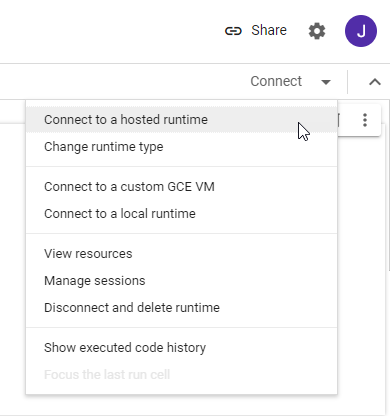
<figcaption>Connect to a hosted runtime</figcaption>
</figure>
</div>

3. Select **File > Upload notebook** and upload `credit_card_fraud.ipynb` from **Lab Files**, or select **File > New notebook in Drive** and enter each cell below.

<div align="center">
<figure>
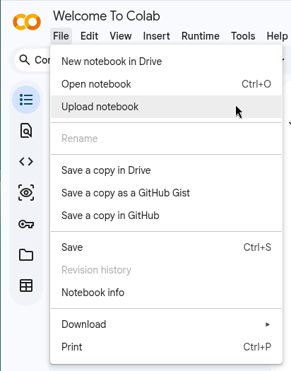
<figcaption>The File menu</figcaption>
</figure>
</div>

4. Colab has no `h2o-env`. In the two cells marked *Colab only*, remove the `#` at the start of each code line: the first cell installs H2O, and the second shows a file upload widget, where you select `H2O.csv`. Also remove the `#` from the `files.download` lines at the end, to download the model and the summary.

<div align="center">
<figure>
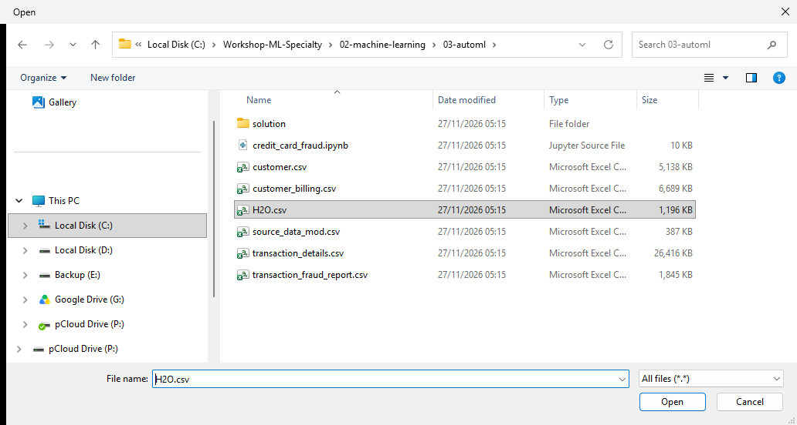
<figcaption>Choose H2O.csv</figcaption>
</figure>
</div>

Colab installs the newest H2O, so its numbers can differ a little from the checkpoints below.

:::

> **Success:** Checkpoint: the notebook is open, with its first cell, **Credit-card fraud: H2O AutoML**, at the top.

2. Run the first code cell, the *Colab only* one, with `Shift+Enter`. In JupyterLab it does nothing: `h2o-env` already has H2O.
3. Run the next cell. It imports the libraries and starts H2O, with up to 4 GB of memory (`max_mem_size="4G"`) and every CPU core (`nthreads=-1`). On the lab machine it starts H2O on Pentaho's Java:

   ```python
   # Import libraries
   import os
   from datetime import datetime

   import h2o
   from h2o.automl import H2OAutoML
   import pandas as pd
   import matplotlib.pyplot as plt

   # On the lab machine, start H2O on Pentaho's Java. H2O reads H2O_JAVA_HOME
   # before any java on PATH.
   pentaho_java = r"C:\Pentaho\java"
   if os.path.isdir(pentaho_java):
       os.environ["H2O_JAVA_HOME"] = pentaho_java

   h2o.init(max_mem_size="4G", nthreads=-1)
   print("\nH2O initialized.")
   ```

> **Success:** Checkpoint: H2O prints a table that describes its new cluster, then `H2O initialized.` Above the table, `Java Version` names Pentaho's Java, `21` on the lab machine.

4. Run the next cell, the second *Colab only* one. In JupyterLab it does nothing either.
5. Run the next cell. It reads `data/H2O.csv`, the file your run wrote, or else the `H2O.csv` from **Lab Files**, and names its columns. The file has no header and uses `;` as its separator, and the target, `reported_as_fraud_historic` in Pentaho Data Integration, is named `fraud` here and converted to text, which H2O treats as classes:

   ```python
   # Load data: the file the transformation wrote, else the Lab Files copy
   path = os.path.join("data", "H2O.csv") if os.path.exists(os.path.join("data", "H2O.csv")) else "H2O.csv"
   data = pd.read_csv(path, sep=";", header=None)

   data.columns = [
       "first_time_customer", "order_dollar_amount", "num_items", "age",
       "web_order", "total_transactions", "hour_of_day",
       "billing_shipping_match", "fraud",
   ]

   # Convert target to string
   data["fraud"] = data["fraud"].astype(str)

   print(f"Read {path}")
   print(f"Dataset: {data.shape[0]:,} rows × {data.shape[1]} columns")
   print(f"Fraud cases: {(data['fraud'] == '1').sum():,} ({(data['fraud'] == '1').mean() * 100:.2f}%)")
   ```

> **Success:** Checkpoint: the cell prints `Dataset: 49,999 rows × 9 columns` and `Fraud cases: 497 (0.99%)`.

The eight features: `first_time_customer` (a first order), `order_dollar_amount`, `num_items` (items in the order), `age` (the customer's age), `web_order` (online, not by phone), `total_transactions` (the customer's history), `hour_of_day` (when the order came in) and `billing_shipping_match` (the zip code flag). `fraud` is the target: `0` for a legitimate order, `1` for fraud.

6. Run the next cell. It charts how many rows each class has:

   ```python
   # Quick class distribution check
   fraud_dist = data["fraud"].value_counts().sort_index()

   plt.figure(figsize=(10, 4))
   fraud_dist.plot(kind="bar", color=["green", "red"])
   plt.title("Class Distribution", fontweight="bold")
   plt.xlabel("Class (0=Normal, 1=Fraud)")
   plt.ylabel("Count")
   plt.xticks([0, 1], ["Normal", "Fraud"], rotation=0)
   for i, v in enumerate(fraud_dist):
       plt.text(i, v + 50, f"{v:,}", ha="center", fontweight="bold")
   plt.tight_layout()
   plt.show()
   ```

> **Success:** Checkpoint: a bar chart titled **Class Distribution**: the green **Normal** bar is labeled `49,502` and the red **Fraud** bar `497`, too short to see without its label.

<div align="center">
<figure>
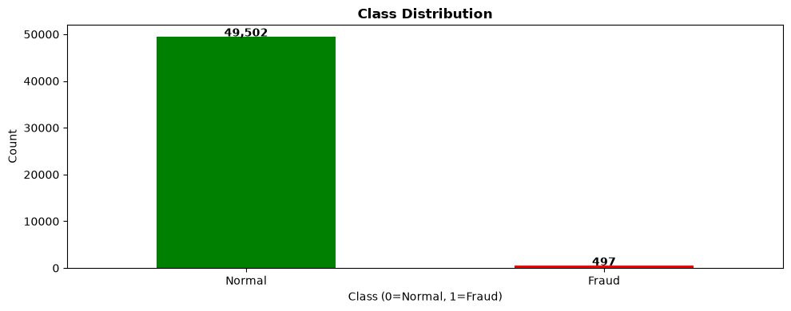
<figcaption>The two classes in H2O.csv</figcaption>
</figure>
</div>

The chart shows how imbalanced the classes are: about one order in a hundred is fraud, as in real card data. A model that called every order genuine would be 99% accurate and catch nothing, which is why the AutoML run sets `balance_classes=True` and ranks its models by AUCPR.

7. Run the next cell. It moves the data into H2O, marks `fraud` as a class label (a *factor*), so H2O trains a classifier and not a regression, and splits the rows 75% for training and 25% for testing. `seed=42` makes the split the same every time you run it:

   ```python
   # Convert to H2O frame
   hf = h2o.H2OFrame(data)
   hf["fraud"] = hf["fraud"].asfactor()

   # Split: 75% train, 25% test
   train, test = hf.split_frame(ratios=[0.75], seed=42)

   print(f"Training: {train.nrows:,} rows")
   print(f"Test:     {test.nrows:,} rows")

   # Define features and target
   x = train.columns
   x.remove("fraud")
   y = "fraud"
   ```

> **Success:** Checkpoint: `Training: 37,513 rows` and `Test: 12,486 rows`. H2O splits by probability, not by exact count, so the split is close to, not exactly, three quarters and one quarter.

8. Run the next cell. It runs AutoML, for up to 15 minutes; on the lab machine it takes well under one:

   ```python
   # Fast configuration
   start_time = datetime.now()

   aml = H2OAutoML(
       max_models=5,                   # Only 5 models for speed
       max_runtime_secs=900,           # 15 minutes max
       seed=42,
       balance_classes=True,           # Handle imbalanced data
       nfolds=5,                       # 5-fold CV
       sort_metric="AUCPR",
       include_algos=[
           "GBM",           # Gradient Boosting (usually best)
           "GLM",           # Generalized Linear Model (fast)
           "DRF",           # Distributed Random Forest (tree-based)
           "DeepLearning",  # Neural Network
           # "XGBoost",     # add on Linux or Colab: H2O's XGBoost does not run on Windows
       ],
       verbosity="warn",
   )

   # Train
   aml.train(x=x, y=y, training_frame=train)

   duration = (datetime.now() - start_time).total_seconds()
   print(f"\nTraining completed in {duration / 60:.1f} minutes.")
   ```

> **Success:** Checkpoint: H2O shows its progress, and the cell ends with `Training completed in` and the number of minutes.

The settings:

| Setting | Effect |
| --- | --- |
| `max_models=5` | Trains at most five models, to keep the run short |
| `max_runtime_secs=900` | Stops after 15 minutes |
| `balance_classes=True` | Balances the classes while training, for imbalanced data |
| `nfolds=5` | Scores each model with 5-fold cross-validation |
| `sort_metric="AUCPR"` | Ranks the models by AUCPR, the area under the precision-recall curve |

The algorithms it may try:

| Algorithm | What it is |
| --- | --- |
| GBM (Gradient Boosting Machine) | Trees built one after another, each correcting the errors of the ones before; H2O's own implementation |
| GLM (Generalized Linear Model) | A fast baseline with coefficients you can read |
| DRF (Distributed Random Forest) | Many decision trees trained independently, their votes combined |
| DeepLearning | A neural network |
| XGBoost | Another gradient boosting implementation, widely used for tabular data. H2O's XGBoost does not run on Windows, so the cell leaves it out; in Colab you can add it |

GBM and DRF each combine many trees, so a single decision tree is not among the candidates.

9. Run the next cell. It shows the leaderboard:

   ```python
   # View leaderboard
   lb = aml.leaderboard
   print(lb)
   print(f"\nTotal models trained: {lb.nrows}")
   print(f"Best model: {lb.as_data_frame()['model_id'][0]}")
   ```

> **Success:** Checkpoint: a table with one row per model, best first by **aucpr**: three GBM models, then a DRF and a GLM. The five-model limit is reached before AutoML gets to DeepLearning. Its columns include the model ID, **aucpr** (the area under the precision-recall curve), **auc**, the mean per-class error, and the error measures RMSE and MSE. The first row, `GBM_1_AutoML_1_` and the time of the run, has an **aucpr** of `0.235918` and an **auc** of `0.925837`, and the cell ends with `Total models trained: 5`.

The leaderboard's numbers come from cross-validation on the training rows. For imbalanced classes, AUCPR is often a better guide than AUC: see the metrics cheat sheet under these tabs. The course ranks by AUCPR (`sort_metric="AUCPR"`) because its fraud is rare, about one order in a hundred, as on real card data: AUC can look excellent while precision at any usable threshold is poor.

10. Run the next cell. It scores the best model on the test rows:

   ```python
   # Get best model and score it on the test rows
   best = aml.leader
   perf = best.model_performance(test)

   # Precision, recall and F1 at the threshold that gives the best F1
   threshold = perf.find_threshold_by_max_metric("f1")

   print(f"BEST MODEL: {best.model_id}")
   print(f"Algorithm: {best.algo}")
   print()
   print(f"AUC:       {perf.auc():.4f}")
   print(f"AUCPR:     {perf.aucpr():.4f}")
   print(f"Precision: {perf.precision(thresholds=[threshold])[0][1]:.4f}")
   print(f"Recall:    {perf.recall(thresholds=[threshold])[0][1]:.4f}")
   print(f"F1 Score:  {perf.F1(thresholds=[threshold])[0][1]:.4f}")
   ```

> **Success:** Checkpoint: `Algorithm: gbm`, then `AUC: 0.9134`, `AUCPR: 0.3400`, `Precision: 0.4127`, `Recall: 0.3969` and `F1 Score: 0.4047`: the same numbers as the **auto machine learning** step, because both run the same search on the same rows with the same seed.

What they measure, for fraud:

* **AUC**: how well the model ranks fraud above legitimate orders, over all thresholds.
* **AUCPR**: the same idea on the precision-recall curve; it weighs the rare class more.
* **Precision**: of the orders it flags, the share that are fraud. Higher precision means fewer false alarms.
* **Recall**: of all fraud cases, the share it catches. Higher recall means less missed fraud.
* **F1 score**: a balance of precision and recall.

Precision, recall and F1 depend on the probability above which an order counts as fraud. The cell measures all three at one threshold, the one that gives the best F1.

11. Run the next cell. It shows the confusion matrix at the same threshold:

   ```python
   # Confusion matrix, at the same threshold
   cm = perf.confusion_matrix(thresholds=threshold)
   print(cm)

   cm_table = cm.table.as_data_frame()
   tn, fp = int(cm_table.iloc[0, 1]), int(cm_table.iloc[0, 2])
   fn, tp = int(cm_table.iloc[1, 1]), int(cm_table.iloc[1, 2])
   print(f"True Negatives:  {tn:>6,}")
   print(f"False Positives: {fp:>6,}")
   print(f"False Negatives: {fn:>6,} (missed fraud)")
   print(f"True Positives:  {tp:>6,}")
   print(f"\nCaught {tp} fraud cases, missed {fn}.")
   ```

> **Success:** Checkpoint: a two-by-two table of actual against predicted classes at a threshold of about `0.036`: `12,281` true negatives, `74` false positives, `79` false negatives and `52` true positives, and the line `Caught 52 fraud cases, missed 79.`

The test rows hold 131 frauds among 12,486 orders. The threshold that gives the best F1 is very low, about 0.04: when fraud is rare, even a small probability is many times the 1% base rate. The model catches about two frauds in five there, with a little over one false alarm for each fraud it catches: realistic for card fraud, and why the Credit Card workshop trains on the full history and Monitoring and Tuning chooses the threshold from costs.

A false negative is fraud that got through: a direct loss. A false positive is a legitimate order declined: friction for a real customer. Where to strike the balance depends on what each costs the business.

12. Run the next cell. It lists and plots the features that matter most to the model:

   ```python
   # Top features
   varimp = best.varimp(use_pandas=True)
   print(varimp.head(10))

   # Plot
   best.varimp_plot()
   ```

> **Success:** Checkpoint: a table of the eight features, most important first, and a bar chart of the same. `first_time_customer` leads, then `hour_of_day` and `order_dollar_amount`.

<div align="center">
<figure>
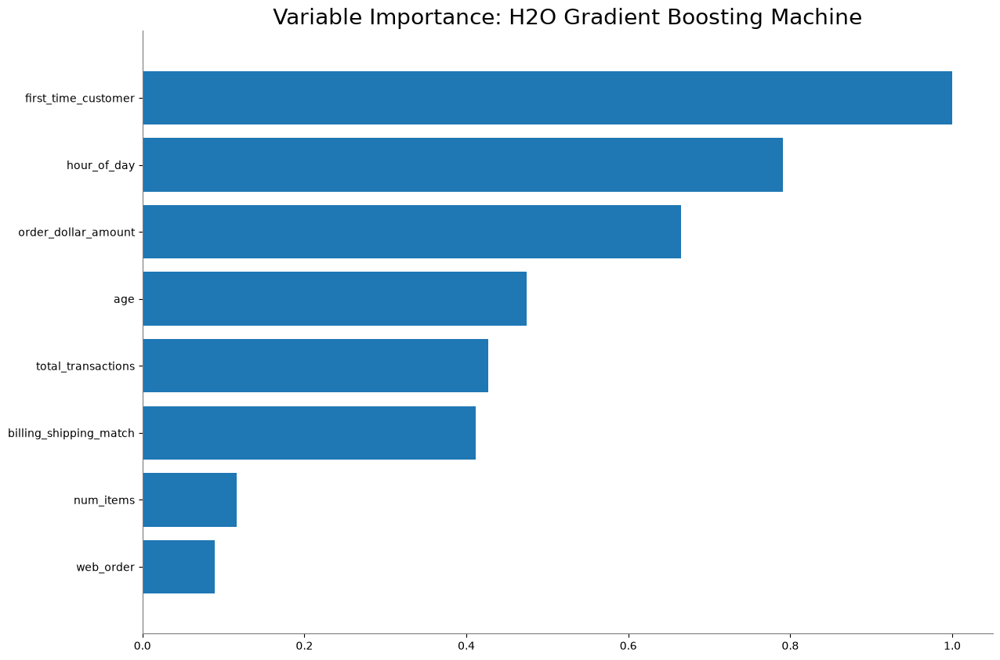
<figcaption>The best model's feature importance</figcaption>
</figure>
</div>

Feature importance explains what drives the predictions, shows where more feature engineering would pay off, and lets you check that the model relies on fields that make business sense. The zip code flag you built in **Feature Engineering** is the second most important feature.

13. Run the next cell. It saves the best model in `automl_output`, next to the notebook. The folder is an H2O model, which you can load back into H2O; exporting it as a MOJO (H2O's standalone Java scoring file, which runs without an H2O cluster) is a separate step:

   ```python
   # Save the best model in automl_output, next to the notebook
   model_path = h2o.save_model(model=best, path="automl_output", force=True)
   print(f"Model saved: {model_path}")

   # Colab only: download it
   # files.download(model_path)
   ```

> **Success:** Checkpoint: `Model saved:` and a path under `automl_output` that ends with the best model's ID.

14. Run the last cell. It writes a summary for the record to `fraud_summary.txt`, next to the notebook:

   ```python
   # Generate summary
   report = f"""
   FRAUD DETECTION - QUICK SUMMARY
   {'=' * 60}

   Date: {datetime.now().strftime('%Y-%m-%d %H:%M:%S')}

   Dataset:
     Total:     {len(data):,}
     Training:  {train.nrows:,}
     Test:      {test.nrows:,}

   Model:
     Best:      {best.model_id}
     Algorithm: {best.algo}
     Training:  {duration / 60:.1f} minutes

   Performance:
     AUC:       {perf.auc():.4f}
     AUCPR:     {perf.aucpr():.4f}
     Precision: {perf.precision(thresholds=[threshold])[0][1]:.4f}
     Recall:    {perf.recall(thresholds=[threshold])[0][1]:.4f}
     F1:        {perf.F1(thresholds=[threshold])[0][1]:.4f}

   Model saved: {model_path}

   {'=' * 60}
   """

   print(report)

   with open("fraud_summary.txt", "w", encoding="utf-8") as f:
       f.write(report)
   print("Summary saved to fraud_summary.txt.")

   # Colab only: download it
   # files.download("fraud_summary.txt")
   ```

> **Success:** Checkpoint: the summary prints, and the cell ends with `Summary saved to fraud_summary.txt.`

A summary like this serves model tracking, reports to stakeholders, comparisons between experiments and audit trails. Once the notebook gives you the answers you need, move the logic into Pentaho Data Integration, as the **auto machine learning** step does, and use the leaderboard to decide which algorithm to put into production.

> **Under the hood:**
>
> #### The same search, run two ways
>
> The notebook and the **auto machine learning** step both hand the same
> rows to H2O AutoML, which trains several algorithms, measures each on
> rows it did not learn from, and ranks them by AUCPR. The notebook runs it
> one cell at a time, keeps every result on screen, and lets you change a
> cell and run it again. The step runs it from start to end, inside a
> transformation, with nobody watching.
>
> **Why it matters:** a notebook is where you find the answer; a
> pipeline is where you use it, every day. The fraud team's question,
> which kind of model, is answered here, and the answer, a GBM, is what
> Credit Card builds into a job.

### 6. GBM

> **Note:**
>
> #### Gradient Boosting Machine
>
> A Gradient Boosting Machine (GBM) builds a series of small decision trees one after another, each one focused on the errors of the trees before it. Its prediction is the weighted sum of all the trees. For fraud, it can capture patterns that combine several fields, such as an unusual amount at an unusual hour, which simple rules miss, and it ranks the features by importance, so investigators can see what drives a score. The [Credit Card](../04-credit-card/guide.md) workshop trains a GBM model with H2O, in a **Python Executor** step.

<div align="center">
<figure>
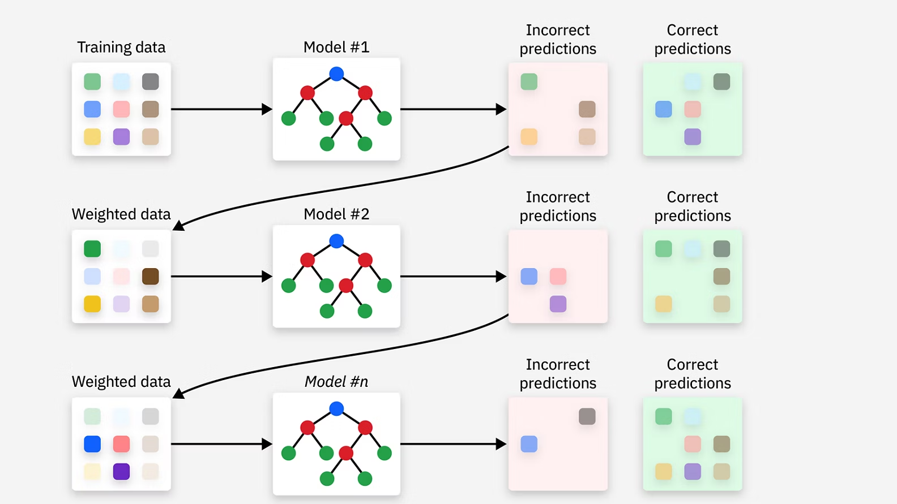
<figcaption>Each model concentrates on what the models before it got wrong</figcaption>
</figure>
</div>

How the training proceeds:

* **Start with a baseline.** The first prediction is simple, often the average of the target.
* **Measure the errors.** The differences between that prediction and the actual values are the *residuals*.
* **Fit a small tree to the errors.** A shallow decision tree learns the pattern in what the model got wrong, not the original target.
* **Update the prediction.** The new tree's output is added, scaled down by a *learning rate* (a small number such as 0.1) so that no single tree overcorrects: new prediction = old prediction + (learning rate × new tree's output).
* **Repeat.** Measuring, fitting and updating run hundreds or thousands of times, and each tree corrects a little more of the remaining error.

The "gradient" in the name comes from *gradient descent*: the residuals each tree fits are the negative gradients of a loss function, such as log-loss for classification. Early trees tend to learn broad patterns (very large orders are riskier); later ones pick up finer signals.

In H2O these settings have their own names: `ntrees` (how many trees), `max_depth` (how deep each tree grows), `learn_rate` (the learning rate) and `sample_rate` (the share of rows each tree sees). The Credit Card workshop sets all four.

::::

<details>

<summary>Metrics cheat sheet (fraud detection)</summary>

Use these metrics to compare models and to pick a decision threshold. Fraud data is usually imbalanced: far fewer fraud cases than legitimate ones.

#### What to look at first

* **AUCPR**: the best single number for imbalanced classification.
* **Recall**: how much fraud you catch (fewer false negatives).
* **Precision**: how many alerts are real fraud (fewer false positives).

#### AUC as a second opinion

**AUC** measures how well the model ranks fraud above legitimate transactions. It can look good even when precision is poor at the thresholds you would use.

#### Why accuracy is a trap

If fraud is 1% of transactions, a model that predicts "legitimate" for every row is 99% accurate and useless.

#### Practical selection guide

* If fraud losses are expensive, prioritize **recall**.
* If customer friction is expensive, prioritize **precision**.
* Use **AUCPR** to compare candidates before you tune thresholds.

#### What to ignore (most of the time)

* **RMSE/MSE**: regression-style errors on probabilities. They don't help you decide.

</details>

## Lab Files

Click a file to download. For `.ktr` and `.kjb` files, **Open in Pentaho Data Integration** launches Pentaho Data Integration with the file loaded. If Pentaho Data Integration is already running, the path is copied to your clipboard — switch to Pentaho Data Integration and press `Ctrl+O`, `Ctrl+V`, `Enter`.

The four source files, 100,000 rows each:

[customer.csv](./files/customer.csv)

[customer_billing.csv](./files/customer_billing.csv)

[transaction_details.csv](./files/transaction_details.csv)

[transaction_fraud_report.csv](./files/transaction_fraud_report.csv)

`H2O.csv` is a ready-made training set in the layout **tfo-H2O** writes: 49,999 rows, no header line. The notebook reads it if you have not run the transformation:

[H2O.csv](./files/H2O.csv)

`credit_card_fraud.ipynb` is the notebook for **AutoML in a Notebook**, for JupyterLab or Colab:

[credit_card_fraud.ipynb](./files/credit_card_fraud.ipynb)

`source_data_mod.csv` is an older, pre-joined sample of 1,500 orders. No transformation in this course reads it:

[source_data_mod.csv](./files/source_data_mod.csv)

### Solution <!-- no-step -->

The finished transformation for this lab. Open it alongside your own to compare, or run it to see the expected result. Like yours, it reads the four source files from its own folder, which holds copies of them, and writes `data/H2O.csv` and `automl_output` there.

Also on disk at `C:\Workshop-ML-Specialty\02-machine-learning\03-automl\solution`.

[autoML.ktr](./files/autoML.ktr) <button data-launch="spoon" data-path="files/autoML.ktr">Open in Pentaho Data Integration</button> <button data-graph="files/autoML.ktr">View graph</button>

`test_python.ktr` is the validation transformation from [Prerequisite Tasks](../02-prerequisite-tasks/guide.md):

[test_python.ktr](./files/test_python.ktr) <button data-launch="spoon" data-path="files/test_python.ktr">Open in Pentaho Data Integration</button> <button data-graph="files/test_python.ktr">View graph</button>
