# AutoML

> **Warning:**
>
> #### Workshop - AutoML
>
> A direct retailer takes orders by phone and on its website and ships the goods to the customer. It keeps its customers' details and their orders in a database, and a CSV report of past orders that turned out to be fraudulent. To reduce its losses from orders paid with stolen credit cards, it wants a model that flags likely fraud. Blend its files into one training set in Pentaho Data Integration (PDI), then let H2O AutoML train several algorithms and rank them.
>
> **What you'll do**
>
> * Join four files with **Stream lookup** steps (data wrangling)
> * Derive a billing and shipping zip code match flag with **Formula** (feature engineering)
> * Write the training set, `H2O.csv`, and run H2O AutoML from a **Python Executor** step
> * Train, rank and evaluate models in a Colab notebook
> * Install the R `gbm` package for the [Credit Card](../04-credit-card/guide.md) workshop
>
> **Prerequisites:** Complete [Prerequisite Tasks](../02-prerequisite-tasks/guide.md): Python with `h2o` in the `h2o-env` virtual environment, a Google account for Colab, and R with rJava
>
> **Estimated time:** 20 minutes

**🎥 Embed:** [Walkthrough (video)](<https://www.loom.com/share/52058cfd36b34a0286d5961ab393c9ad?hideEmbedTopBar=true&hide_owner=true&hide_share=true&hide_title=true>)

<div align="center">
<figure>
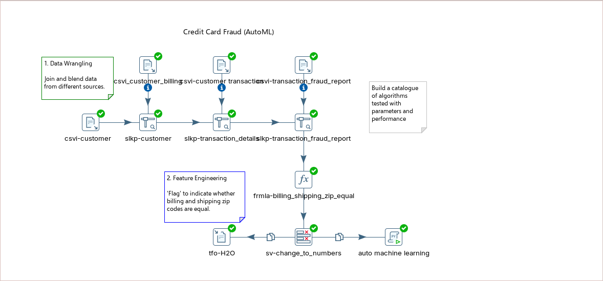
<figcaption>What you build: blend, derive, then write the training set and run AutoML</figcaption>
</figure>
</div>

:::: tabs

### 1. Data Wrangling

> **Note:**
>
> #### Data wrangling
>
> The retailer's data is in four files of 100,000 rows each. `customer.csv` holds each customer's name and billing zip code; `customer_billing.csv` names the transaction and card each customer used; `transaction_details.csv` describes each order (shipping address, amount, number of items, the customer's age, whether it was a web order, the customer's transactions to date and the hour of day); and `transaction_fraud_report.csv` says whether each transaction was reported as fraud. Join them into one row per transaction.

1. Start Spoon with the **Start PDI** button below, or from a terminal:

::: tabs

### Windows (PowerShell)

```powershell
Set-Location C:\Pentaho\design-tools\data-integration
.\spoon.bat
```

### macOS / Linux

```bash
cd ~/Pentaho/design-tools/data-integration
./spoon.sh
```

:::

<button data-launch="spoon" data-path="">Start PDI</button>

2. Select **File > New > Transformation** (`Ctrl+N`).
3. Select **File > Save as** and save it as `autoML.ktr` in `C:\Workshop-ML-Specialty\02-machine-learning\03-automl`, the folder that holds the four CSV files. Saving first gives `${Internal.Entry.Current.Directory}` a value. (On your own machine, download the four files from **Lab Files** below into the folder you save in.)

**The customers**

4. On the **Design** tab, open the **Input** folder and drag **Text file input** onto the canvas.
5. Double-click **Text file input**.
6. Set **Step name** to `csvi-customer`.
7. On the **File** tab, enter `${Internal.Entry.Current.Directory}/customer.csv` in **File or directory** and select **Add**.
8. On the **Content** tab, set **Separator** to `,`, **Format** to `mixed` and **Limit** to `10000`, so the step reads only the first 10,000 customers. Leave **Header** selected, with **Number of header lines** `1`.
9. On the **Fields** tab, select **Get Fields**. Spoon asks for the number of lines to sample: select **OK**, then close **Scan results**.
10. Change the **Fields** grid to match this table:

| Name                   | Type    | Format | Length | Precision | Trim type |
| ---------------------- | ------- | ------ | ------ | --------- | --------- |
| `customer_name`        | String  |        | 22     |           | none      |
| `customer_id`          | Integer | `#`    | 15     | 0         | none      |
| `customer_billing_zip` | Integer | `#`    | 15     | 0         | none      |

11. Select **Preview rows**, enter `100` rows, and select **OK**. The rows show in **Examine preview data**.

<div align="center">
<figure>
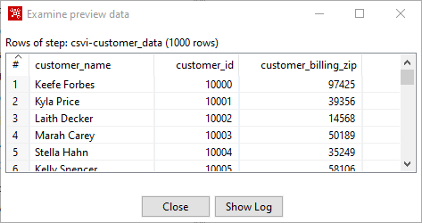
<figcaption>The customers (captured from the Credit Card lab's input step, csvi-customer_data, which previewed 1,000 rows; yours shows 100)</figcaption>
</figure>
</div>

> **Success:** Checkpoint: 100 rows. The first is `Keefe Forbes`, customer `10000`, billing zip `97425`; the second is `Kyla Price`, `10001`, `39356`.

12. Select **Close**, then select **OK**.

**The billing, transaction and fraud files**

13. From the **Input** folder, drag **CSV file input** onto the canvas.
14. Double-click **CSV file input**.
15. Set **Step name** to `csvi_customer_billing`.
16. Set **Filename** to `${Internal.Entry.Current.Directory}/customer_billing.csv`. Keep **Delimiter** `,` and leave **Lazy conversion?** and **Header row present?** selected.
17. Select **Get Fields**, then change the **Fields** grid to match this table:

| Name             | Type    | Format | Length | Precision |
| ---------------- | ------- | ------ | ------ | --------- |
| `customer_id`    | Integer | `#`    | 15     | 0         |
| `transaction_id` | Integer | `#`    | 15     | 0         |
| `card_number`    | Integer | `#`    | 15     | 0         |
| `expiry_date`    | Integer | `#`    | 15     | 0         |

18. Select **OK**.
19. Drag a second **CSV file input** onto the canvas and double-click it.
20. Set **Step name** to `csvi-customer transaction` (with a space before `transaction`, as the solution has it).
21. Set **Filename** to `${Internal.Entry.Current.Directory}/transaction_details.csv`. Leave **Lazy conversion?** and **Header row present?** selected.
22. Select **Get Fields**, then change the **Fields** grid to match this table. Leave **Trim type** at `none`.

| Name                         | Type    | Format | Length | Precision |
| ---------------------------- | ------- | ------ | ------ | --------- |
| `customer_id`                | Integer | `#`    | 15     | 0         |
| `transaction_id`             | Integer | `#`    | 15     | 0         |
| `ship_to_address`            | String  |        | 1      |           |
| `ship_to_address_1`          | String  |        | 62     |           |
| `ship_to_city`               | String  |        | 22     |           |
| `ship_to_country`            | String  |        | 3      |           |
| `ship_to_customer_number`    | Integer | `#`    | 15     | 0         |
| `ship_to_email`              | String  |        | 27     |           |
| `ship_to_name`               | String  |        | 23     |           |
| `ship_to_phone`              | String  |        | 12     |           |
| `ship_to_state`              | String  |        | 2      |           |
| `ship_to_zip`                | Integer | `#`    | 15     | 0         |
| `first_time_customer`        | Boolean |        |        |           |
| `order_dollar_amount`        | Number  | `#.#`  | 6      | 1         |
| `num_items`                  | Integer | `#`    | 15     | 0         |
| `age`                        | Number  | `#.#`  | 5      | 1         |
| `web_order`                  | Boolean |        |        |           |
| `total_transactions_to_date` | Integer | `#`    | 15     | 0         |
| `hour_of_day`                | Integer | `#`    | 15     | 0         |

23. Select **Preview**, enter `100` rows, and select **OK**.

<div align="center">
<figure>
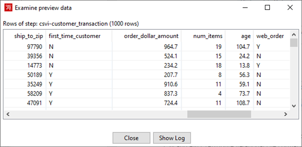
<figcaption>The transactions (captured from the Credit Card lab's input step, which previewed 1,000 rows; yours shows 100)</figcaption>
</figure>
</div>

> **Success:** Checkpoint: 100 rows. The first is customer `10000`, transaction `1`: `ship_to_zip` `97790`, `first_time_customer` `N`, `order_dollar_amount` `964.7`, `num_items` `19`, `age` `104.7`, `web_order` `Y`, `total_transactions_to_date` `40` and `hour_of_day` `7`.

24. Select **Close**, then select **OK**.
25. Drag a third **CSV file input** onto the canvas and double-click it.
26. Set **Step name** to `csvi-transaction_fraud_report`.
27. Set **Filename** to `${Internal.Entry.Current.Directory}/transaction_fraud_report.csv`, and clear **Lazy conversion?**.
28. Select **Get Fields**, then change the **Fields** grid to match this table. Every `transaction_id` in this file starts with a space (` 1`, ` 2`, ...): **Trim type** `both` removes it before the value converts to an Integer.

| Name                         | Type    | Format | Length | Precision | Trim type |
| ---------------------------- | ------- | ------ | ------ | --------- | --------- |
| `transaction_id`             | Integer | `#`    | 15     | 0         | both      |
| `reported_as_fraud_historic` | Boolean |        |        |           | none      |

29. Select **Preview**, enter `100` rows, and select **OK**.

<div align="center">
<figure>
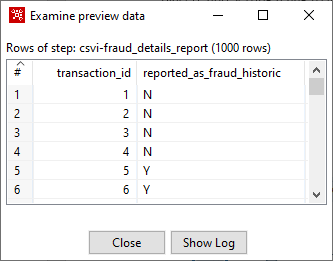
<figcaption>The fraud report (captured from the Credit Card lab's input step, which previewed 1,000 rows; yours shows 100)</figcaption>
</figure>
</div>

> **Success:** Checkpoint: 100 rows. Transactions `1` to `4` show `N` in `reported_as_fraud_historic`; `5` and `6` show `Y`.

30. Select **Close**, then select **OK**.

**Join the files**

31. On the **Design** tab, open the **Lookup** folder and drag **Stream lookup** onto the canvas.
32. Create a hop from **csvi-customer** to **Stream lookup**: hold `Shift` and drag from one step to the other.
33. Create a hop from **csvi_customer_billing** to **Stream lookup**.
34. Double-click **Stream lookup**.
35. Set **Step name** to `slkp-customer` and **Lookup step** to `csvi_customer_billing`. Make sure **Preserve memory (costs CPU)** is selected.
36. Fill **The key(s) to look up the value(s)** grid with one row:

| Field         | LookupField   |
| ------------- | ------------- |
| `customer_id` | `customer_id` |

37. Fill the **Specify the fields to retrieve** grid:

| Field            | New name         | Type    |
| ---------------- | ---------------- | ------- |
| `transaction_id` | `transaction_id` | Integer |
| `card_number`    | `card_number`    | Integer |
| `expiry_date`    | `expiry_date`    | Integer |

38. Select **OK**.
39. Drag a second **Stream lookup** onto the canvas. Create a hop from **slkp-customer** to it, and a hop from **csvi-customer transaction** to it.
40. Double-click the new step. Set **Step name** to `slkp-transaction_details` and **Lookup step** to `csvi-customer transaction`.
41. Fill **The key(s) to look up the value(s)** grid:

| Field            | LookupField      |
| ---------------- | ---------------- |
| `transaction_id` | `transaction_id` |
| `customer_id`    | `customer_id`    |

42. Select **Get lookup fields**, then right-click the `customer_id` row of the fields to retrieve and select **Delete selected lines**. Do the same for `transaction_id`. The grid keeps these 17 fields, each with **New name** the same as **Field**: `ship_to_address`, `ship_to_address_1`, `ship_to_city`, `ship_to_country`, `ship_to_customer_number`, `ship_to_email`, `ship_to_name`, `ship_to_phone`, `ship_to_state`, `ship_to_zip`, `first_time_customer`, `order_dollar_amount`, `num_items`, `age`, `web_order`, `total_transactions_to_date` and `hour_of_day`.
43. Select **OK**.
44. Drag a third **Stream lookup** onto the canvas. Create a hop from **slkp-transaction_details** to it, and a hop from **csvi-transaction_fraud_report** to it.
45. Double-click the new step. Set **Step name** to `slkp-transaction_fraud_report` and **Lookup step** to `csvi-transaction_fraud_report`.
46. Fill the two grids:

| Field            | LookupField      |
| ---------------- | ---------------- |
| `transaction_id` | `transaction_id` |

| Field                        | New name                     | Type    |
| ---------------------------- | ---------------------------- | ------- |
| `reported_as_fraud_historic` | `reported_as_fraud_historic` | Boolean |

47. Select **OK**, and save the transformation (`Ctrl+S`).

<div align="center">
<figure>
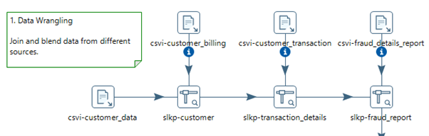
<figcaption>Three lookups, one row per transaction (an earlier capture, with the Credit Card lab's step names)</figcaption>
</figure>
</div>

48. Select **slkp-transaction_fraud_report** on the canvas, press `F10` (**Action > Preview**), and select **Quick Launch**. The rows show in **Examine preview data**.

> **Success:** Checkpoint: each row now carries the fields of all four files. The first is customer `10000`, `Keefe Forbes`, transaction `1`: billing zip `97425`, `ship_to_zip` `97790`, `order_dollar_amount` `964.7`, and `reported_as_fraud_historic` `N`.

49. Select **Close**.

> **Under the hood:**
>
> #### Each lookup read its whole lookup file into memory before the first customer arrived
>
> A **Stream lookup** step has two inputs. Before it handles the first
> row of its main stream, it reads every row from its **Lookup step** and
> keeps them in memory, keyed on the lookup fields. Each main row is then
> a single lookup in memory: no sorting, no database. The **Limit** you
> set on **csvi-customer** applies to the main stream only, so each of
> the three lookup files is read in full, 100,000 rows each.
> **Preserve memory (costs CPU)** stores those rows in a compact form and
> unpacks them on each match.
>
> **Why it matters:** a stream lookup joins files of different shapes
> without a database or a sort, but its lookup side has to fit in Spoon's
> memory. For lookup data much larger than this, a database join is the
> better tool.

### 2. Feature Engineering

> **Note:**
>
> #### Feature engineering
>
> Feature engineering creates fields that give a model more signal. The transaction data already holds the customer's age and the hour of the order; this part adds a flag that says whether the billing and shipping zip codes are the same. Then it turns the `Y`/`N` flags into `1` and `0`, the numbers many algorithms, such as Random Forest, need.

1. On the **Design** tab, open the **Scripting** folder and drag **Formula** onto the canvas.
2. Create a hop from **slkp-transaction_fraud_report** to **Formula**.
3. Double-click **Formula**. Set **Step name** to `frmla-billing_shipping_zip_equal`.
4. Fill the **Fields** grid with one row:

| New field                    | Formula                                  | Value type |
| ---------------------------- | ---------------------------------------- | ---------- |
| `billing_shipping_zip_equal` | `[customer_billing_zip] = [ship_to_zip]` | Boolean    |

<div align="center">
<figure>
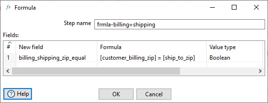
<figcaption>The zip code match flag (the step was named frmla-billing=shipping in this capture)</figcaption>
</figure>
</div>

5. Select **OK**.
6. On the **Design** tab, open the **Transform** folder and drag **Select values** onto the canvas.
7. Create a hop from **frmla-billing_shipping_zip_equal** to **Select values**.
8. Double-click **Select values**. Set **Step name** to `sv-change_to_numbers`.
9. On the **Select & Alter** tab, fill the **Fields** grid with these nine fields, in this order. The step drops every other field.

| Fieldname                    |
| ---------------------------- |
| `first_time_customer`        |
| `order_dollar_amount`        |
| `num_items`                  |
| `age`                        |
| `web_order`                  |
| `total_transactions_to_date` |
| `hour_of_day`                |
| `billing_shipping_zip_equal` |
| `reported_as_fraud_historic` |

10. On the **Meta-data** tab, fill the grid:

| Fieldname                    | Rename to                    | Type   | Length |
| ---------------------------- | ---------------------------- | ------ | ------ |
| `first_time_customer`        | `first_time_customer`        | Number | 1      |
| `web_order`                  | `web_order`                  | Number | 1      |
| `billing_shipping_zip_equal` | `billing_shipping_zip_equal` | Number | 1      |
| `reported_as_fraud_historic` | `reported_as_fraud_historic` | Number | 1      |

11. Select **OK**.
12. Select **sv-change_to_numbers** on the canvas, press `F10` (**Action > Preview**), and select **Quick Launch**.

> **Success:** Checkpoint: nine fields. The first row has `order_dollar_amount` `964.7`, `num_items` `19` and `age` `104.7`, and its four flags are now numbers: `web_order` is 1 (it was `Y`), and `first_time_customer`, `billing_shipping_zip_equal` and `reported_as_fraud_historic` are 0.

13. Select **Close**.

### 3. Training Set

> **Note:**
>
> #### The training set
>
> Write the nine fields to `H2O.csv`, the file you upload to Colab: semicolon-separated, with no header line, the flags written as `0` and `1`.

1. On the **Design** tab, open the **Output** folder and drag **Text file output** onto the canvas.
2. Create a hop from **sv-change_to_numbers** to **Text file output**.
3. Double-click **Text file output**. Set **Step name** to `tfo-H2O`.
4. On the **File** tab, set **Filename** to `${Internal.Entry.Current.Directory}/data/H2O` and **Extension** to `csv`. Make sure **Create Parent folder** is selected: the step creates `data` on its first run.
5. On the **Content** tab, set **Separator** to `;`, clear **Header**, set **Format** to `CR+LF terminated (Windows, DOS)` and set **Encoding** to `UTF-8`.
6. On the **Fields** tab, select **Get Fields**, then change the grid to match this table. An empty cell means an empty cell in the grid.

| Name                         | Type    | Format | Length | Precision |
| ---------------------------- | ------- | ------ | ------ | --------- |
| `first_time_customer`        | Number  | `0`    | 1      |           |
| `order_dollar_amount`        | Number  | `#.#`  | 6      | 1         |
| `num_items`                  | Integer | `#`    | 15     | 0         |
| `age`                        | Number  | `#.#`  | 5      | 1         |
| `web_order`                  | Number  | `0`    | 1      |           |
| `total_transactions_to_date` | Integer | `#`    | 15     | 0         |
| `hour_of_day`                | Integer | `#`    | 15     | 0         |
| `billing_shipping_zip_equal` | Number  | `0`    | 1      |           |
| `reported_as_fraud_historic` | Number  | `0`    | 1      |           |

7. Select **OK**, and save the transformation (`Ctrl+S`).

### 4. AutoML in PDI

> **Note:**
>
> #### Python Executor
>
> The **Python Executor** step runs Python code inside a transformation, so PDI can do the connecting, joining and filtering while Python does the analytics. It hands the data to Python in one of two ways: **Row by row**, where each incoming row's fields become Python variables and the script runs once per row, or **All rows**, where the whole stream arrives at once as a pandas data frame, a NumPy array or a Python list of dictionaries. It supports the CPython runtime only. This step runs H2O AutoML on the same nine fields the file gets, and returns one row that describes the best model.

1. On the **Design** tab, open the **Scripting** folder and drag **Python Executor** onto the canvas.
2. Create a hop from **sv-change_to_numbers** to **Python Executor**. When Spoon asks, select **Copy**: both **tfo-H2O** and the new step need every row.
3. Double-click **Python Executor**. Set **Step name** to `auto machine learning`.
4. On the **Script** tab, under **Source**, select **Embed**. Select **Use a Python virtual environment**, and enter the full path of the virtual environment you created in [Prerequisite Tasks](../02-prerequisite-tasks/guide.md), such as `/home/pentaho/h2o-env`.
5. Enter this script in **Manual Python script**. It reads the rows from the `dataset` variable, runs AutoML with up to five models and 15 minutes (`max_runtime_secs=900`), saves the best model under `/tmp/h2o_models`, and leaves ten one-item lists behind for PDI:

   ```python
   # H2O AutoML for PDI - COMPLETE WORKING VERSION
   import h2o
   from h2o.automl import H2OAutoML
   import pandas as pd
   import numpy as np
   from datetime import datetime

   # Initialize H2O
   try:
       h2o.init(max_mem_size='4G', nthreads=-1)
       print("H2O initialized!")
   except:
       pass

   # Get data from PDI
   input_df = dataset.copy()

   # IMMEDIATE DIAGNOSTIC - Before any processing
   print(f"\nRAW DATA CHECK:")
   print(f"Columns: {list(input_df.columns)}")
   print(f"Shape: {input_df.shape}")
   print(f"\nFirst 5 rows of reported_as_fraud_historic:")
   if 'reported_as_fraud_historic' in input_df.columns:
       print(input_df['reported_as_fraud_historic'].head())
       print(f"Type: {input_df['reported_as_fraud_historic'].dtype}")
       print(f"Unique values: {input_df['reported_as_fraud_historic'].unique()}")
   else:
       print("Column 'reported_as_fraud_historic' NOT FOUND!")
       print(f"Available columns: {list(input_df.columns)}")


   # Print original columns
   print(f"\nColumns received: {list(input_df.columns)}")

   # Rename fraud column
   input_df.columns = input_df.columns.str.replace('reported_as_fraud_historic', 'fraud')
   print(f"After rename: {list(input_df.columns)}")

   # CRITICAL DIAGNOSTIC: Check fraud column
   print(f"\nFRAUD COLUMN DIAGNOSTIC:")
   print(f"Data type: {input_df['fraud'].dtype}")
   print(f"Unique values: {sorted(input_df['fraud'].unique())}")
   print(f"Value counts:")
   print(input_df['fraud'].value_counts())

   # Verify we have both classes
   unique_vals = input_df['fraud'].unique()
   if len(unique_vals) < 2:
       error_msg = f"CRITICAL ERROR: Fraud column has only {len(unique_vals)} unique value(s): {unique_vals}. Need both 0 and 1 for binary classification!"
       print(error_msg)
       raise ValueError(error_msg)

   # Convert to integer
   input_df['fraud'] = input_df['fraud'].astype(int)

   print(f"\nDataset: {input_df.shape[0]:,} rows × {input_df.shape[1]} columns")
   fraud_count = (input_df['fraud'] == 1).sum()
   fraud_pct = (fraud_count / len(input_df)) * 100
   print(f"Fraud cases: {fraud_count:,} ({fraud_pct:.2f}%)")

   if fraud_count == 0:
       raise ValueError("ERROR: No fraud cases found! Cannot train classification model.")

   # Convert to H2O frame
   hf = h2o.H2OFrame(input_df)
   hf['fraud'] = hf['fraud'].asfactor()

   # Split data
   train, test = hf.split_frame(ratios=[0.75], seed=42)
   print(f"\nTraining: {train.nrows:,} rows")
   print(f"Test:     {test.nrows:,} rows")

   # Define features and target
   x = train.columns
   x.remove('fraud')
   y = 'fraud'

   print(f"Using {len(x)} features")

   # Train AutoML
   start_time = datetime.now()
   print("\nStarting H2O AutoML Training...")
   print("="*60)

   aml = H2OAutoML(
       max_models=5,
       max_runtime_secs=900,
       seed=42,
       balance_classes=True,
       nfolds=5,
       sort_metric='AUC',
       include_algos=['GBM', 'XGBoost', 'GLM', 'DRF', 'DeepLearning'],
       verbosity='info'
   )

   aml.train(x=x, y=y, training_frame=train)

   duration = (datetime.now() - start_time).total_seconds()
   print(f"\nTraining completed in {duration/60:.1f} minutes!")
   print("="*60)

   # Get best model
   best = aml.leader
   perf = best.model_performance(test)

   print(f"\nBEST MODEL: {best.model_id}")
   print(f"Algorithm: {best.algo}")

   # Safely get metrics (handle None case)
   try:
       auc_val = perf.auc()
       acc_val = perf.accuracy()[0][1]
       prec_val = perf.precision()[0][1]
       rec_val = perf.recall()[0][1]
       f1_val = perf.F1()[0][1]

       print("\nTEST SET PERFORMANCE")
       print("="*60)
       print(f"AUC:       {auc_val:.4f}")
       print(f"Accuracy:  {acc_val:.4f}")
       print(f"Precision: {prec_val:.4f}")
       print(f"Recall:    {rec_val:.4f}")
       print(f"F1 Score:  {f1_val:.4f}")
       print("="*60)

       # Confusion Matrix
       print("\nCONFUSION MATRIX")
       cm = perf.confusion_matrix()
       print(cm)

   except (TypeError, AttributeError, KeyError) as e:
       print(f"\nWARNING: Could not calculate metrics: {e}")
       print("Setting default values...")
       auc_val = 0.0
       acc_val = 0.0
       prec_val = 0.0
       rec_val = 0.0
       f1_val = 0.0

   # Feature Importance
   try:
       varimp = best.varimp(use_pandas=True)
       print("\nTOP 5 FEATURES")
       print(varimp.head(5))
   except:
       print("\nFeature importance not available")

   # Save model
   model_path = h2o.save_model(model=best, path="/tmp/h2o_models", force=True)
   print(f"\nModel saved to: {model_path}")

   # Leaderboard
   lb = aml.leaderboard.as_data_frame()
   print(f"\nTotal models trained: {lb.shape[0]}")

   # Output as STRINGS for PDI
   best_model_id = [str(best.model_id)]
   best_algorithm = [str(best.algo)]
   best_auc = [str(auc_val)]
   best_accuracy = [str(acc_val)]
   best_precision = [str(prec_val)]
   best_recall = [str(rec_val)]
   best_f1 = [str(f1_val)]
   total_models_trained = [str(int(lb.shape[0]))]
   training_time_minutes = [str(duration/60)]
   saved_model_path = [str(model_path)]

   print("\nAll output variables prepared as strings!")
   print(f"Ready to return: 1 row with 10 fields")
   ```

6. Open the **Input** tab and, under **Row processing**, select **All rows**.
7. Under **Available variables**, add a variable with the plus sign button. Set **Variable name** to `dataset`, **Step** to `sv-change_to_numbers` and **Data structure** to `Pandas dataframe`.
8. Fill the **Mapping** grid so it matches this table:

| Data structure field         | Data structure type | PDI field                    | PDI data type |
| ---------------------------- | ------------------- | ---------------------------- | ------------- |
| `first_time_customer`        | `float64`           | `first_time_customer`        | Number        |
| `order_dollar_amount`        | `float64`           | `order_dollar_amount`        | Number        |
| `num_items`                  | `int64`             | `num_items`                  | Integer       |
| `age`                        | `float64`           | `age`                        | Number        |
| `web_order`                  | `float64`           | `web_order`                  | Number        |
| `total_transactions_to_date` | `int64`             | `total_transactions_to_date` | Integer       |
| `hour_of_day`                | `int64`             | `hour_of_day`                | Integer       |
| `billing_shipping_zip_equal` | `float64`           | `billing_shipping_zip_equal` | Number        |
| `reported_as_fraud_historic` | `float64`           | `reported_as_fraud_historic` | Number        |

9. Open the **Output** tab and, under **Output processing**, select **Variables to fields**.
10. Fill the **Mapping** grid with the ten variables the script leaves behind. Each is a `list` in Python and a String in PDI:

| Variable                | Python data type | PDI field               | PDI data type |
| ----------------------- | ---------------- | ----------------------- | ------------- |
| `best_model_id`         | `list`           | `best_model_id`         | String        |
| `best_algorithm`        | `list`           | `best_algorithm`        | String        |
| `best_auc`              | `list`           | `best_auc`              | String        |
| `best_accuracy`         | `list`           | `best_accuracy`         | String        |
| `best_precision`        | `list`           | `best_precision`        | String        |
| `best_recall`           | `list`           | `best_recall`           | String        |
| `best_f1`               | `list`           | `best_f1`               | String        |
| `total_models_trained`  | `list`           | `total_models_trained`  | String        |
| `training_time_minutes` | `list`           | `training_time_minutes` | String        |
| `saved_model_path`      | `list`           | `saved_model_path`      | String        |

11. Select **OK**, and save the transformation (`Ctrl+S`).

**Run it**

12. Press `F9` (**Action > Run**), and select **Run** in the **Run Options** dialog. AutoML runs inside the **auto machine learning** step, so the run can take up to 15 minutes.

> **Under the hood:**
>
> #### The step gathers every row into one data frame and returns one row
>
> With **All rows**, the **Python Executor** step waits for the whole
> stream from **sv-change_to_numbers**, builds one pandas data frame from
> the nine mapped fields, and hands it to the script as `dataset`. The
> script runs once. **Variables to fields** then reads the ten variables
> the script leaves behind and turns them into fields: each holds a list
> with one item, so the step returns one row. Meanwhile the **Copy** hop
> sends the same rows to **tfo-H2O**.
>
> **Why it matters:** PDI does the joins and conversions, Python does the
> modeling, and the result comes back as an ordinary row. A later step
> could write it to a table of experiments or check `best_auc` against a
> threshold, which turns a notebook experiment into a scheduled job.

13. When the run finishes, open the **Step Metrics** tab in **Execution Results**.

> **Success:** Checkpoint: every step finishes without errors. **csvi-customer** stops at its **Limit**, and **tfo-H2O** and **auto machine learning** each read the same number of rows: with **Copy**, every row goes to both.

14. Select **auto machine learning** on the canvas and open the **Preview data** tab.

> **Success:** Checkpoint: 1 row with the ten fields from `best_model_id` to `saved_model_path`. `best_algorithm` names the algorithm H2O ranked first by AUC, and `saved_model_path` is a path under `/tmp/h2o_models`.

15. Open `data/H2O.csv`, next to your transformation, in a text editor.

<div align="center">
<figure>
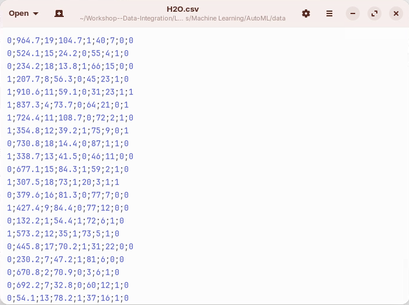
<figcaption>H2O.csv: nine values per line, no header</figcaption>
</figure>
</div>

> **Success:** Checkpoint: no header line, and nine semicolon-separated values per line. The first line is `0;964.7;19;104.7;1;40;7;0;0`: the same customer as the previews, with its flags as numbers.

### 5. AutoML in Colab

> **Note:**
>
> #### H2O AutoML in Colab
>
> A data scientist with a new data set usually starts by getting a feel for it: summary statistics, a few charts, and quick tests of how each field relates to the target, here `reported_as_fraud_historic`. Then come quick tests with common classification algorithms, to see which technique gives the best result. H2O AutoML does that last part for you: it trains and ranks several models and returns a leaderboard. Run the same steps one cell at a time in a Colab notebook, where you can see each result.

<div class="pcm-embed-card" data-href="https://www.loom.com/share/4a72fd0bf16446a7b7c742474ad242c0?hideEmbedTopBar=true&hide_owner=true&hide_share=true&hide_title=true" data-title="loom.com"></div>

1. Open Colab and sign in:

<div class="pcm-embed-card" data-href="https://colab.research.google.com/" data-title="colab.research.google.com"></div>

2. Select **Connect > Connect to a hosted runtime**.

<div align="center">
<figure>
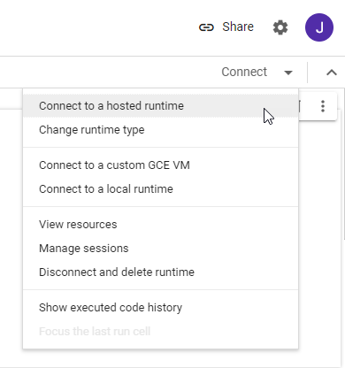
<figcaption>Connect to a hosted runtime</figcaption>
</figure>
</div>

3. Select **File > New notebook in Drive**. (If your instructor gave you the notebook, `credit_card_fraud.ipynb`, select **File > Upload notebook** and upload it instead: it holds the same cells.)

<div align="center">
<figure>
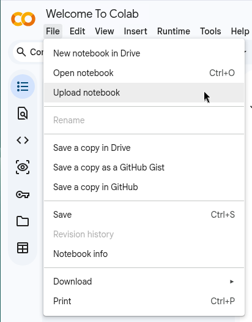
<figcaption>The File menu</figcaption>
</figure>
</div>

4. In the first cell, enter this code and press `Shift+Enter` to run it. `-q` keeps `pip` quiet:

   ```python
   # Install H2O
   !pip install h2o -q
   print("Installation complete.")
   ```

> **Success:** Checkpoint: the cell prints `Installation complete.`

5. In the next cell, import the libraries and start H2O, with up to 4 GB of memory (`max_mem_size='4G'`) and every CPU core (`nthreads=-1`). Run it:

   ```python
   # Import libraries
   import h2o
   from h2o.automl import H2OAutoML
   import pandas as pd
   import numpy as np
   from datetime import datetime
   import matplotlib.pyplot as plt
   import seaborn as sns

   # Initialize H2O
   h2o.init(max_mem_size='4G', nthreads=-1)
   print("\nH2O initialized.")
   ```

> **Success:** Checkpoint: H2O prints a table that describes its new cluster, then `H2O initialized.`

6. In the next cell, enter this code and run it. Colab shows a file upload widget: select `H2O.csv`, either the one your run wrote to `data` or the copy in **Lab Files**.

   ```python
   # Upload data
   from google.colab import files
   uploaded = files.upload()
   ```

<div align="center">
<figure>
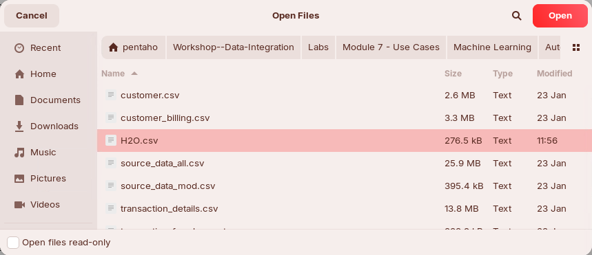
<figcaption>Choose H2O.csv</figcaption>
</figure>
</div>

> **Success:** Checkpoint: the cell prints `Saving H2O.csv to H2O.csv`.

7. In the next cell, load the file and name its columns. The file has no header and uses `;` as its separator, and the target, `reported_as_fraud_historic` in PDI, is named `fraud` here and converted to text, which H2O treats as classes. Run it:

   ```python
   # Load data
   data = pd.read_csv('H2O.csv', sep=';', engine='python', header=None)

   data.columns = [
       'first_time_customer', 'order_dollar_amount', 'num_items', 'age',
       'web_order', 'total_transactions', 'hour_of_day',
       'billing_shipping_match', 'fraud'
   ]

   # Convert target to string
   data['fraud'] = data['fraud'].astype(str)

   print(f"Dataset: {data.shape[0]:,} rows × {data.shape[1]} columns")
   print(f"Fraud cases: {(data['fraud']=='1').sum():,} ({(data['fraud']=='1').mean()*100:.2f}%)")
   ```

> **Success:** Checkpoint: with the `H2O.csv` from **Lab Files**, the cell prints `Dataset: 9,999 rows × 9 columns` and `Fraud cases: 2,623 (26.23%)`.

The eight features: `first_time_customer` (a first order), `order_dollar_amount`, `num_items` (items in the order), `age` (the customer's age), `web_order` (online, not by phone), `total_transactions` (the customer's history), `hour_of_day` (when the order came in) and `billing_shipping_match` (the zip code flag). `fraud` is the target: `0` for a legitimate order, `1` for fraud.

8. In the next cell, chart how many rows each class has. Run it:

   ```python
   # Quick class distribution check
   fraud_dist = data['fraud'].value_counts()

   plt.figure(figsize=(10, 4))
   fraud_dist.plot(kind='bar', color=['green', 'red'])
   plt.title('Class Distribution', fontweight='bold')
   plt.xlabel('Class (0=Normal, 1=Fraud)')
   plt.ylabel('Count')
   plt.xticks([0, 1], ['Normal', 'Fraud'], rotation=0)
   for i, v in enumerate(fraud_dist):
       plt.text(i, v + 50, f'{v:,}', ha='center', fontweight='bold')
   plt.tight_layout()
   plt.show()
   ```

> **Success:** Checkpoint: a bar chart titled **Class Distribution**. With the **Lab Files** copy, the green **Normal** bar is labeled `7,376` and the red **Fraud** bar `2,623`.

The chart shows how imbalanced the classes are. This teaching set is about one quarter fraud; real card data usually has far fewer fraud cases, which is why the AutoML run sets `balance_classes=True`.

9. In the next cell, move the data into H2O, mark `fraud` as a class label (a *factor*), so H2O trains a classifier and not a regression, and split the rows 75% for training and 25% for testing. `seed=42` makes the split the same every time you run it. Run it:

   ```python
   # Convert to H2O frame
   hf = h2o.H2OFrame(data)
   hf['fraud'] = hf['fraud'].asfactor()

   # Split: 75% train, 25% test
   train, test = hf.split_frame(ratios=[0.75], seed=42)

   print(f"Training: {train.nrows:,} rows")
   print(f"Test:     {test.nrows:,} rows")

   # Define features and target
   x = train.columns
   x.remove('fraud')
   y = 'fraud'
   ```

> **Success:** Checkpoint: the cell prints the training and test row counts. They add up to the rows in the file, about three quarters and one quarter: H2O splits by probability, not by exact count.

10. In the next cell, run AutoML. It runs for up to 15 minutes:

   ```python
   # Fast configuration
   start_time = datetime.now()

   print("\nFAST H2O AutoML")
   print("="*70)
   print("Configuration:")
   print("  Max models: 5 (for speed)")
   print("  Max runtime: 15 minutes")
   print("  Algorithms: GBM, XGBoost, GLM, DRF, DeepLearning")
   print("  Balance classes: True")
   print("\nTraining...\n")

   aml = H2OAutoML(
       max_models=5,                   # Only 5 models for speed
       max_runtime_secs=900,           # 15 minutes max
       seed=42,
       balance_classes=True,           # Handle imbalanced data
       nfolds=5,                       # 5-fold CV
       sort_metric='AUC',

       # Best algorithms for fraud detection
       include_algos=[
           'GBM',           # Gradient Boosting (usually best)
           'XGBoost',       # Extreme Gradient Boosting
           'GLM',           # Generalized Linear Model (fast)
           'DRF',           # Distributed Random Forest (tree-based)
           'DeepLearning'   # Neural Network
       ],

       verbosity='info'
   )

   # Train
   aml.train(x=x, y=y, training_frame=train)

   duration = (datetime.now() - start_time).total_seconds()
   print(f"\nTraining completed in {duration/60:.1f} minutes.")
   print("="*70)
   ```

> **Success:** Checkpoint: H2O logs each model as it trains, and the cell ends with `Training completed in` and the number of minutes.

The settings:

| Setting | Effect |
| --- | --- |
| `max_models=5` | Trains at most five models, to keep the run short |
| `max_runtime_secs=900` | Stops after 15 minutes |
| `balance_classes=True` | Balances the classes while training, for imbalanced data |
| `nfolds=5` | Scores each model with 5-fold cross-validation |
| `sort_metric='AUC'` | Ranks the models by AUC |

The five algorithms:

| Algorithm | What it is |
| --- | --- |
| GBM (Gradient Boosting Machine) | Trees built one after another, each correcting the errors of the ones before; H2O's own implementation |
| XGBoost | Another gradient boosting implementation, widely used for tabular data |
| GLM (Generalized Linear Model) | A fast baseline with coefficients you can read |
| DRF (Distributed Random Forest) | Many decision trees trained independently, their votes combined |
| DeepLearning | A neural network |

GBM, XGBoost and DRF each combine many trees, so a single decision tree is not among the candidates.

11. In the next cell, show the leaderboard. Run it:

   ```python
   # View leaderboard
   lb = aml.leaderboard
   print("\n ALL MODELS RANKED BY PERFORMANCE")
   print("="*70)
   print(lb)
   print("="*70)
   print(f"\n Total models trained: {lb.nrows}")
   print(f"Best model: {lb.as_data_frame()['model_id'][0]}")
   ```

> **Success:** Checkpoint: a table with one row per model, best first. Its columns include the model ID, **AUC**, **AUCPR** (the area under the precision-recall curve), the mean per-class error, and the error measures RMSE and MSE. The cell ends with the number of models and the best model's ID.

For imbalanced classes, AUCPR is often a better guide than AUC: see the metrics cheat sheet under these tabs.

12. In the next cell, score the best model on the test rows. Run it:

   ```python
   # Get best model
   best = aml.leader

   print(f"\n BEST MODEL: {best.model_id}")
   print(f"Algorithm: {best.algo}")

   # Performance on test set
   perf = best.model_performance(test)

   print("\n TEST SET PERFORMANCE")
   print("="*70)
   print(f"AUC:       {perf.auc():.4f}")
   print(f"Accuracy:  {perf.accuracy()[0][1]:.4f}")
   print(f"Precision: {perf.precision()[0][1]:.4f}")
   print(f"Recall:    {perf.recall()[0][1]:.4f}")
   print(f"F1 Score:  {perf.F1()[0][1]:.4f}")
   print("="*70)
   ```

> **Success:** Checkpoint: the best model's ID and algorithm, then five measures between 0 and 1: AUC, accuracy, precision, recall and F1 score.

What they measure, for fraud:

* **AUC**: how well the model ranks fraud above legitimate orders, over all thresholds.
* **Accuracy**: the share of rows it gets right. It can be high on imbalanced data even when the model misses every fraud case.
* **Precision**: of the orders it flags, the share that are fraud. Higher precision means fewer false alarms.
* **Recall**: of all fraud cases, the share it catches. Higher recall means less missed fraud.
* **F1 score**: a balance of precision and recall.

13. In the next cell, show the confusion matrix. Run it:

   ```python
   # Confusion matrix
   cm = perf.confusion_matrix()
   print("\n CONFUSION MATRIX")
   print("="*70)
   print(cm)
   print("="*70)

   # Extract values
   cm_table = cm.table.as_data_frame()
   try:
       tn = int(cm_table.iloc[0, 1])
       fp = int(cm_table.iloc[0, 2])
       fn = int(cm_table.iloc[1, 1])
       tp = int(cm_table.iloc[1, 2])

       print("\n BREAKDOWN")
       print(f"True Negatives:  {tn:>6,}")
       print(f"False Positives: {fp:>6,}")
       print(f"False Negatives: {fn:>6,} (missed fraud)")
       print(f"True Positives:  {tp:>6,}")
       print(f"\nCaught {tp} fraud cases, missed {fn}.")
   except:
       print("See confusion matrix table above")
   ```

> **Success:** Checkpoint: a two-by-two table of actual against predicted classes, the four counts, and a line that starts `Caught`.

A false negative is fraud that got through: a direct loss. A false positive is a legitimate order declined: friction for a real customer. Where to strike the balance depends on what each costs the business.

14. In the next cell, list and plot the features that matter most to the model. Run it:

   ```python
   # Top features
   varimp = best.varimp(use_pandas=True)
   print("\n TOP FEATURES")
   print("="*70)
   print(varimp.head(10))
   print("="*70)

   # Plot
   best.varimp_plot()
   ```

> **Success:** Checkpoint: a table of the eight features, most important first, and a bar chart of the same.

Feature importance explains what drives the predictions, shows where more feature engineering would pay off, and lets you check that the model relies on fields that make business sense.

15. In the next cell, save the best model and download it. The file is an H2O model, which you can load back into H2O; exporting a MOJO for low-latency scoring, or PMML, is a separate step. Run it:

   ```python
   model_path = h2o.save_model(model=best, path="./", force=True)
   files.download(model_path)
   ```

> **Success:** Checkpoint: your browser downloads a file named after the best model's ID.

16. In the last cell, write a summary for the record and download it. Run it:

   ```python
   # Generate summary
   report = f"""
   FRAUD DETECTION - QUICK SUMMARY
   {'='*60}

   Date: {datetime.now().strftime('%Y-%m-%d %H:%M:%S')}

   Dataset:
     Total:     {len(data):,}
     Training:  {train.nrows:,}
     Test:      {test.nrows:,}

   Model:
     Best:      {best.model_id}
     Algorithm: {best.algo}
     Training:  {duration/60:.1f} minutes

   Performance:
     AUC:       {perf.auc():.4f}
     Accuracy:  {perf.accuracy()[0][1]:.4f}
     Precision: {perf.precision()[0][1]:.4f}
     Recall:    {perf.recall()[0][1]:.4f}
     F1:        {perf.F1()[0][1]:.4f}

   Model saved: {model_path}

   {'='*60}
   """

   print(report)

   # Save report
   with open('fraud_summary.txt', 'w') as f:
       f.write(report)

   files.download('fraud_summary.txt')
   print("Summary downloaded.")
   ```

> **Success:** Checkpoint: the summary prints, your browser downloads `fraud_summary.txt`, and the cell ends with `Summary downloaded.`

A summary like this serves model tracking, reports to stakeholders, comparisons between experiments and audit trails. Once the notebook gives you the answers you need, move the logic into PDI, as the **auto machine learning** step does, and use the leaderboard to decide which algorithm to put into production.

### 6. GBM

> **Note:**
>
> #### Gradient Boosting Machine
>
> A Gradient Boosting Machine (GBM) builds a series of small decision trees one after another, each one focused on the errors of the trees before it. Its prediction is the weighted sum of all the trees. For fraud, it can capture patterns that combine several fields, such as an unusual amount at an unusual hour, which simple rules miss, and it ranks the features by importance, so investigators can see what drives a score. The [Credit Card](../04-credit-card/guide.md) workshop trains a GBM model in R; this tab installs the R package it uses.

<div align="center">
<figure>
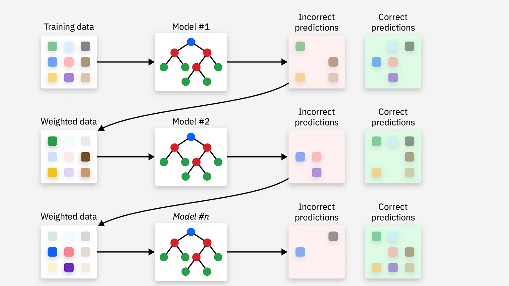
<figcaption>Each model concentrates on what the models before it got wrong</figcaption>
</figure>
</div>

How the training proceeds:

* **Start with a baseline.** The first prediction is simple, often the average of the target.
* **Measure the errors.** The differences between that prediction and the actual values are the *residuals*.
* **Fit a small tree to the errors.** A shallow decision tree learns the pattern in what the model got wrong, not the original target.
* **Update the prediction.** The new tree's output is added, scaled down by a *learning rate* (a small number such as 0.1) so that no single tree overcorrects: new prediction = old prediction + (learning rate × new tree's output).
* **Repeat.** Measuring, fitting and updating run hundreds or thousands of times, and each tree corrects a little more of the remaining error.

The "gradient" in the name comes from *gradient descent*: the residuals each tree fits are the negative gradients of a loss function, such as log-loss for classification. Early trees tend to learn broad patterns (very large orders are riskier); later ones pick up finer signals.

**Install GBM**

1. In a terminal, install the `gbm` package from CRAN:

   ```bash
   sudo R -e "install.packages('gbm', repos='https://cran.r-project.org')"
   ```

<div align="center">
<figure>
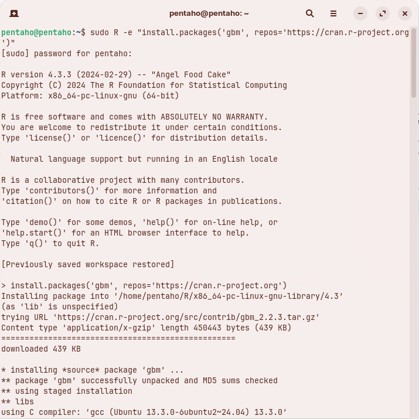
<figcaption>R downloads and compiles gbm</figcaption>
</figure>
</div>

> **Success:** Checkpoint: R downloads the `gbm` source package, compiles it, and ends with `* DONE (gbm)`.

2. Check that R can load it:

   ```bash
   R -e "library(gbm); cat('GBM loaded successfully\n')"
   ```

> **Success:** Checkpoint: R prints `GBM loaded successfully`.

::::

<details>

<summary>Metrics cheat sheet (fraud detection)</summary>

Use these metrics to compare models and to pick a decision threshold. Fraud data is usually imbalanced: far fewer fraud cases than legitimate ones.

#### What to look at first

* **AUCPR**: the best single number for imbalanced classification.
* **Recall**: how much fraud you catch (fewer false negatives).
* **Precision**: how many alerts are real fraud (fewer false positives).

#### AUC as a second opinion

**AUC** measures how well the model ranks fraud above legitimate transactions. It can look good even when precision is poor at the thresholds you would use.

#### Why accuracy is a trap

If fraud is 1% of transactions, a model that predicts "legitimate" for every row is 99% accurate and useless.

#### Practical selection guide

* If fraud losses are expensive, prioritize **recall**.
* If customer friction is expensive, prioritize **precision**.
* Use **AUCPR** to compare candidates before you tune thresholds.

#### What to ignore (most of the time)

* **RMSE/MSE**: regression-style errors on probabilities. They don't help you decide.

</details>

## Lab Files

Click a file to download. For `.ktr` and `.kjb` files, **Open in Pentaho Data Integration** launches PDI with the file loaded. If PDI is already running, the path is copied to your clipboard — switch to PDI and press `Ctrl+O`, `Ctrl+V`, `Enter`.

The four source files, 100,000 rows each:

[customer.csv](./files/customer.csv)

[customer_billing.csv](./files/customer_billing.csv)

[transaction_details.csv](./files/transaction_details.csv)

[transaction_fraud_report.csv](./files/transaction_fraud_report.csv)

`H2O.csv` is a ready-made training set in the layout **tfo-H2O** writes: 9,999 rows, no header line. Upload it to Colab if you have not run the transformation:

[H2O.csv](./files/H2O.csv)

`source_data_mod.csv` is an older, pre-joined sample of 1,500 orders. No transformation in this course reads it:

[source_data_mod.csv](./files/source_data_mod.csv)

### Solution <!-- no-step -->

The finished transformation for this lab. Open it alongside your own to compare, or run it to see the expected result. It reads the four source files from a `data` folder next to it, and writes `data/H2O.csv` there: before you run it, create `data` in the solution folder and copy the four source files into it.

Also on disk at `C:\Workshop-ML-Specialty\02-machine-learning\03-automl\solution`.

[autoML.ktr](./files/autoML.ktr) <button data-launch="spoon" data-path="files/autoML.ktr">Open in Pentaho Data Integration</button> <button data-graph="files/autoML.ktr">View graph</button>

`test_r.ktr` is the validation transformation from [Prerequisite Tasks](../02-prerequisite-tasks/guide.md):

[test_r.ktr](./files/test_r.ktr) <button data-launch="spoon" data-path="files/test_r.ktr">Open in Pentaho Data Integration</button> <button data-graph="files/test_r.ktr">View graph</button>
