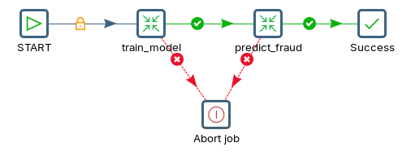
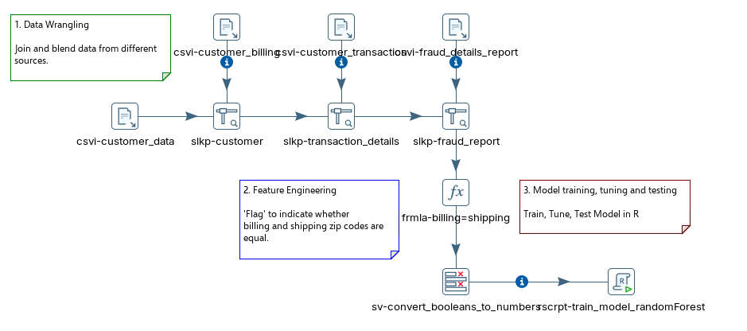
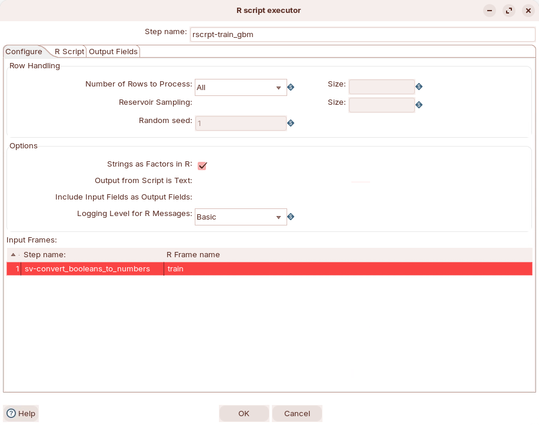
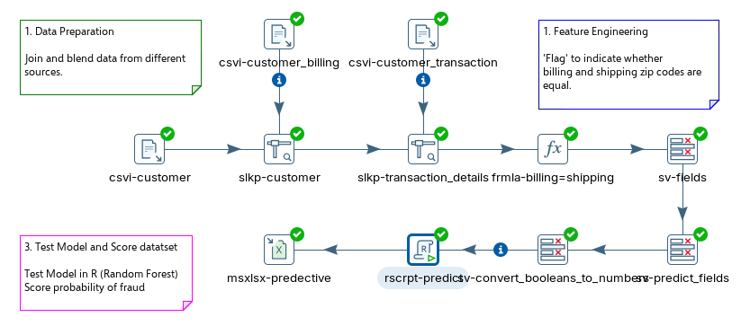
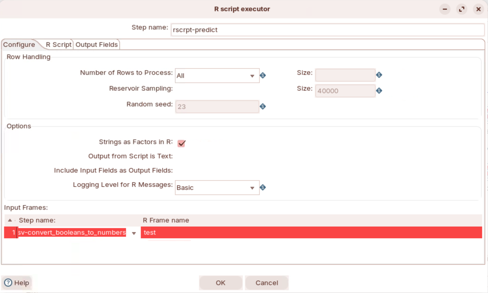
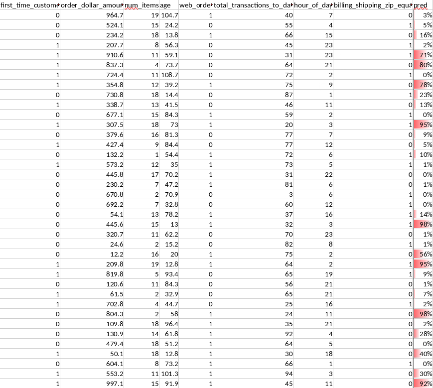

# Credit Card

> **Warning:**
>
> #### Workshop - Credit Card
>
> The H2O results in [AutoML](../03-automl/guide.md) point to a Gradient Boosting Machine (GBM). Put that choice into practice in Pentaho Data Integration: one transformation trains a GBM model in R with the `gbm` package and saves it, a second loads the model and scores every transaction with a fraud probability, and a job runs the two in order.
>
> **What you'll do**
>
> * Open the main job and the two transformations it runs
> * Configure an **R script executor** step that trains a GBM model and saves it to a file
> * Configure a second one that loads the model and scores the transactions
> * Run the job and read the scored file
>
> **Prerequisites:** R and rJava working in Spoon, from [Prerequisite Tasks](../02-prerequisite-tasks/guide.md), and the R `gbm` package, from the **GBM** tab of [AutoML](../03-automl/guide.md)
>
> **Estimated time:** 20 minutes

**🎥 Embed:** [Walkthrough (video)](<https://www.loom.com/share/9da8c5b2d19245a780b402abbde5f00c?hideEmbedTopBar=true&hide_owner=true&hide_share=true&hide_title=true>)

<div align="center">
<figure>

<figcaption>What you run: train, then predict</figcaption>
</figure>
</div>

:::: tabs

### 1. Set Up

> **Note:**
>
> #### Set up the lab folder
>
> The job and both transformations find their files through the folder they are saved in: the job through `${Internal.Entry.Current.Directory}`, the transformations through `${Internal.Transformation.Filename.Directory}`. Keep the data, the job and the transformations in one folder, and give the model a folder to be saved in.

1. Start Spoon with the **Start Pentaho Data Integration** button below, or from a terminal:

::: tabs

### Windows (PowerShell)

```powershell
Set-Location C:\Pentaho\design-tools\data-integration
.\spoon.bat
```

### macOS / Linux

```bash
cd ~/Pentaho/design-tools/data-integration
./spoon.sh
```

:::

<button data-launch="spoon" data-path="">Start Pentaho Data Integration</button>

2. Copy `transaction_fraud_report.csv` from the AutoML lab's folder, `C:\Workshop-ML-Specialty\02-machine-learning\03-automl`, into this lab's folder, `C:\Workshop-ML-Specialty\02-machine-learning\04-credit-card`. The training transformation reads it, and this lab doesn't ship it. (On your own machine, download this lab's files from **Lab Files** below, and `transaction_fraud_report.csv` from the AutoML lab's, into one folder.)
3. In the same folder, create a folder named `train_model_output`. The training script saves the model there, and R doesn't create the folder for you.
4. Select **File > Open** (`Ctrl+O`) and open `jb_fraud_main_job.kjb` from this lab's folder.

> **Success:** Checkpoint: Spoon shows the job: **START**, **train_model**, **predict_fraud** and **Success** in a row, and a red hop from **train_model** and from **predict_fraud** to **Abort job**.

### 2. Train the Model

> **Note:**
>
> #### Train the model
>
> **train_model** runs `tr_train_model_fraud.ktr`. Like the AutoML transformation, it joins the four files with **Stream lookup** steps, adds the zip code match flag and turns the flags into numbers, but it reads all 100,000 customers. Then an **R script executor** step trains the GBM model and saves it.

1. Right-click **train_model** and select **Open Referenced Object > Transformation**.

<div align="center">
<figure>

<figcaption>The training transformation (an earlier capture: the R step is now rscrpt-train_gbm, and the transaction input csv fi: customer transaction)</figcaption>
</figure>
</div>

The steps before the R step prepare the data:

| Step | Type | What it does |
| --- | --- | --- |
| **csvi-customer_data** | CSV file input | Reads `customer.csv` |
| **csvi-customer_billing** | CSV file input | Reads `customer_billing.csv` |
| **csv fi: customer transaction** | CSV file input | Reads `transaction_details.csv` |
| **csvi-fraud_details_report** | CSV file input | Reads `transaction_fraud_report.csv`, trimming the space before each `transaction_id` |
| **slkp-customer** | Stream lookup | Adds `transaction_id`, `card_number` and `expiry_date` by `customer_id` |
| **slkp-transaction_details** | Stream lookup | Adds the 17 order fields by `transaction_id` and `customer_id` |
| **slkp-fraud_report** | Stream lookup | Adds `reported_as_fraud_historic` by `transaction_id` |
| **frmla-billing=shipping** | Formula | Sets `billing_shipping_zip_equal` to `[customer_billing_zip] = [ship_to_zip]`, a Boolean |
| **sv-convert_booleans_to_numbers** | Select values | Keeps the eight features and `reported_as_fraud_historic`, and turns the four Boolean flags into Numbers |

> **Warning:** The transformation also holds two steps with no hops: **input - customer_billing**, a **Table input** on the PostgreSQL connection `postgres_demo`, and **input - transaction_details**, a **MongoDB input**. Pentaho Data Integration starts every step in a transformation, hopped or not, so both try to reach a database server on `localhost`. Delete them unless you have both servers with the lab's data.

2. Right-click **input - customer_billing** and select **Delete**.
3. Right-click **input - transaction_details** and select **Delete**.
4. Double-click **rscrpt-train_gbm**.
5. On the **Configure** tab, set **Number of Rows to Process** to `All`, select **Strings as Factors in R**, and set **Logging Level for R Messages** to `Basic`. Leave **Reservoir Sampling**, **Output from Script is Text** and **Include Input Fields as Output Fields** cleared.
6. Fill the **Input Frames** grid with one row:

| Step name                        | R Frame name |
| -------------------------------- | ------------ |
| `sv-convert_booleans_to_numbers` | `train`      |

<div align="center">
<figure>

<figcaption>All rows, as one R data frame named train</figcaption>
</figure>
</div>

7. Open the **R Script** tab. **Manual R Script** holds this script in the file you opened; enter it if the box is empty:

   ```r
   # ============================================================
   # GBM Model Training - Credit Card Fraud Detection
   # ============================================================
   # This script trains a Gradient Boosting Machine (GBM) model
   # to predict fraudulent credit card transactions.
   # It runs inside the PDI R Script Executor step.
   # ============================================================

   # Load the GBM library for gradient boosting
   library(gbm)

   # Convert the incoming PDI data frame ("train") to a standard R data frame
   # The "train" variable is automatically created by the R Script Executor
   # from the input step: sv-convert_booleans_to_numbers
   train.df <- as.data.frame(train)

   # Convert the target variable to binary 0/1
   # as.factor() creates levels, as.numeric() assigns 1 and 2, then subtract 1
   # Result: 0 = not fraud, 1 = fraud
   train.df$reported_as_fraud_historic <- as.numeric(
     as.factor(train.df$reported_as_fraud_historic)
   ) - 1

   # Train the GBM model
   # --------------------------------------------------------
   # Note: We use OOB (out-of-bag) estimation instead of
   # cross-validation (cv.folds) because JRI runs R inside
   # the JVM process. Cross-validation spawns additional
   # processes that exceed the FD_SETSIZE limit (1024) in
   # Linux's select() system call, causing the JVM to abort.
   # --------------------------------------------------------
   gbm_model <- gbm(
     reported_as_fraud_historic ~ .,   # predict fraud using all other columns
     data = train.df,                  # training data
     distribution = "bernoulli",       # binary classification (fraud yes/no)
     n.trees = 500,                    # number of boosting iterations
     interaction.depth = 4,            # max depth of each tree
     shrinkage = 0.01,                 # learning rate (smaller = more robust)
     n.minobsinnode = 10,              # min observations per terminal node
     bag.fraction = 0.5                # use 50% of data per tree (stochastic GBM)
   )

   # Determine the optimal number of trees using OOB error
   # This avoids overfitting by finding where performance plateaus
   best_trees <- gbm.perf(gbm_model, method = "OOB")

   # Save the trained model and optimal tree count to disk
   # The predict transformation will load this file to score new transactions
   save(gbm_model, best_trees,
     file = "${Internal.Transformation.Filename.Directory}/train_model_output/gbm_fraud.rdata"
   )

   # Return a status message to PDI
   # The R Script Executor expects a data frame as output
   ok <- "Finished"
   ok.df <- as.data.frame(ok)
   ok.df
   ```

The model trains on every other column to predict `reported_as_fraud_historic`:

| Setting | Value | Meaning |
| --- | --- | --- |
| `distribution` | `"bernoulli"` | Two classes: fraud or not |
| `n.trees` | `500` | Boosting iterations, one tree each |
| `interaction.depth` | `4` | Maximum depth of each tree |
| `shrinkage` | `0.01` | The learning rate |
| `n.minobsinnode` | `10` | Fewest rows in a leaf |
| `bag.fraction` | `0.5` | Each tree sees a random half of the rows |

`gbm.perf(..., method = "OOB")` then picks the number of trees from the out-of-bag error, and `save()` writes the model and that number to `train_model_output/gbm_fraud.rdata`, next to the transformation.

8. Open the **Output Fields** tab and fill the **Output Fields** grid with one row: **Name** `ok`, **Type** `String`.
9. Select **OK**, and save the transformation (`Ctrl+S`).

> **Under the hood:**
>
> #### All the rows went to R as one data frame, and one status row came back
>
> With **Number of Rows to Process** set to `All`, the step collects every
> row from **sv-convert_booleans_to_numbers**, pushes them into R as one
> data frame named after the **R Frame name**, `train`, and runs the
> script once. The step's output is whatever data frame the script's
> last statement names: here `ok.df`, one row with the value `Finished`.
> The model itself leaves R through `save()`, as a file.
>
> **Why it matters:** `gbm` needs the whole training set at once, which
> **All** gives it. And because the model travels as a file, not as rows,
> the predict transformation can run later, or on another schedule, and
> still load the same model.

### 3. Predict Fraud

> **Note:**
>
> #### Predict fraud
>
> **predict_fraud** runs `tr_predict_fraud.ktr`. It joins the customer, billing and transaction files the same way, without the fraud report, and converts the flags. Then R loads the saved model and scores each transaction with a fraud probability, and **Predict Fraud** writes the scores to a CSV file.

1. Select the **jb_fraud_main_job** tab, right-click **predict_fraud**, and select **Open Referenced Object > Transformation**.

<div align="center">
<figure>

<figcaption>The predict transformation (an earlier capture: the output step is now Predict Fraud, a Text file output)</figcaption>
</figure>
</div>

The steps before the R step:

| Step | Type | What it does |
| --- | --- | --- |
| **csvi-customer**, **csvi-customer_billing**, **csvi-customer_transaction** | CSV file input | Read `customer.csv`, `customer_billing.csv` and `transaction_details.csv` |
| **slkp-customer**, **slkp-transaction_details** | Stream lookup | Join them, as in the training transformation |
| **frmla-billing=shipping** | Formula | Adds `billing_shipping_zip_equal` |
| **sv-fields** | Select values | Keeps 23 fields; `billing_shipping_zip_equal` becomes a Boolean, and `card_number`, `expiry_date`, `ship_to_zip` and `customer_billing_zip` Numbers |
| **sv-predict_fields** | Select values | Sets `web_order` and `first_time_customer` to Boolean |
| **sv-convert_booleans_to_numbers** | Select values | Keeps the eight features and turns the three flags into Numbers |

2. This transformation has the same two steps with no hops. Right-click **input - customer_billing** and select **Delete**.
3. Right-click **input - transaction_details** and select **Delete**.
4. Double-click **rscrpt-predict**.
5. On the **Configure** tab, set **Number of Rows to Process** to `All`, select **Strings as Factors in R**, and set **Logging Level for R Messages** to `Basic`. Leave **Reservoir Sampling**, **Output from Script is Text** and **Include Input Fields as Output Fields** cleared.
6. Fill the **Input Frames** grid with one row:

| Step name                        | R Frame name |
| -------------------------------- | ------------ |
| `sv-convert_booleans_to_numbers` | `test`       |

<div align="center">
<figure>

<figcaption>The scoring rows arrive as a data frame named test (Reservoir Sampling is off, so its size and seed are unused)</figcaption>
</figure>
</div>

7. Open the **R Script** tab. **Manual R Script** holds this script; enter it if the box is empty:

   ```r
   # ============================================================
   # GBM Prediction - Credit Card Fraud Detection
   # ============================================================
   # This script loads the trained GBM model and scores new
   # transactions with a fraud probability (0 to 1).
   # It runs inside the PDI R Script Executor step.
   # ============================================================

   # Load the GBM library
   library(gbm)

   # Convert the incoming PDI data frame ("test") to a standard R data frame
   # The "test" variable is automatically created by the R Script Executor
   # from the input step: sv-convert_booleans_to_numbers
   test.df <- as.data.frame(test)

   # Load the trained model artifact saved during the training step
   # This file contains: gbm_model (the trained model) and best_trees (optimal tree count)
   load(file = "${Internal.Transformation.Filename.Directory}/train_model_output/gbm_fraud.rdata")

   # ============================================================
   # Score each transaction with a fraud probability
   # ============================================================
   # type = "response" returns probabilities on the 0..1 scale
   # (since the model was trained with distribution = "bernoulli")
   # Values closer to 1 indicate higher likelihood of fraud
   fraud_prob <- predict(
     gbm_model,
     newdata = test.df,
     n.trees = best_trees,
     type = "response"
   )

   # ============================================================
   # Build the output data frame
   # ============================================================
   # fraud_probability  : raw probability from the model (0 to 1)
   # fraud_pct          : probability as a percentage for readability
   # predicted_fraud    : binary flag using a 50% decision threshold
   #                      adjust threshold based on business rules
   #                      (e.g., 0.3 for more aggressive fraud catching)
   pred.df <- data.frame(
     fraud_probability = fraud_prob,
     fraud_pct         = round(fraud_prob * 100, 2),
     predicted_fraud   = ifelse(fraud_prob >= 0.5, 1, 0)
   )

   # Combine the original test data with the predictions
   # This preserves all input fields so downstream PDI steps
   # can filter, sort, or write results with full context
   submission <- cbind(test.df, pred.df)

   # Return the combined data frame to PDI
   submission
   ```

The model returns a probability; `predicted_fraud` turns it into a flag at a threshold of 0.5. Lower the threshold, to 0.3 for example, to catch more fraud at the cost of more false alarms.

8. Open the **Output Fields** tab and fill the **Output Fields** grid. Every field is a **Number**:

| Name                         | Type   |
| ---------------------------- | ------ |
| `first_time_customer`        | Number |
| `order_dollar_amount`        | Number |
| `num_items`                  | Number |
| `age`                        | Number |
| `web_order`                  | Number |
| `total_transactions_to_date` | Number |
| `hour_of_day`                | Number |
| `billing_shipping_zip_equal` | Number |
| `fraud_probability`          | Number |
| `fraud_pct`                  | Number |
| `predicted_fraud`            | Number |

9. Select **OK**.
10. Double-click **Predict Fraud**, a **Text file output** step. On the **File** tab, check that **Filename** is `${Internal.Entry.Current.Directory}/output/credit_card_fraud` and **Extension** is `csv`, and that **Create Parent folder** and **Include time in filename?** are selected. On the **Content** tab, check that **Separator** is `,` and **Header** is selected. The **Fields** tab is empty, so the step writes every field it receives.
11. Select **OK**, and save the transformation (`Ctrl+S`).

### 4. Run and Results

> **Note:**
>
> #### Run the job
>
> Run the job: it trains the model, then scores the transactions with it.

1. Select the **jb_fraud_main_job** tab.
2. Press `F9` (**Action > Run**), and select **Run** in the **Run Options** dialog.

> **Under the hood:**
>
> #### The job ran predict_fraud only because train_model succeeded
>
> The hop from **START** to **train_model** is unconditional. The two
> green hops are evaluated: the job follows them only when the entry
> before them ends without errors. The two red hops are followed only on
> failure, and lead to **Abort job**. Each transformation entry waits for
> its transformation to finish, so **predict_fraud** starts after the
> model file is written.
>
> **Why it matters:** a failed training run never feeds a stale or
> half-written model to the scoring step, and the job's result says
> which part failed.

3. When the job finishes, open the **Job metrics** tab in **Execution Results**.

> **Success:** Checkpoint: **train_model** and **predict_fraud** both succeed and the job ends at **Success**; **Abort job** doesn't run.

4. In the lab folder, open the `output` folder and open the newest `credit_card_fraud_<HHmmss>.csv` in a text editor or a spreadsheet. **Predict Fraud** adds the time of the run, `<HHmmss>`, to the name.

<div align="center">
<figure>

<figcaption>Fraud prediction, from an earlier version of the script that wrote a single <code>pred</code> column</figcaption>
</figure>
</div>

> **Success:** Checkpoint: a header line, then one row for each transaction the job scored, with 11 columns: the eight model inputs from `first_time_customer` to `billing_shipping_zip_equal`, then `fraud_probability` (0 to 1), `fraud_pct` (the same as a percentage, rounded to two decimals) and `predicted_fraud` (`1` when the probability is 0.5 or more, `0` otherwise).

The scored rows can drive further work: for example, a **Filter rows** step on `predicted_fraud` could route likely fraud to a review queue.

::::

## Troubleshooting <!-- no-step -->

<details>
<summary>R reports that there is no package called gbm</summary>

Install `gbm` as the **GBM** tab of [AutoML](../03-automl/guide.md) shows, then run the job again.

</details>

<details>
<summary>The R step fails to save or load gbm_fraud.rdata</summary>

Create the `train_model_output` folder next to the transformations: R's `save()` writes into an existing folder only. The predict step loads the file the training step saved, so run the whole job, not **predict_fraud** alone.

</details>

<details>
<summary>A CSV file input step can't find transaction_fraud_report.csv</summary>

Copy it from the AutoML lab's folder into the folder that holds the transformations.

</details>

<details>
<summary>Errors connecting to PostgreSQL or MongoDB</summary>

The steps **input - customer_billing** and **input - transaction_details** are still in a transformation. Delete them: nothing reads their rows.

</details>

## Lab Files

Click a file to download. For `.ktr` and `.kjb` files, **Open in Pentaho Data Integration** launches Pentaho Data Integration with the file loaded. If Pentaho Data Integration is already running, the path is copied to your clipboard — switch to Pentaho Data Integration and press `Ctrl+O`, `Ctrl+V`, `Enter`.

The data, the same files as the AutoML lab's, 100,000 rows each. The training transformation also reads `transaction_fraud_report.csv`, from the **Lab Files** of [AutoML](../03-automl/guide.md):

[customer.csv](./files/customer.csv)

[customer_billing.csv](./files/customer_billing.csv)

[transaction_details.csv](./files/transaction_details.csv)

The job and the two transformations it runs, ready to open:

[jb_fraud_main_job.kjb](./files/jb_fraud_main_job.kjb) <button data-launch="spoon" data-path="files/jb_fraud_main_job.kjb">Open in Pentaho Data Integration</button> <button data-graph="files/jb_fraud_main_job.kjb">View graph</button>

[tr_train_model_fraud.ktr](./files/tr_train_model_fraud.ktr) <button data-launch="spoon" data-path="files/tr_train_model_fraud.ktr">Open in Pentaho Data Integration</button> <button data-graph="files/tr_train_model_fraud.ktr">View graph</button>

[tr_predict_fraud.ktr](./files/tr_predict_fraud.ktr) <button data-launch="spoon" data-path="files/tr_predict_fraud.ktr">Open in Pentaho Data Integration</button> <button data-graph="files/tr_predict_fraud.ktr">View graph</button>

### Solution <!-- no-step -->

The finished job and transformations for this lab. Open them alongside your own to compare, or run the job to see the expected result.

Also on disk at `C:\Workshop-ML-Specialty\02-machine-learning\04-credit-card\solution`.

[jb_fraud_main_job.kjb](./files/solution/jb_fraud_main_job.kjb) <button data-launch="spoon" data-path="files/solution/jb_fraud_main_job.kjb">Open in Pentaho Data Integration</button> <button data-graph="files/solution/jb_fraud_main_job.kjb">View graph</button>

[tr_train_model_fraud.ktr](./files/solution/tr_train_model_fraud.ktr) <button data-launch="spoon" data-path="files/solution/tr_train_model_fraud.ktr">Open in Pentaho Data Integration</button> <button data-graph="files/solution/tr_train_model_fraud.ktr">View graph</button>

[tr_predict_fraud.ktr](./files/solution/tr_predict_fraud.ktr) <button data-launch="spoon" data-path="files/solution/tr_predict_fraud.ktr">Open in Pentaho Data Integration</button> <button data-graph="files/solution/tr_predict_fraud.ktr">View graph</button>
