# Credit Card

> **Warning:**
>
> #### Workshop - Credit Card
>
> AutoML convinced the fraud team: a Gradient Boosting Machine (GBM) separates fraud from genuine orders in Juniper & Vale's history. Now they want it every week. Their history holds 200,000 transactions, each with the fraud report's verdict; this week brought 10,000 new orders, in files of their own, and nobody knows yet which of them are fraud. The analysts want each of this week's orders scored before it ships, with the reason for the score, in the database their review screen reads.
>
> Build that in Pentaho Data Integration: one transformation trains a GBM with H2O in Python on the history and saves it; a second loads the model and scores this week's transactions; a job runs the two in order. Both make the model's features with one shared sub-transformation, so training and scoring can never make them differently.
>
> **What you'll do**
>
> * Open the main job and the transformations it runs
> * Train on the 200,000-transaction history, and score this week's 10,000 new orders from their own files
> * Write the scores with four copies of **Insert / Update** working in parallel
> * See how one sub-transformation, called through a **Mapping** step, makes the features for training and for scoring
> * Check the settings of a **Python Executor** step that trains a GBM model, measures it and saves it to a folder
> * Check a second one that scores the transactions and says why each score is what it is
> * Write the scores to MySQL with **Insert / Update**, safe to run twice
> * Run the job and read the scored file and table
>
> **Prerequisites:** [Prerequisite Tasks](../02-prerequisite-tasks/guide.md): the `h2o-env` virtual environment, MySQL with the `fraud` database, and the MySQL driver
>
> **Estimated time:** 1 hour

<figure>

<figcaption class="pcm-video-caption">Walkthrough: coming soon</figcaption>

</figure>

<div align="center">
<figure>
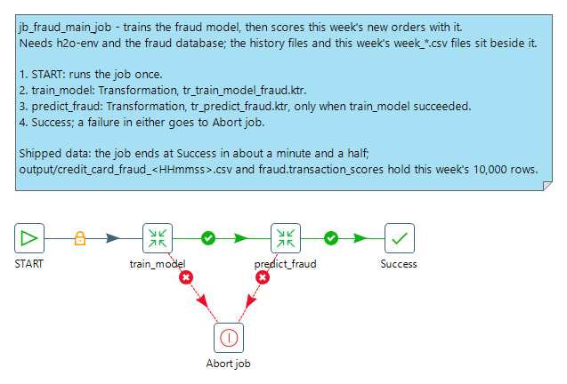
<figcaption>What you run: train, then predict</figcaption>
</figure>
</div>

<div align="center">
<figure>
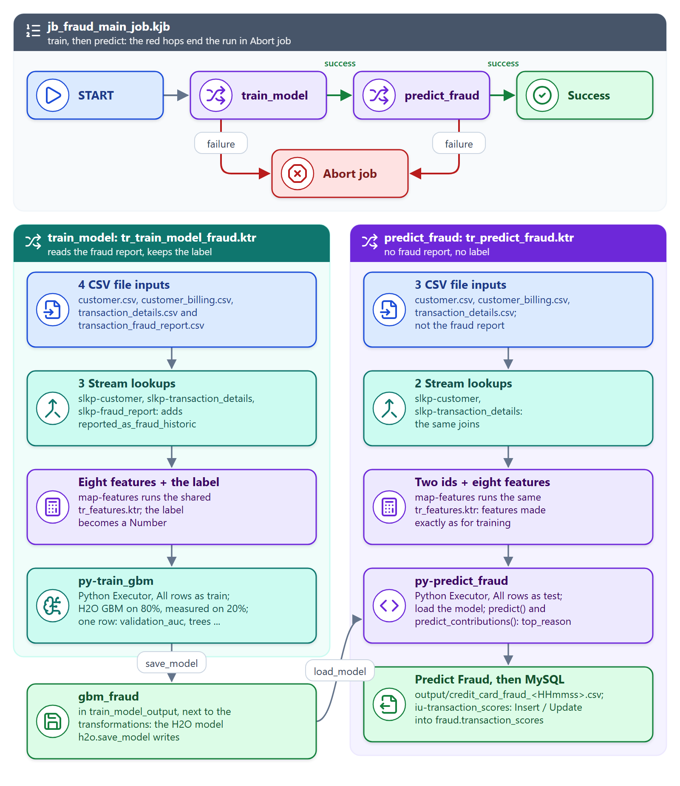
<figcaption>Two transformations, one model file: training saves it, prediction loads it</figcaption>
</figure>
</div>

Read the diagram from the job down. The job runs **train_model** first; only when it succeeds does the green hop start **predict_fraud**, and a failure in either one takes its red hop to **Abort job**. The two transformations underneath are built alike, row for row, with one difference: training also reads `transaction_fraud_report.csv` and keeps `reported_as_fraud_historic` as the label the model learns, from the history files; prediction has no label to read, and reads this week's files, `week_customer.csv`, `week_customer_billing.csv` and `week_transaction_details.csv`. Both run the same sub-transformation, `tr_features.ktr`, through a **Mapping** step to make the features. The model crosses between them as a file: `py-train_gbm` saves `gbm_fraud` in `train_model_output`, and `py-predict_fraud` loads it to score each transaction, then the scores go to a CSV file and to the MySQL table `fraud.transaction_scores`.

> **Note:**
>
> #### Why this lab uses Python, not R
>
> Earlier versions of this lab trained the model in R, with the **R script executor** step and the R `gbm` package. That step reaches R through JRI, a native library that comes with the R package rJava (`jri.dll` on Windows, `libjri.so` on Linux), and it runs R inside Spoon's own Java process. Keeping that working is now harder than the lab is worth:
>
> * **Windows has no current JRI.** From rJava 1.0-15 (March 2026), CRAN's Windows builds of rJava leave `jri.dll` out ([s-u/rJava#355](https://github.com/s-u/rJava/issues/355)), so the step cannot start R. The last Windows build that has it, rJava 1.0-11, was built against R 4.3.2 and stops on any other R with `R.DLL version does not match`. On R 4.5 and later it does not load at all, because `R.dll` no longer exports a function it needs (`EXTPTR_PTR`).
> * **Linux means compiling.** You build rJava from source with a JDK and compiler tools, and pick an rJava release that compiles against your R. Older rJava releases still call `EXTPTR_PTR`, which R 4.5 removed.
> * **R runs inside Spoon.** A crash in R takes Spoon down with it. The old training script could not use cross-validation, because the extra processes it started exceeded a limit of the Java process and aborted it.
>
> The **Python Executor** step avoids all three. It starts Python in its own process, from a virtual environment you choose, with the same steps on Windows and Linux. H2O's GBM is the same kind of model as R's `gbm`, and you already used H2O in AutoML.

:::: tabs

### 1. Set Up

> **Note:**
>
> #### Set up the lab folder
>
> The job and both transformations find their files through the folder they are saved in: the job through `${Internal.Entry.Current.Directory}`, the transformations through `${Internal.Transformation.Filename.Directory}`. (Inside a transformation, `${Internal.Entry.Current.Directory}` names the same folder, which is why **Predict Fraud** can use it.) Keep the data, the job and the transformations in one folder.

1. Start Spoon with the **Start Pentaho Data Integration** button below, or from a terminal:

```powershell
Set-Location C:\Pentaho\design-tools\data-integration
.\spoon.bat
```

<button data-launch="spoon" data-path="">Start Pentaho Data Integration</button>

2. Check that MySQL is running and holds the `fraud` database from [Prerequisite Tasks](../02-prerequisite-tasks/guide.md). In PowerShell:

   ```powershell
   C:\MySQL\run-podman-mysql.ps1
   podman exec sampledata-mysql mysql -ufraud_user -ppassword -e "SHOW TABLES" fraud
   ```

> **Success:** Checkpoint: five tables: `confirmed_outcomes`, `live_scores`, `model_metrics`, `order_scores` and `transaction_scores`. This lab writes `transaction_scores`; the later workshops use the others. (The warning about a password on the command line is expected.)

3. Select **File > Open** (`Ctrl+O`) and open `jb_fraud_main_job.kjb` from this lab's folder, `C:\Workshop-ML-Specialty\02-machine-learning\04-credit-card`. (On your own machine, download this lab's files from **Lab Files** below into one folder.)

> **Success:** Checkpoint: Spoon shows the job: **START**, **train_model**, **predict_fraud** and **Success** in a row, and a red hop from **train_model** and from **predict_fraud** to **Abort job**.

### 2. Train the Model

> **Note:**
>
> #### Train the model
>
> **train_model** runs `tr_train_model_fraud.ktr`. Like the AutoML transformation, it joins the four files with **Stream lookup** steps, but it reads the whole history, 200,000 transactions, and makes the features by calling a sub-transformation, `tr_features.ktr`, through a **Mapping** step. Then a **Python Executor** step trains the GBM model, measures it on rows it held back, and saves it.

1. Right-click **train_model** and select **Open Referenced Object > Transformation**.

<div align="center">
<figure>
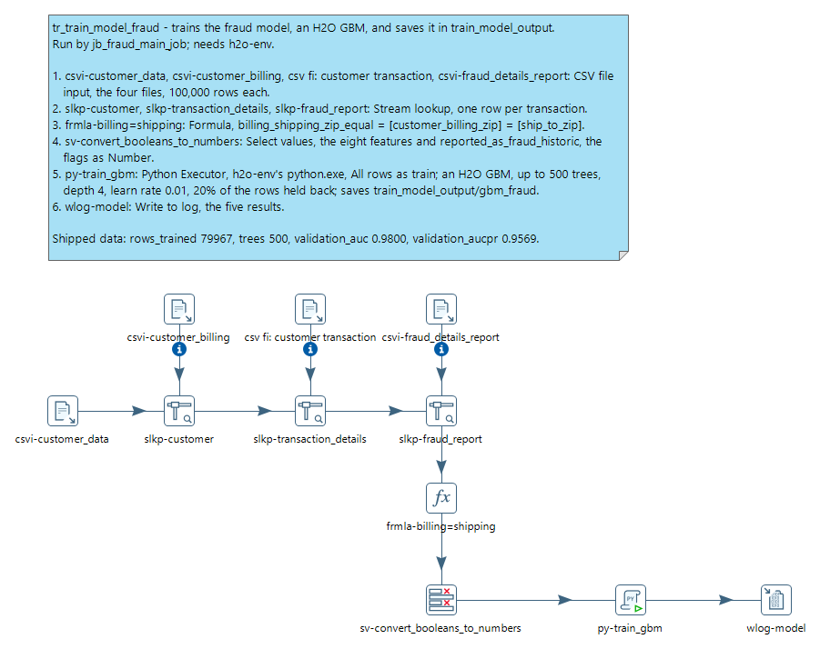
<figcaption>The training transformation</figcaption>
</figure>
</div>

The steps before the Python step prepare the data:

| Step | Type | What it does |
| --- | --- | --- |
| **csvi-customer_data** | CSV file input | Reads `customer.csv` |
| **csvi-customer_billing** | CSV file input | Reads `customer_billing.csv` |
| **csv fi: customer transaction** | CSV file input | Reads `transaction_details.csv` |
| **csvi-fraud_details_report** | CSV file input | Reads `transaction_fraud_report.csv`, trimming the space before each `transaction_id` |
| **slkp-customer** | Stream lookup | Adds `transaction_id`, `card_number` and `expiry_date` by `customer_id` |
| **slkp-transaction_details** | Stream lookup | Adds the 17 order fields by `transaction_id` and `customer_id` |
| **slkp-fraud_report** | Stream lookup | Adds `reported_as_fraud_historic` by `transaction_id` |
| **map-features** | Mapping (sub-transformation) | Runs `tr_features.ktr`: adds `billing_shipping_zip_equal` and turns the three flags into Numbers |
| **sv-convert_booleans_to_numbers** | Select values | Keeps the eight features and `reported_as_fraud_historic`, and turns the label into a Number |

2. Double-click **map-features**. Its **Transformation** box names `${Internal.Entry.Current.Directory}/tr_features.ktr`, and **Inherit all variables from the parent transformation** is selected on the **Parameters** tab. Select **Cancel**.

<div align="center">
<figure>
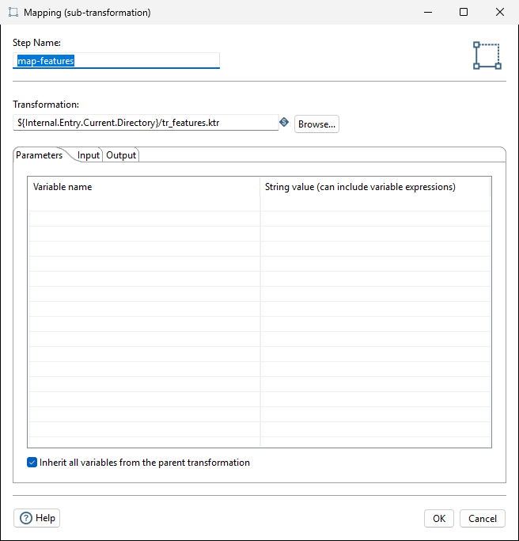
<figcaption>map-features: the Mapping dialog</figcaption>
</figure>
</div>

3. Select **File > Open** and open `tr_features.ktr` from the lab folder, to see the steps it runs:

<div align="center">
<figure>
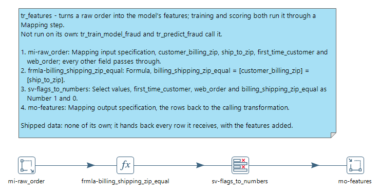
<figcaption>tr_features.ktr: the shared features</figcaption>
</figure>
</div>


| Step | Type | What it does |
| --- | --- | --- |
| **mi-raw_order** | Mapping input specification | Takes the rows from the calling transformation; names the four fields it needs (`customer_billing_zip`, `ship_to_zip`, `first_time_customer`, `web_order`) and lets every other field pass through |
| **frmla-billing_shipping_zip_equal** | Formula | Sets `billing_shipping_zip_equal` to `[customer_billing_zip] = [ship_to_zip]`, a Boolean |
| **sv-flags_to_numbers** | Select values | On the **Meta-data** tab, turns `first_time_customer`, `web_order` and `billing_shipping_zip_equal` into Numbers, 1 and 0 |
| **mo-features** | Mapping output specification | Hands the rows back to the calling transformation |

> **Under the hood:**
>
> #### One sub-transformation makes the features for training and for scoring
>
> A **Mapping** step runs another transformation as if its steps sat in
> its place: rows go in at **Mapping input specification** and come back
> from **Mapping output specification**. `tr_train_model_fraud.ktr` and
> `tr_predict_fraud.ktr` both call `tr_features.ktr`, so they make the
> features with the very same steps.
>
> **Why it matters:** a model scores well only on features made exactly
> the way it was trained on. Two copies of the feature steps drift apart
> one edit at a time, and a model fed a feature made differently still
> returns plausible scores, just wrong ones. With one sub-transformation,
> a change to a feature reaches training and scoring together.

4. Close `tr_features.ktr`, select the **tr_train_model_fraud** tab, and double-click **py-train_gbm**.
5. On the **Script** tab, under **Source**, select **Embed**. Select **Use a Python virtual environment**, and enter the path of the Python program in the virtual environment from [Prerequisite Tasks](../02-prerequisite-tasks/guide.md). The step runs that program, so enter the program, not the folder:

   ```text
   ${user.home}\h2o-env\Scripts\python.exe
   ```

   `${user.home}` is your home folder, such as `C:\Users\pentaho`.

<div align="center">
<figure>
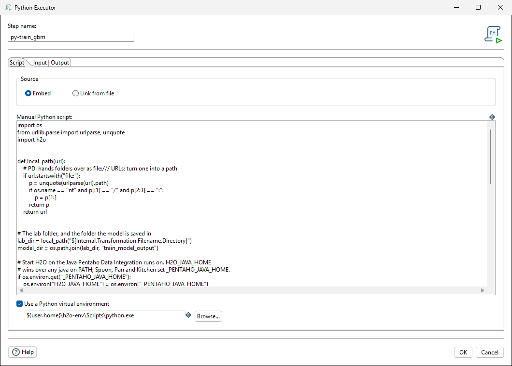
<figcaption>py-train_gbm, Script tab</figcaption>
</figure>
</div>

6. **Manual Python script** holds this script in the file you opened; enter it if the box is empty:

   ```python
   import os
   from urllib.parse import urlparse, unquote
   import h2o


   def local_path(url):
       # PDI hands folders over as file:/// URLs; turn one into a path
       if url.startswith("file:"):
           p = unquote(urlparse(url).path)
           if os.name == "nt" and p[:1] == "/" and p[2:3] == ":":
               p = p[1:]
           return p
       return url


   # The lab folder, and the folder the model is saved in
   lab_dir = local_path("${Internal.Transformation.Filename.Directory}")
   model_dir = os.path.join(lab_dir, "train_model_output")

   # Start H2O on the Java Pentaho Data Integration runs on. H2O_JAVA_HOME
   # wins over any java on PATH; Spoon, Pan and Kitchen set _PENTAHO_JAVA_HOME.
   if os.environ.get("_PENTAHO_JAVA_HOME"):
       os.environ["H2O_JAVA_HOME"] = os.environ["_PENTAHO_JAVA_HOME"]
   h2o.init(nthreads=-1, max_mem_size="2G", verbose=False)

   from h2o.estimators import H2OGradientBoostingEstimator

   # The rows from sv-convert_booleans_to_numbers, as a pandas data frame
   frame = h2o.H2OFrame(train)
   y = "reported_as_fraud_historic"
   frame[y] = frame[y].asfactor()          # a class label: train a classifier
   x = [c for c in frame.columns if c != y]

   # Hold back 20% of the rows to measure the model on rows it never saw
   train_part, valid_part = frame.split_frame(ratios=[0.8], seed=42)

   gbm = H2OGradientBoostingEstimator(
       model_id="gbm_fraud",
       ntrees=500,               # at most 500 trees...
       stopping_rounds=5,        # ...stopping early when validation AUC stops improving
       stopping_metric="AUC",
       score_tree_interval=10,
       max_depth=4,              # depth of each tree
       learn_rate=0.05,          # how much each tree corrects
       min_rows=10,              # fewest rows in a leaf
       sample_rate=0.5,          # each tree sees a random half of the rows
       seed=42,
   )
   gbm.train(x=x, y=y, training_frame=train_part, validation_frame=valid_part)

   perf = gbm.model_performance(valid_part)
   saved = h2o.save_model(gbm, path=model_dir, filename="gbm_fraud", force=True)

   # One row back to PDI, from these five variables
   rows_trained = int(train_part.nrows)
   trees = int(gbm.summary()["number_of_trees"][0])
   validation_auc = f"{perf.auc():.4f}"
   validation_aucpr = f"{perf.aucpr():.4f}"
   model_path = str(saved)

   h2o.cluster().shutdown()
   ```

The script does four things:

* **Finds the lab folder.** Pentaho Data Integration replaces `${Internal.Transformation.Filename.Directory}` before Python runs, with a URL such as `file:///C:/Workshop-ML-Specialty/...`; `local_path` turns it into a path. `h2o.save_model` creates `train_model_output` when it is missing.
* **Starts H2O on Pentaho's Java.** H2O's engine is a Java program. Spoon sets `_PENTAHO_JAVA_HOME` to the Java it runs on, and the script passes it to H2O as `H2O_JAVA_HOME`, which H2O reads before it looks for a `java` on `PATH`. Without it, H2O would start on whichever Java is first on `PATH`.
* **Trains and measures.** It holds back 20% of the rows, trains on the rest, and scores the model on the held-back rows.
* **Saves and reports.** It saves the model as `train_model_output/gbm_fraud` and leaves five variables for Pentaho Data Integration to read.

The GBM settings:

| Setting | Value | Meaning |
| --- | --- | --- |
| `ntrees` | `500` | At most 500 boosting iterations, one tree each |
| `stopping_rounds`, `stopping_metric` | `5`, `"AUC"` | Stop early when five scoring rounds in a row don't improve the AUC on the held-back rows |
| `max_depth` | `4` | Maximum depth of each tree |
| `learn_rate` | `0.05` | How much each tree corrects the trees before it: higher learns in fewer trees, too high overshoots |
| `min_rows` | `10` | Fewest rows in a leaf |
| `sample_rate` | `0.5` | Each tree sees a random half of the rows |

7. Open the **Input** tab. Under **Row processing**, check that **All rows** is selected. Under **Available variables**, the variable `train` takes its rows from **Step** `sv-convert_booleans_to_numbers` as a **Data structure** of `Pandas dataframe`, and the **Mapping** grid lists its nine fields:

| Data structure field         | Data structure type | Pentaho Data Integration field | Pentaho Data Integration data type |
| ---------------------------- | ------------------- | ------------------------------ | ---------------------------------- |
| `first_time_customer`        | `float64`           | `first_time_customer`          | Number                             |
| `order_dollar_amount`        | `float64`           | `order_dollar_amount`          | Number                             |
| `num_items`                  | `int64`             | `num_items`                    | Integer                            |
| `age`                        | `float64`           | `age`                          | Number                             |
| `web_order`                  | `float64`           | `web_order`                    | Number                             |
| `total_transactions_to_date` | `int64`             | `total_transactions_to_date`   | Integer                            |
| `hour_of_day`                | `int64`             | `hour_of_day`                  | Integer                            |
| `billing_shipping_zip_equal` | `float64`           | `billing_shipping_zip_equal`   | Number                             |
| `reported_as_fraud_historic` | `float64`           | `reported_as_fraud_historic`   | Number                             |

<div align="center">
<figure>
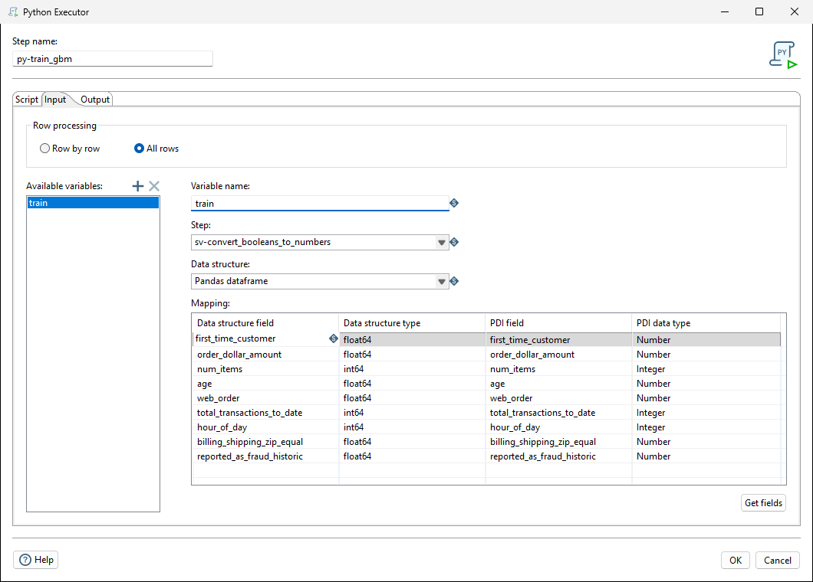
<figcaption>py-train_gbm, Input tab</figcaption>
</figure>
</div>

8. Open the **Output** tab. Under **Output processing**, check that **Variables to fields** is selected, with the five variables the script leaves behind:

| Variable           | Python data type | Pentaho Data Integration field | Pentaho Data Integration data type |
| ------------------ | ---------------- | ------------------------------ | ---------------------------------- |
| `rows_trained`     | `int`            | `rows_trained`                 | Integer                            |
| `trees`            | `int`            | `trees`                        | Integer                            |
| `validation_auc`   | `str`            | `validation_auc`               | String                             |
| `validation_aucpr` | `str`            | `validation_aucpr`             | String                             |
| `model_path`       | `str`            | `model_path`                   | String                             |

<div align="center">
<figure>
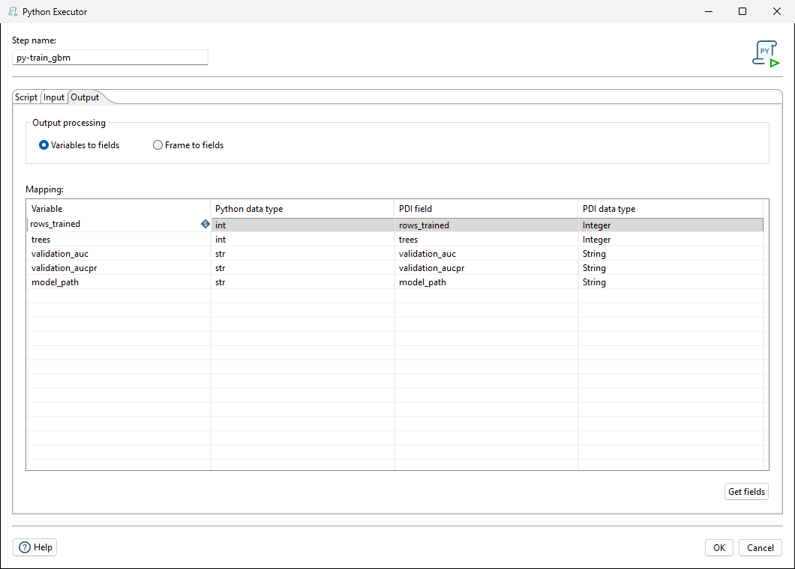
<figcaption>py-train_gbm, Output tab</figcaption>
</figure>
</div>

9. Select **OK**. The step's one output row goes to **wlog-model**, a **Write to log** step that prints the five fields in the run's log.

> **Under the hood:**
>
> #### All the rows went to Python as one data frame, and one row came back
>
> With **All rows**, the **Python Executor** step waits for the whole
> stream from **sv-convert_booleans_to_numbers**, builds one pandas data
> frame named `train`, starts the virtual environment's Python in a
> process of its own, and runs the script once. **Variables to fields**
> then reads the five variables the script leaves behind and turns them
> into one row. The model itself leaves Python as a folder on disk,
> written by `h2o.save_model`.
>
> **Why it matters:** GBM needs the whole training set at once, which
> **All rows** gives it. Because the model travels as a file, not as rows,
> the predict transformation can run later, or on another schedule, and
> still load the same model. And because Python runs outside Spoon's
> process, a failure in the script fails the step, not Spoon.

### 3. Predict Fraud

> **Note:**
>
> #### Predict fraud
>
> **predict_fraud** runs `tr_predict_fraud.ktr`. It joins the customer, billing and transaction files the same way, without the fraud report, and makes the features through the same `tr_features.ktr`. Then Python loads the saved model, scores each transaction with a fraud probability and the reason for it, and the scores go to a CSV file and to the MySQL table `fraud.transaction_scores`.

1. Select the **jb_fraud_main_job** tab, right-click **predict_fraud**, and select **Open Referenced Object > Transformation**.

<div align="center">
<figure>
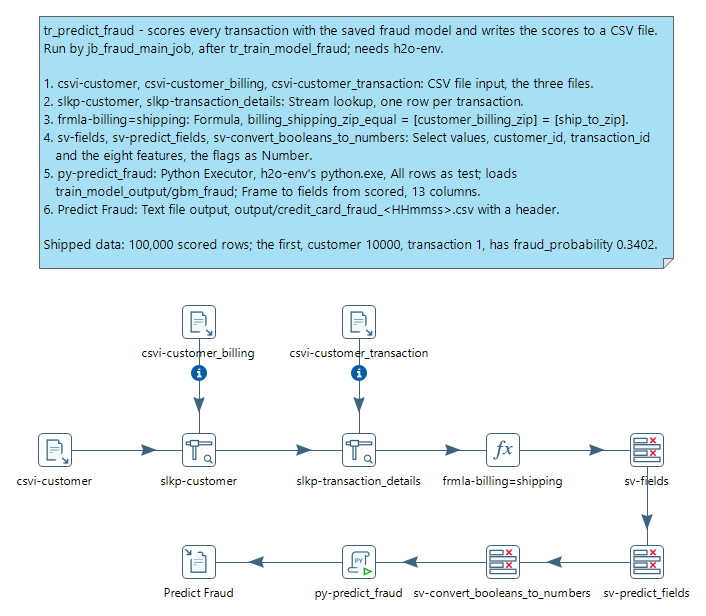
<figcaption>The prediction transformation</figcaption>
</figure>
</div>

The steps before the Python step:

| Step | Type | What it does |
| --- | --- | --- |
| **csvi-customer**, **csvi-customer_billing**, **csvi-customer_transaction** | CSV file input | Read this week's files: `week_customer.csv`, `week_customer_billing.csv` and `week_transaction_details.csv` |
| **slkp-customer**, **slkp-transaction_details** | Stream lookup | Join them, as in the training transformation |
| **map-features** | Mapping (sub-transformation) | Runs the same `tr_features.ktr` as training |
| **sv-convert_booleans_to_numbers** | Select values | Keeps `customer_id`, `transaction_id` and the eight features |

The two ids are not model inputs: they ride along so that each score names its customer and transaction.

> **Under the hood:**
>
> #### The past trains the model, the present is scored
>
> Training reads the history: 200,000 transactions, numbered 1 to
> 200,000, every one with its verdict in the fraud report. Prediction
> reads this week's files: 10,000 new orders, numbered 200,001 to
> 210,000, from customers and on cards the history has never seen, and
> with no verdict yet. The two transformations never read the same row.
>
> **Why it matters:** a model must be judged on orders it has never
> seen, as it will be used. Scoring the orders it learned from flatters
> it, because it remembers them. Next week, this week's orders, with
> their verdicts, join the history, and a new week's files arrive.

2. Double-click **py-predict_fraud**.
3. On the **Script** tab, make sure **Use a Python virtual environment** is selected and names the Python program, as in the training step. **Manual Python script** holds this script; enter it if the box is empty:

   ```python
   import os
   from urllib.parse import urlparse, unquote
   import h2o


   def local_path(url):
       # PDI hands folders over as file:/// URLs; turn one into a path
       if url.startswith("file:"):
           p = unquote(urlparse(url).path)
           if os.name == "nt" and p[:1] == "/" and p[2:3] == ":":
               p = p[1:]
           return p
       return url


   # The lab folder, and the folder the model is saved in
   lab_dir = local_path("${Internal.Transformation.Filename.Directory}")
   model_dir = os.path.join(lab_dir, "train_model_output")

   # Start H2O on the Java Pentaho Data Integration runs on. H2O_JAVA_HOME
   # wins over any java on PATH; Spoon, Pan and Kitchen set _PENTAHO_JAVA_HOME.
   if os.environ.get("_PENTAHO_JAVA_HOME"):
       os.environ["H2O_JAVA_HOME"] = os.environ["_PENTAHO_JAVA_HOME"]
   h2o.init(nthreads=-1, max_mem_size="2G", verbose=False)

   # Load the model the training transformation saved
   gbm = h2o.load_model(os.path.join(model_dir, "gbm_fraud"))

   # Score every row from sv-convert_booleans_to_numbers. The model reads the
   # eight features by name and ignores customer_id and transaction_id.
   frame = h2o.H2OFrame(test)
   pred = gbm.predict(frame).as_data_frame(use_multi_thread=True)

   scored = test.copy()
   scored["fraud_probability"] = pred["p1"].round(4).values      # 0 to 1
   scored["fraud_pct"] = (pred["p1"] * 100).round(2).values      # the same, as a percentage
   scored["predicted_fraud"] = (pred["p1"] >= 0.5).astype("int64").values  # 1 at 0.5 or more

   # Why: the feature that pushes each score hardest towards fraud. H2O's
   # predict_contributions gives every feature's share of the score (SHAP values).
   contrib = gbm.predict_contributions(frame).as_data_frame(use_multi_thread=True)
   reasons = contrib.drop(columns=["BiasTerm"])
   scored["top_reason"] = reasons.idxmax(axis=1).values

   h2o.cluster().shutdown()
   ```

<div align="center">
<figure>
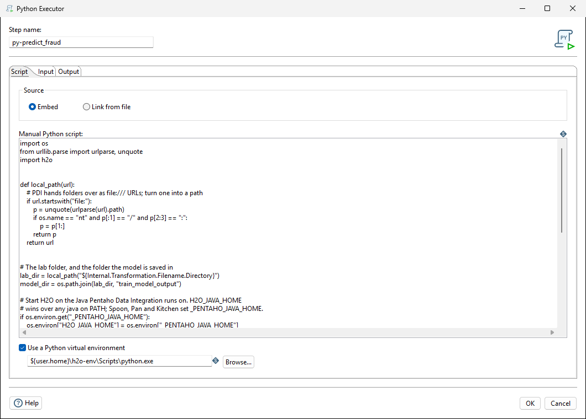
<figcaption>py-predict_fraud, Script tab</figcaption>
</figure>
</div>

`gbm.predict` returns, for each row, the predicted class and the probability of each class; `p1` is the probability of fraud. `predicted_fraud` turns it into a flag at a threshold of 0.5. Lower the threshold, to 0.15 for example, to catch more fraud at the cost of more false alarms; the [Monitoring and Tuning](../05-monitoring-and-tuning/guide.md) workshop chooses it from what each mistake costs.

`gbm.predict_contributions` explains each score: for every row it returns how much each feature pushed the score up or down (the feature's SHAP value), plus a `BiasTerm`, the starting point all rows share. `top_reason` is the feature with the largest push towards fraud, so a fraud reviewer can see at a glance why an order was flagged.

4. Open the **Input** tab. **All rows** is selected, and the variable `test` takes its rows from `sv-convert_booleans_to_numbers` as a `Pandas dataframe`: `customer_id` and `transaction_id` as `int64` to Integer, then the eight features as in the training step.

<div align="center">
<figure>
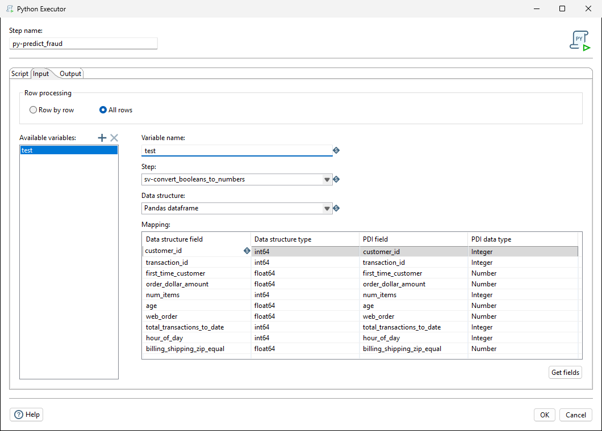
<figcaption>py-predict_fraud, Input tab</figcaption>
</figure>
</div>

5. Open the **Output** tab. Under **Output processing**, **Frame to fields** is selected, with **Variable** `scored`: the step returns the rows of that data frame. The **Mapping** grid lists its 14 columns:

| Data frame column            | Python data type | Pentaho Data Integration field | Pentaho Data Integration data type |
| ---------------------------- | ---------------- | ------------------------------ | ---------------------------------- |
| `customer_id`                | `int64`          | `customer_id`                  | Integer                            |
| `transaction_id`             | `int64`          | `transaction_id`               | Integer                            |
| `first_time_customer`        | `float64`        | `first_time_customer`          | BigNumber                          |
| `order_dollar_amount`        | `float64`        | `order_dollar_amount`          | BigNumber                          |
| `num_items`                  | `int64`          | `num_items`                    | Integer                            |
| `age`                        | `float64`        | `age`                          | BigNumber                          |
| `web_order`                  | `float64`        | `web_order`                    | BigNumber                          |
| `total_transactions_to_date` | `int64`          | `total_transactions_to_date`   | Integer                            |
| `hour_of_day`                | `int64`          | `hour_of_day`                  | Integer                            |
| `billing_shipping_zip_equal` | `float64`        | `billing_shipping_zip_equal`   | BigNumber                          |
| `fraud_probability`          | `float64`        | `fraud_probability`            | BigNumber                          |
| `fraud_pct`                  | `float64`        | `fraud_pct`                    | BigNumber                          |
| `predicted_fraud`            | `int64`          | `predicted_fraud`              | Integer                            |
| `top_reason`                 | `object`         | `top_reason`                   | String                             |

<div align="center">
<figure>
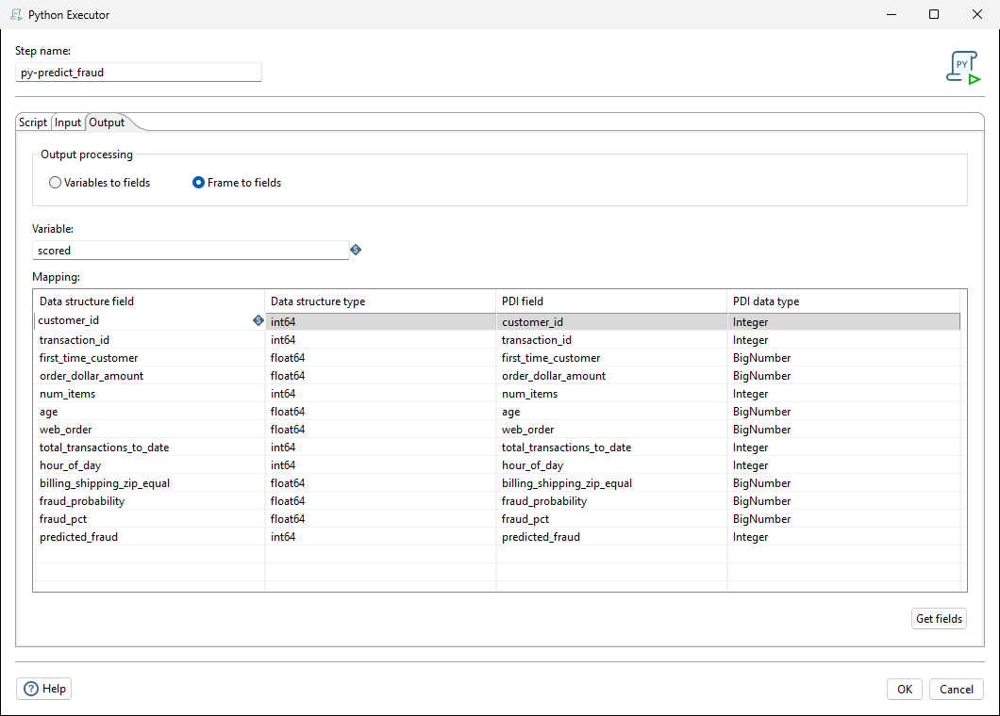
<figcaption>py-predict_fraud, Output tab</figcaption>
</figure>
</div>

> **Note:** Coming back from Python, decimal values map only to **BigNumber**: the step stops with `Unable to convert from Python data type 'float64' to PDI data type 'Number'` if you choose Number. Going in, **Number** to `float64` is fine. Whole numbers map to **Integer** both ways, and text (`object` in pandas) to **String**.

6. Select **OK**.
7. Double-click **Predict Fraud**, a **Text file output** step. On the **File** tab, check that **Filename** is `${Internal.Entry.Current.Directory}/output/credit_card_fraud` and **Extension** is `csv`, and that **Create Parent folder** and **Include time in filename?** are selected. On the **Content** tab, check that **Separator** is `,` and **Header** is selected. The **Fields** tab is empty, so the step writes every field it receives. A **Text file output** step passes its rows on, so the same rows go on to the database.
8. Select **OK**.
9. Double-click **iu-transaction_scores**, an **Insert / Update** step. **Connection** is `fraud` (MySQL, `localhost:3306`, database `fraud`, user `fraud_user`) and **Target table** is `transaction_scores`.

<div align="center">
<figure>
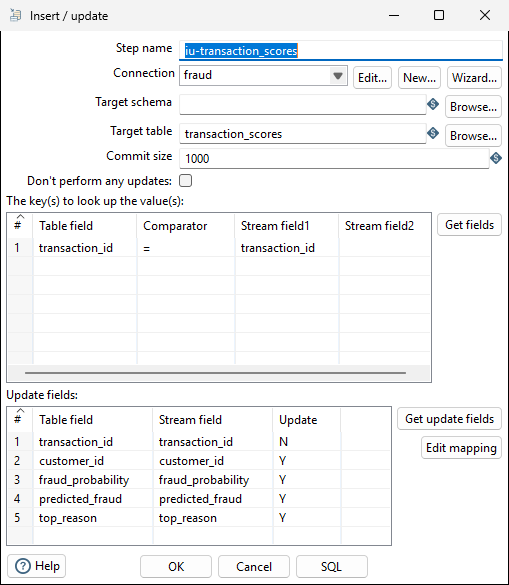
<figcaption>iu-transaction_scores</figcaption>
</figure>
</div>

10. Under **The key(s) to look up the value(s)**, the one key is **Table field** `transaction_id`, **Comparator** `=`, **Stream field 1** `transaction_id`. Under **Update fields**, `transaction_id` is written with **Update** `N`, and `customer_id`, `fraud_probability`, `predicted_fraud` and `top_reason` with **Update** `Y`.
11. Select **OK**.
12. Right-click **iu-transaction_scores** and select **Change Number of Copies to Start**. It is `4`: on the canvas, the step shows `x4`.

> **Under the hood:**
>
> #### Insert / Update made the run safe to repeat
>
> For each row, **Insert / Update** looks the key up in the table: a
> `transaction_id` that is not there yet is inserted, and one that is
> has the fields marked **Update** `Y` overwritten. The table's
> `scored_at` column moves to the time of the update.
>
> **Why it matters:** a job that runs every night, and sometimes twice
> after a failure, must not double its output. With a key and **Insert /
> Update**, the second run leaves one row per transaction with the
> latest score. The cost is one lookup per row, so the step runs in four
> copies: four connections, each sent every fourth row in turn, write
> at once, about two seconds for this week's 10,000 instead of five
> and a half with one. Every row has its own key, so no two copies ever
> touch the same row.
>
> Copies speed up a step that handles rows one at a time. Never give
> them to a **Python Executor** step with **All rows**: each copy would
> get only part of the rows, and training would build several models,
> each on a fragment.

### 4. Run and Results

> **Note:**
>
> #### Run the job
>
> Run the job: it trains the model, then scores the transactions with it. Each Python step starts and stops its own H2O engine, which takes most of the run: about a minute and a half.

1. Select the **jb_fraud_main_job** tab.
2. Press `F9` (**Action > Run**), and select **Run** in the **Run Options** dialog.

> **Under the hood:**
>
> #### The job ran predict_fraud only because train_model succeeded
>
> The hop from **START** to **train_model** is unconditional. The two
> green hops are evaluated: the job follows them only when the entry
> before them ends without errors. The two red hops are followed only on
> failure, and lead to **Abort job**. Each transformation entry waits for
> its transformation to finish, so **predict_fraud** starts after the
> model is saved.
>
> **Why it matters:** a failed training run never feeds a stale or
> half-written model to the scoring step, and the job's result says
> which part failed.

3. When the job finishes, open the **Job metrics** tab in **Execution Results**.

> **Success:** Checkpoint: **train_model** and **predict_fraud** both succeed and the job ends at **Success**; **Abort job** doesn't run.

On **Step Metrics**, see where the minute and a half went. In this run:

| Part | Time |
| --- | --- |
| **train_model**: read and join 200,000 transactions, make the features | about 13 seconds |
| **py-train_gbm**: start Python and an H2O engine, train, save | about 37 seconds |
| **predict_fraud**: read and join this week's files, make the features | about 4 seconds |
| **py-predict_fraud**: start Python and another H2O engine, score, explain | about 32 seconds |
| **iu-transaction_scores**, four copies | about 2 seconds |

Starting H2O, twice, is most of the wait: each Python step starts an engine and shuts it down when its Python ends. [Scoring as a Service](../06-scoring-as-a-service/guide.md) keeps one engine running instead, so a scoring call starts nothing.

4. Open the **Logging** tab and find the lines from **wlog-model**, under `The fraud model`.

> **Success:** Checkpoint: `rows_trained = 160013` (80% of the 200,000 history rows), `trees = 150` (it stopped early), `validation_auc = 0.9324`, `validation_aucpr = 0.4061`, and `model_path` ending in `train_model_output\gbm_fraud`. With `seed=42` the split and the model are the same on every run.

Read the two numbers together. An AUC of 0.93 says the model ranks a fraud above a genuine order 93 times in 100. An AUCPR of 0.41 says how hard it is to act on that: with about one fraud in a hundred orders, any threshold that catches much of the fraud also flags many genuine orders. That is what real card fraud models look like.

5. In the lab folder, open the `output` folder and open the newest `credit_card_fraud_<HHmmss>.csv` in a text editor or a spreadsheet. **Predict Fraud** adds the time of the run, `<HHmmss>`, to the name.

> **Success:** Checkpoint: a header line, then 10,000 rows with 14 columns: `customer_id`, `transaction_id`, the eight model inputs, `fraud_probability` (0 to 1), `fraud_pct` (the same as a percentage), `predicted_fraud` (`1` when the probability is 0.5 or more) and `top_reason`. The first row is customer `210000`, transaction `200001`, with `fraud_probability` `0.0020`, `predicted_fraud` `0` and `top_reason` `total_transactions_to_date`: a returning customer's ordinary order.

6. Check the table. In PowerShell:

   ```powershell
   podman exec sampledata-mysql mysql -ufraud_user -ppassword -e "SELECT COUNT(*), SUM(predicted_fraud) FROM transaction_scores; SELECT top_reason, COUNT(*) FROM transaction_scores WHERE predicted_fraud = 1 GROUP BY top_reason ORDER BY 2 DESC" fraud
   ```

> **Success:** Checkpoint: `10000` rows, only `38` of them flagged at 0.5. Among those, the commonest reasons are `billing_shipping_zip_equal` (31) and `hour_of_day` (6): goods sent to another address, and orders placed late at night. Run the job again: the count stays `10000`, because **Insert / Update** updates the rows it finds.

Thirty-eight orders a week is a short list for the analysts, and too short: about a hundred of this week's orders are fraud, so a line at 0.5 misses most of them. Where to draw the line is a business decision, and Monitoring and Tuning makes it.

The scores are this week's alone: the model never saw these transactions or their outcomes. The fraud team will confirm, over the coming weeks, which of them really were fraud; the [Monitoring and Tuning](../05-monitoring-and-tuning/guide.md) workshop joins those outcomes to `transaction_scores` to measure the model and tune its threshold.

::::

## Troubleshooting <!-- no-step -->

<details>
<summary>Cannot run program ... h2o-env: CreateProcess error=5, Access is denied</summary>

The **Use a Python virtual environment** box names the folder. Enter the Python program inside it: `${user.home}\h2o-env\Scripts\python.exe`.

</details>

<details>
<summary>No module named h2o</summary>

The step runs a Python without H2O: either **Use a Python virtual environment** is cleared, or it names another Python. Check the path, and run `powershell -ExecutionPolicy Bypass -File C:\ML\setup-ml.ps1 -Status` to check the environment.

</details>

<details>
<summary>H2O cannot start, or complains about the Java version</summary>

The script starts H2O on `_PENTAHO_JAVA_HOME`, which `spoon.bat`, `pan.bat` and `kitchen.bat` set. If you run the script another way, set `H2O_JAVA_HOME` to Pentaho's Java (`C:\Pentaho\java` on the lab machine) before you start it: H2O reads `H2O_JAVA_HOME` first, then a `java` on `PATH`, and only then `JAVA_HOME`. H2O lists Java 8 to 17 as supported, and Pentaho's Java is 21: H2O's Python client starts it with `-allow_unsupported_java`, and the lab is tested on that Java.

</details>

<details>
<summary>Unable to convert from Python data type 'float64' to PDI data type 'Number'</summary>

On the **Output** tab, set every `float64` column to **BigNumber**: decimals coming back from Python map only to BigNumber.

</details>

<details>
<summary>iu-transaction_scores: Communications link failure, or Access denied for user 'fraud_user'</summary>

MySQL is not running, or the `fraud` database was not created. Start MySQL and run `fraud_schema.sql` as in [Prerequisite Tasks](../02-prerequisite-tasks/guide.md).

</details>

<details>
<summary>predict_fraud fails to load the model</summary>

It loads `train_model_output/gbm_fraud`, which the training step saves. Run the whole job, not **predict_fraud** alone, at least once.

</details>

## Lab Files

Click a file to download. For `.ktr` and `.kjb` files, **Open in Pentaho Data Integration** launches Pentaho Data Integration with the file loaded. If Pentaho Data Integration is already running, the path is copied to your clipboard — switch to Pentaho Data Integration and press `Ctrl+O`, `Ctrl+V`, `Enter`.

The history: the customers, billing and order details of transactions 1 to 200,000, and the fraud report on every one of them. Only the training transformation reads these:

[customer.csv](./files/customer.csv)

[customer_billing.csv](./files/customer_billing.csv)

[transaction_details.csv](./files/transaction_details.csv)

[transaction_fraud_report.csv](./files/transaction_fraud_report.csv)

This week's new orders, 200,001 to 210,000, which the prediction transformation scores:

[week_customer.csv](./files/week_customer.csv)

[week_customer_billing.csv](./files/week_customer_billing.csv)

[week_transaction_details.csv](./files/week_transaction_details.csv)

The job, the two transformations it runs, and the feature sub-transformation they share, ready to open:

[jb_fraud_main_job.kjb](./files/jb_fraud_main_job.kjb) <button data-launch="spoon" data-path="files/jb_fraud_main_job.kjb">Open in Pentaho Data Integration</button> <button data-graph="files/jb_fraud_main_job.kjb">View graph</button>

[tr_train_model_fraud.ktr](./files/tr_train_model_fraud.ktr) <button data-launch="spoon" data-path="files/tr_train_model_fraud.ktr">Open in Pentaho Data Integration</button> <button data-graph="files/tr_train_model_fraud.ktr">View graph</button>

[tr_predict_fraud.ktr](./files/tr_predict_fraud.ktr) <button data-launch="spoon" data-path="files/tr_predict_fraud.ktr">Open in Pentaho Data Integration</button> <button data-graph="files/tr_predict_fraud.ktr">View graph</button>

[tr_features.ktr](./files/tr_features.ktr) <button data-launch="spoon" data-path="files/tr_features.ktr">Open in Pentaho Data Integration</button> <button data-graph="files/tr_features.ktr">View graph</button>

### Solution <!-- no-step -->

The finished job and transformations for this lab. Open them alongside your own to compare, or run the job to see the expected result.

Also on disk at `C:\Workshop-ML-Specialty\02-machine-learning\04-credit-card\solution`.

[jb_fraud_main_job.kjb](./files/solution/jb_fraud_main_job.kjb) <button data-launch="spoon" data-path="files/solution/jb_fraud_main_job.kjb">Open in Pentaho Data Integration</button> <button data-graph="files/solution/jb_fraud_main_job.kjb">View graph</button>

[tr_train_model_fraud.ktr](./files/solution/tr_train_model_fraud.ktr) <button data-launch="spoon" data-path="files/solution/tr_train_model_fraud.ktr">Open in Pentaho Data Integration</button> <button data-graph="files/solution/tr_train_model_fraud.ktr">View graph</button>

[tr_predict_fraud.ktr](./files/solution/tr_predict_fraud.ktr) <button data-launch="spoon" data-path="files/solution/tr_predict_fraud.ktr">Open in Pentaho Data Integration</button> <button data-graph="files/solution/tr_predict_fraud.ktr">View graph</button>

[tr_features.ktr](./files/solution/tr_features.ktr) <button data-launch="spoon" data-path="files/solution/tr_features.ktr">Open in Pentaho Data Integration</button> <button data-graph="files/solution/tr_features.ktr">View graph</button>
