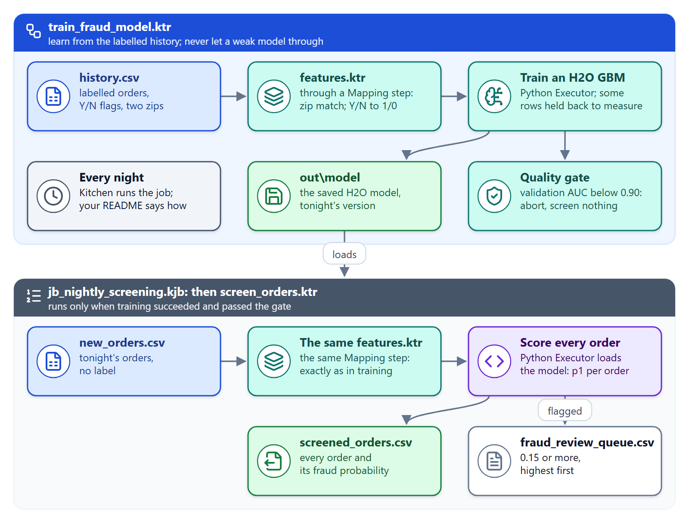

# Capstone: Nightly Fraud Screening

> **Capstone Project — bring it all together.**

You're the data engineer for the retailer from the workshops. The fraud
team liked the model, and now they want it every night. Each evening a
file of the day's new orders arrives. Before the orders ship, the team
wants a review queue: the orders the model thinks are most likely
fraud, highest first, so their investigators start at the top. And they
want the model retrained every night on the latest history, with one
safeguard: a model that turns out weaker than they can trust must never
screen a single order.

The history and tonight's orders are in your workshop folder. The
pipelines are yours to build.

> **Objectives:**
>
> - Engineer the same features from raw orders in two places, for training and for scoring, so the model sees the same thing both times.
> - Train an H2O GBM in a **Python Executor** step, measure it on rows it never saw, and save it.
> - Stop the night's run when the model falls below a quality bar.
> - Score every new order and write a review queue at a business threshold, highest first.
> - Run it all from one job that Kitchen can run every night.
> - Produce something portfolio-worthy ("I built this for my Specialty course accreditation").
>
> **Estimated time:** 3 hours for a clean, well-named solution. Re-shape and revisit as you'd like.

---

> **Warning:**
>
> #### Required for your course accreditation: six checks on your own folders
>
> The course accreditation is issued only when all six of these checks
> pass. They read your workshop folder, so save (or copy) your work into
> exactly these places **before you take the exam**:
>
> | # | What must be there | Where |
> | --- | --- | --- |
> | 1 | Your job, `jb_nightly_screening.kjb`, running your transformations, `screen_orders.ktr` among them | `C:\Workshop-ML-Specialty\capstone\solution\` |
> | 2 | Your training transformation, `train_fraud_model.ktr`, saving the model with `h2o.save_model` | `C:\Workshop-ML-Specialty\capstone\solution\` |
> | 3 | The same `train_fraud_model.ktr`, with an **Abort** step for the quality gate | `C:\Workshop-ML-Specialty\capstone\solution\` |
> | 4 | Your scoring transformation, `screen_orders.ktr`, loading the model with `h2o.load_model` | `C:\Workshop-ML-Specialty\capstone\solution\` |
> | 5 | Your review queue, `fraud_review_queue.csv`, from your last run, with its `fraud_probability` column | `C:\Workshop-ML-Specialty\capstone\out\` |
> | 6 | Your `README.md`: how to run the job, schedule it, and read its results | `C:\Workshop-ML-Specialty\capstone\solution\` |
>
> Your `solution\` folder starts with a **blank** transformation or job
> for each file named below: build each one and save it. A blank file
> passes no check. Select **Run checks** under **Verification checks**
> to see where you stand.

## Inputs

Download the files from **Lab Files** at the bottom of this page, or
use the copies the installer put in `C:\Workshop-ML-Specialty\capstone\data\`.

| File | What it is |
| ---- | ---------- |
| `history.csv` | 50,000 past orders, each with its outcome: `reported_as_fraud_historic` is `Y` or `N`. About a quarter are fraud |
| `new_orders.csv` | Tonight's 2,000 orders, the same columns without the outcome. The model has never seen them |

Both files have a header line and these columns, in the raw form the
order system writes them:

| Column | What it holds |
| ------ | ------------- |
| `transaction_id`, `customer_id` | The order and its customer |
| `order_dollar_amount`, `num_items`, `age` | The order's value, its item count, and the customer's age |
| `first_time_customer`, `web_order` | `Y` or `N` |
| `total_transactions_to_date`, `hour_of_day` | The customer's history, and when the order came in |
| `customer_billing_zip`, `ship_to_zip` | The two zip codes |

The model needs the eight features the workshops used, as numbers. One
of them is not a column here yet, and the flags are letters.

---

## Required behavior

Build the screening in four stages. Each maps to a part of the course,
so you can look back at the workshop that taught it.

### 1. Features, the same way twice *(AutoML, Credit Card)*

From the raw columns, make the eight features the workshops used:
`first_time_customer`, `order_dollar_amount`, `num_items`, `age`,
`web_order`, `total_transactions_to_date`, `hour_of_day` and
`billing_shipping_zip_equal` (the two zip codes are the same). The
flags, and the outcome in the history, become `1` and `0`. Both
transformations must make them exactly the same way.

### 2. Train, measure, save, gate *(Credit Card)*

`train_fraud_model.ktr` reads `data\history.csv`, trains an H2O GBM in
a **Python Executor** step on part of the rows, measures its AUC on the
rows it held back, and saves the model in `capstone\out\model\`. When
that validation AUC is below `0.90`, the transformation aborts, with a
message that says why.

### 3. Score and queue *(Credit Card)*

`screen_orders.ktr` reads `data\new_orders.csv`, loads the saved model
in a **Python Executor** step, and gives every order its fraud
probability. It writes two files to `capstone\out\`, each with a header
line:

- `screened_orders.csv`: every order, with at least `transaction_id`,
  `customer_id`, `order_dollar_amount` and `fraud_probability`.
- `fraud_review_queue.csv`: the same columns for the orders whose
  probability is `0.3` or more, highest first. The fraud team chose
  `0.3`, not `0.5`: a missed fraud costs them more than a review.

### 4. One job, every night *(Credit Card)*

`jb_nightly_screening.kjb` runs `train_fraud_model.ktr` and then, only
if it succeeded, `screen_orders.ktr`. If either fails, the job ends in
failure. Keep the three files in `capstone\solution\` and write a
`README.md` that says how to run the job with Kitchen, how to schedule
it to run every night, and what to open in the morning.

---

## Suggested shape

<div align="center">
<figure>

<figcaption>Retrain, gate, then screen: one job, every night</figcaption>
</figure>
</div>

Read the diagram top to bottom. The top panel is training: the raw
history becomes features, H2O learns from most of it and is measured on
the rest, and the model is saved only to be used if it passes the gate.
The bottom panel runs only after that: tonight's orders become the same
features, the saved model scores them, and every order is written, with
the flagged ones queued for review.

```text
C:\Workshop-ML-Specialty\capstone\
├── data\                           history.csv, new_orders.csv
├── solution\
│   ├── jb_nightly_screening.kjb    the job
│   ├── train_fraud_model.ktr       features, training, the gate
│   ├── screen_orders.ktr           features, scoring, the queue
│   └── README.md
└── out\
    ├── model\                      the saved H2O model
    ├── screened_orders.csv
    └── fraud_review_queue.csv
```

Every `.ktr` and the `.kjb` above are waiting for you in `solution\` as
blank files, with no steps or entries: the names are given, what goes in
them is yours. The `README.md` you create. If
`C:\Workshop-ML-Specialty\` has no `capstone` folder, create
`capstone\data\`, `capstone\solution\` and `capstone\out\` yourself.

---

## Hints for the tricky bits

- **Y and N.** Set a flag field's **Type** to **Boolean** in **CSV file input**, and it reads `Y`/`N`; a **Select values** step's **Meta-data** tab then turns the Boolean into a Number, as the AutoML workshop's `sv-change_to_numbers` does.
- **One feature is a comparison.** The AutoML workshop's **Formula** step makes `billing_shipping_zip_equal` from the two zip codes.
- **The same features twice.** The model learns from columns by name. Make every feature the same way, with the same name and the same `1`/`0` meaning, in both transformations: a difference fails silently, with scores that look plausible and are wrong.
- **The folders beside solution\\.** `${Internal.Transformation.Filename.Directory}` is `solution\`; `data\` and `out\` are its siblings, so a step's file name can start `${Internal.Transformation.Filename.Directory}/../out/`. In a Python script the variable arrives as a `file:///` URL: the Credit Card workshop's `local_path` turns it into a path.
- **Exact file names.** The checks look for `fraud_review_queue.csv` by that name. Clear **Include time in filename?** in **Text file output**: the Credit Card workshop selected it, and it adds the time to the name.
- **The outcome is a class.** H2O trains a classifier only when the target is a factor: `asfactor()`.
- **The gate.** Leave the AUC as a Python `float`, not a formatted string as in the Credit Card workshop, and map it to **BigNumber** in **Variables to fields**. A **Filter rows** step can then compare it with `0.90` and send the rows below it to an **Abort** step. In the **Abort** step, choose **Abort and log as an error**, so the transformation fails and the job takes its red hop.
- **What the gate protects.** The script saves the model before the gate sees its AUC, so a rejected model is still on disk. The job is what keeps it from screening orders: run `screen_orders.ktr` only from the job.
- **Highest first.** **Sort rows** sorts descending when **Ascending** is `N`.
- **Prove the gate.** Raise the bar to `0.999` for one run: the job must end in failure, and `screen_orders.ktr` must not run. Then put it back.
- **Every night.** Kitchen runs a job from the command line; Windows Task Scheduler (or `cron` on Linux) runs a command on a schedule.

---

## Lab Files

Click a file to download. Put both in `C:\Workshop-ML-Specialty\capstone\data\`
before you start, if the installer has not already. Beyond these and the
blank files in `solution\`, nothing in the capstone is supplied: the
pipelines are yours to build.

[history.csv](./files/history.csv)

[new_orders.csv](./files/new_orders.csv)

---

## Verification checks

> **Warning:** These six checks decide your course accreditation, and
> they look only in `C:\Workshop-ML-Specialty\capstone\`: in
> `solution\` your `jb_nightly_screening.kjb` running
> `screen_orders.ktr`, your `train_fraud_model.ktr` with
> `h2o.save_model` and an **Abort** step, your `screen_orders.ktr` with
> `h2o.load_model`, and your `README.md`; and in `out\` your
> `fraud_review_queue.csv` with its `fraud_probability` column. Save
> your work there before you take the exam.

After a successful run of the job, select **Run checks** below to
confirm each file landed where expected. The checks confirm that the
files exist and hold the parts named above. Check the results yourself:
your model's settings are your own, so the exact figures vary, but a
correct solution always passes these tests.

| Test | How to see it | A correct solution shows |
| ---- | ------------- | ------------------------ |
| The model is good enough | The job's log | A validation AUC of `0.90` or more; the workshops' settings give about `0.99` |
| Every order scored | `screened_orders.csv` | A header line and 2,000 orders |
| The queue is the threshold | `fraud_review_queue.csv` | Only probabilities of `0.3` or more, the highest first: roughly 500 to 650 orders, a little over a quarter of the night |
| The gate stops the night | A run with the bar at `0.999` | The job ends in failure at the **Abort** step, and the time stamp of `screened_orders.csv` does not change |

One correct solution flagged 586 of the 2,000 orders, with
`0.9999` at the top of its queue.

> **Under the hood:**
>
> #### Why the queue is longer than the fraud the model expects
>
> At a threshold of `0.5` the model flags an order only when fraud is
> its better guess. At `0.3` it also flags the orders it is unsure
> about, so the queue holds more orders than the model believes are
> fraud: some of them are false alarms. In exchange, very little fraud
> stays out of the queue.
>
> **Why it matters:** the threshold is a business decision, not a
> property of the model. The same model, with the same AUC, gives a
> short queue of near-certain fraud at a high threshold and a long
> queue that misses almost nothing at a low one. The fraud team chooses
> the trade, and the job carries it out every night.

---

## Deliverables

Your `solution\` folder and your `out\` folder, under
`C:\Workshop-ML-Specialty\capstone\`:

1. `jb_nightly_screening.kjb` — the job: training, then screening only on success
2. `train_fraud_model.ktr` — the features, the model, its validation AUC, and the gate
3. `screen_orders.ktr` — the same features, the scores, and the two files
4. `README.md` — how to run the job, schedule it every night, and read its results
5. `out\fraud_review_queue.csv` and `out\screened_orders.csv` — from your last run

> **Warning:** Save into `capstone\solution\`, not into the course
> folder. Course content is refreshed from the repository on every
> launch, so anything you leave there will be overwritten. Reinstalling
> or upgrading the course never touches `capstone\solution\` or
> `capstone\out\`, and only puts back a blank file you have deleted.

This becomes a portfolio piece: name things clearly, keep the folder
tidy, and be ready to explain why the queue uses `0.3` and what the
gate protects.

---

## Build outline and hints <!-- no-step -->

One section per file, in the order you build them. Each says what the
file must do, what it reads and writes, which requirement it meets, and
what a correct run shows. The hints name a step or a technique; the
settings are yours to work out. Each file starts blank in `solution\`:
open it in Spoon (**File > Open**), build it and save it.

:::: tabs

### 1. Prepare

**Must do:** check that `h2o-env` is ready, and that the two data files
are in `capstone\data\`.

**Reads:** nothing yet.
**Meets:** every requirement.

```powershell
powershell -ExecutionPolicy Bypass -File C:\ML\setup-ml.ps1 -Status
Get-ChildItem C:\Workshop-ML-Specialty\capstone\data
```

> **Success:** Checkpoint: the kit ends with `Machine Learning setup is complete.`, and `data\` lists `history.csv` and `new_orders.csv`.

### 2. train_fraud_model.ktr

**Must do:** make the eight features and the outcome as numbers, train
and measure an H2O GBM, save it in `out\model\`, and abort below a
validation AUC of `0.90`.

**Reads:** `data\history.csv`.
**Writes:** `out\model\`.
**Meets:** requirements 1 and 2.

**Hints:** **CSV file input**, **Formula**, **Select values**,
**Python Executor** (**All rows**, **Variables to fields**), **Filter
rows**, **Abort**, and a **Write to log** step for the model's figures.

> **Success:** Checkpoint: run it on its own: the log shows a validation AUC of about `0.99`, and `out\model\` holds the model.

### 3. screen_orders.ktr

**Must do:** make the same eight features, load the model, score every
order, and write the two files.

**Reads:** `data\new_orders.csv`, `out\model\`.
**Writes:** `out\screened_orders.csv`, `out\fraud_review_queue.csv`.
**Meets:** requirements 1 and 3.

**Hints:** the first three steps of `train_fraud_model.ktr`, without the
outcome; **Python Executor** (**Frame to fields**); **Text file
output**; **Filter rows**; **Sort rows**.

> **Success:** Checkpoint: run it on its own after a training run: `screened_orders.csv` holds 2,000 orders, and the queue starts with probabilities above `0.99`.

### 4. jb_nightly_screening.kjb

**Must do:** run the training transformation, then the scoring one only
on success, and end in failure if either fails.

**Meets:** requirement 4.

**Hints:** two **Transformation** entries, as in the Credit Card
workshop's `jb_fraud_main_job.kjb`; green and red hops.

To look at the results, show the first lines of each file:

```powershell
Get-Content C:\Workshop-ML-Specialty\capstone\out\fraud_review_queue.csv -TotalCount 5
(Get-Content C:\Workshop-ML-Specialty\capstone\out\screened_orders.csv).Count
```

> **Success:** Checkpoint: every test under **Verification checks** passes, including the gate test. The second command prints `2001`: the header line and 2,000 orders.

### 5. README.md

**Must do:** say how to run the job with Kitchen, how to schedule it
every night, and what to open in the morning.

**Meets:** requirement 4.

> **Success:** Checkpoint: all six checks under **Verification checks** pass.

::::

---

> **Tip:** When every check passes, your screening job is the course's last deliverable. To look back at how any piece works, every workshop is still in the sidebar: [AutoML](../03-automl/guide.md) for the features, [Credit Card](../04-credit-card/guide.md) for training, scoring and the job.
