# Monitoring and Tuning

> **Warning:**
>
> #### Workshop - Monitoring and Tuning
>
> A month after [Credit Card](../04-credit-card/guide.md) scored that week's 10,000 orders, Juniper & Vale's fraud team has confirmed what happened to every one of them: the chargebacks have come in, and the investigations are closed. Finance asks two questions. Is the model still good enough? It must catch at least as much fraud as the hand-checking rules it replaced, about 35%. And is 0.5 the right line? A missed fraud costs the business the goods and the chargeback, about 200; a needless review costs an analyst's time, about 25.
>
> Answer both in Pentaho Data Integration: load the outcomes into MySQL beside the scores, work out what each threshold would have cost, measure the model on every run, and let a job retrain it only when it falls short.
>
> **What you'll do**
>
> * Load the confirmed outcomes with **Insert / Update**
> * Try nine thresholds at once with **Join rows**, **Group by** and a cost model held in two parameters
> * Measure precision and recall at the live threshold in SQL, and keep one row per run in `model_metrics`
> * Pass the answer to a job with **Set variables**, and branch on it with **Simple evaluation**
> * Run the Credit Card job again, from this job, only when the model needs retraining
>
> **Prerequisites:** [Credit Card](../04-credit-card/guide.md) run at least once, so that `fraud.transaction_scores` holds this week's 10,000 scores
>
> **Estimated time:** 45 min

<figure>

<figcaption class="pcm-video-caption">Walkthrough: coming soon</figcaption>

</figure>

<div align="center">
<figure>
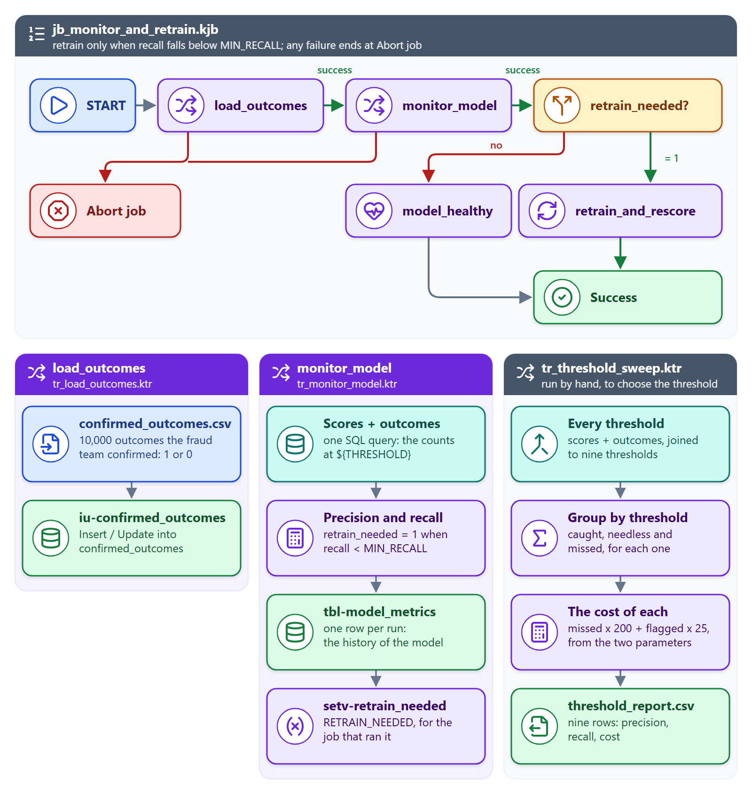
<figcaption>Outcomes in, a measurement every run, a retrain only when it is needed</figcaption>
</figure>
</div>

Read the diagram as a loop. Credit Card put a score on every transaction. Here the outcomes the fraud team confirmed go into a second table, and every run of the job joins the two: **monitor_model** measures how much of the confirmed fraud the model caught, writes that to `model_metrics`, and tells the job whether recall has fallen below the line you set. Only then does the job run the Credit Card job again, to retrain the model and rescore. The threshold sweep sits beside the loop: you run it when you choose the threshold, not every night.

:::: tabs

### 1. Set Up

> **Note:**
>
> #### Set up the lab folder
>
> Every file in this lab reads and writes the `fraud` database you created in Credit Card, through a connection named `fraud`. Only the job reaches outside this folder: its `CREDIT_CARD_JOB` parameter names the Credit Card job, two folders up, in `02-machine-learning\04-credit-card`.

1. Start Spoon with the **Start Pentaho Data Integration** button below, or from a terminal:

```powershell
Set-Location C:\Pentaho\design-tools\data-integration
.\spoon.bat
```

<button data-launch="spoon" data-path="">Start Pentaho Data Integration</button>

2. Check that the scores from Credit Card are in MySQL. In PowerShell:

   ```powershell
   C:\MySQL\run-podman-mysql.ps1
   podman exec sampledata-mysql mysql -ufraud_user -ppassword -e "SELECT COUNT(*) FROM transaction_scores" fraud
   ```

> **Success:** Checkpoint: `10000`. If the table is missing or empty, run the Credit Card job first.

3. Select **File > Open** (`Ctrl+O`) and open `jb_monitor_and_retrain.kjb` from this lab's folder, `C:\Workshop-ML-Specialty\03-ml-in-production\05-monitoring-and-tuning`. (On your own machine, download this lab's files from **Lab Files** below into one folder, beside a `02-machine-learning\04-credit-card` folder with the Credit Card files.)

<div align="center">
<figure>
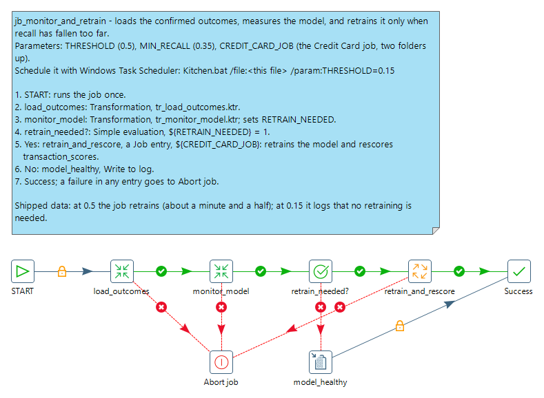
<figcaption>jb_monitor_and_retrain.kjb</figcaption>
</figure>
</div>


> **Success:** Checkpoint: Spoon shows the job: **START**, **load_outcomes**, **monitor_model**, **retrain_needed?**, **retrain_and_rescore** and **Success** in a row, **model_healthy** under **retrain_needed?**, and **Abort job** under **monitor_model**.

### 2. Load the Outcomes

> **Note:**
>
> #### Load what the fraud team confirmed
>
> `confirmed_outcomes.csv` holds the confirmed outcomes of Credit Card's week, transactions 200,001 to 210,000: 10,000 transactions, `transaction_id` and `confirmed_fraud`, `1` for fraud and `0` for a genuine order. **load_outcomes** runs `tr_load_outcomes.ktr`, which loads them into `fraud.confirmed_outcomes`.

1. Right-click **load_outcomes** and select **Open Referenced Object > Transformation**.

<div align="center">
<figure>
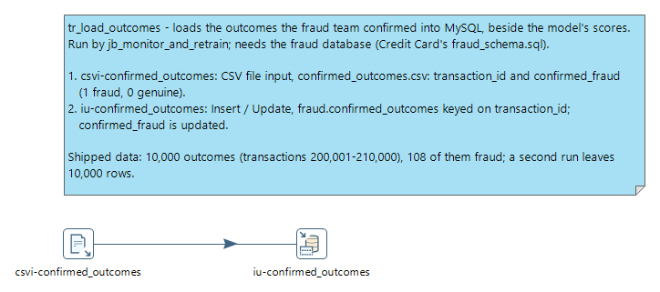
<figcaption>tr_load_outcomes.ktr</figcaption>
</figure>
</div>


| Step | Type | What it does |
| --- | --- | --- |
| **csvi-confirmed_outcomes** | CSV file input | Reads `confirmed_outcomes.csv`: `transaction_id` and `confirmed_fraud`, both Integer |
| **iu-confirmed_outcomes** | Insert / Update | Into `confirmed_outcomes`, keyed on `transaction_id`; updates `confirmed_fraud` when the team changes its mind |

2. Double-click **iu-confirmed_outcomes**. **Connection** is `fraud` and **Target table** is `confirmed_outcomes`; the key is `transaction_id` `=` `transaction_id`, and **Update fields** writes `transaction_id` with **Update** `N` and `confirmed_fraud` with **Update** `Y`. Select **Cancel**.
3. Press `F9` and select **Run**.

> **Success:** Checkpoint: on the **Step Metrics** tab, **csvi-confirmed_outcomes** reads 10,000 rows and **iu-confirmed_outcomes** writes 10,000; 108 of them are fraud, about one in a hundred. Run it again and the table still holds 10,000 rows.

Each outcome now sits in MySQL beside the score Credit Card gave the same transaction, joined by `transaction_id`.

> **Under the hood:**
>
> #### Outcomes arrive late, and sometimes change
>
> The model never saw these transactions: it learned from the history,
> 1 to 200,000, and these are this week's new orders, 200,001 to 210,000. Their outcomes exist only now, weeks
> after the scores. **Insert / Update** keyed on `transaction_id`
> adds an outcome the first time and overwrites it when the fraud team
> reopens a case and changes its mind.
>
> **Why it matters:** this is the only fair test of a model: scores made
> before anyone knew the answer, judged against the answer once it is
> known. A model measured on the rows it learned from always looks
> better than it is.

### 3. Tune the Threshold

> **Note:**
>
> #### What does each threshold cost?
>
> Credit Card flags an order when its `fraud_probability` is 0.5 or more. That number is a business choice, not a property of the model. A fraud the model misses costs the chargeback and the goods; a genuine order it flags costs an analyst's review. `tr_threshold_sweep.ktr` prices nine thresholds, from 0.02 to 0.5, against the confirmed outcomes. They sit low on purpose: when fraud is rare, few orders ever score high.

1. Select **File > Open** and open `tr_threshold_sweep.ktr` from the lab folder.

<div align="center">
<figure>
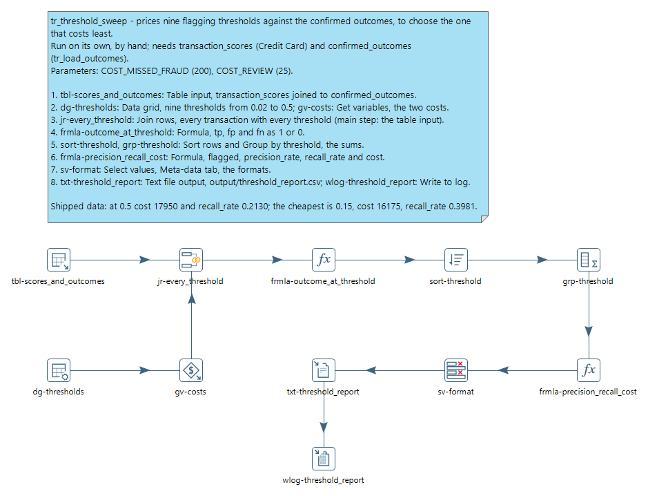
<figcaption>tr_threshold_sweep.ktr</figcaption>
</figure>
</div>


| Step | Type | What it does |
| --- | --- | --- |
| **tbl-scores_and_outcomes** | Table input | Joins `transaction_scores` to `confirmed_outcomes`: one row per confirmed transaction, with its `fraud_probability` and `confirmed_fraud` |
| **dg-thresholds** | Data grid | Nine rows, `threshold` 0.02, 0.05, 0.1, 0.15, 0.2, 0.25, 0.3, 0.4 and 0.5 |
| **gv-costs** | Get variables | Adds `cost_missed_fraud` and `cost_review` to each threshold, from the parameters `COST_MISSED_FRAUD` (200) and `COST_REVIEW` (25) |
| **jr-every_threshold** | Join rows (cartesian product) | Pairs every transaction with every threshold: 10,000 × 9 = 90,000 rows |
| **frmla-outcome_at_threshold** | Formula | For each pair, `tp`, `fp` and `fn`: 1 when the order would be a caught fraud, a needless review or a missed fraud at that threshold, else 0 |
| **sort-threshold** | Sort rows | By `threshold`, because **Group by** needs its groups together |
| **grp-threshold** | Group by | One row per threshold: the sums of `tp`, `fp` and `fn` |
| **frmla-precision_recall_cost** | Formula | `flagged`, `precision_rate`, `recall_rate`, and `cost` = missed fraud × `cost_missed_fraud` + flagged orders × `cost_review` |
| **sv-format** | Select values | On the **Meta-data** tab, formats the rates to four places and the costs to whole numbers |
| **txt-threshold_report** | Text file output | `output/threshold_report.csv` |
| **wlog-threshold_report** | Write to log | One block per threshold under `Cost of each threshold` |

<div align="center">
<figure>
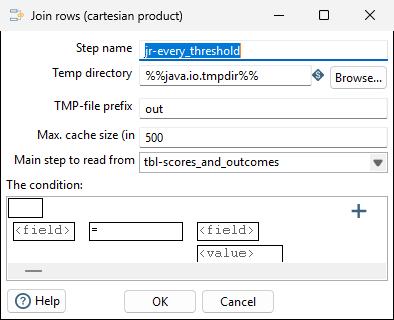
<figcaption>jr-every_threshold: every transaction with every threshold</figcaption>
</figure>
</div>


2. Double-click **frmla-outcome_at_threshold** and read the three formulas, for example `IF(AND([fraud_probability]>=[threshold];[confirmed_fraud]=1);1;0)` for `tp`. Select **Cancel**.

<div align="center">
<figure>
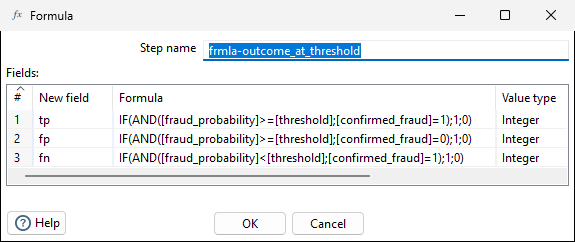
<figcaption>frmla-outcome_at_threshold</figcaption>
</figure>
</div>

3. Double-click on an empty part of the canvas to open **Transformation properties**, and select the **Parameters** tab: `COST_MISSED_FRAUD` is `200` and `COST_REVIEW` is `25`. Select **Cancel**.

> **Under the hood:**
>
> #### A cartesian join turned one question into nine
>
> **Join rows** with no condition pairs every row of one input with
> every row of the other. It keeps the small input, the nine
> thresholds, in memory and streams the large one past it, which is why
> **Main step to read from** names **tbl-scores_and_outcomes**. After
> that, each threshold is just a group: three 1-or-0 flags summed by
> **Group by** are the counts a confusion matrix holds.
>
> **Why it matters:** a precision–recall curve is nine rows of ordinary
> data, built with steps you already use. And the costs are parameters,
> not numbers inside a formula, so the people who know them, the fraud
> and finance teams, can change them at run time without editing the
> transformation.

4. Press `F9`, and select **Run** in the **Run Options** dialog. The run takes under a minute.
5. Open `output/threshold_report.csv` in the lab folder.

> **Success:** Checkpoint: nine rows. At `0.5`, the Credit Card threshold, only 38 orders are flagged: `precision_rate` is `0.6053`, `recall_rate` is `0.2130` and `cost` is `17950`. The cheapest is `0.15`: 127 flagged, `precision_rate` `0.3386`, `recall_rate` `0.3981`, `cost` `16175`.

At 0.15 the team reviews 89 more orders and catches 20 more frauds, which saves 1,775 on one week's orders. With no model at all, every one of the 108 frauds gets through, at 21,600. Notice too how flat the bottom of the curve is: `0.05` costs `16300`, only 125 more. With about a hundred frauds a week, the costs of nearby thresholds are within the luck of a few frauds; between two that cost about the same, the fraud team takes the one with fewer reviews. Notice how close 0.15 is to 25 / 200 = 0.125, the cost of a review over the cost of a miss: for a model whose probabilities are honest, that ratio is where reviewing starts to pay. The best threshold moves when the costs do:

6. Press `F9` again. In **Run Options**, on the **Parameters** tab, set `COST_MISSED_FRAUD` to `400`, and select **Run**.

> **Success:** Checkpoint: the cheapest threshold is now `0.05`, with `cost` `24300`. When a missed fraud costs more, it pays to review more orders.

### 4. Monitor the Model

> **Note:**
>
> #### Measure the model at the live threshold
>
> **monitor_model** runs `tr_monitor_model.ktr`. It measures the model at the threshold in use, the `THRESHOLD` parameter, keeps the result in `model_metrics`, and decides whether the model needs retraining: when its recall, the share of the confirmed fraud it caught, is below `MIN_RECALL`.

1. Select the **jb_monitor_and_retrain** tab, right-click **monitor_model** and select **Open Referenced Object > Transformation**.

<div align="center">
<figure>
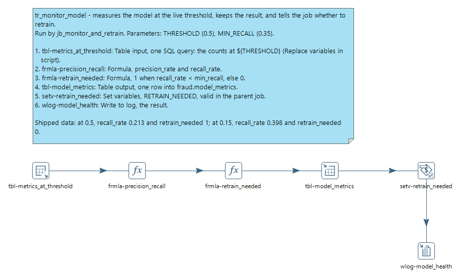
<figcaption>tr_monitor_model.ktr</figcaption>
</figure>
</div>


| Step | Type | What it does |
| --- | --- | --- |
| **tbl-metrics_at_threshold** | Table input | One SQL query: the counts of true positives, false positives and false negatives at `${THRESHOLD}`, over the confirmed transactions |
| **frmla-precision_recall** | Formula | `precision_rate` and `recall_rate` |
| **frmla-retrain_needed** | Formula | `retrain_needed` = `IF([recall_rate]<[min_recall];1;0)` |
| **tbl-model_metrics** | Table output | One row into `model_metrics`; MySQL fills `run_id` and `run_at` |
| **setv-retrain_needed** | Set variables | Sets `RETRAIN_NEEDED` to `retrain_needed`, for the parent job |
| **wlog-model_health** | Write to log | The threshold, the rates and the answer, under `Model health` |

2. Double-click **tbl-metrics_at_threshold**. The query uses `${THRESHOLD}` and `${MIN_RECALL}`, and **Replace variables in script?** is selected, so PDI puts the parameters' values into the SQL before MySQL sees it. Select **Cancel**.

<div align="center">
<figure>
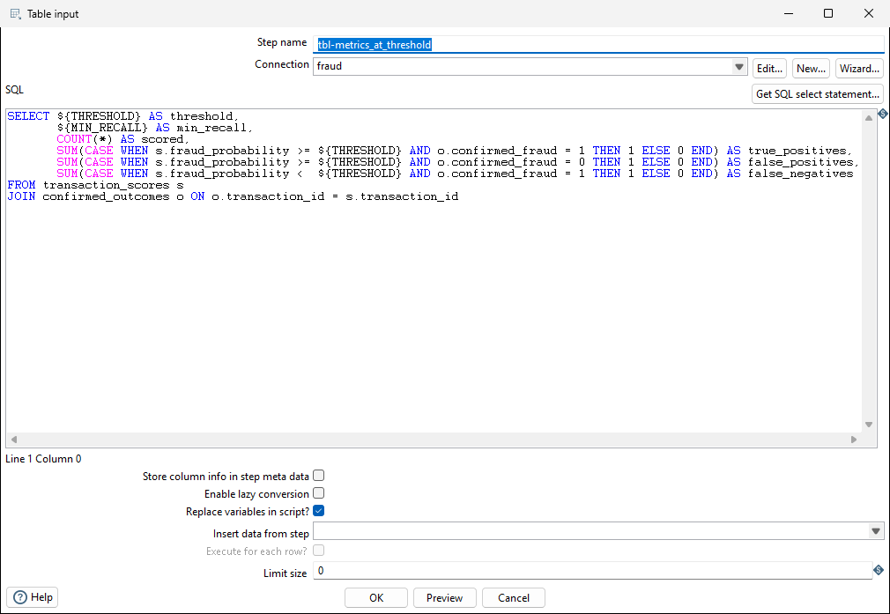
<figcaption>tbl-metrics_at_threshold</figcaption>
</figure>
</div>

3. Double-click **setv-retrain_needed**: field `retrain_needed`, variable `RETRAIN_NEEDED`, **Variable scope type** `Valid in the parent job`. Select **Cancel**.

<div align="center">
<figure>
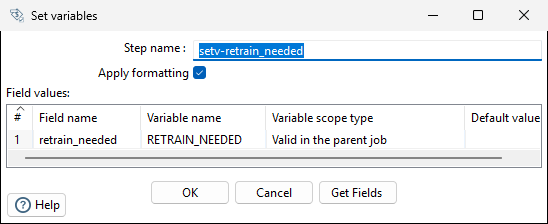
<figcaption>setv-retrain_needed</figcaption>
</figure>
</div>


> **Under the hood:**
>
> #### Two ways to aggregate, chosen on purpose
>
> The sweep counts in PDI, because it builds rows that are not in any
> table: nine thresholds that exist only in a data grid. The monitor
> counts in SQL, because its question is one row over two tables that
> sit side by side in MySQL: the database does the join and the sums,
> and only one row comes back to PDI.
>
> **Why it matters:** pushing an aggregate down to the database moves
> one row over the network instead of 10,000. Keep the work in PDI when
> it needs PDI, such as rows you generate or data from more than one
> source.

### 5. Run the Job

> **Note:**
>
> #### Retrain only when the model needs it
>
> The job loads the outcomes, measures the model, and then checks `RETRAIN_NEEDED`. At the Credit Card threshold, 0.5, recall is about 0.21, below `MIN_RECALL`, the fraud team's 0.35, so the job runs the Credit Card job again: it retrains the model and rescores the week, about a minute and a half.

1. Select the **jb_monitor_and_retrain** tab and double-click **retrain_needed?**, a **Simple evaluation** entry: it evaluates the variable `${RETRAIN_NEEDED}`, as a String, with **Success condition** `If value is equal to` and **Value** `1`. Select **Cancel**.

<div align="center">
<figure>
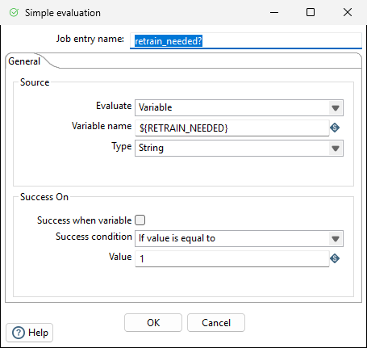
<figcaption>retrain_needed?</figcaption>
</figure>
</div>

2. Double-click **retrain_and_rescore**, a **Job** entry. Its job is `${CREDIT_CARD_JOB}`. Select **Cancel**.

<div align="center">
<figure>
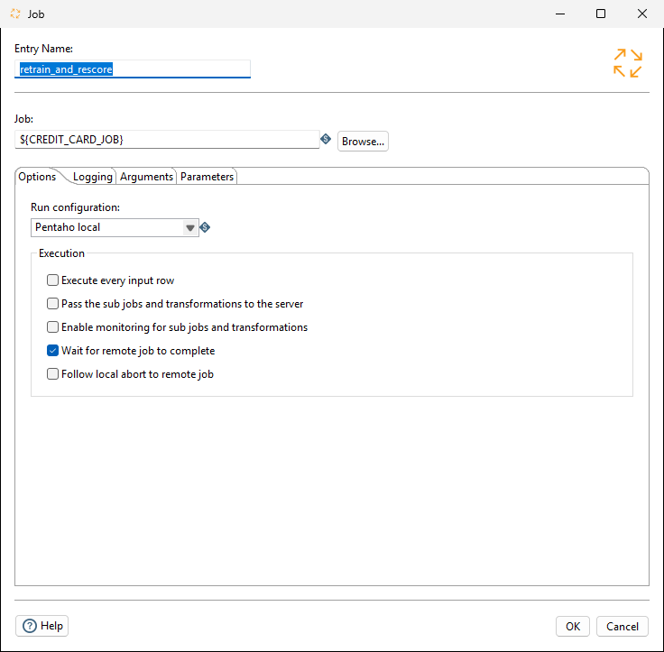
<figcaption>retrain_and_rescore</figcaption>
</figure>
</div>

3. Press `F9`, and select **Run**.

> **Success:** Checkpoint: in **Job metrics**, **retrain_needed?** succeeds and **retrain_and_rescore** runs the Credit Card job's **train_model** and **predict_fraud**; the job ends at **Success**. In **Logging**, under `Model health`, `recall_rate` is `0.212962963` and `retrain_needed = 1`.

4. Run it again at the threshold the sweep chose. Press `F9`; in **Run Options**, on the **Parameters** tab, set `THRESHOLD` to `0.15`, and select **Run**.

> **Success:** Checkpoint: this time `recall_rate` is `0.3981481481` and `retrain_needed = 0`; **retrain_needed?** fails, the red hop runs **model_healthy**, and the log says `Recall 0.35 or better at threshold 0.15: no retraining needed.` The job still ends at **Success**: a healthy model is not an error.

5. See the history the job keeps. In PowerShell:

   ```powershell
   podman exec sampledata-mysql mysql -ufraud_user -ppassword -e "SELECT run_id, run_at, threshold, precision_rate, recall_rate, retrain_needed FROM model_metrics" fraud
   ```

> **Success:** Checkpoint: one row per run of **monitor_model**, the latest with `threshold` `0.15`, `precision_rate` `0.3386`, `recall_rate` `0.3981` and `retrain_needed` `0`.

With the lab's fixed data and seed, the retrained model is the same model, so its scores do not change. In production the training data grows with every month's confirmed outcomes, and that is what lets a retrained model catch the fraud the old one missed.

> **Under the hood:**
>
> #### A variable carried the answer from a transformation to its job
>
> **Set variables** with the scope **Valid in the parent job** writes
> `RETRAIN_NEEDED` into the job that ran the transformation, once the
> transformation ends. The next entry, **retrain_needed?**, reads it.
> The variable cannot be used inside the transformation that sets it:
> every step starts at once, before the value exists. And the **Job**
> entry runs a whole other job, with its own folder, so the Credit Card
> job finds its files exactly as it does when you run it yourself.
>
> **Why it matters:** retraining costs minutes and, in production,
> money and risk. A job that measures first and retrains only when the
> model has drifted is cheaper and safer than one that retrains every
> night, and `model_metrics` shows when and why it did.

6. Run it every night. This course schedules with Windows Task Scheduler, which runs Kitchen, PDI's command-line job runner, with the parameters you choose. In PowerShell:

   ```powershell
   $kitchen = 'C:\Pentaho\design-tools\data-integration\Kitchen.bat'
   $job = 'C:\Workshop-ML-Specialty\03-ml-in-production\05-monitoring-and-tuning\jb_monitor_and_retrain.kjb'
   $action = New-ScheduledTaskAction -Execute $kitchen -Argument "/file:`"$job`" /param:THRESHOLD=0.15 /level:Basic"
   Register-ScheduledTask -TaskName 'Fraud model monitor' -Action $action -Trigger (New-ScheduledTaskTrigger -Daily -At 2am)
   ```

> **Success:** Checkpoint: **Task Scheduler** lists **Fraud model monitor**. To try it now, right-click it and select **Run**; a new row appears in `model_metrics`. Remove it when you are done with `Unregister-ScheduledTask -TaskName 'Fraud model monitor'`.

::::

## Troubleshooting <!-- no-step -->

<details>
<summary>tbl-scores_and_outcomes or tbl-metrics_at_threshold returns no rows</summary>

One of the two tables is empty. Run the Credit Card job for `transaction_scores`, and **load_outcomes** (or the whole job) for `confirmed_outcomes`.

</details>

<details>
<summary>retrain_and_rescore: the job file cannot be found</summary>

`CREDIT_CARD_JOB` names the Credit Card job two folders up, `..\..\02-machine-learning\04-credit-card\jb_fraud_main_job.kjb`. If your Credit Card files are somewhere else, set the parameter to the full path of your `jb_fraud_main_job.kjb`, on the job's **Parameters** tab or in **Run Options**.

</details>

<details>
<summary>retrain_needed? always takes the same hop</summary>

The variable is set when **monitor_model** ends, for the job that ran it. Run the whole job, not the transformation on its own, and check that **setv-retrain_needed** has the scope **Valid in the parent job**.

</details>

<details>
<summary>Communications link failure, or Access denied for user 'fraud_user'</summary>

MySQL is not running, or the `fraud` database was not created. Start MySQL and run `fraud_schema.sql` as in [Prerequisite Tasks](../02-prerequisite-tasks/guide.md).

</details>

## Lab Files

Click a file to download. For `.ktr` and `.kjb` files, **Open in Pentaho Data Integration** launches Pentaho Data Integration with the file loaded. If Pentaho Data Integration is already running, the path is copied to your clipboard — switch to Pentaho Data Integration and press `Ctrl+O`, `Ctrl+V`, `Enter`.

The confirmed outcomes of Credit Card's week, 10,000 rows:

[confirmed_outcomes.csv](./files/confirmed_outcomes.csv)

The job and the three transformations, ready to open:

[jb_monitor_and_retrain.kjb](./files/jb_monitor_and_retrain.kjb) <button data-launch="spoon" data-path="files/jb_monitor_and_retrain.kjb">Open in Pentaho Data Integration</button> <button data-graph="files/jb_monitor_and_retrain.kjb">View graph</button>

[tr_load_outcomes.ktr](./files/tr_load_outcomes.ktr) <button data-launch="spoon" data-path="files/tr_load_outcomes.ktr">Open in Pentaho Data Integration</button> <button data-graph="files/tr_load_outcomes.ktr">View graph</button>

[tr_threshold_sweep.ktr](./files/tr_threshold_sweep.ktr) <button data-launch="spoon" data-path="files/tr_threshold_sweep.ktr">Open in Pentaho Data Integration</button> <button data-graph="files/tr_threshold_sweep.ktr">View graph</button>

[tr_monitor_model.ktr](./files/tr_monitor_model.ktr) <button data-launch="spoon" data-path="files/tr_monitor_model.ktr">Open in Pentaho Data Integration</button> <button data-graph="files/tr_monitor_model.ktr">View graph</button>

### Solution <!-- no-step -->

The finished job and transformations for this lab. Open them alongside your own to compare, or run the job to see the expected result. The solution's job runs the Credit Card solution's job.

Also on disk at `C:\Workshop-ML-Specialty\03-ml-in-production\05-monitoring-and-tuning\solution`.

[jb_monitor_and_retrain.kjb](./files/solution/jb_monitor_and_retrain.kjb) <button data-launch="spoon" data-path="files/solution/jb_monitor_and_retrain.kjb">Open in Pentaho Data Integration</button> <button data-graph="files/solution/jb_monitor_and_retrain.kjb">View graph</button>

[tr_load_outcomes.ktr](./files/solution/tr_load_outcomes.ktr) <button data-launch="spoon" data-path="files/solution/tr_load_outcomes.ktr">Open in Pentaho Data Integration</button> <button data-graph="files/solution/tr_load_outcomes.ktr">View graph</button>

[tr_threshold_sweep.ktr](./files/solution/tr_threshold_sweep.ktr) <button data-launch="spoon" data-path="files/solution/tr_threshold_sweep.ktr">Open in Pentaho Data Integration</button> <button data-graph="files/solution/tr_threshold_sweep.ktr">View graph</button>

[tr_monitor_model.ktr](./files/solution/tr_monitor_model.ktr) <button data-launch="spoon" data-path="files/solution/tr_monitor_model.ktr">Open in Pentaho Data Integration</button> <button data-graph="files/solution/tr_monitor_model.ktr">View graph</button>
