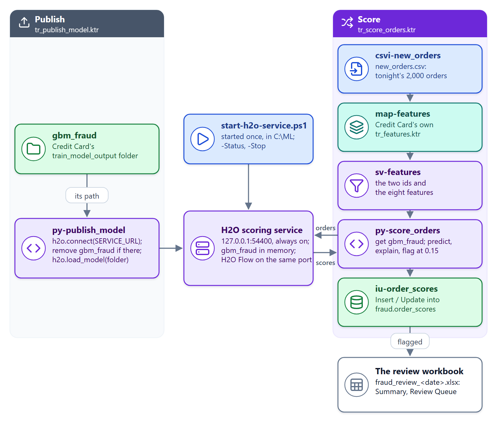
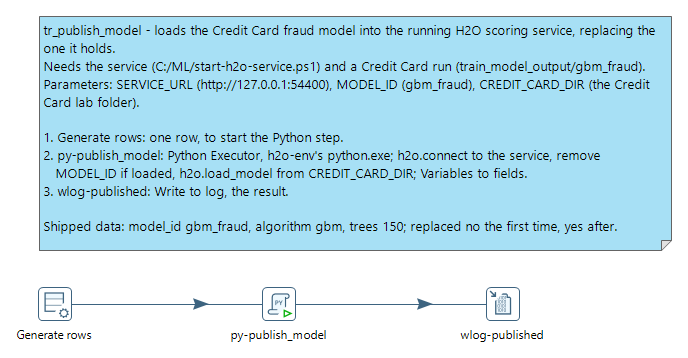
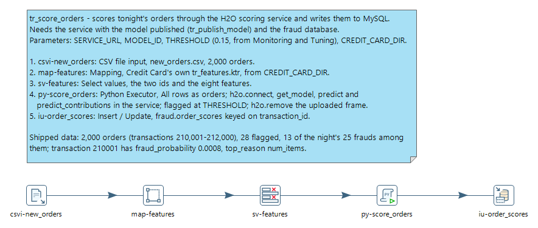
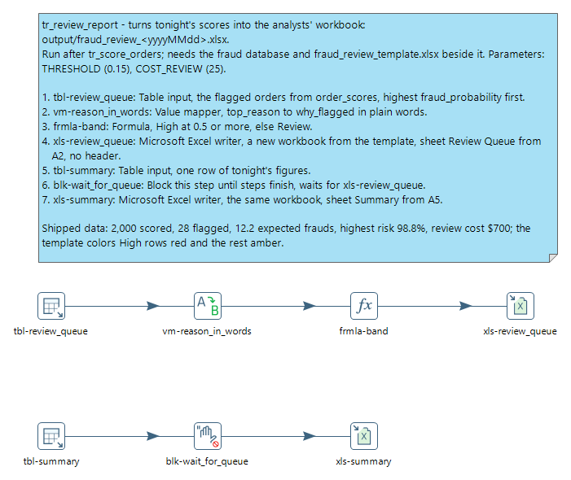
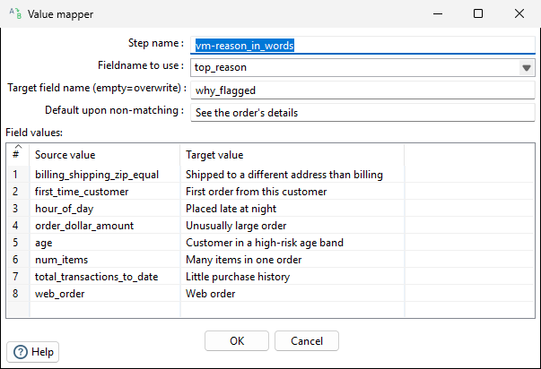
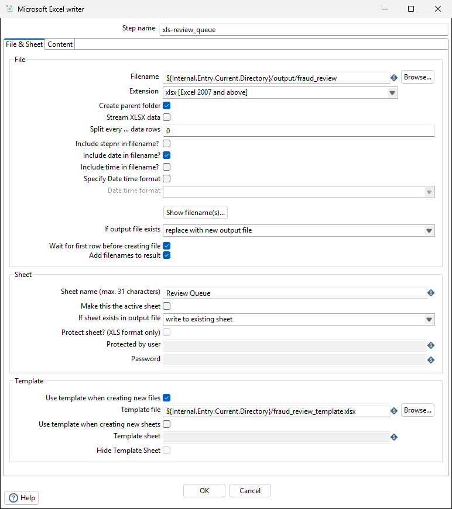
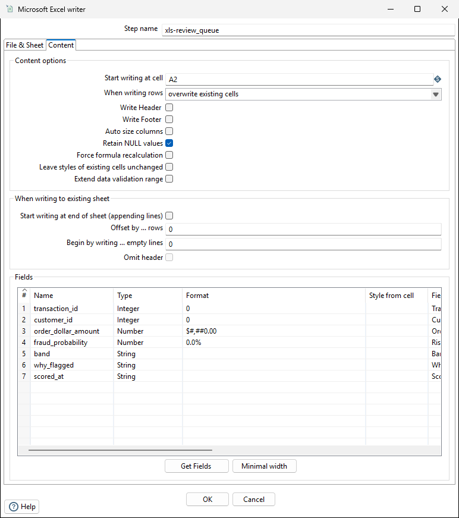
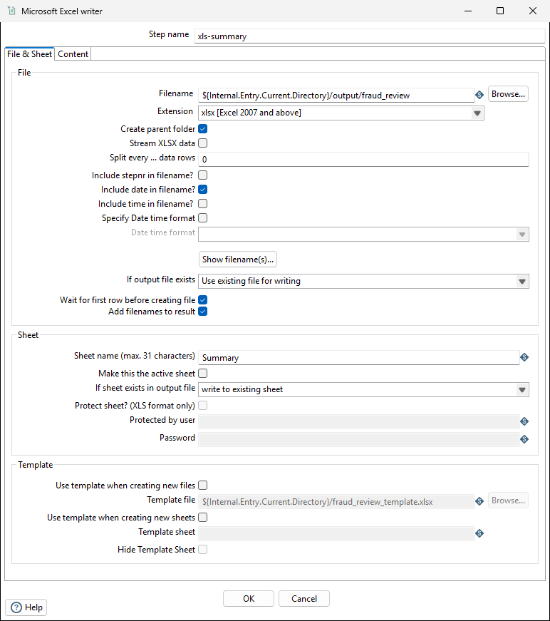
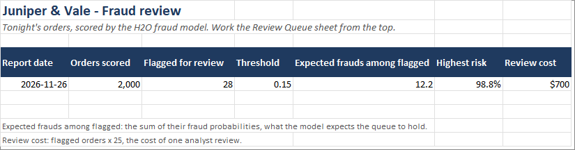
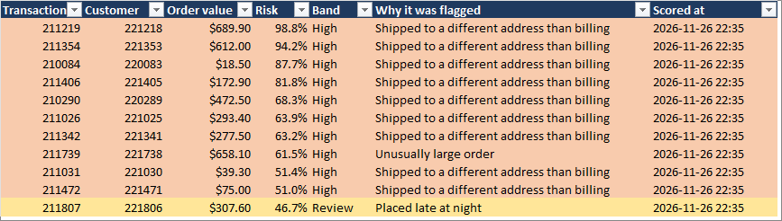

# Scoring as a Service

> **Warning:**
>
> #### Workshop - Scoring as a Service
>
> Juniper & Vale's warehouse now packs orders twice a day, and the fraud team wants every order screened before it is packed, not once a week. Credit Card's scoring step can't keep up with that: it starts its own H2O engine, loads the model from disk, scores, and shuts H2O down again, every time. Run the model as a service instead: one H2O server that stays up, holds the fraud model in memory, and answers every scoring call Pentaho Data Integration makes. Publish the model to it, swap in a new one without stopping anything, and score tonight's 2,000 orders through it.
>
> **What you'll do**
>
> * Start the H2O scoring service, and see the model it holds in H2O Flow
> * Publish the Credit Card model to the service with a **Python Executor** step, and publish it again to replace it
> * Score tonight's 2,000 orders through the service, with the features made by Credit Card's own `tr_features.ktr`
> * Flag them at the threshold you chose in Monitoring and Tuning, and write them to MySQL
> * Turn them into the analysts' review report: an Excel workbook with a summary and a color-coded queue
>
> **Prerequisites:** [Credit Card](../04-credit-card/guide.md) run at least once, so that its `train_model_output\gbm_fraud` model exists; [Monitoring and Tuning](../05-monitoring-and-tuning/guide.md) for the threshold
>
> **Estimated time:** 45 min

<figure>

<figcaption class="pcm-video-caption">Walkthrough: coming soon</figcaption>

</figure>

<div align="center">
<figure>

<figcaption>Publish the model once; every scoring call goes to the running service</figcaption>
</figure>
</div>

Read the diagram from the middle. The H2O scoring service is a long-running process on this machine: start it once and it stays up. **tr_publish_model** is how a model gets into it: it tells the service to load the Credit Card model from its folder. **tr_score_orders** is how PDI uses it: it sends the night's orders to the service and gets the scores back, without starting H2O or reading the model file.

:::: tabs

### 1. Set Up

> **Note:**
>
> #### Start the scoring service
>
> The scoring service is H2O itself, the same `h2o.jar` your `h2o-env` virtual environment runs, started on its own as a server. `C:\ML\start-h2o-service.ps1` starts it on port 54400, bound to this machine only, on Pentaho's Java. Credit Card's and Monitoring and Tuning's Python steps keep starting their own H2O on the default port, 54321, so the two never meet.

1. Start the service. In PowerShell:

   ```powershell
   powershell -ExecutionPolicy Bypass -File C:\ML\start-h2o-service.ps1
   ```

   On your own machine, run `start-h2o-service.ps1` from the folder you downloaded it to from [Prerequisite Tasks](../02-prerequisite-tasks/guide.md): the same script.

> **Success:** Checkpoint: `The H2O scoring service is running on http://127.0.0.1:54400 (H2O 3.46.0.12, cloud fraud-scoring).` Run it again with `-Status` at any time to check; `-Stop` shuts it down.

2. Open `http://127.0.0.1:54400` in a browser. This is H2O Flow, the service's own web page. Select **Model > List All Models**.

> **Success:** Checkpoint: Flow lists no models yet. The service is running but empty.

H2O lists Java 8 to 17 as supported, and Pentaho's Java is 21. The script starts the service with `-allow_unsupported_java`, the same flag H2O's own Python client passes when the course's Python steps start H2O on that Java.

> **Under the hood:**
>
> #### A server of its own, on a port of its own
>
> The script runs `h2o.jar` from `h2o-env` as a separate Java process,
> named `fraud-scoring`, with 2 GB of memory, listening on
> `127.0.0.1:54400`, and waits until it answers. Bound to `127.0.0.1`, it
> takes calls from this machine only. Its logs go to
> `%TEMP%\h2o-scoring-service`.
>
> **Why it matters:** the Python steps in Credit Card and Monitoring and
> Tuning start an H2O of their own on port 54321 and shut it down when
> they finish. On its own port, the service is never the one they shut
> down. In production it would run on a server, as a service that starts
> with the machine, with access limited to the machines that score.

3. Start Spoon with the **Start Pentaho Data Integration** button below, or from a terminal:

```powershell
Set-Location C:\Pentaho\design-tools\data-integration
.\spoon.bat
```

<button data-launch="spoon" data-path="">Start Pentaho Data Integration</button>

4. Select **File > Open** (`Ctrl+O`) and open `tr_publish_model.ktr` and `tr_score_orders.ktr` from this lab's folder, `C:\Workshop-ML-Specialty\03-ml-in-production\06-scoring-as-a-service`. (On your own machine, download this lab's files from **Lab Files** below into one folder, beside a `02-machine-learning\04-credit-card` folder where the Credit Card job has run.)

### 2. Publish the Model

> **Note:**
>
> #### Load the model into the service
>
> `tr_publish_model.ktr` is a **Generate rows** step, one row to start the Python step, and a **Python Executor** step that connects to the service and loads the Credit Card model into it. Three parameters say where: `SERVICE_URL` (`http://127.0.0.1:54400`), `MODEL_ID` (`gbm_fraud`) and `CREDIT_CARD_DIR`, the Credit Card lab folder two folders up.

1. Select the **tr_publish_model** tab and double-click **py-publish_model**. On the **Script** tab:

<div align="center">
<figure>

<figcaption>tr_publish_model.ktr</figcaption>
</figure>
</div>


```python
import os
from urllib.parse import urlparse, unquote
import h2o


def local_path(url):
    # PDI hands folders over as file:/// URLs; turn one into a path
    if url.startswith("file:"):
        p = unquote(urlparse(url).path)
        if os.name == "nt" and p[:1] == "/" and p[2:3] == ":":
            p = p[1:]
        return p
    return url


# The H2O scoring service, started with C:\ML\start-h2o-service.ps1
service_url = "${SERVICE_URL}"
h2o.connect(url=service_url, verbose=False)

# The model the Credit Card job saved. The service reads the folder
# itself, so the path must be one it can see: here, the same machine.
model_path = os.path.normpath(os.path.join(local_path("${CREDIT_CARD_DIR}"), "train_model_output", "gbm_fraud"))

# Replace the model the service holds, if any: scoring calls made after
# this line use the new one. Nothing else is restarted.
replaced = "yes" if "${MODEL_ID}" in h2o.ls()["key"].tolist() else "no"
if replaced == "yes":
    h2o.remove("${MODEL_ID}")
model = h2o.load_model(model_path)

# One row back to PDI
model_id = model.model_id
algorithm = model.algo
trees = str(model.params["ntrees"]["actual"])
service = service_url
```

The script calls `h2o.connect`, not `h2o.init`: it joins a running H2O and starts nothing. And it never calls `h2o.cluster().shutdown()`, because the service must outlive the step.

2. On the **Output** tab, **Variables to fields** returns `model_id`, `algorithm`, `trees`, `replaced` and `service`, all String. Select **OK**.
3. Press `F9`, and select **Run**.

> **Success:** Checkpoint: in **Logging**, under `Published to the scoring service`: `model_id = gbm_fraud`, `algorithm = gbm`, `trees = 150`, `replaced = no`, `service = http://127.0.0.1:54400`. In Flow, **Model > List All Models** now lists `gbm_fraud`.

4. Press `F9` and **Run** again.

> **Success:** Checkpoint: `replaced = yes`. The service dropped the model it held and loaded the one on disk.

In Flow, select **Model > List All Models** again: one `gbm_fraud`, not two.

> **Under the hood:**
>
> #### Publishing is a hand-over, not a restart
>
> The service keeps each model in memory under its key, `gbm_fraud`.
> Publishing removes that key and loads the saved model under it again;
> any scoring call made after that uses the model just loaded. The
> service, and every other model it holds, keep running.
>
> **Why it matters:** this is how a retrained model goes live. Run
> Monitoring and Tuning's job; when it retrains, run
> **tr_publish_model** after it, and the next batch is scored by the
> new model, with no downtime and no change to the scoring
> transformation. The service holds models in memory only: after a
> restart, publish again.

### 3. Score Tonight's Orders

> **Note:**
>
> #### Score through the service
>
> `new_orders.csv` holds tonight's 2,000 orders, one row per order, already joined: transaction numbers `210001` to `212000`, new orders from new customers. The model has never seen them. `tr_score_orders.ktr` makes their features, has the service score them, and writes the scores to `fraud.order_scores`.

1. Select the **tr_score_orders** tab.

<div align="center">
<figure>

<figcaption>tr_score_orders.ktr</figcaption>
</figure>
</div>


| Step | Type | What it does |
| --- | --- | --- |
| **csvi-new_orders** | CSV file input | Reads `new_orders.csv`: the ids, the order fields, and the two zip codes |
| **map-features** | Mapping (sub-transformation) | Runs Credit Card's `tr_features.ktr`, from `${CREDIT_CARD_DIR}`: the zip match, and the flags as Numbers |
| **sv-features** | Select values | Keeps the two ids and the eight features |
| **py-score_orders** | Python Executor | Sends the orders to the service; returns the scored data frame `scored` |
| **iu-order_scores** | Insert / Update | Into `order_scores`, keyed on `transaction_id` |

2. Double-click **map-features**. Its file is `${CREDIT_CARD_DIR}/tr_features.ktr`: not a copy, the same file Credit Card trains and scores with. Select **Cancel**.

> **Under the hood:**
>
> #### One feature file across three labs
>
> Training, batch scoring and service scoring all make the model's
> features through Credit Card's `tr_features.ktr`. Change the zip match
> there and all three change together. The parameter `CREDIT_CARD_DIR`
> is the one place that says where it is.
>
> **Why it matters:** a model scores well only on features made exactly
> as they were when it was trained. A second copy of the feature logic,
> for a second way of scoring, is the classic way that promise breaks.

3. Double-click **py-score_orders**. On the **Script** tab:

```python
import h2o

# Connect to the running scoring service: no H2O to start, no model to load
h2o.connect(url="${SERVICE_URL}", verbose=False)
gbm = h2o.get_model("${MODEL_ID}")
threshold = float("${THRESHOLD}")

# Send tonight's orders to the service, and score them there
frame = h2o.H2OFrame(orders)
pred_frame = gbm.predict(frame)
contrib_frame = gbm.predict_contributions(frame)
pred = pred_frame.as_data_frame(use_multi_thread=True)
contrib = contrib_frame.as_data_frame(use_multi_thread=True)

scored = orders[["transaction_id", "customer_id", "order_dollar_amount"]].copy()
scored["fraud_probability"] = pred["p1"].round(4).values
scored["flagged"] = (pred["p1"] >= threshold).astype("int64").values
scored["top_reason"] = contrib.drop(columns=["BiasTerm"]).idxmax(axis=1).values

# The service keeps running: remove the three frames this call made in it
h2o.remove([frame, pred_frame, contrib_frame])
```

4. On the **Input** tab, **sv-features** goes in, **All rows**, as the data frame `orders`. On the **Output** tab, **Frame to fields** returns `scored`: `transaction_id`, `customer_id` and `flagged` as **Integer**, `order_dollar_amount` and `fraud_probability` as **BigNumber**, `top_reason` as **String**. Select **OK**.
5. Open **Transformation properties** (`Ctrl+T`), **Parameters** tab: `THRESHOLD` is `0.15`, the cheapest threshold from Monitoring and Tuning. Select **Cancel**.
6. Press `F9`, and select **Run**.

> **Success:** Checkpoint: on **Step Metrics**, every step handles 2,000 rows, and **py-score_orders** finishes about five seconds after **sv-features**: Python starting, connecting, and scoring. Credit Card's scoring step spends longer than that just starting its own H2O.

7. Check the table. In PowerShell:

   ```powershell
   podman exec sampledata-mysql mysql -ufraud_user -ppassword -e "SELECT COUNT(*), SUM(flagged) FROM order_scores; SELECT * FROM order_scores ORDER BY transaction_id LIMIT 3; SELECT top_reason, COUNT(*) FROM order_scores WHERE flagged = 1 GROUP BY top_reason ORDER BY 2 DESC" fraud
   ```

> **Success:** Checkpoint: `2000` orders, `28` flagged for review. The first order, transaction `210001`, has `fraud_probability` `0.0008`. Eighteen of the flagged orders score between `0.15` and `0.5`: Credit Card's 0.5 would have let them through. Among the flagged orders, the commonest reasons are `billing_shipping_zip_equal` (17) and `hour_of_day` (6).

The fraud team later confirmed 25 of tonight's 2,000 orders as fraud; 13 of them are among the 28 flagged. Twenty-eight reviews to stop thirteen frauds is a good night's work, and the twelve that got through show why the team still watches the chargebacks.

8. In Flow, select **Data > List All Frames**. The run left nothing behind: the script removed the orders it uploaded and the two frames of results.

> **Under the hood:**
>
> #### The work moved, the cost did not disappear
>
> `h2o.H2OFrame(orders)` uploads the rows to the service over HTTP;
> `predict` and `predict_contributions` run inside the service; only the
> results come back. The Python process still starts once per run, but
> it starts small: it imports a client and makes a few web calls, while
> the service already has its Java engine running and the model in
> memory. `h2o.remove` deletes the uploaded rows and the two result
> frames, so a service that runs for weeks does not fill with old
> batches.
>
> **Why it matters:** the slow, fixed costs, starting Java and loading
> the model, are paid once, when the service starts. That is what makes
> small, frequent batches affordable, and it is what the next lab,
> [Real-time Scoring](../07-real-time-scoring/guide.md), needs: orders
> scored seconds after they arrive.

9. When you are done with the course's labs, stop the service:

   ```powershell
   powershell -ExecutionPolicy Bypass -File C:\ML\start-h2o-service.ps1 -Stop
   ```

### 4. The Review Report

> **Note:**
>
> #### The workbook the analysts open
>
> A table in MySQL is where the scores live; the analysts work from a workbook. `tr_review_report.ktr` reads `order_scores` and writes `output/fraud_review_<yyyyMMdd>.xlsx`: a **Summary** sheet with tonight's figures, and a **Review Queue** sheet with every flagged order, highest risk first, the reason in plain words, and the risky rows in color. The look comes from `fraud_review_template.xlsx`, in this lab's folder: PDI fills it with data.

1. Select **File > Open** and open `tr_review_report.ktr` from the lab folder.

<div align="center">
<figure>

<figcaption>tr_review_report.ktr</figcaption>
</figure>
</div>


| Step | Type | What it does |
| --- | --- | --- |
| **tbl-review_queue** | Table input | The flagged orders from `order_scores`, highest `fraud_probability` first |
| **vm-reason_in_words** | Value mapper | Turns `top_reason` into words, in a new field `why_flagged` |
| **frmla-band** | Formula | `band`: `High` at 0.5 or more, `Review` below |
| **xls-review_queue** | Microsoft Excel writer | Creates the workbook from the template and writes the queue into **Review Queue**, from cell `A2` |
| **tbl-summary** | Table input | One row of tonight's figures, counted in SQL |
| **blk-wait_for_queue** | Block this step until steps finish | Holds the summary row until **xls-review_queue** has finished the file |
| **xls-summary** | Microsoft Excel writer | Opens the same workbook and writes the row into **Summary**, from cell `A5` |

2. Double-click **vm-reason_in_words**. **Fieldname to use** is `top_reason` and **Target field name** is `why_flagged`:

| Source value | Target value |
| --- | --- |
| `billing_shipping_zip_equal` | Shipped to a different address than billing |
| `first_time_customer` | First order from this customer |
| `hour_of_day` | Placed late at night |
| `order_dollar_amount` | Unusually large order |
| `age` | Customer in a high-risk age band |
| `num_items` | Many items in one order |
| `total_transactions_to_date` | Little purchase history |
| `web_order` | Web order |

   **Default upon non-matching** is `See the order's details`. Select **Cancel**.

<div align="center">
<figure>

<figcaption>vm-reason_in_words</figcaption>
</figure>
</div>


3. Double-click **xls-review_queue**. On the **File & Sheet** tab: **Filename** `${Internal.Entry.Current.Directory}/output/fraud_review`, **Extension** `xlsx [Excel 2007 and above]`, **Include date in filename?** selected, **If output file exists** `replace with new output file`; **Sheet name** `Review Queue`, **If sheet exists in output file** `write to existing sheet`; and under **Template**, **Use template when creating new files** selected, with **Template file** `${Internal.Entry.Current.Directory}/fraud_review_template.xlsx`.

<div align="center">
<figure>

<figcaption>xls-review_queue, File & Sheet tab</figcaption>
</figure>
</div>

4. On the **Content** tab: **Start writing at cell** `A2`, and **Write Header** cleared: the template already holds the column titles, in row 1. In the **Fields** grid on the same tab, each field has the Excel **Format** it is shown in, such as `$#,##0.00` for the order value and `0.0%` for the risk. Select **Cancel**.

<div align="center">
<figure>

<figcaption>xls-review_queue, Content tab</figcaption>
</figure>
</div>

5. Double-click **xls-summary**. **If output file exists** is `Use existing file for writing`, **Sheet name** `Summary`, **Start writing at cell** `A5`, no template. Select **Cancel**.

<div align="center">
<figure>

<figcaption>xls-summary, File & Sheet tab</figcaption>
</figure>
</div>


> **Under the hood:**
>
> #### The template carries the look; PDI carries the data
>
> The template is an ordinary workbook: titles, column widths, a frozen
> header row, filters, and two conditional formatting rules on the
> queue, a red fill where the risk in column D is 50% or more and amber
> on every other queued row. The first writer copies it to a new file
> and writes values only, so the rules color whatever rows arrive. The
> two writers share one file, so the summary must not open it before
> the queue is finished: **Block this step until steps finish** holds the
> summary row until **xls-review_queue** has closed the file.
>
> **Why it matters:** the analysts can change the look, the colors or
> the column widths, in Excel, without touching the transformation. And
> two writers on one file without the blocking step is a race: the run
> that works today fails, or silently loses a sheet, the day the queue
> takes a moment longer.

6. Press `F9`, and select **Run**.
7. Open `output/fraud_review_<date>.xlsx` in Excel.

> **Success:** Checkpoint: the **Summary** sheet's row reads: today's date, `2,000` orders scored, `28` flagged for review, threshold `0.15`, `12.2` expected frauds among the flagged, highest risk `98.8%`, and a review cost of `$700`. **Review Queue** lists 28 orders, starting with transaction `211219`, `$689.90`, risk `98.8%`, `High`, *Shipped to a different address than billing*; the `High` rows are red and the rest amber.

<div align="center">
<figure>

<figcaption>The Summary sheet</figcaption>
</figure>
</div>

<div align="center">
<figure>

<figcaption>The Review Queue sheet: High rows red, the rest amber</figcaption>
</figure>
</div>

The expected frauds figure is the sum of the flagged orders' probabilities: what the model expects the queue to hold. Tonight it expects about twelve; the fraud team later confirmed thirteen.

::::

## Troubleshooting <!-- no-step -->

<details>
<summary>py-publish_model or py-score_orders: Could not establish link to the H2O cloud http://127.0.0.1:54400</summary>

The service is not running. Run `C:\ML\start-h2o-service.ps1`, then `C:\ML\start-h2o-service.ps1 -Status`.

</details>

<details>
<summary>The H2O scoring service did not answer within 60 seconds</summary>

Its logs are in `%TEMP%\h2o-scoring-service`. The commonest cause is port 54400 in use by another program; start the service on another port with `-Port 54401`, and set `SERVICE_URL` to match in both transformations.

</details>

<details>
<summary>py-publish_model: File not found, or the model cannot be loaded</summary>

`CREDIT_CARD_DIR` must name the Credit Card lab folder, and the Credit Card job must have run there, so that `train_model_output\gbm_fraud` exists. Set the parameter to your folder's full path if your Credit Card files are somewhere else.

</details>

<details>
<summary>py-score_orders: Object 'gbm_fraud' not found</summary>

The service holds no model under that name: it was restarted, or the model was never published. Run **tr_publish_model** first.

</details>

<details>
<summary>iu-order_scores: Communications link failure, or Access denied for user 'fraud_user'</summary>

MySQL is not running, or the `fraud` database was not created. Start MySQL and run `fraud_schema.sql` as in [Prerequisite Tasks](../02-prerequisite-tasks/guide.md).

</details>

## Lab Files

Click a file to download. For `.ktr` and `.kjb` files, **Open in Pentaho Data Integration** launches Pentaho Data Integration with the file loaded. If Pentaho Data Integration is already running, the path is copied to your clipboard — switch to Pentaho Data Integration and press `Ctrl+O`, `Ctrl+V`, `Enter`.

Tonight's 2,000 orders:

[new_orders.csv](./files/new_orders.csv)

The three transformations, ready to open:

[tr_publish_model.ktr](./files/tr_publish_model.ktr) <button data-launch="spoon" data-path="files/tr_publish_model.ktr">Open in Pentaho Data Integration</button> <button data-graph="files/tr_publish_model.ktr">View graph</button>

[tr_score_orders.ktr](./files/tr_score_orders.ktr) <button data-launch="spoon" data-path="files/tr_score_orders.ktr">Open in Pentaho Data Integration</button> <button data-graph="files/tr_score_orders.ktr">View graph</button>

[tr_review_report.ktr](./files/tr_review_report.ktr) <button data-launch="spoon" data-path="files/tr_review_report.ktr">Open in Pentaho Data Integration</button> <button data-graph="files/tr_review_report.ktr">View graph</button>

The report's look, which **tr_review_report** fills with data:

[fraud_review_template.xlsx](./files/fraud_review_template.xlsx)

### Solution <!-- no-step -->

The finished transformations for this lab. Open them alongside your own to compare, or run them to see the expected result. The solution's transformations use the Credit Card solution's model and `tr_features.ktr`.

Also on disk at `C:\Workshop-ML-Specialty\03-ml-in-production\06-scoring-as-a-service\solution`.

[tr_publish_model.ktr](./files/solution/tr_publish_model.ktr) <button data-launch="spoon" data-path="files/solution/tr_publish_model.ktr">Open in Pentaho Data Integration</button> <button data-graph="files/solution/tr_publish_model.ktr">View graph</button>

[tr_score_orders.ktr](./files/solution/tr_score_orders.ktr) <button data-launch="spoon" data-path="files/solution/tr_score_orders.ktr">Open in Pentaho Data Integration</button> <button data-graph="files/solution/tr_score_orders.ktr">View graph</button>

[tr_review_report.ktr](./files/solution/tr_review_report.ktr) <button data-launch="spoon" data-path="files/solution/tr_review_report.ktr">Open in Pentaho Data Integration</button> <button data-graph="files/solution/tr_review_report.ktr">View graph</button>
