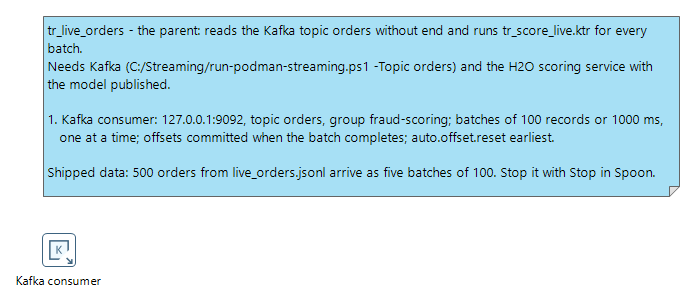
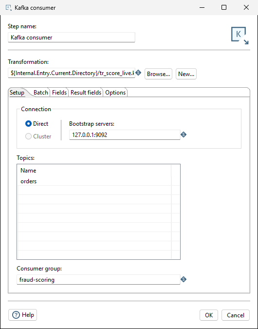
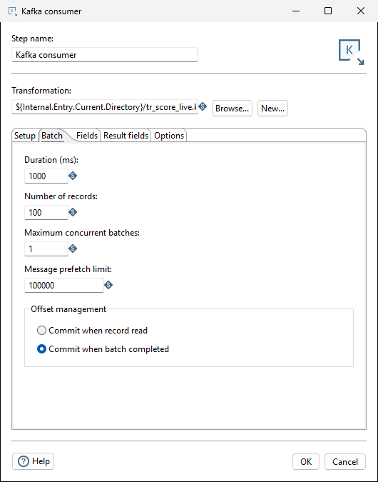
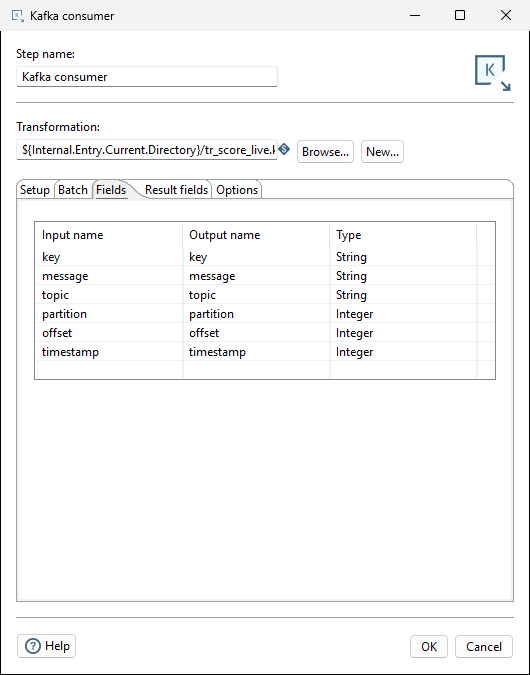
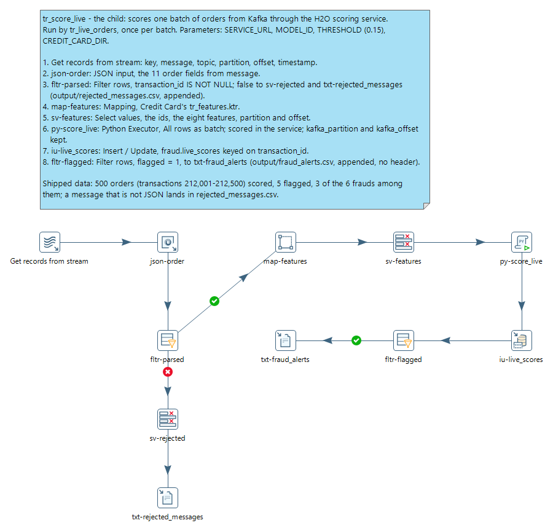
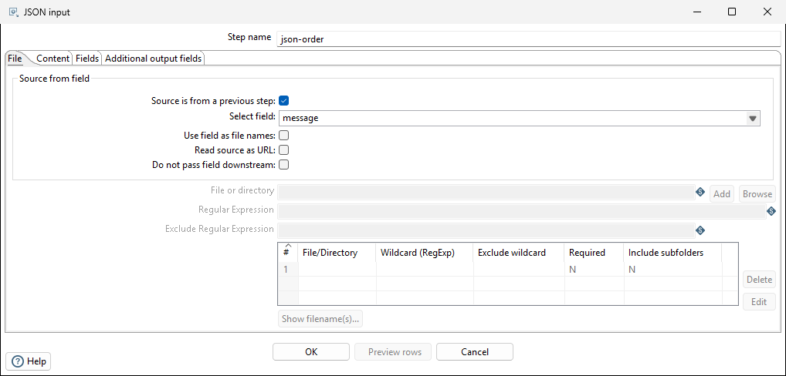
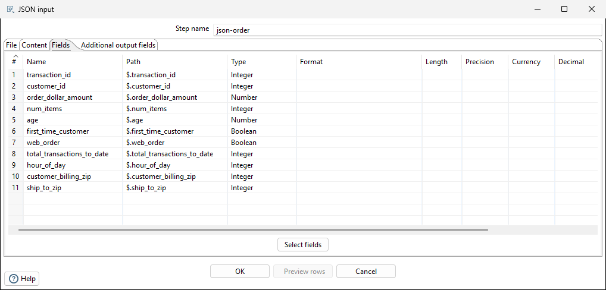

# Real-time Scoring

> **Warning:**
>
> #### Workshop - Real-time Scoring
>
> Twice a day is still too late for the orders that matter most: a fraudster who orders express delivery is gone before the next batch. Juniper & Vale's web shop team offers to publish every order to Kafka the moment it is placed, if the fraud team can screen it there and then. Score each order as it arrives: the web shop publishes every order to a Kafka topic, and a Pentaho Data Integration transformation reads the topic continuously, scores each batch of orders through the H2O scoring service from [Scoring as a Service](../06-scoring-as-a-service/guide.md), writes the scores to MySQL, and raises an alert for every order that looks like fraud, seconds after it was placed.
>
> **What you'll do**
>
> * Publish 500 orders to the `orders` topic you created in Prerequisite Tasks
> * Read the topic with a **Kafka consumer** step that hands each batch to a child transformation
> * Parse each order with **JSON input**, make its features with Credit Card's `tr_features.ktr`, and score it through the service
> * Write every score to `fraud.live_scores` with its Kafka partition and offset, and append the flagged orders to an alerts file
> * Send a message that is not an order, and see it set aside instead of stopping the stream
>
> **Prerequisites:** Kafka and the `orders` topic from [Prerequisite Tasks](../02-prerequisite-tasks/guide.md); [Scoring as a Service](../06-scoring-as-a-service/guide.md), with the service running and the model published
>
> **Estimated time:** 40 min

<figure>

<figcaption class="pcm-video-caption">Walkthrough: coming soon</figcaption>

</figure>

<div align="center">
<figure>

<figcaption>Every batch from Kafka runs the child once: parse, make the features, score, store, alert</figcaption>
</figure>
</div>

Read the diagram from the topic down. The parent transformation never ends: its **Kafka consumer** waits on the `orders` topic, collects up to 100 orders or one second's worth, and runs the child transformation on that batch. The child does what Scoring as a Service did for a file of orders, for each batch: features through Credit Card's `tr_features.ktr`, scores from the running service. Only when the child finishes does the consumer commit the batch's offsets, so an order is never lost between the topic and the table.

:::: tabs

### 1. Set Up

> **Note:**
>
> #### Kafka, the service and the topic
>
> This lab uses the Kafka broker you started in [Prerequisite Tasks](../02-prerequisite-tasks/guide.md), on `127.0.0.1:9092`, and its `orders` topic. The orders are JSON, one order per message, with the fields `new_orders.csv` had in Scoring as a Service: 500 more new orders, transactions 212,001 to 212,500.

1. Make sure Kafka is running and the `orders` topic exists. In PowerShell, on the lab machine:

   ```powershell
   C:\Streaming\run-podman-streaming.ps1 -Broker kafka -Topic orders
   ```

   On your own machine, run the copy of `run-podman-streaming.ps1` you downloaded in Prerequisite Tasks, with the same parameters. It starts Kafka only if it is stopped, and creates the topic only if it is missing.

> **Success:** Checkpoint: the script ends by describing the topic: `Topic: orders`, `PartitionCount: 1`.

2. Check that the scoring service is running and holds the model:

   ```powershell
   powershell -ExecutionPolicy Bypass -File C:\ML\start-h2o-service.ps1 -Status
   ```

If the service has been restarted since Scoring as a Service, run **tr_publish_model** again: the service holds the model in memory only.

3. Start Spoon with the **Start Pentaho Data Integration** button below, or from a terminal:

```powershell
Set-Location C:\Pentaho\design-tools\data-integration
.\spoon.bat
```

<button data-launch="spoon" data-path="">Start Pentaho Data Integration</button>

4. Select **File > Open** (`Ctrl+O`) and open `tr_live_orders.ktr` and `tr_score_live.ktr` from this lab's folder, `C:\Workshop-ML-Specialty\03-ml-in-production\07-real-time-scoring`. (On your own machine, download this lab's files from **Lab Files** below into one folder, beside a `02-machine-learning\04-credit-card` folder with the Credit Card files.)

<div align="center">
<figure>

<figcaption>tr_live_orders.ktr: the parent</figcaption>
</figure>
</div>


### 2. The Consumer

> **Note:**
>
> #### The parent reads the topic
>
> `tr_live_orders.ktr` holds one step, a **Kafka consumer**. It reads the `orders` topic as the consumer group `fraud-scoring`, and for every batch of records runs `tr_score_live.ktr`.

1. Select the **tr_live_orders** tab and double-click **Kafka consumer**. The **Transformation** box, above the tabs, names `${Internal.Entry.Current.Directory}/tr_score_live.ktr`. On the **Setup** tab, check:

| Setting | Value |
| --- | --- |
| **Connection** | **Direct**, **Bootstrap servers** `127.0.0.1:9092` |
| **Topics** | `orders` |
| **Consumer group** | `fraud-scoring` |

<div align="center">
<figure>

<figcaption>Kafka consumer, Setup tab</figcaption>
</figure>
</div>


2. On the **Batch** tab: **Duration (ms)** `1000`, **Number of records** `100`, **Maximum concurrent batches** `1`, **Offset management** **Commit when batch completed**.

<div align="center">
<figure>

<figcaption>Kafka consumer, Batch tab</figcaption>
</figure>
</div>

3. On the **Fields** tab are the six fields every record brings to the child: `key`, `message`, `topic`, `partition`, `offset` and `timestamp`. On the **Options** tab, `auto.offset.reset` is `earliest`, so a new consumer group starts at the beginning of the topic. Select **Cancel**.

<div align="center">
<figure>

<figcaption>Kafka consumer, Fields tab</figcaption>
</figure>
</div>


> **Under the hood:**
>
> #### The parent owns Kafka, the child owns the work
>
> Everything about Kafka lives in the parent: the broker, the topic,
> the consumer group, the batch size and when offsets are committed.
> The child knows only the six fields its **Get records from stream**
> step declares. It never connects to Kafka, so you can open it, read
> it and change it like any transformation.
>
> **Why it matters:** the same child works behind any of PDI's
> streaming consumers. Feed it from an MQTT or AMQP consumer instead,
> and the scoring does not change.

### 3. The Child

> **Note:**
>
> #### Each batch: parse, check, score, store, alert
>
> `tr_score_live.ktr` runs once per batch. It is Scoring as a Service's `tr_score_orders.ktr` with Kafka in front and an alert at the end.

1. Select the **tr_score_live** tab.

<div align="center">
<figure>

<figcaption>tr_score_live.ktr: the child</figcaption>
</figure>
</div>


| Step | Type | What it does |
| --- | --- | --- |
| **Get records from stream** | Get records from stream | The batch from the consumer: `key`, `message`, `topic`, `partition`, `offset`, `timestamp` |
| **json-order** | JSON input | Reads the 11 order fields out of `message`, for example `$.transaction_id` |
| **fltr-parsed** | Filter rows | `transaction_id` `IS NOT NULL`: true goes on to scoring, false to **sv-rejected** |
| **sv-rejected**, **txt-rejected_messages** | Select values, Text file output | Keep `partition`, `offset` and `message`, appended to `output/rejected_messages.csv` |
| **map-features** | Mapping (sub-transformation) | Credit Card's `tr_features.ktr`, from `${CREDIT_CARD_DIR}` |
| **sv-features** | Select values | The two ids, the eight features, `partition` and `offset` |
| **py-score_live** | Python Executor | Scores the batch in the service; returns `kafka_partition` and `kafka_offset` too |
| **iu-live_scores** | Insert / Update | Into `live_scores`, keyed on `transaction_id` |
| **fltr-flagged** | Filter rows | `flagged` = `1`: true goes on to **txt-fraud_alerts**; false ends there |
| **txt-fraud_alerts** | Text file output | Appends the flagged orders to `output/fraud_alerts.csv` |

2. Double-click **json-order**. On the **File** tab, **Source is from a previous step** is selected and **Select field** is `message`. On the **Fields** tab, each field has a **Path** such as `$.order_dollar_amount`, and `first_time_customer` and `web_order` are **Boolean**, as `tr_features.ktr` expects. Select **Cancel**.

<div align="center">
<figure>

<figcaption>json-order, File tab</figcaption>
</figure>
</div>

<div align="center">
<figure>

<figcaption>json-order, Fields tab</figcaption>
</figure>
</div>

3. Double-click **py-score_live**. The script is Scoring as a Service's, for a data frame named `batch`: it leaves `partition` and `offset` out of the frame it sends to the service, and copies them into `scored` beside each score. Select **Cancel**.
4. Double-click **txt-fraud_alerts**. On the **Content** tab, **Append** is selected, so each batch adds its alerts to the same file, and **Header** is cleared, because an appended file would repeat it. Select **Cancel**.

> **Under the hood:**
>
> #### One bad message must not stop the stream
>
> **JSON input** reads a message that is not JSON, or JSON without the
> fields, as a row of nulls. Without **fltr-parsed**, that row would
> reach the Python step, which refuses nulls, and the batch would fail.
> A failed batch stops the consumer, and its offsets are never
> committed, so the next start reads the same bad message and fails
> again.
>
> **Why it matters:** a stream has no "fix the file and run it again".
> Set the bad message aside, with its partition and offset so someone
> can find it, and keep scoring the good ones.

### 4. Run the Stream

> **Note:**
>
> #### Start the consumer, then publish the orders
>
> Start the parent first: it waits for orders. Then publish the 500 orders in `live_orders.jsonl` to the topic, and watch the batches arrive.

1. Select the **tr_live_orders** tab. Press `F9`, and select **Run**. The transformation keeps running: the consumer waits for records.
2. Publish the orders. The file is copied into the Kafka container first and published from there, which sends it byte for byte. In PowerShell:

   ```powershell
   Set-Location C:\Workshop-ML-Specialty\03-ml-in-production\07-real-time-scoring
   podman cp live_orders.jsonl pcm-kafka:/tmp/live_orders.jsonl
   podman exec pcm-kafka sh -c "/opt/kafka/bin/kafka-console-producer.sh --bootstrap-server 127.0.0.1:9092 --topic orders < /tmp/live_orders.jsonl"
   ```

Piping the file from PowerShell into `podman exec` instead adds a byte-order mark to the first message, and that message would arrive as one that is not JSON.

3. Watch **Execution Results > Logging** in Spoon: about every five seconds, a batch of 100 runs the child, and **py-score_live** finishes it.

> **Success:** Checkpoint: five batches of 100. The consumer keeps running when the topic is empty.

4. Check the table. In PowerShell:

   ```powershell
   podman exec sampledata-mysql mysql -ufraud_user -ppassword -e "SELECT COUNT(*), SUM(flagged), MIN(kafka_offset), MAX(kafka_offset) FROM live_scores; SELECT top_reason, COUNT(*) FROM live_scores WHERE flagged = 1 GROUP BY top_reason ORDER BY 2 DESC" fraud
   ```

> **Success:** Checkpoint: `500` orders, `5` flagged, offsets `0` to `499`. The flagged orders' reasons are `billing_shipping_zip_equal` (3), `hour_of_day` (1) and `total_transactions_to_date` (1).

5. Open `output/fraud_alerts.csv` in the lab folder. Its columns, with no header: `transaction_id`, `customer_id`, `order_dollar_amount`, `fraud_probability`, `flagged`, `top_reason`, `kafka_partition`, `kafka_offset`.

> **Success:** Checkpoint: 5 lines; the first is transaction `212233`, `fraud_probability` `0.4863`, `top_reason` `hour_of_day`, offset `232`.

Six of these 500 orders turned out to be fraud, and three of them are among the five alerts: half the fraud stopped seconds after the order was placed, for five reviews. A few minutes of orders holds too few frauds to judge a model by, though: judge it over weeks of confirmed outcomes, as [Monitoring and Tuning](../05-monitoring-and-tuning/guide.md) does.

6. Send a message that is not an order, with the consumer still running:

   ```powershell
   podman exec pcm-kafka sh -c "echo 'not an order' | /opt/kafka/bin/kafka-console-producer.sh --bootstrap-server 127.0.0.1:9092 --topic orders"
   ```

> **Success:** Checkpoint: within a second or two, one more batch, of one record, runs. `output/rejected_messages.csv` holds `0,500,not an order`: partition `0`, offset `500`, the message. `live_scores` still has 500 rows, and the consumer is still running.

7. See where the consumer group stands:

   ```powershell
   podman exec pcm-kafka /opt/kafka/bin/kafka-consumer-groups.sh --bootstrap-server 127.0.0.1:9092 --describe --group fraud-scoring
   ```

> **Success:** Checkpoint: `CURRENT-OFFSET` `501`, `LOG-END-OFFSET` `501`, `LAG` `0`: every message has been read and committed.

8. In Spoon, select **Stop** (the square button above the canvas) to stop the consumer.

> **Under the hood:**
>
> #### Where the five seconds go
>
> Each batch starts one run of the child, and the child's Python step
> starts one Python process: the scoring itself, in the service, takes
> a fraction of a second. That is why the batch size matters. One order
> per batch would pay the process start for each order; 100 per batch
> pays it once for 100.
>
> **Why it matters:** **Number of records** and **Duration (ms)**
> trade speed of reaction for throughput. A quiet hour sends each order
> within a second of its arrival, because the duration closes the batch;
> a busy hour fills batches of 100. Committing only when the batch
> completes means a crash scores some orders twice, never zero times,
> and **Insert / Update** keyed on `transaction_id` makes the second time
> harmless.

::::

## Troubleshooting <!-- no-step -->

<details>
<summary>Every order goes to rejected_messages.csv</summary>

**JSON input** reads nothing from the messages. Check that **json-order** reads the field `message`, and that each **Path** names a field the orders have, such as `$.transaction_id`. Open `rejected_messages.csv` to see what the messages hold.

</details>

<details>
<summary>py-score_live: Found a null value in python input field transaction_id</summary>

A row with no order reached the Python step. Check that **fltr-parsed** sits between **json-order** and **map-features**, and sends false rows to **sv-rejected**.

</details>

<details>
<summary>The consumer runs but no batch arrives</summary>

The group `fraud-scoring` has already read the topic: it starts where it last committed. Publish the orders again, or reset the group while the consumer is stopped: `podman exec pcm-kafka /opt/kafka/bin/kafka-consumer-groups.sh --bootstrap-server 127.0.0.1:9092 --group fraud-scoring --topic orders --reset-offsets --to-earliest --execute`.

</details>

<details>
<summary>py-score_live: Could not establish link, or Object 'gbm_fraud' not found</summary>

The scoring service is not running, or it was restarted and holds no model. Run `C:\ML\start-h2o-service.ps1`, then **tr_publish_model** from Scoring as a Service.

</details>

<details>
<summary>Kafka consumer: Timeout expired while fetching topic metadata</summary>

Kafka is not running. Run `C:\Streaming\run-podman-streaming.ps1 -Status`, and start it with `C:\Streaming\run-podman-streaming.ps1 -Broker kafka` (on your own machine, the copy from Prerequisite Tasks).

</details>

## Lab Files

Click a file to download. For `.ktr` and `.kjb` files, **Open in Pentaho Data Integration** launches Pentaho Data Integration with the file loaded. If Pentaho Data Integration is already running, the path is copied to your clipboard — switch to Pentaho Data Integration and press `Ctrl+O`, `Ctrl+V`, `Enter`.

The 500 orders, one JSON message per line:

[live_orders.jsonl](./files/live_orders.jsonl)

The parent and child transformations, ready to open:

[tr_live_orders.ktr](./files/tr_live_orders.ktr) <button data-launch="spoon" data-path="files/tr_live_orders.ktr">Open in Pentaho Data Integration</button> <button data-graph="files/tr_live_orders.ktr">View graph</button>

[tr_score_live.ktr](./files/tr_score_live.ktr) <button data-launch="spoon" data-path="files/tr_score_live.ktr">Open in Pentaho Data Integration</button> <button data-graph="files/tr_score_live.ktr">View graph</button>

### Solution <!-- no-step -->

The finished transformations for this lab. Open them alongside your own to compare, or run them to see the expected result. The solution's child uses the Credit Card solution's `tr_features.ktr`.

Also on disk at `C:\Workshop-ML-Specialty\03-ml-in-production\07-real-time-scoring\solution`.

[tr_live_orders.ktr](./files/solution/tr_live_orders.ktr) <button data-launch="spoon" data-path="files/solution/tr_live_orders.ktr">Open in Pentaho Data Integration</button> <button data-graph="files/solution/tr_live_orders.ktr">View graph</button>

[tr_score_live.ktr](./files/solution/tr_score_live.ktr) <button data-launch="spoon" data-path="files/solution/tr_score_live.ktr">Open in Pentaho Data Integration</button> <button data-graph="files/solution/tr_score_live.ktr">View graph</button>
