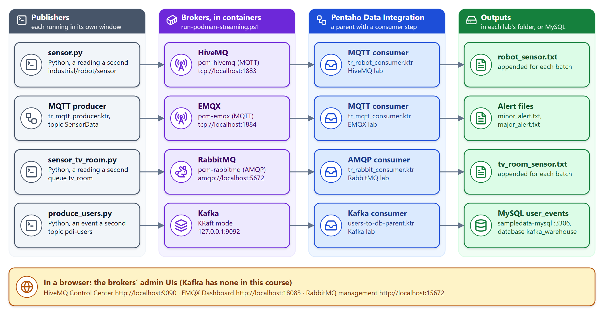

# Before You Start

> **Note:**
>
> #### Get Ready — Before You Start
>
> Before the first workshop, check that your environment is ready and
> that the workshop folders and files are in place. The course streams
> data through four brokers, HiveMQ, EMQX, RabbitMQ and Kafka, into
> files and a MySQL database, and **none of the lab time should go on
> setup**: this page does it in advance.
>
> **What you'll do:**
>
> * Learn how the guide works: progress, copy buttons, the assistant.
> * Confirm Pentaho Data Integration starts and the brokers and MySQL answer.
> * Check the workshop folder: *C:\Workshop-SD-Specialty*
>
> **Prerequisites:** Familiarity with Pentaho Data Integration transformations: steps, hops and database connections.
>
> **Estimated time:** 5 minutes on a lab VM; about 25 minutes on your own machine

## Meet your lab guide

This panel stays beside your tools for the whole workshop:

- **Float or dock** — drag the title bar to move the window anywhere
  (any monitor), or use the dock button to pin it to the right edge of
  the screen so maximized apps make room for it.
- **The sidebar** lists every section and lab. A <span data-icon="video"></span> badge means the lab
  includes a video; the `~15 min` tag is a time estimate.
- Use the **font-size** and **reading-mode** controls in the toolbar if
  you're on a small VM screen.

## Track your progress

Each workshop's steps sit in a numbered row at the top of the lab, one
dot per step. Work through them in order: the button at the end of a
step names the next one, and moving on puts a check mark on the step
you leave. Your progress is saved on this machine and survives
restarts, so you can pick up exactly where you left off. (This page has
no steps: tracking starts in the first workshop.)

## Copy code from the guide

Every code block has a **copy button**: hover over the block and select
it, then paste into your tool. Try it:

```sql
SELECT 'hello from the lab guide' AS greeting;
```

## How the labs fit together

Every workshop follows the same map. A publisher sends to a broker that
runs in a container, a Pentaho Data Integration transformation consumes
from that broker, and the data lands in a file or in MySQL:

<div align="center">
<figure>

<figcaption>The lab map: publishers, broker containers, consumers and outputs</figcaption>
</figure>
</div>

Read the diagram one row per workshop, left to right: HiveMQ, EMQX,
RabbitMQ, then Kafka. The EMQX lab publishes from Pentaho Data
Integration itself, with the **MQTT producer** in `tr_mqtt_producer.ktr`;
the other three use a bundled Python script. Each consumer step runs a
child transformation for every batch, which writes to a file in the
lab's folder or, for Kafka, loads the workshop MySQL. HiveMQ, EMQX and
RabbitMQ each have an admin UI you open in a browser; their logins are
in the **Ports and logins** tab below.

## Set up your environment

Launch your main tool straight from the guide:

<button data-launch="spoon">Start Pentaho Data Integration</button>

If it is already open from a previous session, the button focuses
the running window instead of starting a second copy.

### Do you need to set anything up?

:::: tabs

### I'm using a lab VM

Nothing to do. Everything is installed and running already, and it
starts with the machine.

If something looks wrong later, tell your instructor rather than
reinstalling anything.

### I'm installing on my own machine

Everything here is a **one-off setup** for your own laptop. Work through
the tabs in order — **Check your environment**, below these tabs,
checks your machine as you go, so you can always see what is left. The
last tab is a reference card of ports and logins, for when you come back
to it later.

> **Note:** Every broker this course uses — HiveMQ, EMQX, RabbitMQ
> and Kafka — runs as a container, and one command starts them all.
> The two MQTT brokers coexist on their own ports (HiveMQ 1883,
> EMQX 1884), so no lab ever has to stop another's broker. The MySQL
> the Kafka lab loads is a container too, from the MySQL kit.

::: tabs

### 1. Container runtime

The brokers and the MySQL kit run under **Podman Desktop**, and the
commands the labs use (`podman run`, `podman exec`) come with it.

1. Install Podman Desktop:

   ```powershell
   winget install -e --id RedHat.Podman-Desktop
   ```

2. Open it once and let it create its machine. When it offers, accept,
   and select **rootful** if it asks.

3. Check the machine is up:

   ```powershell
   podman machine list
   ```

<details>
<summary>Troubleshooting</summary>

**`podman` is not recognized.** PATH updates only reach new terminals —
close and reopen PowerShell.

**The machine won't start.** Podman machines run inside WSL 2 — run
`wsl --update`, reboot if it asks, then start the machine from Podman
Desktop.

**Everything worked yesterday but not today.** The machine does not
start with Windows by default — open Podman Desktop and start it, or
run `podman machine start`.

</details>

### 2. Start the brokers

One command brings up HiveMQ and EMQX (MQTT), RabbitMQ (AMQP) **and**
Kafka. The course installer lays the Streaming kit down at
`C:\Streaming`:

```powershell
C:\Streaming\run-podman-streaming.ps1
```

The first run downloads the images — give it a few minutes. It ends with
`The brokers are up.` once each broker answers its own clients, and it
creates the Kafka lab's topic, `pdi-users`. See which brokers run, and on
which image, any time:

```powershell
C:\Streaming\run-podman-streaming.ps1 -Status
```

The Kafka lab also loads a MySQL table. The MySQL kit at `C:\MySQL`
starts its `sampledata-mysql` container:

```powershell
C:\MySQL\run-podman-mysql.ps1
```

<details>
<summary>Troubleshooting</summary>

**A port is already in use.** Something else owns 1883, 1884, 5672,
9092, 9090, 18083, 15672 or 3306 — usually an older broker or database
container. For a broker port, the Streaming script names the container
and prints the `podman stop` command that frees the port; `podman ps`
lists every running container with the ports it publishes.

**Images fail to pull.** Corporate proxies often block container
registries — try again on an open network, or configure the proxy in
Podman Desktop's settings.

**A consumer connects but no messages arrive.** Almost always the
publisher isn't running — each lab's script must stay running in its
own terminal while the transformation executes. For Kafka, also check
the topic name matches exactly (`pdi-users`).

**Kafka works, then refuses after a reboot.** The machine (and its
containers) don't autostart — run `C:\Streaming\run-podman-streaming.ps1`
again: it starts the Podman machine and the brokers, and waits until
each one answers.

**Everything is slow or containers get OOM-killed.** The Podman
machine defaults to a modest memory slice — in Podman Desktop, under
**Settings > Resources**, give it 4 GB or more when running all four
brokers and MySQL.

**Which MQTT broker am I talking to?** HiveMQ listens on **1883**,
EMQX on **1884** — both run at once. If a consumer sees nothing,
check the port in your connection string matches the lab you're on.

</details>

### 3. Python for the publishers

Each streaming lab feeds its broker with a small bundled Python
script (`sensor.py`, `sensor_tv_room.py`, `produce_users.py`).

1. Install Python 3.12:

   ```powershell
   winget install -e --id Python.Python.3.12
   ```

2. Open a **new** terminal and confirm:

   ```powershell
   python --version
   ```

Each lab installs its script's one dependency with
`pip install -r requirements.txt`, run in the lab's folder under
`C:\Workshop-SD-Specialty`.

<details>
<summary>Troubleshooting</summary>

**A Microsoft Store window opens instead.** Windows' app-alias stub is
shadowing the real install. In **Settings > Apps > Advanced app settings > App execution aliases**,
clear the two `python` entries.

</details>

### 4. Pentaho Data Integration

1. Install Pentaho Data Integration to `C:\Pentaho`, so Spoon lives at:

   ```text
   C:\Pentaho\design-tools\data-integration\spoon.bat
   ```

2. The Kafka lab uses the **Kafka consumer** step, which ships with
   Pentaho Data Integration 11 in its `pentaho-streaming-kafka-plugin`.
   It is in the **Streaming** folder of the **Design** tab.

3. The Kafka lab and the capstone load MySQL, and Pentaho Data
   Integration 11 does not ship a MySQL JDBC driver. The course
   installer puts one in `C:\Pentaho\design-tools\data-integration\lib`;
   restart Spoon if it was open when you installed the course.

4. Start Spoon once from the button above these tabs.

### 5. Ports and logins

Everything this course uses, all local to your machine:

| Service            | Address                   | Login             |
| ------------------ | ------------------------- | ----------------- |
| HiveMQ (MQTT)      | `tcp://localhost:1883`    | *none*            |
| HiveMQ Control Center | http://localhost:9090  | `admin` / `hivemq` (a 25-connection trial) |
| EMQX (MQTT)        | `tcp://localhost:1884`    | *none*            |
| EMQX Dashboard     | http://localhost:18083    | `admin` / `public` (the first sign-in offers a password change: **Skip** keeps this one) |
| RabbitMQ (AMQP)    | `amqp://localhost:5672`   | `guest` / `guest` |
| RabbitMQ management | http://localhost:15672   | `guest` / `guest` |
| Kafka              | `127.0.0.1:9092`   (use the IP, not `localhost` - Windows resolves that to IPv6 first)          | *none*            |
| MySQL kit (`sampledata-mysql`) | `localhost:3306` | `root` / `password`; the Kafka lab adds `kafka_user` / `password` |
| Ollama — the Chat tab | `127.0.0.1:11434`      | *none*            |

> **Caution:** These are the stock workshop credentials and are widely
> known. Change them on any machine reachable beyond your own.

:::

When the last tab is done, **Check your environment** below these tabs
should be all green.

::::

## Check your environment

This panel probes the machine live — Pentaho Data Integration, the four
brokers, the MySQL container and the container tooling that runs them —
whichever tab above you chose. Each row reports one of four states:

* **<span class="pcm-c-ok">Green</span>** — the check passed; that piece is present and answering.
* **<span class="pcm-c-warn">Amber</span>** — usable, but worth tidying before the session.
* **<span class="pcm-c-danger">Red</span>** — it will block a lab, and the row tells you the exact fix.
* **<span class="pcm-c-muted">Gray</span>** — skipped, because this course doesn't use it.

The brokers matter most: HiveMQ on `1883` and EMQX on `1884` for the
MQTT labs, RabbitMQ on `5672` for the AMQP lab, and Kafka on `9092` for
the Kafka lab and the capstone.

<div data-env-check="streaming"></div>

> **Success:** Checkpoint: every row is green, or gray for a check this course skips. An amber row is usable, but worth tidying.

## Check the working folders

The installer lays every lab's files out under
**`C:\Workshop-SD-Specialty`**, one folder per protocol, in the order
the sidebar reads. The overview pages have no lab files, and the EMQX
lab works in the HiveMQ lab's folder. Each workshop's **Solution**
section quotes its own folder.

```text
C:\Workshop-SD-Specialty
├── 03-mqtt
│   └── 03-mqtt-hivemq
│       ├── sensor.py                     the HiveMQ lab's publisher
│       ├── tr_mqtt_producer.ktr          the EMQX lab's starters
│       └── solution                      the finished answers, ready to run
├── 04-amqp
│   └── 06-amqp-rabbitmq
│       ├── sensor_tv_room.py             the publisher
│       └── solution
├── 05-kafka
│   └── 08-kafka-use-cases
│       ├── produce_users.py              the publisher
│       ├── 01-create-kafka-warehouse.sql
│       └── solution
└── capstone
    ├── data                              what the capstone reads, shipped
    ├── solution                          your transformations
    └── out                               your output, checked for your accreditation
```

Every lab's `solution` folder holds the finished transformations. Open
one in Pentaho Data Integration to compare it with your own; your work
at the lab root is never touched.

**Confirm the files are there**, not only the folder: open
`03-mqtt\03-mqtt-hivemq` and check you can see `sensor.py` and a
`solution` folder holding `tr_robot_consumer.ktr`. An empty folder is
the one thing worth catching now rather than in the middle of a lab.

> **Note:** Upgrading the app refreshes the shipped lab files and never
> touches `capstone\solution\` or `capstone\out\`. Your own work is
> safe, so you can install a new version mid-course.

## Check the database

The Kafka lab and the capstone load MySQL: the MySQL kit's
`sampledata-mysql` container, which `C:\MySQL\run-podman-mysql.ps1`
starts. To see that it runs, in PowerShell, run:

```powershell
podman ps --filter name=sampledata-mysql
```

> **Success:** Checkpoint: one row, `sampledata-mysql`, with a **STATUS** that starts with `Up` and port `3306` in **PORTS**.

|              |                     |
| ------------ | ------------------- |
| Container    | `sampledata-mysql`  |
| Host         | `localhost`         |
| Port         | `3306`              |
| Admin login  | `root` / `password` |

Each lab creates its own database and user as it starts:

* The Kafka lab runs `01-create-kafka-warehouse.sql`, which adds the
  `kafka_warehouse` database and `kafka_user` / `password`.
* The capstone adds the `factory` database and `line_user` / `password`.

If a connection times out with `localhost`, set **Host Name** to
`127.0.0.1`: it reaches the same server.

## Ask the AI assistant

The **Chat** tab in the bottom panel answers questions about Pentaho —
ask it anything from "what does this step do?" to "why did my
transformation fail?". A model on this machine writes the answers, and
it grounds them in a live search of the official Pentaho documentation.
Without an internet connection that search is unavailable, so only the
local model answers, without the documentation behind it.

## How this course is organized

Each section starts with an **overview page** (<span data-icon="page"></span> — background reading,
no check boxes) followed by **hands-on workshops** (<span data-icon="workshop"></span> — tracked steps).
The MQTT, AMQP and Kafka sections each open with an overview of the
protocol, then the workshops that put it to work. The last page is the
capstone.

## The exam and your course accreditation

When you have worked through the sections, the **Streaming Data
Specialty Exam** in the sidebar draws 30 questions from a pool of 40. It
is open-book — take your time, browse any page to refresh your memory,
or ask the assistant. Your answers are saved as you go, so leaving the
page to look something up is fine, and the explanations show afterwards
so you can learn from anything you missed. The pass mark is **80%**.

You are asked for your name, email and organization before you begin
(and your Partner ID, if you are taking it as part of the Pentaho Partner
Program); those are what your accreditation is made out to. Pass the
exam, and have the capstone's checks pass, and your **Pentaho Developer
- Streaming Data - Specialty Level** course accreditation appears on the
results screen to download. It is valid for two years, and you can come
back for it later from the same screen.

The capstone, [Capstone: A Plant-Floor Alert Feed](../09-capstone-a-plant-floor-alert-feed/guide.md),
is a project of your own: subscribe to three machines' telemetry with
one MQTT wildcard, archive every reading, publish over-threshold
readings to a keyed Kafka topic, and load the alerts into MySQL without
duplicates.

Head to the first section whenever you're ready.

---

> **Tip:** You can revisit this page any time from the sidebar.
