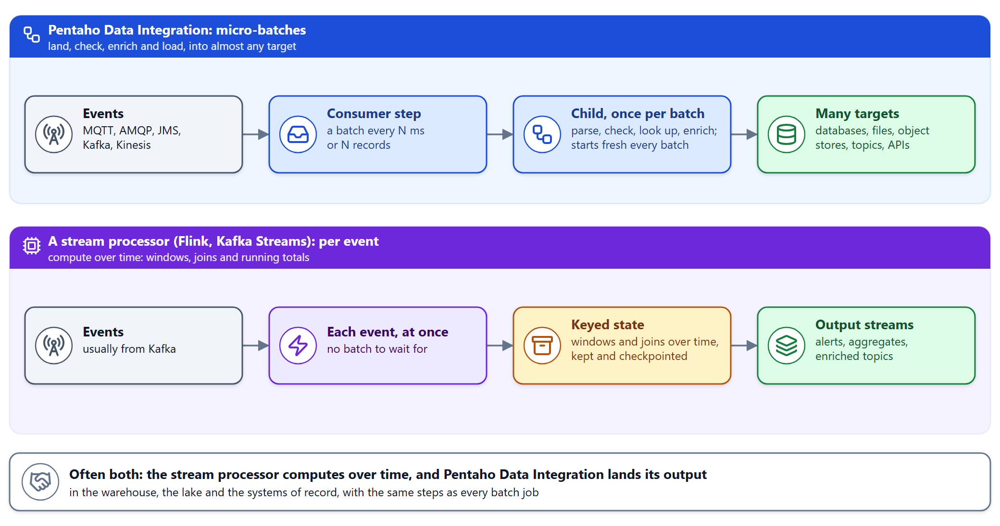

# Overview

Streaming data never ends: sensors, applications and logs keep producing events, and a pipeline has to process each one as it arrives. This course shows how Pentaho Data Integration consumes those streams over three protocols, MQTT, AMQP and Kafka, with one pattern that works the same way for all of them.

**What You'll Learn**

* **Batch vs. streaming** - what changes when the data has no end.
* **The parent/child streaming pattern** - how a consumer step batches messages and runs a child transformation for each batch.
* **Where Pentaho Data Integration fits** - what micro-batches do well, and when a stream processor such as Flink joins it.
* **The three protocols** - where MQTT, AMQP and Kafka fit, and which broker each workshop uses.

<figure>

<figcaption>From streaming sources to the tools that use the data</figcaption>
</figure>

> **Note:**
>
> #### Streaming Data
>
> Streaming data is a continuous flow of information generated in real time by sources such as IoT devices, social media feeds, financial transactions or sensor networks. Unlike batch processing, where data is collected and analyzed in fixed chunks, streaming data arrives as an unbounded sequence of events that must be processed as it comes.
>
> Processing data in real time makes storage and analysis harder, but it lets an organization see changes and respond to them as they happen.
>
> Pentaho Data Integration handles streaming data with its streaming steps. You build a streaming pipeline on the same canvas as a batch one: consume data from a streaming source, transform it as it arrives, and load it into a target system.
>
> Pentaho Data Integration has consumer steps for MQTT, AMQP, JMS and Kafka, among other sources, so it connects to the streaming infrastructure you already run. Batch and streaming transformations are built the same way, so a team moving from batch to real-time integration keeps the skills it has.

## Batch vs. streaming

The fundamental shift from batch to streaming is the move from a **bounded** dataset to an **unbounded** one.

| | Batch | Streaming |
| --- | --- | --- |
| **Data shape** | Finite — a file, a table, a query result | Infinite — an open-ended sequence of events |
| **When it runs** | On a schedule or on demand | Continuously, as events arrive |
| **Latency** | Minutes to hours | Sub-second to seconds |
| **Completion** | The job ends when the data is exhausted | The transformation stays running, waiting for the next event |
| **Typical use** | Nightly warehouse loads, reports | Sensor telemetry, fraud alerts, live dashboards |

## The Pentaho Data Integration streaming pattern

Every streaming source in Pentaho Data Integration — MQTT, Kafka, AMQP, JMS, Kinesis — follows the same **parent/child transformation** pattern:

* A **parent transformation** holds the streaming **consumer** step (for example **MQTT consumer**, **Kafka consumer**, **AMQP consumer**). The consumer subscribes to the stream and collects incoming messages into **batches**.
* A **batch** is flushed to the child transformation whenever the first of two thresholds is reached:
  * **Duration (ms)** — a time window, or
  * **Number of records** — a message count.
* A **child transformation** processes each batch. It **must** start with the **Get records from stream** step, which surfaces the batched messages as rows. From there you parse, transform, and load the records like any other Pentaho Data Integration stream.

<figure>

<figcaption>One pattern for every protocol: the parent batches, the child runs once per batch</figcaption>
</figure>

Read the diagram from the broker down the left: the consumer step in the parent subscribes and collects messages, and the amber box is the rule that closes a batch. Each batch crosses to the right and starts one run of the child, which begins with **Get records from stream** and then parses, transforms and loads the rows. The table under the parent lists the batch settings the workshops use; the MQTT and AMQP workshops load with **Text file output** rather than **Table output**.

This pattern means the same skills — **JSON input**, **Select values**, **Formula**, **Table output** — apply to every protocol. Only the consumer step at the front changes.

> **Note:**
>
> #### Get Records from Stream
>
> This step produces rows and so must be the **first** step in the child transformation — it cannot sit mid-stream. To combine streamed rows with other data, read that data in the child and join it to the stream (for example with **Stream lookup**).

## Where Pentaho Data Integration fits

The pattern above processes a stream in *micro-batches*: the consumer collects messages for a few seconds, or up to a count, and the child handles them together. Each run of the child starts fresh, so nothing is carried from one batch to the next unless the pipeline writes it to a table or a file. A *stream processor*, such as Apache Flink or Kafka Streams, works the other way: it handles each event as it arrives and keeps *state* between events, so it can compute over time, a five-minute window, a join of two streams, a running total per machine.

<figure>

<figcaption>Micro-batches and a stream processor: different jobs, often in one pipeline</figcaption>
</figure>

| | Pentaho Data Integration | A stream processor |
| --- | --- | --- |
| **Unit of work** | A batch, every few seconds or records | One event |
| **State between batches or events** | None of its own: kept in a table or file | Built in, checkpointed |
| **Strengths** | Landing, checking, enriching and loading into many targets with the same steps as batch jobs | Windows, joins over time, per-event latency |
| **Typical output** | Rows in a warehouse, lake or application database; files; topics | Alerts, aggregates, enriched topics |

So the choice is rarely one or the other. Where the work is *land it, check it, enrich it, load it*, as in every workshop here, Pentaho Data Integration does it alone. Where the work is a computation over time, a stream processor does that part, and Pentaho Data Integration lands what it produces.

## Protocols covered in this specialty

::: tabs

### MQTT

**Message Queuing Telemetry Transport** — a lightweight publish/subscribe protocol built for the Internet of Things (IoT). Minimal overhead suits constrained devices and sensor networks. You will publish and consume truck telemetry on an **EMQX** broker, share the subscription between two consumers and require a login, then consume robot telemetry from a **HiveMQ** broker on a Unified Namespace topic, with a Last Will.

### AMQP

**Advanced Message Queuing Protocol** — a standardized broker protocol for reliable, decoupled messaging. You will consume room-sensor data from a **RabbitMQ** broker and append it to `tv_room_sensor.txt`.

### Kafka

**Apache Kafka** — a distributed event-streaming platform for high-volume, fault-tolerant publish/subscribe pipelines. You will consume a user-activity stream from Kafka in real time (running in KRaft mode) and land it in a MySQL warehouse, then give the pipeline a data contract, send the events that break it to a rejects topic, and rebuild the table by replaying the log.

:::

> **Tip:** Next, the first protocol: MQTT. Start with the MQTT [Overview](../02-mqtt/guide.md).
