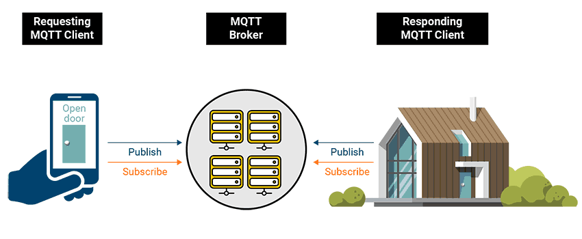
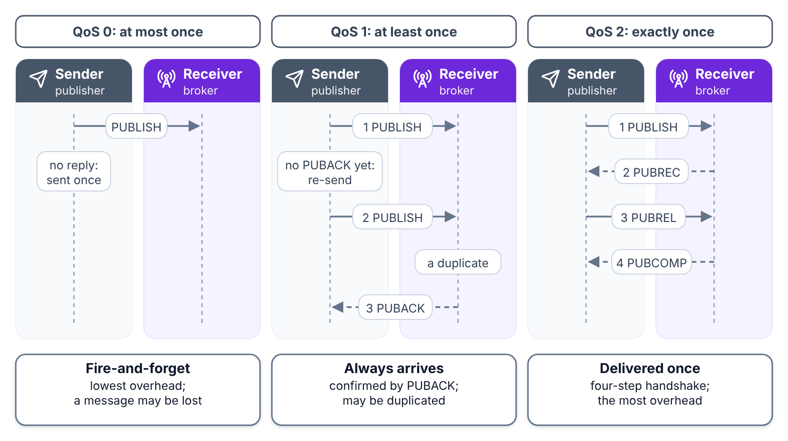

# Overview

Message Queuing Telemetry Transport (MQTT) is the lightweight publish/subscribe protocol most Internet of Things (IoT) devices speak. This module explains the protocol features that shape how a consumer behaves, then puts them to work in two workshops, one on HiveMQ and one on EMQX.

**What You'll Learn**

* **Publish/subscribe** - how publishers and subscribers meet at a broker through topics.
* **Quality of Service (QoS)** - the three delivery guarantees and what each costs.
* **Topics, sessions and retained messages** - how a broker routes messages and what it keeps for a client.
* **Last Will and Testament and keep alive** - how subscribers learn that a device has gone.

<figure>

<figcaption>MQTT publish / subscribe: clients talk only to the broker</figcaption>
</figure>

> **Note:**
>
> #### Message Queuing Telemetry Transport
>
> MQTT is a standard messaging protocol for the Internet of Things (IoT) because it needs minimal resources and runs on the small microcontrollers found in connected devices.
>
> Its small packets and light handshakes suit devices with little memory, power or bandwidth, which keeps power consumption and manufacturing costs low.

MQTT works on a **publish/subscribe** model. Devices (publishers) send messages to a **topic** on a **broker**; any number of subscribers can register interest in that topic and receive messages in near real time. Pentaho Data Integration subscribes as a consumer through the **MQTT consumer** step.

## MQTT essentials

A handful of protocol features shape how the workshops behave. You configure several of these directly on the **MQTT consumer** and **MQTT producer** steps in Pentaho Data Integration.

::: tabs

### Quality of Service (QoS)

QoS is the delivery guarantee agreed between sender and receiver. There are three levels:

* **QoS 0 — at most once:** fire-and-forget. The message is sent once and may be lost. Lowest overhead; fine for high-frequency sensor data where the odd dropped reading doesn't matter.
* **QoS 1 — at least once:** the message is confirmed (`PUBACK`) and re-sent if needed, so it always arrives but may be **duplicated**. The most commonly used level.
* **QoS 2 — exactly once:** a four-step handshake (`PUBLISH`, `PUBREC`, `PUBREL`, `PUBCOMP`) guarantees a single delivery, at the cost of the most overhead and latency. Reserve it for messages where a duplicate would cause harm.

<figure>

<figcaption>The three QoS levels, packet by packet</figcaption>
</figure>

Read the diagram one level at a time, top to bottom: solid arrows go from the sender to the receiver, and dashed arrows are replies. At QoS 0 the publisher sends once and hears nothing back. At QoS 1 a publisher that has no `PUBACK` yet sends the message again, so the broker can receive it twice. At QoS 2 the two sides exchange four packets before the message counts as delivered once. The box under each level is what it guarantees.

Pick the lowest level that satisfies the use case — higher QoS means more round-trips and resource use.

### Topics and wildcards

A **topic** is a hierarchical UTF-8 string with levels separated by `/`, e.g. `industrial/robot/sensor`. The broker accepts any valid topic on the fly — no need to create it first. Subscribers can use **wildcards** (subscribe only):

* `+` — single level: `industrial/+/sensor` matches `industrial/robot/sensor` and `industrial/arm/sensor`.
* `#` — multi level (last character only): `industrial/#` matches everything under `industrial/`.

**Best practices:** keep topics short and specific, use only ASCII, avoid spaces and a leading `/`, and don't subscribe a production client to `#`: it receives every message on the broker.

### Sessions

The **clean session** flag set on connect decides whether the broker keeps state for a client:

* **Clean session (true):** the broker discards subscriptions and queued messages on disconnect — a fresh start each connect.
* **Persistent session (false):** the broker stores the client's subscriptions and **queues QoS 1/2 messages while it is offline**, delivering them on reconnect. Essential for intermittently connected devices.

MQTT 5 splits the clean session flag in two: **Clean Start** decides whether a connect begins a new session, and **Session Expiry Interval** decides how long the broker keeps the session after the client disconnects.

### Retained messages

A message published with the **retained** flag is stored by the broker as the last-known value for that topic (one per topic). Any client that subscribes *later* immediately receives it — so a new subscriber learns the current state without waiting for the next publish. Ideal for status topics (e.g. `device/status` = `online`).

### Last Will and Testament (LWT)

A client can register a **will message** when it connects. If it disconnects ungracefully (crash, network drop, missed keep-alive), the broker publishes that message on its behalf — typically a `sensor gone` / `offline` notice on a status topic. Combined with a retained status topic, this keeps subscribers informed of device availability.

### Keep alive

On connect the client negotiates a **keep-alive** interval (seconds). If no other packet is sent within it, the client sends a `PINGREQ` and the broker replies `PINGRESP`, so both sides can detect a dead ("half-open") connection. If the broker hears nothing within 1.5× the interval, it drops the client and fires its LWT.

:::

This module has two hands-on workshops:

* [HiveMQ](../03-mqtt-hivemq/guide.md) — consume industrial robot-sensor telemetry from a HiveMQ broker.
* [EMQX](../04-mqtt-emqx/guide.md) — consume delivery-truck telemetry from an EMQX broker for a predictive-maintenance use case.

> **Tip:** Next, consume robot telemetry from HiveMQ: [HiveMQ](../03-mqtt-hivemq/guide.md).
