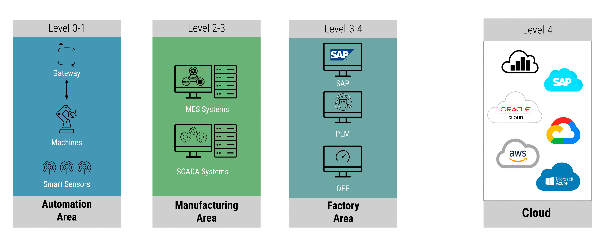
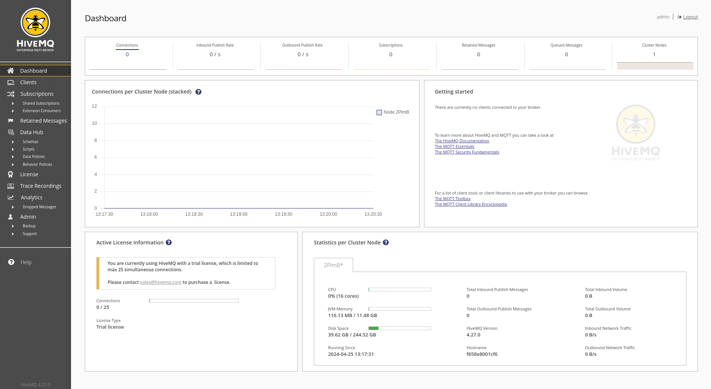
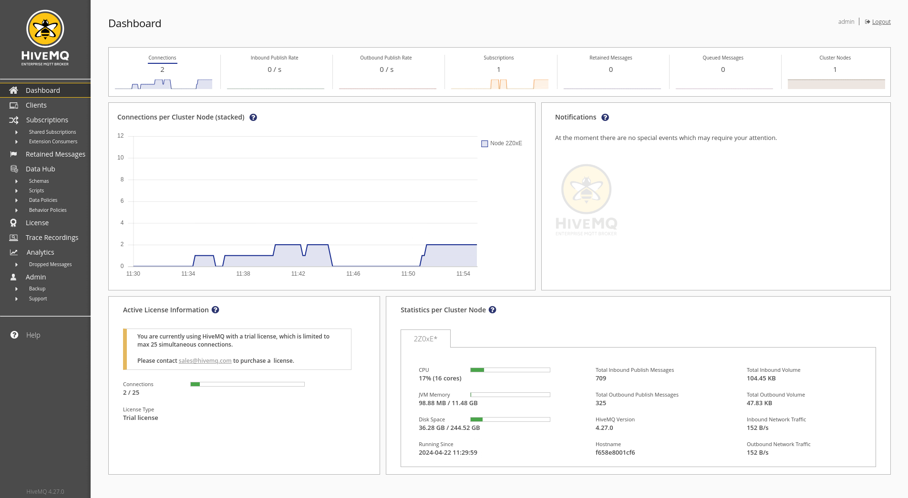
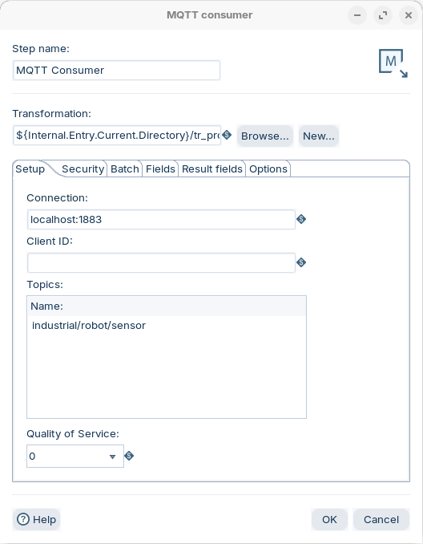
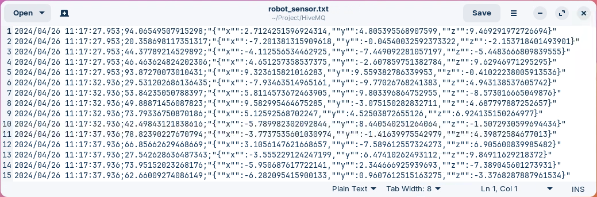

# HiveMQ

> **Warning:**
>
> #### Workshop - HiveMQ (industrial robot sensors)
>
> Plants collect readings from many industrial sensors through Supervisory Control and Data Acquisition (SCADA) systems, and MQTT is a common protocol for moving those readings. In this workshop you run a HiveMQ MQTT broker, publish simulated robot-sensor readings to it, and consume the live stream in Pentaho Data Integration with an **MQTT consumer** that runs a child transformation for each batch.
>
> **What you'll do**
>
> * Start a HiveMQ broker with Podman and sign in to its Control Center
> * Publish simulated robot-sensor readings to the `industrial/robot/sensor` topic with a Python script
> * Build a child transformation that parses each reading, timestamps it and appends it to a file
> * Build a parent transformation whose **MQTT consumer** step runs the child for each batch
> * Watch a Last Will and Testament (LWT) message report the sensor offline
>
> **Prerequisites:**
>
> * The brokers and Python from [Before You Start](../00-before-you-start/guide.md)
> * The parent/child pattern, from the Streaming Data [Overview](../01-overview/guide.md)
> * The MQTT essentials (QoS, retained messages, LWT), from the MQTT [Overview](../02-mqtt/guide.md)
>
> **Estimated time:** 40 minutes

<div align="center">
<figure>

<figcaption>Where SCADA sits, between the machines and the factory systems</figcaption>
</figure>
</div>

> **Note:** Two challenges a SCADA project often meets:
>
> * **Data silos:** brownfield factories run equipment and back-end systems from many vendors, each with its own data format. Those formats keep data apart and make analysis across the whole factory hard.
> * **IT/OT priorities:** a modernization project needs experts from both the operations side (OT) and the enterprise IT side (IT).

:::: tabs

### 1. Start HiveMQ

> **Note:**
>
> #### Start HiveMQ
>
> HiveMQ runs as a container under **Podman**, which is free for commercial use; Docker Desktop needs a paid subscription in larger organizations. The commands are the same, so if your machine has a licensed Docker Desktop, `docker` works in place of `podman`. The brokers live in the course's workshop-services compose file alongside MySQL and MinIO, so one command brings up everything and the ports never clash between workshops.
>
> This broker accepts any MQTT client without a username or password. For production, add a security extension and remove the `hivemq-allow-all` extension (see the HiveMQ Marketplace).

1. If a Mosquitto broker from another workshop runs on this machine, stop it, so it does not hold port `1883`. In PowerShell, run:

```powershell
podman stop mosquitto
```

2. Start the streaming brokers. In PowerShell, from the app's install folder, run:

```powershell
provisioning\setup-services.ps1 -Streaming
```

It starts HiveMQ, EMQX, RabbitMQ and Kafka, and leaves MySQL and MinIO running if they already are.

3. Check that HiveMQ is running:

```powershell
podman ps --filter name=pcm-hivemq
```

> **Success:** Checkpoint: one container, `pcm-hivemq`, publishing these ports:
>
> | Port | What it is |
> | --- | --- |
> | `1883` | MQTT listener: what your transformations connect to |
> | `9090` | HiveMQ Control Center (container port 8080) |
> | `9081` | HiveMQ websocket listener (container port 9000) |

The websocket listener is on `9081`, not HiveMQ's default `9000`: host port `9000` belongs to MinIO's S3 API, which the `pvfs://` workshops use, and the two cannot share it.

4. Open `http://localhost:9090` in a browser and sign in to the HiveMQ Control Center:

| | |
| --- | --- |
| User | `admin` |
| Password | `hivemq` |

<div align="center">
<figure>

<figcaption>HiveMQ Control Center before any client connects</figcaption>
</figure>
</div>

> **Success:** Checkpoint: the **Dashboard** opens, and **Connections** shows `0`.

### 2. Publish Sensor Data

> **Note:**
>
> #### Publish robot-sensor readings
>
> `sensor.py` plays the robot. Once a second it publishes a JSON message, a temperature and an x/y/z position, to the `industrial/robot/sensor` topic on `localhost:1883`.

1. Install the script's one dependency, the Paho MQTT client. In PowerShell, run:

```powershell
Set-Location C:\Workshop-SD-Specialty\03-mqtt\03-mqtt-hivemq
pip install -r requirements.txt
```

2. Review the publisher, `sensor.py`. These are the lines that matter:

```python
broker = 'localhost'
port = int(sys.argv[1]) if len(sys.argv) > 1 else 1883
topic = "industrial/robot/sensor"

def publish(client):
    while True:
        temperature = random.uniform(20.0, 100.0)  # Simulate temperature sensor data
        position = {'x': random.uniform(-10.0, 10.0), 'y': random.uniform(-10.0, 10.0), 'z': random.uniform(-10.0, 10.0)}  # Simulate position sensor data
        message = json.dumps({'temperature': temperature, 'position': position})
        result = client.publish(topic, message)
        ...
        time.sleep(1)
```

The script creates its client with `callback_api_version=VERSION1`: [release 2.0.0](https://github.com/eclipse/paho.mqtt.python/releases/tag/v2.0.0) of the Paho client (February 2024) changed the callback signatures, and this setting keeps the version 1 form.

3. Start the publisher, and leave it running in its own PowerShell window:

```powershell
python sensor.py
```

> **Success:** Checkpoint: the script prints `Connected to MQTT Broker!`, then one line a second that starts with `Sent` and ends with the topic, `industrial/robot/sensor`.

4. In the HiveMQ Control Center, open the **Dashboard**.

<div align="center">
<figure>

<figcaption>HiveMQ Dashboard with clients connected (an earlier session)</figcaption>
</figure>
</div>

> **Success:** Checkpoint: **Connections** counts the publisher, and **Total Inbound Publish Messages** grows by one a second.

5. Leave the publisher running. To stop it later, press `Ctrl+C` in its window.

### 3. Child Transformation

> **Note:**
>
> #### Process one batch
>
> The child transformation handles one batch of messages. **Get records from stream** hands it the batch as rows; from there the steps treat them like any other stream. Build the child first, so the parent has a file to point to.

1. Start Spoon with the **Start Pentaho Data Integration** button below, or from a terminal:

::: tabs

### Windows (PowerShell)

```powershell
Set-Location C:\Pentaho\design-tools\data-integration
.\spoon.bat
```

### macOS / Linux

```bash
cd ~/Pentaho/design-tools/data-integration
./spoon.sh
```

:::

<button data-launch="spoon" data-path="">Start Pentaho Data Integration</button>

2. Select **File > New > Transformation** (`Ctrl+N`).
3. Select **File > Save as** and save it as `tr_process_robot_data.ktr` in `C:\Workshop-SD-Specialty\03-mqtt\03-mqtt-hivemq`. The folder already holds `tr_process_sensor_data.ktr`, the [EMQX](../04-mqtt-emqx/guide.md) lab's child, so use the new name.
4. On the **Design** tab, open the **Streaming** folder and drag **Get records from stream** onto the canvas.
5. Double-click **Get records from stream**. Fill the **Fields** grid with one row, the message text:

| Fieldname | Type |
| --- | --- |
| `message` | String |

6. Select **OK**.
7. On the **Design** tab, open the **Input** folder and drag **Get system info** onto the canvas.
8. Create a hop from **Get records from stream** to **Get system info**: hold `Shift` and drag from one step to the other.
9. Double-click **Get system info**. Fill the **Fields** grid with one row: set **Name** to `current_time`, select the **Type** cell and pick `system date (fixed)` in the **Select info type** list.

| Name | Type |
| --- | --- |
| `current_time` | `system date (fixed)` |

10. Select **OK**.
11. From the **Input** folder, drag **JSON input** onto the canvas, and create a hop from **Get system info** to **JSON input**.
12. Double-click **JSON input**. On the **File** tab, select **Source is from a previous step** and set **Select field** to `message`.
13. Open the **Content** tab and check that **Ignore missing path** and **Default path leaf to null** are selected.
14. Open the **Fields** tab and fill the grid:

| Name | Path | Type |
| --- | --- | --- |
| `temperature` | `$.temperature` | String |
| `position` | `$.position` | String |

`position` is a JSON object, so the field holds the object as JSON text: `{"x":...,"y":...,"z":...}`.

15. Select **OK**.
16. From the **Output** folder, drag **Text file output** onto the canvas, and create a hop from **JSON input** to **Text file output**.
17. Double-click **Text file output**. On the **File** tab, set:

| Setting | Value |
| --- | --- |
| **Filename** | `${Internal.Transformation.Filename.Directory}/robot_sensor` |
| **Extension** | `txt` |
| **Append** | selected |
| **Create Parent folder** | selected |

18. Open the **Content** tab. Set **Separator** to `;`, and clear **Header**.
19. Open the **Fields** tab and select **Get Fields**. Right-click the `message` row and select **Delete selected lines**, so the grid lists three fields:

| Name | Type |
| --- | --- |
| `current_time` | Date |
| `temperature` | String |
| `position` | String |

20. Select **OK**, and save the transformation (`Ctrl+S`).

> **Success:** Checkpoint: four steps in a line, **Get records from stream** to **Get system info** to **JSON input** to **Text file output**.

### 4. Parent Transformation

> **Note:**
>
> #### Subscribe with MQTT consumer
>
> The parent holds one step, **MQTT consumer**. It subscribes to the topic, collects messages into batches, and runs the child for each batch.

1. Select **File > New > Transformation** (`Ctrl+N`).
2. Select **File > Save as** and save it as `tr_robot_consumer.ktr` in `C:\Workshop-SD-Specialty\03-mqtt\03-mqtt-hivemq`, next to the child.
3. On the **Design** tab, open the **Streaming** folder and drag **MQTT consumer** onto the canvas.
4. Double-click **MQTT consumer**. Set **Step name** to `MQTT Consumer`.
5. Set **Transformation** to `${Internal.Entry.Current.Directory}/tr_process_robot_data.ktr`.
6. On the **Setup** tab, set **Connection** to `localhost:1883`, enter `industrial/robot/sensor` in the first row of the **Topics** grid, and set **Quality of Service** to `0`. Leave **Client ID** empty.

<div align="center">
<figure>

<figcaption>MQTT consumer subscribed to industrial/robot/sensor</figcaption>
</figure>
</div>

A `+` or `#` wildcard in the topic would let one consumer cover several sensors. QoS `0` suits a reading every second: an occasional lost reading does no harm. Use `1` if every reading must arrive.

7. Open the **Batch** tab and set:

| Setting | Value |
| --- | --- |
| **Duration (ms)** | `5000` |
| **Number of records** | `50` |
| **Maximum concurrent batches** | `1` |
| **Message prefetch limit** | `100000` |

A batch goes to the child after 5,000 ms or 50 messages, whichever comes first.

8. Select **OK**, and save the transformation (`Ctrl+S`).
9. With `sensor.py` still publishing, press `F9` (**Action > Run**), and select **Run** in the **Run Options** dialog. The transformation keeps running: a streaming consumer has no last row.
10. After 15 seconds, open `C:\Workshop-SD-Specialty\03-mqtt\03-mqtt-hivemq\robot_sensor.txt` in a text editor.

<div align="center">
<figure>

<figcaption>robot_sensor.txt: five readings per batch time (an older run, written to another folder)</figcaption>
</figure>
</div>

> **Success:** Checkpoint: each line holds a time, a temperature and the position as JSON text, separated by `;`. The lines come in groups of about five that share one time, and each group's time is about 5 seconds after the one before.

11. Close the file. Leave the transformation and `sensor.py` running.

> **Under the hood:**
>
> #### The child ran once per batch, and fixed its clock each time
>
> The MQTT consumer collected messages until 5,000 ms had passed or 50 had
> arrived, then ran `tr_process_robot_data.ktr` with that batch. **Get system
> info** with `system date (fixed)` returns the time that run of the child
> started, so every row of a batch carries the same `current_time`: at one
> message a second, about five rows per time. Each batch is a new run of the
> child, which is why **Append** is selected: without it, every run would
> replace the file.
>
> **Why it matters:** the child is an ordinary transformation, tested and
> debugged like any other, and the batch settings decide how fresh the file
> is against how often the child starts.

### 5. Last Will and Testament

> **Note:**
>
> #### Last Will and Testament
>
> A client can leave a *will* with the broker when it connects: a message the broker publishes for it if the connection drops without a clean disconnect. On a *retained* status topic, the will tells any subscriber, even one that connects later, whether the device is alive. The bundled `sensor.py` sets no will, so you add one.

1. Stop the publisher: press `Ctrl+C` in its window.
2. Open `sensor.py` in a text editor. Replace the whole `connect_mqtt` function with this version, which adds a status topic, a will, and an `online` message on connect:

```python
status_topic = "industrial/robot/status"

def connect_mqtt():
    def on_connect(client, userdata, flags, rc):
        if rc == 0:
            print("Connected to MQTT Broker!")
            # Announce we're alive. Retained, so a subscriber that connects
            # later still sees the current status.
            client.publish(status_topic, "online", qos=1, retain=True)
        else:
            print("Failed to connect, return code %d\n", rc)
    client = mqtt_client.Client(client_id=client_id, callback_api_version=mqtt_client.CallbackAPIVersion.VERSION1)
    # Last Will and Testament: the broker publishes this for us if we drop
    # unexpectedly (crash, network loss, missed keep-alive).
    client.will_set(status_topic, "offline", qos=1, retain=True)
    client.on_connect = on_connect
    client.connect(broker, port)
    return client
```

3. Save `sensor.py`, and start it again:

```powershell
python sensor.py
```

4. In an MQTT client such as MQTT Explorer, connect to `localhost:1883` and subscribe to `industrial/robot/status`.

> **Success:** Checkpoint: the client shows `online` straight away. The message is retained, so the broker hands its last value to every new subscriber.

5. Stop the sensor without a clean disconnect: close the PowerShell window that runs it. (On macOS or Linux, run `pkill -f sensor.py`.)

> **Success:** Checkpoint: `industrial/robot/status` changes to `offline`.

6. In Spoon, select **Stop** in the canvas toolbar to stop `tr_robot_consumer.ktr`.

> **Under the hood:**
>
> #### The broker spoke for the client
>
> When `sensor.py` connected, it handed HiveMQ a will: the topic, the payload
> `offline`, QoS 1, retained. Closing the window ended the process without
> an MQTT DISCONNECT packet, so the broker published the will on its behalf.
> A client that calls `disconnect()` tells the broker to discard its will,
> so a clean shutdown sends nothing. If the network fails without closing
> the connection, the broker notices only when 1.5 times the keep-alive
> interval passes with no packet (paho's default keep-alive is 60 seconds),
> and then publishes the will.
>
> **Why it matters:** a subscriber can tell a sensor that has gone quiet
> from one that has gone away, without polling it. Starting `sensor.py`
> again publishes a retained `online`, which replaces the `offline`.

::::

## Troubleshooting <!-- no-step -->

<details>
<summary>sensor.py prints "Failed to connect" or a connection refused error</summary>

HiveMQ is not running, or something else holds port `1883`. Run `podman ps --filter name=pcm-hivemq`; if the container is missing, run `provisioning\setup-services.ps1 -Streaming` again. If a Mosquitto container holds the port, run `podman stop mosquitto`.

</details>

<details>
<summary>robot_sensor.txt does not appear</summary>

The publisher must be running while the parent runs: each lab's script stays running in its own window. Check that the topic in **MQTT consumer** is exactly `industrial/robot/sensor`, and that **Transformation** names `tr_process_robot_data.ktr`, the child you saved in the same folder.

</details>

## Lab Files

Click a file to download. For `.ktr` and `.kjb` files, **Open in Pentaho Data Integration** launches Pentaho Data Integration with the file loaded. If Pentaho Data Integration is already running, the path is copied to your clipboard — switch to Pentaho Data Integration and press `Ctrl+O`, `Ctrl+V`, `Enter`.

These files are also on disk in `C:\Workshop-SD-Specialty\03-mqtt\03-mqtt-hivemq`. The publisher and its dependency list:

[sensor.py](./files/sensor.py)

[requirements.txt](./files/requirements.txt)

The [EMQX](../04-mqtt-emqx/guide.md) lab works in this folder too. Its starter transformations ship here:

[tr_mqtt_producer.ktr](./files/tr_mqtt_producer.ktr) <button data-launch="spoon" data-path="files/tr_mqtt_producer.ktr">Open in Pentaho Data Integration</button> <button data-graph="files/tr_mqtt_producer.ktr">View graph</button>

[tr_mqtt_consumer.ktr](./files/tr_mqtt_consumer.ktr) <button data-launch="spoon" data-path="files/tr_mqtt_consumer.ktr">Open in Pentaho Data Integration</button> <button data-graph="files/tr_mqtt_consumer.ktr">View graph</button>

[tr_process_sensor_data.ktr](./files/tr_process_sensor_data.ktr) <button data-launch="spoon" data-path="files/tr_process_sensor_data.ktr">Open in Pentaho Data Integration</button> <button data-graph="files/tr_process_sensor_data.ktr">View graph</button>

### Solution <!-- no-step -->

The robot pipeline you build here, `tr_robot_consumer.ktr` and `tr_process_robot_data.ktr`, has no bundled solution. The `solution` folder holds the EMQX lab's finished transformations. Open them alongside your own to compare.

Also on disk at `C:\Workshop-SD-Specialty\03-mqtt\03-mqtt-hivemq\solution`.

[tr_mqtt_producer.ktr](./files/solution/tr_mqtt_producer.ktr) <button data-launch="spoon" data-path="files/solution/tr_mqtt_producer.ktr">Open in Pentaho Data Integration</button> <button data-graph="files/solution/tr_mqtt_producer.ktr">View graph</button>

[tr_mqtt_consumer.ktr](./files/solution/tr_mqtt_consumer.ktr) <button data-launch="spoon" data-path="files/solution/tr_mqtt_consumer.ktr">Open in Pentaho Data Integration</button> <button data-graph="files/solution/tr_mqtt_consumer.ktr">View graph</button>

[tr_process_sensor_data.ktr](./files/solution/tr_process_sensor_data.ktr) <button data-launch="spoon" data-path="files/solution/tr_process_sensor_data.ktr">Open in Pentaho Data Integration</button> <button data-graph="files/solution/tr_process_sensor_data.ktr">View graph</button>
